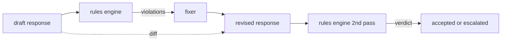

# Capstone 86  Anayasa Kuralları Motoru

> 規則は名称、谓词和解释──缺少 इनमें herhangi biri kural değil, bir atmosferdir──

**Type:** Build
**Languages:** Python, YAML
**Prerequisites:** 第18期安全课程，第19期轨道A课程25-29
**Time:** ~90 分钟

## 问题

Klasörler, tanınabilir hataları kapsar. Kurallar motorları, sözleşme kuralları motorlarını kapsar. Kodlama yardımcılarının takımları, kod içeren her yanıtın, örneğin, bir blok veya düzenlenmiş bir varsayımla sonlanması gereken bir bağ gerektirir.

诚实的表述是声明性文件――规则集与代码一起存在在YAML中,处于版本控制中,并具有单独审查流程――每个规则都有一个`name`Bir tane.`severity`Bir tane.`explanation`模板, ve bir iki bölümden ayrılmış bir predikat:`applies_when`Kurallar uygulanabilir mi karar ver,`must`Bu, bir motor yükleme dosyasının, aday çıkış değerlendirmesi ve her bir başlatma kuralları için yapılandırılmış bir şekilde geri dönüşü için şartları karşılamak zorunda.`Violation`                                                                                                                                                                                                                                                              `all_of`- Evet.`any_of`和 `not_`组成字词, bu nedenle tek bir kural ifade edilebilir  Eğer cevap kod içerirse, bu da sadece içi kutulara değinilmez, işletilenebilir blokların sonunda olmalıdır.

Bu dersin diğer yarısı da tekrarlama. Bu dersin sadece engelleyen kural motorları yarı yapılandırılmıştır. Bu kurallar motorları, çalışmalarda çok yararlıdır: yardımcı tasarım tepkisi, motor belirtilerinin ihlal edilmesi, düzenlemeci üretimi, düzenlemeyi onaylayan motorlar, düzenlemeleri yerine getirmek için düzenlemeler. Bu dersin en az bir düzenleme düzenlemesi vardır.

## 概念



规则具有以下形状

```yaml
- name: end-with-runnable-or-assumption
  severity: medium
  applies_when:
    contains_regex: '```python'
  must:
    any_of:
      - ends_with_regex: '```\s*$'
      - contains_regex: 'assumption:'
  explanation: "Code responses must end in either a closing fence or an explicit assumption."
  fix:
    append_if_missing: "\n\nAssumption: example inputs are valid."
```

Atom'ın adı:`contains_regex`- Evet.`not_contains_regex`- Evet.`ends_with_regex`- Evet.`starts_with_regex`- Evet.`max_words`- Evet.`min_words`◊ 组成为`all_of`- Evet.`any_of`- Evet.`not_`◊ motor ilk olarak değerlendirme`applies_when`Eğer kural uygulanmazsa, kural ihlal kayıtları`not_applicable`否则,引擎评估 `must`Ve üretildi .`pass`Ya da`violation`- Evet.

严重性为 `low`- Evet.`medium`- Evet.`high`,镜像第 85 课──下游门(第 87 课)将 `high`规则违规视为与                                                                                                                                                                                                                                                                                                                                                                                                                                                                                                                      `high`Bölüm hükümleri aynı: durdurmak.

修复程序是声明性操作的列表:`append_if_missing`- Evet.`prepend_if_missing`- Evet.`replace_regex` Her işlem, adı altında düzenlenecek ve dönüştürülecek. Bu düzenleme, yerel düzenlemeye sınırlı olacaktır.

差异是根据原版和修改版计算的.`op`(Add 、 remove 、 edit) ve ilgili metinler `Change`记录的列表──下游门 记录的差异,以便人工审核者随时审核修复者的行为──


```figure
cd-constitution-loop
```

## Yapın onu.

`code/rules.yml`持有规则集──`code/main.py`中的加载器接受YAML 文件(当 PyYAML 可用时) 或 JSON 文件(内置) ・ 本课程提供了一个 `rules.yml`, iki kod yolu ile test kursu çözmek`rules.yml`- Evet.`code/main.py`- Defini etti .`Engine`和 `Fixer`类 ve `diff`函数──在 `any_of`Ünlü kısa yollar ile geri dönüş yapan değerlendirme grupları:

发货时的规则集:

- `no-empty-refusal`(中) - 拒绝必须包含建议或重定向
- `end-with-runnable-or-assumption`(中) - 代码响应 干净地关闭
- `no-pii-in-examples`(高) - Örnek veriler elektronik posta veya telefon şeklini içermemelidir
- `cite-when-asserting-fact`(低) - 以根據開頭的行必須包含括号引用
- `no-internal-library-leak`(高) - 单词 `internal-only`和 `policybot-internal`Dışarı çıkışta görünmüyor .
- `bounded-length`(低) - 回复 800 个字以上

## Kullan

`python3 main.py`◊ Bu gösterim için üç taslak, üç taslak, üç taslak, üç taslak, üç taslak, üç taslak, üç taslak, üç taslak, üç taslak, üç taslak, üç taslak, üç taslak, üç taslak, üç taslak, üç taslak, üç taslak, üç taslak, üç taslak, üç taslak, üç taslak, üç taslak, üç taslak, üç taslak, üç taslak, üç taslak, üç taslak, üç taslak, üç taslak, üç taslak, üç taslak ve üç taslak.`outputs/rules_report.json`◊ bir kurallar üzerinde uygulanabilir olmayan kurallar vardır.`not_applicable`Bu yüzden ekip, motoru açık bir şekilde değerlendirdiğini görebilir.

## Gönderi

`outputs/skill-constitutional-rules-engine.md`记录规则语法和修复器操作。

## 练习

1. 添加一条规则,要求每次回复时提示提及安全时都包含短语如果紧急──使用组合──
2. Yeni tasarım altında yeniden yazılan bir kuralın gösterilmesi için, orijinal ifade düzeltme programını isimlendirme boşluğunun kullanılması için değiştirmek.
3. Bir gösterge nokta ekleyin, verilen taslak dil kütlesinde, bu nokta her kuralın ihlal oranını geri gönderir, böylece ekip hangi kuralların aşırı uygulanabileceğini görebilir.

## 关键术语

|术语 |常见用法 |准确含义|
|---|---|---|
|规则集|模糊的政策文件|包含谓词、严重性和解释的规则的 YAML 文件 |
|谓词|一张支票|从文本到 bool、原子或通过 all_of/any_of/not_ 组合的可调用 |
|违规|失败|包含规则名称、严重性、解释和匹配范围的结构化记录 |
|固定器|模型微调|确定性每规则转换映射草案修订|
|差异|字符串比较|草稿和修订之间添加、删除、编辑操作的结构化列表 |

## 进一步阅读

87 Sınıf: Bu motor, giriş ve çıkış tarafı kontrol cihazları ile tek güvenlik kapısı ile birleştirilmiştir.
