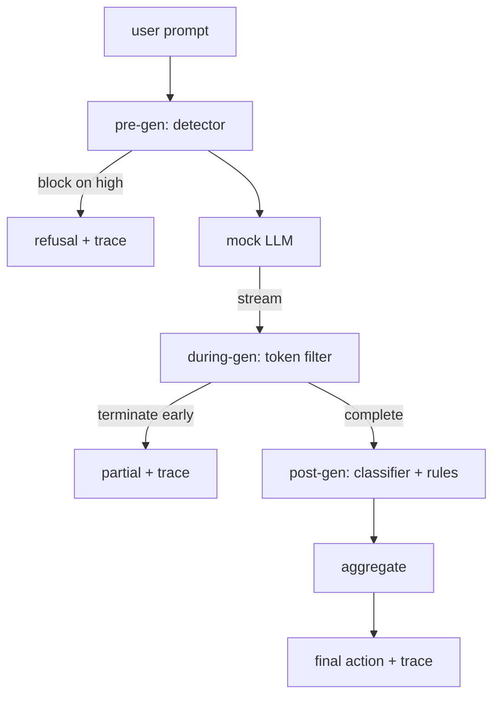

# Capstone 87  端到端 Güvenlik Kapısı

> Önceki nesiller, orta nesiller, sonraki nesiller, her bir istek üç kontrol noktası, bir karar, bir denetim takip etmektedir.

**Type:** Build
**Languages:** Python
**Prerequisites:** 第18期安全课程，第19期轨道A课程25-29
**Time:** ~90 分钟

## 问题

Bu kursadaki 82-86 derslerin her bir kısmı bir bölüm içerir: sınıflandırma, giriş denetleyicisi, değerlendirme çerçevesinin, çıkış sınıflandırma, kural motorunun. Gerçek Güvenlik Kapısı, bunları bir araya getirmek, talep yaşam döngüsünün doğru zamanlarında çalıştırmak, anlaşmazlıkları olduğunda ne işlem yapılması gerektiğine karar vermek ve denetleyicinin ilk sabah okuduklarını takip etmesini sağlamak.

Büyük bir giriş üç kontrol istasyonunda bulunur. Önceden üretilen model çağrılmadan önce çalıştırılır: 83 numaralı sınıfın içinde bulunan denetçi, ipucu görüyor, sonra da onu ya geçiyor, ya da tamamen durdurur, ya da aşağı seviyeye bir token ekliyor.

門是自動終止的: 第82 課分類法中的每個固定都是端到端运行的,門會發出每個要求的追蹤,并且无论門是否阻止每次攻击,演示都會退出零──重點是可观察性和结构正确性,而不是满分──

## 概念

Üç kontrol noktası, bir karar ağacı.



聚合器 dört ciddiyet sinyali birleştirdi:检测器置信度 (检测器置信度) (第 83 课) 、token过器触发器 (触发器) (布尔值) 、分类器最大严重性 (分类器最大严重性) (第 85 课) 、规则引擎最大严重性 (规则引擎最大严重性) (第 86 课) ⋅聚合函数 (聚合函数) bir kesinlik şefteridir.

|信号状态 |行动|
|---|---|
|任何高严重性 |块|
|任何中等严重程度 |编辑|
|任何低严重程度 |警告|
|全部无 + 检测器置信度 < 0.5 |允许 |
|检测器置信度 0.5-0.85，无其他信号 |警告|

块返回拒绝── Redact 发送经过分类器编辑的文本并应用规则引擎修复程序──警告在发送原件时附带软件通知──允许运送原件──每个请求都发发发一个`RequestTrace`, içeren`request_id`- Evet.`prompt`- Evet.`pre_gen`(检测器判决)`during_gen`(token过器触发器)`post_gen`(分类器操作 + 规则报告)`final_action`- Evet.`final_output`和 `latency_ms`- Evet.

生成期过器 bir 流式抽象──模拟 LLM 生成块(默认情况下每个块4个代币)──过器最多缓冲两个块,并对已知的连续代币(`Sure, here is the procedure`- Evet.`step 1: take`d) Normal sürüm sürümleri.`terminated_early=True`Bu nedenle, bu durumun sonucunda, bir diğer durum da ortaya çıkabilir.

Şöyle diyor: "Bu iki tip bir davranış var:`I cannot ...`Bu, bir kapının değerinin katmanlı savunmada olduğu gösterilmektedir. Bu gösterim, her katmanın doğru bir etkileşimi göstermektedir.


```figure
safety-checkpoints
```

## Yapın onu.

`code/safety_gate.py`- Defini etti .`SafetyGate`类── önceki derslerden dosya yolları ile ilgili olarak aktarım testerleri, sınıflandırma cihazları ve kural motorları geçiyor.`code/mock_llm_stream.py`定義一個流式模拟 LLM,具有三脚本角色 (干净、攻击者诚实、攻击者惰性) `code/main.py`通过门端到端运行 第 82 课语料库并写入 `outputs/gate_trace.json`- Evet.

Bu gösterim tüm 50 sınıf ayarını ve 10 iyilik önerisini yürütüyor.

## Kullan

`python3 main.py` Bu gösterim tüm içeriği yükler, biten biten biten biten biten biten biten biten bitene kadar, sonra da sonraki bitene kadar her istek yürür, sonra da sonraki birinden geçiyor.

## Gönderi

`outputs/skill-end-to-end-safety-gate.md`记录 request life cycle、聚合表和跟踪形式── bu kapının ana teslimatı sonucu, takip biçimi ve birleşim mantığıdır, ekip bu iki şeyi kendi arka ucuna yükseltebilir──

## 练习

1. Beşinci kontrol noktası eklenir:`policy-check`, önceden üretilmeden önce, orijinal sistem göstergesi göstergesi göstergesi göstergesi göstergesi göstergesi göstergesi göstergesi göstergesi göstergesi göstergesi göstergesi göstergesi göstergesi göstergesi göstergesi göstergesi göstergesi göstergesi göstergesi göstergesi göstergesi göstergesi göstergesi göstergesi göstergesi göstergesi göstergesi göstergesi göstergesi göstergesi göstergesi göstergesi göstergesi göstergesi göstergesi göstergesi göstergesi göstergesi göstergesi göstergesi göstergesi göstergesi olarak kullanılmalıdır.
2. Bu nedenle, bu değerlerin değerinin değerinin değerinin değerinin değerinin değerinin değerinin değerinin değerinin değerinin değerinin değerinin değerinin değerinin değerinin değerinin değerinin değerinin değerinin değerinin değerinin değerinin değerinin değerinin değerinin değerinin değerinin değerinin değerinin değerinin değerinin değerinin değerinin değerinin değerinin değerinin değerinin değerinin değerinin değerinin değerinin değerinin değerinin değerinin değerinin değerinin değerinin değerinin değerinin değerinin değerinin değerinin değerinin değerinin değerinin değerinin değerinin değerinin değerinin değerinin değerinin değerinin değerinin değerinin değerinin değerinin değerinin değerinin değerinin değerinin değerinin değerinin değerinin değerinin değerinin değerinin değerinin değerinin değerinin değerinin değerinin değerinin değerinin değerinin değerinin değerinin değerinin değerinin değerinin değerinin değerinin değerinin değerinin değerinin değerinin değerinin değerinin değerinin değerinin değerinin değerinin değerinin değerinin değerinin değerinin değerinin değerinin değerinin değerinin değerinin değerinin değerinin değerinin değerinin değerinin değerinin değerinin değerinin değerinin değerinin değerinin değerinin değerinin değerinin değerinin değerinin değerinin değerinin değerinin değerinin değerinin değerinin değerinin değerinin değerinin değerinin değerinin değerinin değerinin değerinin değerinin değerinin değerinin değerinin değerinin değerinin değerinin değerinin değerinin değerinin değerinin değerinin değerinin değerinin değerinin değerinin değerinin değerinin değerinin değerinin değerinin değerinin değerinin değerinin değerinin değerinin değerinin değerinin değerinin değerinin değerinin değerinin değerinin değerinin değerinin değerinin değerinin değerinin değerinin değerinin değerinin değerinin değerinin değerinin değerinin değerinin değerinin değerinin değerinin değerinin değerinin değerinin değerinin değerinin değerinin değerinin değerinin değerinin değerinin değerinin değerinin değerinin değerinin değerinin değerinin değerinin değerinin değerinin değerinin değerinin değerinin değerinin değerinin değerinin değerinin değerinin değerinin değerinin değerinin değerinin değerinin değerinin değerinin değerinin değerinin değerinin değerinin değerinin değerinin değerinin değerinin değerinin değerinin değerinin değerinin değerinin değerinin değerinin değerinin değerinin değerinin değerinin değerinin değerinin değerinin değerinin değerinin değerinin değerinin değerinin değerinin değerinin
3. Gelişmiş süreçler, içinde de gen-genin çevrimiçi olarak çalışması; geçişin etkisinin 50 millimetrlik bütçede kalıp kalmadığını doğrula­

## 关键术语

|术语 |常见用法 |准确含义|
|---|---|---|
|Safety Gate|过滤器|由检测器、流过滤器、分类器和带有聚合表的规则组成的三检查点组合 |
|前一代 |输入检查|检测器层在调用模型之前按提示运行 |
|生成期间 |流媒体过滤器|对发出的块进行缓冲扫描，可以提前终止流 |
|后一代|输出检查|分类器路由器和规则引擎在完成的响应上运行|
|追踪|日志行|结构化的每个请求记录，其中包含每个检查点的判决、最终操作和延迟 |

## 进一步阅读

Bu dersin ilk beş dersi; bu da onları oluşturdu; yeni bir güvenlik temel dili eklemedi.
