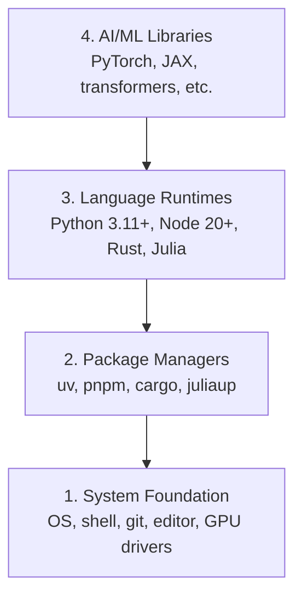

# Môi trường phát triển

> Công cụ của bạn sẽ hình thành cách suy nghĩ của bạn. Một lần định vị, đúng định vị.

**Type:** Build
**Languages:** Python, Node.js, Rust
**Prerequisites:** None
**Time:** ~45 分钟

## Học mục tiêu
- Từ zero bắt đầu thiết lập Python 3.11+、Node.js 20+ và Rust toolchains
-  cấu hình môi trường ảo và quản lý gói, để thực hiện xây dựng có thể tái tạo
- Sử dụng CUDA/MPS 验证 GPU truy cập,并运行一个测试 Tensor hoạt động
- Nghĩ 4 tầng: hệ thống, gói, thời gian chạy, thư viện AI

## 问题
Bạn sẽ học được 500+ bài học về kỹ thuật AI bằng Python, TypeScript, Rust và Julia. Nếu môi trường của bạn bị hỏng, mỗi bài học sẽ trở thành một công cụ để đấu tranh, thay vì học.

Nhiều người sẽ bỏ qua cài đặt môi trường. Sau đó họ dành vài giờ để gỡ lỗi nhập khẩu, xung đột phiên bản và thiếu tài xế CUDA. Chúng tôi phải làm điều này một lần và đúng.

## 概念
Một môi trường kỹ thuật AI có bốn tầng:



Chúng ta tự đặt lên tầng dưới. Mỗi tầng đều phụ thuộc vào tầng dưới.


```figure
s0-env-stack
```

##  xây dựng nó
### 步骤 1: Hệ thống Foundation

Kiểm tra hệ thống của bạn và cài đặt các bộ phận cơ bản.

```bash
# macOS
xcode-select --install
brew install git curl wget

# Ubuntu/Debian
sudo apt update && sudo apt install -y build-essential git curl wget unzip

# Windows (use WSL2)
wsl --install -d Ubuntu-24.04
```

### 步骤 2: Python với uv

Chúng tôi sử dụng `uv`Nó nhanh hơn pip 10-100x, và sẽ tự động xử lý môi trường ảo.

```bash
curl -LsSf https://astral.sh/uv/install.sh | sh

uv python install 3.12

uv venv
source .venv/bin/activate  # or .venv\Scripts\activate on Windows

uv pip install numpy matplotlib jupyter
```

验证:

```python
import sys
print(f"Python {sys.version}")

import numpy as np
print(f"NumPy {np.__version__}")
a = np.array([1, 2, 3])
print(f"Vector: {a}, dot product with itself: {np.dot(a, a)}")
```

### 步骤 3: Node.js với pnpm

Sử dụng TypeScript 课程(agent、MCP server、web apps)

```bash
curl -fsSL https://fnm.vercel.app/install | bash
fnm install 22
fnm use 22

npm install -g pnpm

node -e "console.log('Node', process.version)"
```

Fnm 安装程序会先检查 `unzip`, thiếu thời gian`Not installing fnm due to missing dependencies.`退出: trên Linux 上它 cần phải giải quyết một zip 归档, trên macOS 上则通过 Homebrew 安装──macOS 自带 `unzip`Ubuntu、Debian 和 WSL2 会通过步骤 1 的 apt 命令安装它(Nếu bạn nhảy qua bước đó,运行`sudo apt install -y unzip`(■)

**macOS / Apple Silicon（M1/M2/M3/M4）：**Nếu cài đặt quy trình`Error: Cannot install under Rosetta 2 in ARM default prefix (/opt/homebrew)`停止,说明终端运行在Rosetta 2 下(`arch`输出 `i386`), trong khi Homebrew là nguồn gốc của arm64  xây dựng.`fnm install 22` bắt đầu tái vận hành lệnh trên:

```bash
arch -arm64 brew install fnm
echo 'eval "$(fnm env --use-on-cd)"' >> ~/.zshrc
source ~/.zshrc
```

### 步骤 4: Rust

Sử dụng cho các hệ thống quan trọng về hiệu suất (các môn học)

```bash
curl --proto '=https' --tlsv1.2 -sSf https://sh.rustup.rs | sh

rustc --version
cargo --version
```

### 步骤 5: Julia (Tự chọn)

Với Julia, nó rất giỏi về toán học.

```bash
curl -fsSL https://install.julialang.org | sh

julia -e 'println("Julia ", VERSION)'
```

### 步骤 6:GPU 设置( nếu có)

**NVIDIA（Linux / Windows）：**

```bash
nvidia-smi

# Install PyTorch with CUDA
uv pip install torch torchvision torchaudio --index-url https://download.pytorch.org/whl/cu124
```

**macOS / Apple Silicon（M1/M2/M3/M4）：**Mac 上 không có CUDA  Đây là tình huống dự kiến, không phải là故障.**不要**传入 `--index-url .../cuXXX`(Những bánh xe này chỉ áp dụng cho Linux/Windows, cài đặt sẽ thất bại)

```bash
uv pip install torch torchvision torchaudio
```

验证( áp dụng cho bất kỳ nền tảng nào):

```python
import torch
print(f"CUDA available: {torch.cuda.is_available()}")           # False on macOS — expected
print(f"MPS available:  {torch.backends.mps.is_available()}")   # True on Apple Silicon
if torch.cuda.is_available():
    print(f"GPU: {torch.cuda.get_device_name(0)}")
```

没有 GPU?没有问题──大多数课程可在CPU上运行──对于训练重的课程,使用Google Colab或云 GPU──

### Bước 7: Thử nghiệm con đường bạn bắt đầu

Mỗi lệnh trong bài học này đều được chạy từ thư mục kho, nghĩa là chứa`README.md`和 `phases/`Đăng ký: Precheck chỉ kiểm tra bắt đầu các nội dung cần thiết của tuyến đường được chọn. Nó tự động nhảy qua các công cụ sau đó, vì vậy học viên mới thấy là một kết luận rõ ràng, chứ không phải là một cảnh báo lớn.

开始完整的入门序列:

```bash
python3 phases/00-setup-and-tooling/01-dev-environment/code/verify.py --route beginner
```

Hoặc chỉ cần kiểm tra đường đi của bạn:

```bash
python3 phases/00-setup-and-tooling/01-dev-environment/code/verify.py --route ml-foundations
python3 phases/00-setup-and-tooling/01-dev-environment/code/verify.py --route llm-engineering
python3 phases/00-setup-and-tooling/01-dev-environment/code/verify.py --route agents
python3 phases/00-setup-and-tooling/01-dev-environment/code/verify.py --route mcp
python3 phases/00-setup-and-tooling/01-dev-environment/code/verify.py --route agent-skills
python3 phases/00-setup-and-tooling/01-dev-environment/code/verify.py --route certification
```

Nếu muốn cho các công cụ và phụ thuộc cho các khóa học trước và sau kiểm tra được sử dụng, cộng với `--show-later`                                                                                                                                                                                                                                                              

Mỗi kiểm tra cần thiết thất bại sẽ cung cấp đường dẫn hoặc sai lầm nhập khẩu được kiểm tra, cũng như một lệnh sửa chữa chính xác.

Khi nhập học, sẽ in một lệnh chính xác về chương trình học:

```text
Ready to start Beginner course.
Next: python3 phases/01-math-foundations/01-linear-algebra-intuition/code/vectors.py
```

## Sử dụng nó
Môi trường của bạn đã có thể bắt đầu kiểm tra các tuyến đường bạn đã kiểm tra. Các khóa học cần phải cài đặt lại, không cần phải để toàn bộ bộ công nghệ cản trở bài học đầu tiên của bạn. Dưới đây là nội dung sẽ được sử dụng trong toàn bộ khóa học:

| Language | Used In | Package Manager |
|----------|---------|-----------------|
| Python | Phases 1-12 (ML, DL, NLP, Vision, Audio, LLMs) | uv |
| TypeScript | Phases 13-17 (Tools, Agents, Swarms, Infra) | pnpm |
| Rust | Phases 12, 15-17 (Performance-critical systems) | cargo |
| Julia | Phase 1 (Math foundations) | Pkg |

## 交付 nó
Bài học này được tạo ra một bản văn chứng minh mà bất cứ ai cũng có thể sử dụng, để kiểm tra thiết lập của mình.

查看 `outputs/prompt-env-check.md`, trong đó có một, có thể giúp trợ lý AI  chẩn đoán các vấn đề môi trường.

## 练习
1. 运行验证脚本并修复 bất kỳ thất bại nào
2. Trong khóa học này tạo ra một môi trường ảo Python, và cài đặt PyTorch
3. Sử dụng tất cả bốn ngôn ngữ  viết một "hào thế giới",并逐个运行

### 提示

**练习 1。**Trong thư mục kho `python3 phases/00-setup-and-tooling/01-dev-environment/code/verify.py --route beginner`, trước sửa lỗi thứ nhất, xem lại thứ sau, xem lại phần sau, tất cả các kiểm tra cần thiết đều qua, mới hoàn thành.

**练习 2。**Trong thư mục kho `uv venv` tạo môi trường và kích hoạt, sử dụng lại bước 6  Trong phù hợp với phần cứng của bạn lệnh cài đặt PyTorch.`python -c "import torch; print(torch.__version__)"`;输出版本号就表示安装成功。

**练习 3。**Sử dụng khái niệm trong 4 phần của công nghệ: Python, sử dụng TypeScript của Node.js, Rust và Julia.`python3``npx tsx`(Node.js không thể trực tiếp运行 `.ts`文件) 、`cargo run`Hoặc`rustc``julia`Mỗi lần chạy đều phải in tin tin của bạn, và kết thúc.
