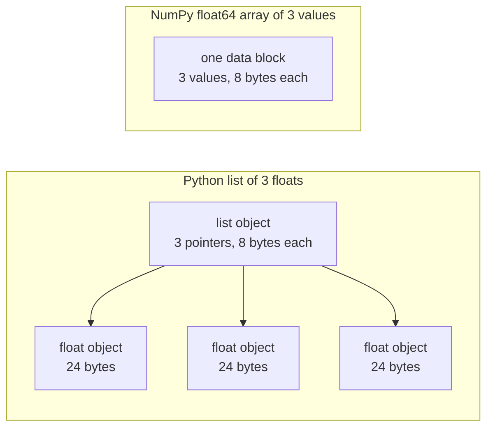

# 面向 AI 工程的 Python

> Phần lớn các mã trong khóa học này đều sử dụng cùng một nhóm Python 习惯用法. Trước khi các khóa học toán học và mô hình tiếp theo phụ thuộc vào chúng, hãy nắm bắt chúng trước đây.

**Type:** Build
**Languages:** Python
**Prerequisites:** 开发环境、Python 环境
**Time:** ~120 分钟

## Học mục tiêu

- 阅读课程代码中最常见的习惯用法, từ giải包和f字符串 đến dữ liệu类与推导式──
- Tìm ra 3 loại không báo cáo sai nhưng sẽ tạo ra kết quả sai Python  vấn đề: chia sẻ danh sách ∞ có thể thay đổi giá trị mặc định và đã hết các trình tạo ∞
- Chỉ sử dụng các thư viện tiêu chuẩn, xây dựng CSV với JSON tải, chia dữ liệu của các hạt giống, cũng như bộ tạo khối lượng nhỏ.
- Sử dụng Python  viết điểm积、平均值和标准差计算,并测量速度与内存量.
- Giải thích tại sao các vòng lặp Python thuần túy của giá trị số lại chậm hơn, cũng như cách thức NumPy 广播 sẽ chuyển vòng lặp vào mã sau khi biên dịch.

## 问题

Trong các khóa học sau giai đoạn này, có 541 file Python được đưa vào, 276 个导入.`dataclasses`Ngoài ra, 187 tập tin được sử dụng.`random.seed`Hoặc tạo ra`random.Random`Nếu bạn không quen thuộc với những thói quen sử dụng, bạn sẽ bận rộn khi muốn hiểu toán học.

Python còn có một số không cung cấp thông tin sai trái, nhưng sẽ dẫn đến hành vi kết quả sai trái. Hai tên gọi có thể chỉ đến cùng một danh sách, do đó thông qua một tên gọi thay đổi danh sách, cũng sẽ thay đổi nội dung của tên gọi khác.

Một vấn đề cuối cùng là tốc độ. Trong máy tính xách tay thử nghiệm của chúng tôi, vòng Python hoàn toàn tính toán 1 triệu điểm trên một khối lượng, khoảng 30毫秒; NumberPy hoàn thành tính toán tương tự không đến 1毫秒. Bạn cần hiểu lý do, để có thể lựa chọn giữa vòng lặp rõ ràng và hoạt động của một khối lượng.

## 概念

### 课程代码 sử dụng những gì viết法

Chúng tôi sử dụng `ast`模块解析了 `phases/*/*/code/`Trong đó có 541 tệp Python :::::::::::::::::::::::::::::::::::::::::::::::::::::::::::::::::::::::::::::::::::::::::::::::::::::::::::::::::::::::::::::::::::::::::::::::::::::::::::::::::::::::::::::::::::::::::::::::::::::::::::::::::::::::::::::::::::::::::::::::::::::::::::::::::::::::::::::::::::::::::::::::::::::::::::::::::::::::::::::::::::::::::::::::::::::::::::::::::::::::::::::::::::::::::::::::::::::::::::::::::::::::::::::::::::::::::::::::::::::::::::::::::::::::::::::::::::::::::::::::::::::::::::::::::::::

| 结构 | 文件数 | 占比 |
|-----------|-------|-------|
| 函数定义 | 541 | 100% |
| `if __name__ == "__main__":` | 529 | 98% |
| f 字符串 | 517 | 96% |
| 元组解包 | 448 | 83% |
| 类 | 379 | 70% |
| 列表推导式 | 375 | 69% |
| 函数类型标注 | 342 | 63% |
| 生成器表达式 | 326 | 60% |
| 切片 | 314 | 58% |
| `lambda` | 175 | 32% |
| `try` 与 `except` | 120 | 22% |
| `with` 语句 | 96 | 18% |
| 字典推导式 | 93 | 17% |
| 使用 `yield` 的生成器函数 | 14 | 3% |

Các trường hợp nhập khẩu phản ánh những tiêu chuẩn mô-đun quan trọng nhất trong 541 tài liệu, 340 trong số đó.`from __future__ import annotations`开头,276 个导入 `dataclasses``math``random`和 `json`模块分别 hiện xuất hiện trong 187、175 và 126 文件.`collections`Hiện tại có 70 hồ sơ, và`itertools`Chỉ xuất hiện trong 4 tài liệu.

Không có khóa học调用`map()`Hoặc`filter()`; được khuyến cáo thực hiện các công việc này.`sorted``min``max`Hoặc`.sort`时使用了 `key=`函数──本课会将最多时间花在这些列表中排名上.

### 名称引用对象

Trong Python, biến số là tham chiếu tên đối tượng. Định giá sẽ gắn tên đối tượng, không sao chép đối tượng. Khi hai tên tham khảo cùng một danh sách, thông qua các sửa đổi được thực hiện, hai tên đều có thể nhìn thấy. Số, chuỗi và bộ phận không thể thay đổi, vì vậy quy tắc này sẽ không mang lại vấn đề cho chúng.

### 列表 lưu trữ chỉ số,数组 lưu trữ số giá trị

Python không phải là một danh sách lưu trữ trực tiếp, mà là chỉ số lưu trữ, mỗi chỉ số trích dẫn một đối tượng Python hoàn chỉnh. Trong 64 điểm CPython, mỗi chỉ số chiếm 8 字节, mỗi chỉ số.`float`đối tượng chiếm 24 字节──NumPy của `float64`Số lượng sẽ được lưu trữ trong một khối内存.



Các trình giải thích trình bày các yếu tố này được thực hiện theo các quy định của các quy trình trình trình trình trình bày.

NumPy cho các hoạt động số lượng nguyên thủy, hoàn thành cùng một hoạt động. Nó chỉ kiểm tra một kiểu dữ liệu cho toàn bộ các hoạt động, sẽ không tạo ra các Python đối tượng cho mỗi yếu tố.`(x - mean) / std`,再由库执行循环──本课的向量函数也遵循这个原则: mỗi hàm chỉ hoàn thành một số lượng hoạt động, sau đó bạn có thể thay thế nó cho một lần NumPy 调用──

### 列表保存全部元素, máy tạo mỗi lần lưu một

Lưu ý của danh sách sẽ xây dựng tất cả các yếu tố trước khi thực hiện dòng tiếp theo. Khi người dùng yêu cầu mỗi lần, người tạo sẽ xây dựng một yếu tố.

Cỗ máy chỉ có thể đi qua một lần. Sau một phần tử cuối cùng, mỗi lần yêu cầu đều được kích hoạt.`StopIteration`, vì vậy, thứ hai đi qua nó `for`循环拿不到任何元素──训练代码每轮都会读一次数据集, vì vậy phải tạo ra một trình tạo mới cho mỗi轮──

Các hàm máy phát triển rất ít xuất hiện trong mã khóa học, nhưng các bộ tải dữ liệu sử dụng trong các khóa học học sâu là các đối tượng có thể cung cấp dữ liệu theo từng loạt, do đó ý tưởng này tồn tại trong mỗi vòng tập luyện.

```figure
s0-list-vs-generator
```

## Bạn cần phải nắm bắt các thói quen sử dụng

Mỗi khối mã trong phần này có thể hoạt động độc lập.`python3`运行──代码块 cần Python 3.11 hoặc phiên bản mới hơn, đây cũng là phiên bản chúng tôi cài đặt trong các khóa học phát triển môi trường──

### 1. Giá trị, dung lượng và giải包

Python có bốn loại container trong... xin hãy nắm bắt các trường hợp thích hợp của riêng mình...

| 类型 | 示例 | 有序 | 可变 | 在课程中的典型用途 |
|------|---------|---------|------------|---------------------------|
| `list` | `[0.5, 1.2]` | 是 | 是 | 样本、损失、权重 |
| `tuple` | `(32, 784)` | 是 | 否 | 形状、固定记录、字典键 |
| `dict` | `{"lr": 0.01}` | 按插入顺序 | 是 | 配置、词表、JSON 行 |
| `set` | `{"cat", "dog"}` | 否 | 是 | 唯一 token、重叠检查 |

Các mã sau đây cho thấy các giá trị không được sao chép danh sách:

```python
weights = [0.5, -1.2, 3.0]
alias = weights
alias[0] = 99.0
print(weights)

independent = list(weights)
independent[1] = 0.0
print(weights, independent)

grid = [[0] * 3] * 2
grid[0][0] = 1
print(grid)

grid = [[0] * 3 for _ in range(2)]
grid[0][0] = 1
print(grid)
```

```text
[99.0, -1.2, 3.0]
[99.0, -1.2, 3.0] [99.0, 0.0, 3.0]
[[1, 0, 0], [1, 0, 0]]
[[1, 0, 0], [0, 0, 0]]
```

biểu hiện`[[0] * 3] * 2`Tạo một danh sách ngoài tầng, trong đó hai trích dẫn chỉ ra cùng một danh sách bên trong tầng.

解包在一行中将序列元素赋予多个名称──带星号的名称收集剩余元素──f 字符串将表达的值嵌入字符串,也可以在冒号之后指定格式──

```python
shape = (32, 784)
batch_size, n_features = shape
first, *middle, last = [1, 2, 3, 4, 5]
x, y = 1.0, 3.0
x, y = y, x

config = {"lr": 0.01, "epochs": 5}
config["seed"] = 7
tokens = ["the", "cat", "sat", "on", "the", "mat"]
vocab = set(tokens)

print(batch_size, n_features, first, middle, last, x, y)
print(config.get("momentum", 0.9), "cat" in vocab, len(vocab))
print(f"lr={config['lr']:.0e} loss={0.123456:.3f} n={60_000:,} {batch_size=}")
```

```text
32 784 1 [2, 3, 4] 5 3.0 1.0
0.9 True 5
lr=1e-02 loss=0.123 n=60,000 batch_size=32
```

键不存在时,`dict.get`返回默认值──无论集合大小如何,集合上的 `in`Chuyến kiểm tra cần thời gian đều lớn.`{batch_size=}`形式同时印名称和值,有助调试──

切片 `a[start:stop:step]`包含 `start`, không bao gồm`stop` Từ cuối bắt đầu tính toán.  Các đoạn của danh sách là một danh sách mới, do đó, đối với các đoạn danh sách lớn, sẽ có tất cả các chỉ số trong phạm vi của các đoạn.

```python
tokens = ["<s>", "the", "cat", "sat", "on", "the", "mat", "</s>"]
print(tokens[1:-1])
print(tokens[:3], tokens[-3:])
print(tokens[::2])
print(tokens[::-1][:2])
windows = [tokens[i:i + 3] for i in range(len(tokens) - 2)]
print(len(windows), windows[0])
```

```text
['the', 'cat', 'sat', 'on', 'the', 'mat']
['<s>', 'the', 'cat'] ['the', 'mat', '</s>']
['<s>', 'cat', 'on', 'mat']
['</s>', 'mat']
6 ['<s>', 'the', 'cat']
```

### 2. 推导式

推导式通过一个表达式,从可代对象构建列表、字典或集合──它的读法接近其描述的数学运算──

```python
scores = [0.91, 0.42, 0.77, 0.15, 0.66]
labels = [1 if s >= 0.5 else 0 for s in scores]
high = [s for s in scores if s > 0.6]
squares = {i: i * i for i in range(4)}
lengths = {len(word) for word in ["a", "bb", "cc", "ddd"]}
sum_sq = sum(s * s for s in scores)

matrix = [[1, 2, 3], [4, 5, 6]]
transposed = [list(column) for column in zip(*matrix)]
flat = [v for row in matrix for v in row]

print(labels, high, squares, lengths, round(sum_sq, 4))
print(transposed, flat)
```

```text
[1, 0, 1, 0, 1] [0.91, 0.77, 0.66] {0: 0, 1: 1, 2: 4, 3: 9} {1, 2, 3} 2.0555
[[1, 4], [2, 5], [3, 6]] [1, 2, 3, 4, 5, 6]
```

末尾 của `if`Chỉ giữ một phần của các yếu tố.`for`Báo cáo trước có thể là một biểu hiện điều kiện, tức là`a if condition else b` `for`Nền tròn của các dòng, cùng với hai vòng tròn.

圆括号创建生成器表达式──在 `sum(s * s for s in scores)`Trung,`sum`Mỗi lần đọc một giá trị vuông, Python sẽ không xây dựng danh sách.`zip(*matrix)`Trung, số sao sẽ mỗi dòng như các phần tử độc lập truyền vào,`zip`sẽ có các yếu tố cùng vị trí đối tác.

### 3. 函数、参数与闭包

默认值让参数变为可选. 关键字实参在调用时明确指定形参名称. 参数列表中单独.`*`, sẽ được đặt các tham số sau đó chỉ được truyền qua các từ khóa.

```python
def clip(value, low=0.0, high=1.0):
    return max(low, min(high, value))


def train(data, *, lr=0.01, epochs=3):
    return f"{len(data)} samples, lr={lr}, epochs={epochs}"


def make_scaler(factor):
    def scale(values):
        return [v * factor for v in values]
    return scale


print(clip(1.7), clip(-3.0, low=-1.0), clip(0.4, high=0.3))
print(train([1, 2, 3], lr=0.1))
to_percent = make_scaler(100)
print(to_percent([0.25, 0.5]))
```

```text
1.0 -1.0 0.3
3 samples, lr=0.1, epochs=3
[25.0, 50.0]
```

Sử dụng chỉ chỉ các yếu tố của các từ khóa,`train(data, 0.1, 3)`Như thế sẽ được sử dụng.`TypeError`❖ Người dùng phải viết ra `lr=0.1`, vì vậy hai giá trị số sẽ không có ý định thay đổi vị trí ngoại giao.

内部函数 `scale`Sử dụng tạo ra trong hàm của nó`factor` Nếu `scale` vẫn tồn tại, Python sẽ giữ lại `factor` giữ hàm biến số người sáng lập được gọi là đóng gói.

`lambda`Không có tên chỉ chứa một hàm biểu hiện.`key=`函数,第 8 部分会介绍这种用法──

Python trong thực hiện`def`语句时, chỉ tính một lần định giá. Mỗi lần sử dụng định giá, bạn nhận được cùng một đối tượng.

```python
def add_bad(item, bucket=[]):
    bucket.append(item)
    return bucket


def add_good(item, bucket=None):
    if bucket is None:
        bucket = []
    bucket.append(item)
    return bucket


add_bad("a")
print(add_bad("b"))
add_good("a")
print(add_good("b"))
```

```text
['a', 'b']
['b']
```

列表、字典或集合的默认值应使用 `None`, và tạo ra các đối tượng mới trong hàm.

### 4. 类与数据类

`@dataclass`装饰器根据带类型标注的字段,生成 `__init__``__repr__`和 `__eq__`❖ thiết lập`frozen=True`后, đối tượng tạo sau không thể sửa đổi, có thể được sử dụng như một chữ cái hoặc đặt vào tập hợp.

```python
from dataclasses import dataclass, field


@dataclass(frozen=True)
class Example:
    features: tuple[float, ...]
    label: int


@dataclass
class TrainConfig:
    lr: float = 0.01
    epochs: int = 5
    hidden: list[int] = field(default_factory=lambda: [64, 32])

    def describe(self):
        return f"lr={self.lr} epochs={self.epochs} hidden={self.hidden}"


ex = Example((1.5, 2.0), 1)
print(ex)
print(ex == Example((1.5, 2.0), 1), len({ex, Example((1.5, 2.0), 1)}))
print(TrainConfig(epochs=10).describe())
try:
    ex.label = 0
except AttributeError as err:
    print(type(err).__name__)
```

```text
Example(features=(1.5, 2.0), label=1)
True 1
lr=0.01 epochs=10 hidden=[64, 32]
FrozenInstanceError
```

`field(default_factory=...)`Để mỗi trường hợp cung cấp một danh sách mới. Nó giải quyết các vấn đề về giá trị mặc định chung trong các loại dữ liệu như phần 3.

特殊方法将类与Python 语法连接起来──`len(ds)`调用 `__len__`- Tôi không biết.`ds[2]`调用 `__getitem__`

```python
class SquaresDataset:
    def __init__(self, n):
        self.n = n

    def __len__(self):
        return self.n

    def __getitem__(self, index):
        if not 0 <= index < self.n:
            raise IndexError(index)
        return index, index * index


ds = SquaresDataset(4)
print(len(ds), ds[2])
print(list(ds))
```

```text
4 (2, 4)
[(0, 0), (1, 1), (2, 4), (3, 9)]
```

Ngay cả khi không có`__iter__`方法,`list(ds)`内部的 `for`循环也能工作──Python theo sau sử dụng 0、1、2 等索引调用 `__getitem__`, cho đến khi nhận được .`IndexError`Bộ dữ liệu chụp của PyTorch cũng sử dụng hai phương pháp tương tự:`__len__`和 `__getitem__`

### 5. 代器与生成器

Có thể tạo ra bất cứ thứ gì.`for`循环接受的对象──`iter()`Từ trong lấy 代器,`next()`代器 yêu cầu một yếu tố. 代器 không có nhiều yếu tố hơn, sẽ触发.`StopIteration``for`循环替你调用 `next()`, và gặp nhau .`StopIteration`时停止.

```python
numbers = [10, 20, 30]
it = iter(numbers)
print(next(it), next(it), next(it))
try:
    next(it)
except StopIteration:
    print("no more items")


def countdown(n):
    while n > 0:
        yield n
        n -= 1


gen = countdown(3)
print(type(gen).__name__)
print(list(gen))
print(list(gen))
```

```text
10 20 30
no more items
generator
[3, 2, 1]
[]
```

函数体中包含 `yield`Các hàm là hàm máy tạo. Nó sẽ không thực hiện bất kỳ mã nào trong các hàm, mà quay lại một đối tượng máy tạo.`next()`Thành phố sẽ vận hành các hàm trong hệ thống tiếp theo`yield`,并暂停在那里.`list(gen)`Vì lần đầu tiên dùng máy phát điện đã hết.

Cỗ máy có thể đọc các tài liệu.

```python
import os
import tempfile


def read_rows(path):
    with open(path, encoding="utf-8") as fh:
        header = fh.readline().rstrip("\n").split(",")
        for line in fh:
            yield dict(zip(header, line.rstrip("\n").split(",")))


with tempfile.TemporaryDirectory() as tmp:
    path = os.path.join(tmp, "rows.csv")
    with open(path, "w", encoding="utf-8") as fh:
        fh.write("x,label\n")
        fh.writelines(f"{i * 0.5},{i % 2}\n" for i in range(5))
    rows = read_rows(path)
    print(next(rows))
    print(sum(1 for _ in rows))
```

```text
{'x': '0.0', 'label': '0'}
4
```

`read_rows`Mỗi lần chỉ có một dòng trong bộ nhớ lưu trữ tài liệu. Đó là trong hình ảnh.`read_rows`▽ Để làm cho ví dụ ngắn gọn, ở đây trực tiếp nhấn逗号切分── thực tế CSV 文件的引号字段内可能包含逗号,因此动手构建部分会使用`csv`模块──

```python
import sys

as_list = [i * i for i in range(1_000_000)]
as_generator = (i * i for i in range(1_000_000))
print(sys.getsizeof(as_list), sys.getsizeof(as_generator))
print(sum(as_list) == sum(as_generator))
```

Trong 64 vị trí CPython, danh sách báo cáo khoảng 8 MB, máy tạo khoảng 200 字节.`sys.getsizeof`Chỉ tính toán danh sách chỉ số của mình, tổng số đối tượng cũng chiếm thêm bộ nhớ.`tracemalloc` đo lường giá trị đỉnh thực tế, chúng tôi đã sử dụng nó trong các khóa học kiểm tra và phân tích hiệu suất.

### 6. 上下文 quản lý và bất thường

`with`语句先执行准备代码,再运行语句体,最后执行清理代码──即使语句体抛出异常,清理也会执行──`open()`objet của file return là một người quản lý văn bản trên và dưới của file close.

Trong bài học về kiểm tra và phân tích hiệu suất, chúng tôi đã viết một cuốn sách.`__enter__`和 `__exit__`của `Timer`类──`contextlib.contextmanager`装饰器 có thể được tạo từ máy tạo ra cùng loại đối tượng.`yield`之前的代码负责准备,`finally`块 chịu trách nhiệm thanh lý.

```python
import time
from contextlib import contextmanager


@contextmanager
def timer(label):
    start = time.perf_counter()
    try:
        yield
    finally:
        print(f"{label}: {(time.perf_counter() - start) * 1000:.1f} ms")


def parse_label(text):
    try:
        return int(text)
    except ValueError:
        raise ValueError(f"label must be an integer, got {text!r}") from None


with timer("sum of squares"):
    total = sum(i * i for i in range(200_000))

print(parse_label("3"))
try:
    parse_label("cat")
except ValueError as err:
    print("rejected:", err)
```

```text
sum of squares: 9.4 ms
3
rejected: label must be an integer, got 'cat'
```

Thời gian trên máy tính của bạn sẽ khác nhau.`except`子句中, viết明预期的具体异常, ví dụ:`ValueError`Hoặc`KeyError`◊ không xác định loại bất thường `except:`Cũng sẽ bị bắt.`KeyboardInterrupt`, vì vậy Ctrl + C có thể không thể ngừng chứa các vòng lặp của nó. Khi nhập lỗi, nên bỏ đi với thông tin rõ ràng của các bất thường. Nếu thông tin của bạn thay thế thông tin trở lại gốc, thì thêm `from None`

### 7.  loại nhãn 模块 và bảo vệ các chương trình chính

类标告诉读者函数接受什么、返回什么──Python 运行代码时不会检查这些标签──mypy 等类标查器会在代码运行前读取它们──

```python
from __future__ import annotations

from collections.abc import Iterable, Sequence


def mean(values: Sequence[float]) -> float:
    if not values:
        raise ValueError("mean() needs at least one value")
    return sum(values) / len(values)


def count_tokens(docs: Iterable[str]) -> int:
    return sum(len(doc.split()) for doc in docs)


def main() -> None:
    print(mean([1.0, 2.0, 4.0]))
    print(count_tokens(["the cat sat", "on the mat"]))
    print(mean.__annotations__)


if __name__ == "__main__":
    main()
```

```text
2.3333333333333335
6
{'values': 'Sequence[float]', 'return': 'float'}
```

Sử dụng `from __future__ import annotations`Khi, Python sẽ lưu lại mỗi dấu hiệu cho các string, như cuối cùng của các dòng hiển thị.`Sequence`biểu hiện bất cứ sự ủng hộ nào `len()`Và các đối tượng của chỉ số, ví dụ như danh sách hoặc nhóm;`Iterable`Tự chỉ bất cứ điều gì có thể được `for`循环接受的对象── nhiều tài liệu khóa học từ `typing`导入这些相同的名称,也同样有效.

Mỗi người`.py`文件都是一个模块.`python3 file.py`运行文件时,Python sẽ `__name__`设置为 `"__main__"`Một tài liệu khác nhập vào nó,`__name__`则是模块名称;; điều kiện bảo vệ chỉ được sử dụng trong trường hợp đầu tiên `main()`Vì vậy,`code/tests/`Trung 测试 có thể nhập `main.py`, mà không bắt đầu buổi biểu diễn.

### 8. 文件、JSON、CSV và排序

`pathlib.Path`用 `/`拼接路径,并能通过一次调用读取或写入整个文件──请始终指定 `encoding="utf-8"`, vì mã thông thường phụ thuộc vào hệ điều hành.

```python
import csv
import json
import tempfile
from pathlib import Path

rows = [
    {"text": "great movie", "label": 1, "score": 0.93},
    {"text": "boring plot", "label": 0, "score": 0.12},
    {"text": "fine acting", "label": 1, "score": 0.58},
]

with tempfile.TemporaryDirectory() as tmp:
    json_path = Path(tmp) / "reviews.json"
    json_path.write_text(json.dumps(rows, indent=2), encoding="utf-8")
    from_json = json.loads(json_path.read_text(encoding="utf-8"))

    csv_path = Path(tmp) / "reviews.csv"
    with csv_path.open("w", newline="", encoding="utf-8") as fh:
        writer = csv.DictWriter(fh, fieldnames=["text", "label", "score"])
        writer.writeheader()
        writer.writerows(rows)
    with csv_path.open(newline="", encoding="utf-8") as fh:
        from_csv = list(csv.DictReader(fh))

print(from_json == rows)
print(from_csv[0])

by_score = sorted(rows, key=lambda r: r["score"], reverse=True)
print([r["text"] for r in by_score])
print(max(rows, key=lambda r: r["score"])["text"])
print([r["text"] for r in sorted(rows, key=lambda r: (-r["label"], r["text"]))])
```

```text
True
{'text': 'great movie', 'label': '1', 'score': '0.93'}
['great movie', 'fine acting', 'boring plot']
great movie
['fine acting', 'great movie', 'boring plot']
```

JSON sẽ giữ số lượng như số lượng. Mỗi phần của CSV trở lại là một字符串, vì vậy bạn phải chuyển đổi từng phần.`csv`文档的要求,打开 CSV文件时应指定 `newline=""`

`key=`Phụng hàm trả về Python để so sánh giá trị của mỗi yếu tố.`sorted``min`和 `max`Chúng tôi chấp nhận các hàm như vậy. Các hàm được xếp hạng theo thứ nhất, chỉ sử dụng thứ hai trong các pha khác.

### 9. 计数,分组与代工具

Hai mô-đun này cung cấp danh sách thông thường và cấu trúc dữ liệu không có chữ cái và các công cụ thế hệ.

```python
from collections import Counter, defaultdict, deque
from itertools import chain, islice, product

labels = ["cat", "dog", "cat", "bird", "cat", "dog"]
counts = Counter(labels)
print(counts.most_common(2))

positions = defaultdict(list)
for i, label in enumerate(labels):
    positions[label].append(i)
print(dict(positions))

recent = deque(maxlen=3)
for loss in [2.0, 1.5, 1.2, 1.1, 0.9]:
    recent.append(loss)
print(list(recent), round(sum(recent) / len(recent), 3))

print(list(product([0.1, 0.01], [16, 32])))
print(list(chain([1, 2], [3], [4, 5])))
print(list(islice(range(100), 5, 10)))
```

```text
[('cat', 3), ('dog', 2)]
{'cat': [0, 2, 4], 'dog': [1, 5], 'bird': [3]}
[1.2, 1.1, 0.9] 1.067
[(0.1, 16), (0.1, 32), (0.01, 16), (0.01, 32)]
[1, 2, 3, 4, 5]
[5, 6, 7, 8, 9]
```

`Counter`统计标签、代号等可哈希元素──第一次使用新键时,`defaultdict(list)`会创建空列表, do đó phân组循环无需检查键是否存在──向 `deque(maxlen=3)`Khi thêm một yếu tố thứ tư, nó sẽ di chuyển các yếu tố cũ nhất, tạo ra một cửa sổ trượt để lưu trữ giá trị mất gần đây.`enumerate`Để mỗi yếu tố cung cấp chỉ dẫn.

`product`生成输入的全部组合,也就是超参数网格.`chain`Sẽ có thể thay đổi đối tượng đầu tiên`islice`Có thể lấy các mảnh của bất kỳ máy phát triển nào, bao gồm cả máy phát triển.`islice`

### 10. Tại sao vòng quay giá trị chậm

`dis`模块打印解释器 thực hiện một hàm nào đó

```python
import dis


def dot(a, b):
    total = 0.0
    for x, y in zip(a, b):
        total += x * y
    return total


dis.dis(dot)
```

Từ `FOR_ITER`Để nhảy trở lại chỉ thị của nó, sẽ được thực hiện một lần cho mỗi yếu tố.

Chuyển vào vòng lặp, các bước thực hiện được càng ít, tốc độ càng nhanh hơn.`sum``map`和 `zip`等内置函数 sử dụng C 编写──动手构建部分会在纯Python中测量这种效果; sử dụng现成工具部分则将整个循环移入NumPy──

## 动手构建

现在构建后续课程需要的组件──完整版本位于 `code/main.py`, từ`code/tests/test_main.py`测试──下方 每个代码块都可以独立运行──

### Bước 1: loại hồ sơ và bộ tải tập dữ liệu

Các bộ tải sẽ CSV hoặc JSON 文件读取为同样的结构:浮点特征元组,加一个整数标签.

```python
import csv
import json
import tempfile
from dataclasses import dataclass
from pathlib import Path


@dataclass(frozen=True)
class Record:
    features: tuple[float, ...]
    label: int


def row_to_record(row, names, label_field="label"):
    if label_field not in row:
        raise ValueError(f"row has no {label_field!r} field: {row}")
    if set(row) != {*names, label_field}:
        raise ValueError(f"row fields {list(row)} do not match {[*names, label_field]}")
    return Record(tuple(float(row[name]) for name in names), int(row[label_field]))


def load_records(path, label_field="label"):
    path = Path(path)
    if path.suffix == ".json":
        rows = json.loads(path.read_text(encoding="utf-8"))
    elif path.suffix == ".csv":
        with path.open(newline="", encoding="utf-8") as fh:
            rows = list(csv.DictReader(fh))
    else:
        raise ValueError(f"unsupported file type: {path.suffix!r}")
    if not rows:
        return []
    names = [key for key in rows[0] if key != label_field]
    return [row_to_record(row, names, label_field) for row in rows]


with tempfile.TemporaryDirectory() as tmp:
    csv_path = Path(tmp) / "data.csv"
    csv_path.write_text("x1,x2,label\n1.5,60,1\n1.8,82.5,0\n", encoding="utf-8")
    json_path = Path(tmp) / "data.json"
    json_path.write_text('[{"x1": 1.5, "x2": 60, "label": 1}]', encoding="utf-8")
    print(load_records(csv_path))
    print(load_records(json_path))
```

```text
[Record(features=(1.5, 60.0), label=1), Record(features=(1.8, 82.5), label=0)]
[Record(features=(1.5, 60.0), label=1)]
```

Đầu tiên xác định tên của đặc điểm và thứ tự của nó.`DictReader`和 `json.loads`Bảo trì các khóa trong các tài liệu,字典也保留键的插入序列──JSON 标准没有定义对象键的序列,因此 `row_to_record`Theo thứ tự được xác định trên dòng đầu tiên, theo tên đọc mỗi dòng.`ValueError`, để các tài liệu vô hiệu lực bắt đầu vận hành đã ngăn chặn xử lý tiếp theo.`main.py`Còn cung cấp `save_records`, để viết ra cùng 2 hình thức.

### Bước 2: chia tập hợp tập hợp và tập hợp thử nghiệm của con giống theo thời gian

```python
import random


def train_test_split(items, test_fraction=0.2, seed=0):
    if not 0.0 < test_fraction < 1.0:
        raise ValueError(f"test_fraction must be between 0 and 1, got {test_fraction}")
    if len(items) < 2:
        raise ValueError(f"need at least 2 items to split, got {len(items)}")
    order = list(range(len(items)))
    random.Random(seed).shuffle(order)
    n_test = min(max(1, round(len(items) * test_fraction)), len(items) - 1)
    test = [items[i] for i in order[:n_test]]
    train = [items[i] for i in order[n_test:]]
    return train, test


items = list(range(10))
print(train_test_split(items, seed=1))
print(train_test_split(items, seed=1) == train_test_split(items, seed=1))
print(train_test_split(items, seed=2)[1])
print(items)
```

```text
([9, 7, 5, 3, 0, 4, 1, 2], [6, 8])
True
[5, 9]
[0, 1, 2, 3, 4, 5, 6, 7, 8, 9]
```

`random.Random(seed)`创建私有随机数生成器──`random.seed(seed)`Đặt lại tất cả các mô-đun chia sẻ toàn diện máy phát, vì vậy một lần điều chỉnh trong các thư viện khác có thể thay đổi trình tự của bạn. Trong các khóa học có 100 file điều chỉnh.`random.seed`,96 个  sáng tạo `random.Random`❖ 新代码中应使用私有生成器──

Function打乱 là danh sách chỉ mục, do đó nhập danh sách giữ nguyên không thay đổi.`ValueError`❖ Trước khi bất kỳ bước nào trong việc chuẩn hóa như là cần thiết từ bước học dữ liệu, trước đó phân chia dữ liệu. Trong các khóa học điều tra và phân tích hiệu suất, chúng ta đã thấy, việc tập dữ liệu và dữ liệu thử nghiệm chồng chất sẽ dẫn đến tỷ lệ kiểm tra cao.

### 第3 步: máy tạo khối lượng nhỏ

```python
from itertools import islice


def batches(items, batch_size, drop_last=False):
    if batch_size < 1:
        raise ValueError(f"batch_size must be at least 1, got {batch_size}")
    return _batch_iter(iter(items), batch_size, drop_last)


def _batch_iter(iterator, batch_size, drop_last):
    while True:
        batch = list(islice(iterator, batch_size))
        if not batch or (drop_last and len(batch) < batch_size):
            return
        yield batch


print(list(batches(range(10), 4)))
print(list(batches(range(10), 4, drop_last=True)))
squares = (i * i for i in range(7))
print([len(b) for b in batches(squares, 3)])

for epoch in range(2):
    sizes = [len(b) for b in batches(range(10), 4)]
    print(f"epoch {epoch}: {sizes}")
```

```text
[[0, 1, 2, 3], [4, 5, 6, 7], [8, 9]]
[[0, 1, 2, 3], [4, 5, 6, 7]]
[3, 3, 1]
epoch 0: [4, 4, 2]
epoch 1: [4, 4, 2]
```

`islice`Từ 代器 lấy ra nhiều nhất `batch_size`个元素.`batches`Chỉ cần `iter()`, do đó chấp nhận danh sách, tài liệu và các máy tạo khác. Khi tổng chiều dài không phải là số lượng lớn của lô, lô cuối cùng sẽ nhỏ hơn. Đối với các mô hình cần hình dạng lô cố định,`drop_last=True`会移除这一批.

Nó sẽ được chia thành hai hàm, bởi vì hàm máy phát hành lần đầu tiên.`next()`之前不会执行任何代码. Nếu kiểm tra được đặt bên trong máy phát hành,`batches(data, 0)`会不报错地返回, lỗi phải đến vòng tròn tập luyện chỉ xuất hiện bên trong.`batches()`, vì máy tạo chỉ cung cấp một lần các yếu tố của nó.

### 第4 步: Kiến thức toán học và tiêu chuẩn hóa

```python
import math


def dot(a, b):
    return sum(x * y for x, y in zip(a, b, strict=True))


def mean(values):
    if not values:
        raise ValueError("mean() needs at least one value")
    return sum(values) / len(values)


def std(values):
    mu = mean(values)
    return math.sqrt(sum((v - mu) ** 2 for v in values) / len(values))


def make_standardizer(rows):
    columns = list(zip(*rows))
    means = [mean(c) for c in columns]
    scales = [s if s > 0 else 1.0 for s in (std(c) for c in columns)]

    def standardize(row):
        return [(v - m) / s for v, m, s in zip(row, means, scales, strict=True)]

    return standardize


print(dot([1.0, 2.0, 3.0], [4.0, 5.0, 6.0]))
values = [2.0, 4.0, 4.0, 4.0, 5.0, 5.0, 7.0, 9.0]
print(mean(values), std(values))

train_rows = [(1.0, 100.0), (2.0, 300.0), (3.0, 500.0)]
standardize = make_standardizer(train_rows)
print([[round(v, 3) for v in standardize(r)] for r in train_rows])
print([round(v, 3) for v in standardize((4.0, 700.0))])
```

```text
32.0
5.0 2.0
[[-1.225, -1.225], [0.0, 0.0], [1.225, 1.225]]
[2.449, 2.449]
```

设置 `strict=True`后, hai chiều kích khác nhau`zip`会抛出`ValueError`Không có nó,`zip`会在较短输入结束时停止,并无声息地返回错误答案──`strict`参数 cần Python 3.10 hoặc phiên bản mới hơn.

`std`Ngoài ra`n`, vì vậy đưa ra các tiêu chuẩn chung khác nhau, với`statistics.pstdev`Một cách: Sử dụng mô hình ước tính mức độ phân tán lớn hơn của tổng thể, nên phân loại để`n - 1`

`make_standardizer`Đó là một kết thúc. Nó chỉ tính toán từ tập luyện một lần trung bình và tiêu chuẩn khác nhau, sau đó là`standardize`保存这些统计量──将同一个函数应用于测试行,测试数据就不会影响统计量──常量列的标准差为0,因此标准化器对它使用1作为缩小因子──

### 第5 步:完整运行

`code/main.py`Để kết nối các thành phần này, nó tạo ra 400 bài đăng từ hai bài đăng, lưu lại cho CSV và JSON, tái tải lại hai file.

Recent质心分类器保存每个类别的平均特征向量,并预测平均值距离输入近乎类别的`fit_centroids`Mỗi tập thể được thêm vào từng tập thể, do đó không cần phải đặt tập thể đào tạo hoàn chỉnh vào trong bộ nhớ.`predict`使用带 `key=`函数 của `min()`, tìm thấy chất lượng gần đây nhất.

```bash
python3 phases/00-setup-and-tooling/13-python-for-ai-engineering/code/main.py
```

```text
Python for AI engineering: a standard-library toolkit
data     400 records, CSV and JSON load back unchanged: True
split    320 train, 80 test, records in both: 0
batches  size 48: [48, 48, 48, 48, 48, 48, 32]
scale    train feature means after standardizing: [0.0, 0.0]
model    nearest-centroid test accuracy: raw 0.86, standardized 0.89
speed    dot product of 200,000 floats, best of 5:
           index loop         6.60 ms
           zip generator      5.93 ms
           map + mul          2.89 ms
memory   peak bytes to sum 100,000 squares:
           list              4,000,616
           generator               472
```

Sự khác biệt về kích thước của hai đặc điểm rất lớn. Độ phân tán của đặc điểm thứ hai là gấp 10 lần của đặc điểm thứ nhất, do đó dẫn đến khoảng cách ban đầu, làm cho tỷ lệ chính xác trong thời gian chưa chuẩn hóa thấp hơn.

### 第6 步: đo tốc độ và bộ nhớ

```python
import operator
import random
import time
import tracemalloc


def dot_index_loop(a, b):
    total = 0.0
    for i in range(len(a)):
        total += a[i] * b[i]
    return total


def dot_zip(a, b):
    return sum(x * y for x, y in zip(a, b, strict=True))


def dot_map(a, b):
    return sum(map(operator.mul, a, b))


def best_time(fn, *args, repeat=5):
    times = []
    for _ in range(repeat):
        start = time.perf_counter()
        fn(*args)
        times.append(time.perf_counter() - start)
    return min(times)


def peak_bytes(fn):
    tracemalloc.start()
    try:
        fn()
        return tracemalloc.get_traced_memory()[1]
    finally:
        tracemalloc.stop()


rng = random.Random(0)
a = [rng.random() for _ in range(1_000_000)]
b = [rng.random() for _ in range(1_000_000)]
for fn in (dot_index_loop, dot_zip, dot_map):
    print(f"{fn.__name__:15} {best_time(fn, a, b) * 1000:7.2f} ms")

print(peak_bytes(lambda: sum([i * i for i in range(100_000)])))
print(peak_bytes(lambda: sum(i * i for i in range(100_000))))
```

`best_time`报告 nhiều lần chạy một lần nhanh nhất. Các chương trình khác trên máy tính chỉ tăng thời gian, do đó giá trị tối thiểu gần nhất với chi phí thực tế.`timeit`模块文档 cũng đưa ra những lời khuyên tương tự.

Trong cài đặt Python 3.11 trên máy tính xách tay, vòng tròn chỉ dẫn mất khoảng 33 ms, phiên bản zip khoảng 30 ms,`map`版本约14 ms──三者完成相同运算──`map`版本更快, là vì `map`和 `operator.mul`Sử dụng C 编写, mỗi phần tử thực hiện của字节码 chỉ thị ít hơn.

## 使用现成工具

### 标准库版本

Phần lớn các bộ phận bạn xây dựng, trong các standard library có phiên bản đã được thử nghiệm.

| 自己构建的组件 | 标准库 | 说明 |
|-----------|------------------|------|
| `mean`、`std` | `statistics.fmean`、`statistics.pstdev` | 测试会与这些函数比较 |
| `dot` | `math.sumprod` | Python 3.12 或更新版本 |
| `batches` | `itertools.batched` | Python 3.12 或更新版本，返回元组 |
| `best_time` | `timeit.repeat` | 运行期间还会关闭垃圾回收 |
| `peak_bytes` | `tracemalloc` | 相同模块，支持快照和逐行统计 |

```python
import statistics
import sys

values = [2.0, 4.0, 4.0, 4.0, 5.0, 5.0, 7.0, 9.0]
print(statistics.fmean(values), statistics.pstdev(values))

if sys.version_info >= (3, 12):
    import math
    from itertools import batched

    print(math.sumprod([1.0, 2.0, 3.0], [4.0, 5.0, 6.0]))
    print(list(batched(range(10), 4)))
```

```text
5.0 2.0
32.0
[(0, 1, 2, 3), (4, 5, 6, 7), (8, 9)]
```

课程支持 Python 3.11, vì vậy `main.py`Sử dụng tự thực hiện của mình `dot`和 `batches`Trong Python 3.11 trên, các khối mã chỉ được in dòng đầu tiên.

### 用编译后数组执行相同数学运算

Trong Python 环境课程建立的虚拟环境内安装 NumPy, ví dụ sử dụng `uv pip install numpy`◊ khóa học mã và test không cần nó.

```python
import time

import numpy as np

n = 1_000_000
rng = np.random.default_rng(0)
a = rng.random(n)
b = rng.random(n)
a_list, b_list = a.tolist(), b.tolist()

start = time.perf_counter()
slow = sum(x * y for x, y in zip(a_list, b_list))
python_ms = (time.perf_counter() - start) * 1000

start = time.perf_counter()
fast = float(a @ b)
numpy_ms = (time.perf_counter() - start) * 1000

print(f"pure Python {python_ms:8.2f} ms")
print(f"NumPy       {numpy_ms:8.2f} ms")
print(f"difference  {abs(slow - fast):.1e}")
print(a.dtype, a.itemsize, a.nbytes)
```

Trong bài kiểm tra trên máy tính xách tay,NumPy được sử dụng trong thời gian không đến 1 ms, phiên bản Python hoàn toàn là khoảng 30 ms. Kết quả của hai phiên bản khác nhau, vì hai phiên bản theo thứ tự khác nhau tăng lên gấp đôi.

Có ba lý do:

- 数组将原始 `float64`Giá trị được bảo đảm tồn tại trong một khối trong bộ nhớ, mỗi giá trị chiếm 8 字节.
- 循环在编译后的代码中运行――NumPy chỉ được kiểm tra một lần cho toàn bộ các phân tích, không phải cho mỗi yếu tố tạo ra Python đối tượng――
- Trong bộ nhớ có các giá trị tương ứng để NumPy có thể sử dụng SIMD, một lệnh xử lý nhiều giá trị.

Đối với một số rất nhỏ, một lần sử dụng NumPy 调用 có thể vượt quá một vòng Python ngắn.

### 广播

广播让 NumPy 能够组合数组 khác nhau, mà không cần phải viết vòng lặp trong mã của bạn.`make_standardizer`Tương tự như vậy.

```python
import numpy as np

X = np.array([[1.0, 100.0], [2.0, 300.0], [3.0, 500.0]])
mu = X.mean(axis=0)
sigma = X.std(axis=0)
Z = (X - mu) / sigma
print(X.shape, mu.shape, Z.shape)
print(Z.round(3))

norms = np.sqrt((X ** 2).sum(axis=1, keepdims=True))
print(norms.shape, (X / norms).shape)
```

```text
(3, 2) (2,) (3, 2)
[[-1.225 -1.225]
 [ 0.     0.   ]
 [ 1.225  1.225]]
(3, 1) (3, 2)
```

NumPy từ chiều cuối cùng về phía trước so sánh hai hình dạng. Hai chiều kích kích thước tương tự, hoặc một trong số đó là 1 , chúng đang được tích hợp.

| `X` 的形状 | 另一个数组的形状 | 结果 |
|--------------|--------------------------|--------|
| `(3, 2)` | `(2,)`，各列均值 | `(3, 2)` |
| `(3, 2)` | `(3, 1)`，使用 `keepdims=True` 的各行范数 | `(3, 2)` |
| `(3, 2)` | `(3,)`，未使用 `keepdims` 的各行范数 | `ValueError` |

Cuối cùng là lỗi thường gặp. Số so sánh cuối cùng của 2 và 3, và cả hai không phải là 1.`keepdims=True`                                                                                                                                                                                                                                                              

## 交付 nó

本课产 出 `outputs/prompt-python-review.md` Nó hướng tới AI và dự án dữ liệu Python 代码.

- 共享引用与可变默认参数
- Lần thứ hai đọc được máy phát hành đã hết
- Số lượng bất thường của hạt không được thiết lập, hoặc chỉ sử dụng toàn bộ hạt
- Số liệu thống kê của tập hợp kiểm tra
-  Thông qua các chuỗi số lượng lớn của Python 循环

Nó sẽ báo cáo vị trí của mỗi vấn đề phát hiện, giải thích và cách sửa chữa.

## 练习

1. 运行 `main.py`Trung `run_demo(seed=8)` tìm ra những gì xuất phát thay đổi  những gì giữ không thay đổi, và giải thích tại sao phân chia sau đó không thay đổi 
2. Sử dụng Python 编写 `median(values)`◊ sử dụng danh sách độ dài kỳ lạ và độ dài đôi, với`statistics.median`Để kiểm tra.
3. 编写 `stream_records(path)`, như một máy phát từ CSV 文件 trong mỗi lần phát ra một `Record`❖ Tạo ra một tài liệu có chứa 200.000 行, sử dụng `tracemalloc`So sánh`stream_records`和 `load_records`                                                                                                                                                                                                                                                              
4. 分別使用纯Python和NumPy 编写 `matvec(matrix, vector)` Sử dụng`best_time`测量大小为4、64和1024 时的两种实现, tìm ra sốPy trên máy của bạn bắt đầu kích thước nhanh hơn.
5. 编写概念部分所述的语法结构扫描机──对 `phases/*/*/code/*.py`Trung  của mỗi tài liệu sử dụng `ast.parse`和 `ast.walk`, thống kê bao gồm`ast.ListComp``ast.Yield`和 `ast.With`Số tài liệu,并与表格比较.

### 提示

**练习 1。**Từ `code/main.py`导入 `run_demo`,分別使用 `seed=7`和 `seed=8`调用,再通过 `format_report`印两结果――来自随机数据的值会变化; phân chia kích thước chỉ phụ thuộc vào`n`和 `test_fraction`, vì vậy giữ được không thay đổi.

**练习 2。**Nửa của bảng xếp hạng trước, số kỳ lạ dài khi lấy phần tử trung gian, số đôi dài khi lấy trung bình giá trị của hai phần tử.`[3, 1, 2]``[4, 1, 3, 2]`等列表与 `statistics.median`So sánh, cả hai phải cung cấp cùng một giá trị số.

**练习 3。**阅读 `code/main.py`Trung `load_records`, giữ các bước phân tích, nhưng không cần phải mỗi `Record`添加到列表,而是使用 `yield`产出它.`make_dataset(200_000)`配合 `save_records`创建文件,再比较 `peak_bytes(lambda: load_records(path))`和 `peak_bytes(lambda: sum(1 for _ in your_generator(path)))` phải được chuyển vào các đối tượng có thể điều chỉnh trong máy sản xuất tiêu thụ, nếu không `peak_bytes`量 chỉ là tạo của máy tạo 版本 版本 应报告小得多的峰值 

**练习 4。**纯 Python 版本以 `dot`Đối với mỗi dòng调用一次;NumPy 版本使用 `np.array(matrix) @ np.array(vector)` `best_time`Trong phân biệt thời gian, và cho mỗi quy mô in một dòng biểu đồ.

**练习 5。**用 `Path.read_text`读取 mỗi tài liệu, qua `ast.parse`解析, tái sử dụng `any(isinstance(node, ast.ListComp) for node in ast.walk(tree))`检测一种结构. Mỗi tài liệu chỉ được tính một lần, vì biểu đồ của khái niệm phần thống kê là số tài liệu.

## 关键术语

| 术语 | 人们常说 | 含义 |
|------|----------------|----------------------|
| 可迭代对象 | “可以循环遍历的东西” | `iter()` 接受的对象，例如列表、文件或生成器 |
| 迭代器 | “游标” | `__next__` 方法每次调用返回一个元素，并在结束时抛出 `StopIteration` 的对象 |
| 生成器 | “惰性列表” | 来自 `yield` 函数或生成器表达式的迭代器，按需生成每个元素，且只能遍历一次 |
| 推导式 | “单行循环” | 从可迭代对象构建列表、字典或集合的表达式，可以附带筛选条件 |
| 闭包 | “函数里的函数” | 保留创建它的函数中变量的函数 |
| 数据类 | “结构体” | Python 根据带类型标注的字段，生成 `__init__`、`__repr__` 和 `__eq__` 方法的类 |
| 上下文管理器 | “with 块” | 在 `with` 块开始时运行准备代码、结束时运行清理代码的对象，即使发生异常也会清理 |
| 种子 | “随机数” | 伪随机生成器的起始值；相同种子产生相同序列 |
| 向量化代码 | “快速代码” | 将一个操作应用于整个数组，由编译后的代码执行循环的代码 |
| 广播 | “自动形状匹配” | NumPy 通过重复使用大小为 1 的维度、无需复制数据，来组合不同形状数组的规则 |

## 延伸阅读

- [Python 教程：数据结构](https://docs.python.org/3/tutorial/datastructures.html):列表、元组、集合、字典与推导式──
- [Python 教程：类](https://docs.python.org/3/tutorial/classes.html):作用域、类、代器与生成器──
- [dataclasses](https://docs.python.org/3/library/dataclasses.html): toàn bộ các lựa chọn của trang trí, bao gồm:`frozen`和 `field`
- [collections](https://docs.python.org/3/library/collections.html)- Có thể là:`Counter``defaultdict``deque`及其他容器类型──
- [itertools](https://docs.python.org/3/library/itertools.html)- Có thể là:`islice``chain``product``batched`, và các bộ phận của chúng
- [排序技巧](https://docs.python.org/3/howto/sorting.html): hàm khóa, xếp hạng ổn định và nhiều hàm khóa.
- [timeit](https://docs.python.org/3/library/timeit.html): làm thế nào để đo nhỏ đoạn code, và tại sao nên báo cáo giá trị tối thiểu.
- [random](https://docs.python.org/3/library/random.html): toàn局生成器`random.Random`例与可复现性──
- [PEP 255：简单生成器](https://peps.python.org/pep-0255/):引入 `yield`Ưu điểm và lý do thiết kế:
- [NumPy：广播](https://numpy.org/doc/stable/user/basics.broadcasting.html): hoàn chỉnh hình dạng quy tắc và biểu đồ
- [Harris 等，Array programming with NumPy，Nature 585，2020](https://doi.org/10.1038/s41586-020-2649-2):NumPy số组的设计及其速度优势的原因──
