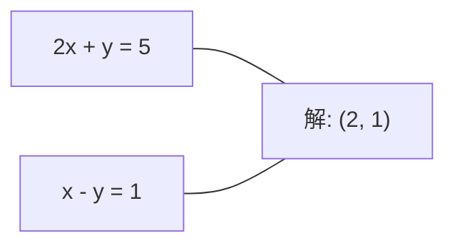
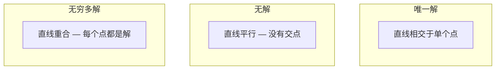

# Hệ thống tuyến tính

> 求解 $Ax = b$Đó là một trong những vấn đề cổ xưa nhất trong toán học, và nó vẫn đang hoạt động trên mạng thần kinh của bạn.

**Type:** Build
**Language:**Python
**前置要求：**Giai đoạn 1,Dạy 01 (Linear Algebra Intuition),02 (Vectors & Matrices),03 (Matrix Transformations)
**Time:** ~120 minutes

## Học mục tiêu
- 使用带 phân quay và thay thế trở lại của loại bỏ Gaussian 求解 $Ax = b$
- Sử dụng LU、QR 和 Cholesky phân hủy phân giải Matrix,并 giải thích từng phương pháp thích hợp
- 推导 các phương trình bình thường của các hình vuông nhỏ nhất,并将其与线性回归和脊回归联系起来
- Sử dụng số điều kiện 诊断 hệ thống không điều kiện tốt,并 áp dụng quy định để ổn định

## 问题
Mỗi lần tập về sự lùi ngược tuyến tính, bạn đang tìm cách giải quyết một hệ thống tuyến tính. Mỗi lần tính toán các khối lượng vuông tối thiểu phù hợp, bạn đang tìm cách giải quyết một hệ thống tuyến tính.`y = Wx + b`Khi bạn tham gia vào việc điều chỉnh hệ thống này, bạn đang sửa đổi hệ thống này. Khi bạn sử dụng các quy trình Gaussian, bạn đang phân tích một Matrix. Khi bạn đang tìm kiếm sự ngược lại của matrix tính biến đối với khoảng cách của Mahalanobis, bạn đang tìm kiếm giải pháp cho một hệ thống tuyến tính.

方程 $Ax = b$Không đâu cả.$A$là một số lượng đã được biết đến của các cấu trúc Matrix.$b$là một vector đã được biết đến.$x$Là anh muốn tìm được Vê-tơ không biết... trong vòng quay về đường,$A$là dữ liệu của bạn,$b$là mục tiêu của bạn vector,$x$là vector trọng lượng.$x$,使 $Ax$尽可能接近 $b$

Bài học này sẽ giải quyết tất cả các phương pháp chính của phương trình này từ không. Bạn sẽ hiểu tại sao một số phương pháp nhanh hơn và một số khác ổn định hơn, tại sao một số phương pháp chỉ áp dụng cho các hệ thống vuông và một số khác có thể xử lý các hệ thống xác định quá cao, cũng như tại sao số điều kiện của Matrix quyết định câu trả lời của bạn có ý nghĩa hay không.

## 概念
### Ax = b trong quan điểm nghĩa là gì

Một hệ thống phương trình tuyến tính 具有几何解释──每个方程式 定义一个超平面──解就是所有超平面 相交的点(或点集)──

```
2x + y = 5          2D 中的两条直线。
x - y  = 1          它们相交于 x=2, y=1。
```



Có thể xảy ra ba tình huống:



Trong Matrix 形式中, "một giải pháp" có nghĩa là$A$là đảo ngược. Không có giải pháp. Có nghĩa là hệ thống không nhất quán.$A$có không gian không có gì. Hầu hết các vấn đề của ML đều thuộc về không có giải thích chính xác. bởi vì các phương trình của bạn (đọc các điểm dữ liệu) nhiều hơn các thông số không rõ.

### hình cột vs hình hàng

Có hai cách để hiểu.$Ax = b$

**Row picture.** $A$Mỗi đường của định nghĩa một phương trình. Mỗi phương trình là một siêu phẳng.

**Column picture.** $A$Mỗi hàng là một vector.$A$Kết hợp tuyến tính của các cột có thể tạo ra$b$- Không .

```
A = | 2  1 |    b = | 5 |
    | 1 -1 |        | 1 |

Row picture: 同时求解 2x + y = 5 和 x - y = 1。

Column picture: 找到 x1, x2，使得：
  x1 * [2, 1] + x2 * [1, -1] = [5, 1]
  2 * [2, 1] + 1 * [1, -1] = [4+1, 2-1] = [5, 1]   check.
```

Hình dung cột 更根本──如果 $b$位于 $A$Trong không gian cột, hệ thống sẽ có giải pháp. Nếu$b$Không trong số đó, bạn đã tìm thấy không gian cột Trung离 nó điểm gần nhất.

### Phục tiêu Gaussian

Việc loại bỏ Gaussian sẽ xảy ra.$Ax = b$转换为 hệ thống tam giác trên $Ux = c$, sau đó sử dụng thay thế trở lại 求解. Đó là phương pháp trực tiếp nhất.

算法:

```
1. 对每一列 k（pivot column）：
   a. 在第 k 行及其下方，找到 column k 中最大的 entry（partial pivoting）。
   b. 将该行与第 k 行交换。
   c. 对 k 下方的每一行 i：
      - 计算 multiplier m = A[i][k] / A[k][k]
      - 从第 i 行中减去 m 倍的第 k 行。
2. Back substitute：从最后一个 equation 向上求解。
```

Ví dụ:

```
Original:
| 2  1  1 | 8 |       R2 = R2 - (2)R1     | 2  1   1 |  8 |
| 4  3  3 |20 |  -->  R3 = R3 - (1)R1 --> | 0  1   1 |  4 |
| 2  3  1 |12 |                            | 0  2   0 |  4 |

                       R3 = R3 - (2)R2     | 2  1   1 |  8 |
                                       --> | 0  1   1 |  4 |
                                           | 0  0  -2 | -4 |

Back substitute:
  -2 * x3 = -4    -->  x3 = 2
  x2 + 2  = 4     -->  x2 = 2
  2*x1 + 2 + 2 = 8 --> x1 = 2
```

Giao dịch Gaussian của tính toán chi phí$O(n^3)$ $1000 \times 1000$Hệ thống, đó là khoảng một tỷ lần hoạt động điểm nổi. Nó rất nhanh, nhưng nếu bạn cần sử dụng cùng một.$A$Tìm giải quyết nhiều hệ thống, còn có thể làm tốt hơn nữa.

### Phòng xoay một phần: vì sao quan trọng

Không xoay, loại bỏ Gaussian có thể thất bại hoặc tạo ra kết quả rác. Nếu yếu tố xoay là 0, bạn sẽ được tách ra thành 0.

```
Bad pivot:                       With partial pivoting:
| 0.001  1 | 1.001 |            先交换行：
| 1      1 | 2     |            | 1      1 | 2     |
                                 | 0.001  1 | 1.001 |
m = 1/0.001 = 1000              m = 0.001/1 = 0.001
R2 = R2 - 1000*R1               R2 = R2 - 0.001*R1
| 0.001  1     | 1.001   |      | 1      1     | 2     |
| 0     -999   | -999.0  |      | 0      0.999 | 0.999 |

x2 = 1.000（正确）              x2 = 1.000（正确）
x1 = (1.001 - 1)/0.001          x1 = (2 - 1)/1 = 1.000（正确）
   = 0.001/0.001 = 1.000        稳定，因为 multiplier 很小。
```

Trong toán học điểm nổi hạn chế trong độ chính xác, phiên bản chưa xoay có thể mất đi các con số đáng kể.

### LU phân hủy

LU phân hủy sẽ$A$分解为 hình ba tầng dưới $L$和 hình dáng hình ba phía trên $U$- Có thể là:$A = LU$$L$Matrix  lưu trữ Gaussian loại bỏ 中的乘法──$U$Matrix là kết quả của việc loại bỏ.

```
A = L @ U

| 2  1  1 |   | 1  0  0 |   | 2  1   1 |
| 4  3  3 | = | 2  1  0 | @ | 0  1   1 |
| 2  3  1 |   | 1  2  1 |   | 0  0  -2 |
```

Tại sao phải là yếu tố thay vì loại bỏ trực tiếp?$L$和 $U$, đối với bất kỳ thứ gì mới $b$求解 $Ax = b$Chỉ cần $O(n^2)$- Có thể là:

```math
\begin{aligned}
Ax &= b \\
LUx &= b \\
&\text{令 } y = Ux\text{:} \\
Ly &= b \quad \text{（前代，} O(n^2)\text{）} \\
Ux &= y \quad \text{（回代，} O(n^2)\text{）}
\end{aligned}
```

$O(n^3)$Chi phí chỉ trong việc tính toán 支付一次.$O(n^2)$Nếu cần dùng cùng một thứ.$A$、 khác nhau $b$Các vector 求解 1000 系统,LU 会让总工作量节省约1000/3倍

Sử dụng xoay một phần, bạn có được$PA = LU$, trong số đó $P$是记录 dòng swaps của matrix permutation.

### Sự phân hủy QR

QR phân hủy sẽ$A$分解为矩阵直角$Q$和 hình dáng hình ba phía trên $R$- Có thể là:$A = QR$

Matrix trực giác 具有 $Q^T Q = I$Các cột của nó là các vector hoặc thường.$Q$会保持长和角──

```
A = Q @ R

Q has orthonormal columns: Q^T Q = I
R is upper triangular

To solve Ax = b:
  QRx = b
  Rx = Q^T b    (只需乘以 Q^T，不需要 inversion)
  Back substitute to get x.
```

Trong tìm kiếm giải quyết các vấn đề bình phương nhỏ nhất, QR hơn LU trong sự ổn định số trên tốt hơn.$Q$- Có thể là:

```
Given columns a1, a2, ... of A:

q1 = a1 / ||a1||

q2 = a2 - (a2 . q1) * q1        (减去到 q1 上的 projection)
q2 = q2 / ||q2||                (normalize)

q3 = a3 - (a3 . q1) * q1 - (a3 . q2) * q2
q3 = q3 / ||q3||

R[i][j] = qi . aj    for i <= j
```

Mỗi bước đều được chuyển đi.$q$Các thành phần của các vector, chỉ để lại hướng thẳng đứng mới.

### Sự phân hủy của Cholesky

Khi đó$A$Là đối xứng$A = A^T$(Trong số 1 và 2), tất cả các giá trị riêng đều được phân tích thành$A = L L^T$, trong số đó $L$Đó là hình ba thấp hơn. Đó là sự phân hủy của Cholesky.

```
A = L @ L^T

| 4  2 |   | 2  0 |   | 2  1 |
| 2  5 | = | 1  2 | @ | 0  2 |

L[i][i] = sqrt(A[i][i] - sum(L[i][k]^2 for k < i))
L[i][j] = (A[i][j] - sum(L[i][k]*L[j][k] for k < j)) / L[j][j]    for i > j
```

Cholesky gấp đôi LU, và chỉ cần một nửa không gian lưu trữ. Nó chỉ áp dụng cho các matrix tích cực đối xứng, nhưng loại Matrix này thường xuất hiện:

- Các matrices có tính tính biến đổi là một định nghĩa tích cực đối xứng (via regularization 可变为 một định nghĩa tích cực)
- Các quy trình Gaussian trung tâm của các khối lõi là đối xứng tích cực xác định.
- Hessian là hàm hình dạng đối xứng tích cực xác định.
- $A^T A$总是 đối xứng tích cực bán xác định.

Trong các quá trình Gaussian, bạn sử dụng Cholesky phân giải các matrix hạt nhân$K$, rồi tìm giải$K \alpha = y$Để có được một ý nghĩa dự đoán. Cholesky factor cũng sẽ cung cấp log-determinant của xác suất biên:$\log \det(K) = 2 \sum \log(\mathop{\mathrm{diag}}(L))$

### Các vuông thấp nhất:当 Ax = b 没有精确解时

Nếu $A$ $m \times n$且 $m > n$(các phương trình không rõ), hệ thống là quá xác định.

```
minimize ||Ax - b||^2

这是 squared residuals 的总和：
  sum((A[i,:] @ x - b[i])^2 for i in range(m))
```

Tối thiểu 满足 các phương trình bình thường:

```math
A^T A x = A^T b
```

推导:展开 $\lVert Ax - b \rVert^2 = (Ax - b)^T (Ax - b) = x^T A^T A x - 2 x^T A^T b + b^T b$ đối với $x$求 Gradient,并令其为零:$2 A^T A x - 2 A^T b = 0$

```
Original system (overdetermined, 4 equations, 2 unknowns):
| 1  1 |         | 3 |
| 1  2 | x     = | 5 |       没有精确的 x 能满足全部 4 个 equations。
| 1  3 |         | 6 |
| 1  4 |         | 8 |

Normal equations:
A^T A = | 4  10 |    A^T b = | 22 |
        | 10 30 |            | 63 |

Solve: x = [1.5, 1.7]

这就是 linear regression。x[0] 是 intercept，x[1] 是 slope。
```

### Các phương trình bình thường = sự lùi lại tuyến tính

Sự liên kết này là chính xác. Trong sự lùi đường thẳng, dữ liệu của matrix.$X$Mỗi dòng đối ứng với một mẫu, mỗi dòng đối ứng với một tính năng.$y$Mỗi mục đối với một mẫu ơ vector trọng lượng $w$满足:

```math
\begin{aligned}
X^T X w &= X^T y \\
w &= (X^T X)^{-1} X^T y
\end{aligned}
```

Đây là giải pháp hình thức đóng của sự lùi đường thẳng.`sklearn.linear_model.LinearRegression.fit()`Thành phố tính toán kết quả này (hoặc qua QR hoặc SVD tính toán kết quả tương đương giá)

向 Matrix 添加 quy định thuật ngữ $\lambda I$, bạn đã có được sự lùi lại của dãy núi:

```math
\begin{aligned}
(X^T X + \lambda I) w &= X^T y \\
w &= (X^T X + \lambda I)^{-1} X^T y
\end{aligned}
```

Việc điều chỉnh sẽ làm cho điều kiện của Matrix trở nên tốt hơn (đơn giản hơn để xác định ngược), và thông qua việc giảm trọng lượng về phía zero để ngăn chặn quá phù hợp.$\lambda > 0$时,Matrix $X^T X + \lambda I$总是对称正确, do đó có thể sử dụng Cholesky 求解。

### Phép đảo ngược (Moore-Penrose)

Phép đảo ngược$A^+$将 matrix inversion 推广到非平方 和单数矩阵── đối với bất kỳ Matrix $A$- Có thể là:

```math
\begin{aligned}
x &= A^+ b \\[4pt]
\text{其中 } A^+ &= V \Sigma^+ U^T \quad \text{（通过 SVD 计算）}
\end{aligned}
```

$\Sigma^+$通过对每个非零单数值 取相互并转置结果构成──如果$A = U \Sigma V^T$Vậy thì$A^+ = V \Sigma^+ U^T$

```
A = U Sigma V^T        (SVD)

Sigma = | 5  0 |       Sigma+ = | 1/5  0  0 |
        | 0  2 |                | 0  1/2  0 |
        | 0  0 |

A+ = V Sigma+ U^T
```

Phép đảo  đưa ra giải pháp bình thường tối thiểu của các bình thường nhỏ nhất. Nếu hệ thống có:
- 唯一解:$A^+ b$Đưa ra giải pháp.
- 无解:$A^+ b$给出最小平方的解决方案──
- 无穷多解:$A^+ b$ Đưa ra $\lVert x \rVert$Cái nhỏ nhất là giải pháp.

NumPy của `np.linalg.lstsq`和 `np.linalg.pinv`内部都使用 SVD。

### Số điều kiện

Số điều kiện đo giải pháp đối với những thay đổi nhỏ của đầu vào có nhiều nhạy cảm.$A$, số điều kiện là:

```math
\kappa(A) = \lVert A \rVert \cdot \lVert A^{-1} \rVert = \frac{\sigma_{\max}}{\sigma_{\min}}
```

Trong số đó $\sigma_{\max}$和 $\sigma_{\min}$分别是最大和最小单数值──

```
Well-conditioned (kappa ~ 1):        Ill-conditioned (kappa ~ 10^15):
b 中的小变化 -->                    b 中的小变化 -->
x 中的小变化                         x 中的巨大变化

| 2  0 |   kappa = 2/1 = 2          | 1   1          |   kappa ~ 10^15
| 0  1 |   safe to solve            | 1   1+10^(-15) |   solution is garbage
```

经验法则:
- $\kappa < 100$:安全, giải pháp 准确。
- $\kappa \approx 10^k$Bạn sẽ gặp phải những vấn đề trong toán học điểm nổi$k$位精度──
- $\kappa \approx 10^{16}$( đối với float64): giải pháp 没有意义──矩阵 实际上是单一──

Trong ML, điều kiện xấu xảy ra trong các tính năng gần như tròn.$\lambda I$) sẽ được số điều kiện từ $\sigma_{\max} / \sigma_{\min}$ cải thiện$(\sigma_{\max} + \lambda) / (\sigma_{\min} + \lambda)$

### Phương pháp lặp lại:tốc độ kết hợp

Đối với các hệ thống rất lớn và hiếm, có hàng triệu người không biết, LU hoặc Cholesky như phương pháp trực tiếp, thành phần quá cao.

Tốc độ kết hợp (CG) 在 $A$时求解 时求解 时求解 时求解 时求解 时求解 时求解 时求解 时求解 时求解 时求解 时求解 时求解 时求解 时求解 时求解 时求解 时求解 时求解 时求解 时求解 时求解 时求解 时求解 时求解 时求解 时求解 时求解 时求解 时求解$Ax = b$ Nó trong toán học chính xác $n$Next代 tìm ra giải pháp chính xác, nhưng nếu $A$của giá trị riêng  tập hợp, thường sẽ nhanh hơn 收──

```
Algorithm sketch:
  x0 = initial guess (often zero)
  r0 = b - A x0           (residual)
  p0 = r0                 (search direction)

  For k = 0, 1, 2, ...:
    alpha = (rk . rk) / (pk . A pk)
    x_{k+1} = xk + alpha * pk
    r_{k+1} = rk - alpha * A pk
    beta = (r_{k+1} . r_{k+1}) / (rk . rk)
    p_{k+1} = r_{k+1} + beta * pk
    if ||r_{k+1}|| < tolerance: stop
```

CG dùng:
- Phương pháp tối ưu hóa quy mô lớn (Newton-CG)
- 求解 PDE phân biệt
- Các phương pháp hạt nhân, trong đó các matrix hạt nhân quá lớn không thể nhân tố
- 作为其他反复解决器的预定

Tỷ lệ hội tụ phụ thuộc vào số điều kiện. Điều kiện tốt hơn hệ thống nhanh hơn, đó cũng là một lý do khác của sự điều chỉnh có ích.

### Hình ảnh đầy đủ:何时使用哪种方法

| Method | Requirements | Cost | Use case |
|--------|-------------|------|----------|
| Gaussian elimination | Square, nonsingular $A$ | $O(n^3)$ | 对 square system 的一次性求解 |
| LU decomposition | Square, nonsingular $A$ | $O(n^3)$ factor + $O(n^2)$ solve | 使用相同 $A$ 的多次求解 |
| QR decomposition | Any $A$ ($m \ge n$) | $O(mn^2)$ | Least squares，numerically stable |
| Cholesky | Symmetric positive definite $A$ | $O(n^3/3)$ | Covariance matrices，Gaussian processes，ridge regression |
| Normal equations | Overdetermined ($m > n$) | $O(mn^2 + n^3)$ | Linear regression（小 $n$） |
| SVD / pseudoinverse | Any $A$ | $O(mn^2)$ | Rank-deficient systems，minimum-norm solutions |
| Conjugate gradient | Symmetric positive definite, sparse $A$ | $O(n \cdot k \cdot \text{nnz})$ | Large sparse systems，$k$ = iterations |

### Kết nối với ML

Mỗi phương pháp trong bài học này sẽ xuất hiện trong lớp ML sản xuất:

**Linear regression.**Giải pháp hình thức đóng 求解 phương trình bình thường $X^T X w = X^T y$ Đó là một cách cho cho cholesky nếu $n$很小) 、QR(Nếu ổn định số 很重要) hoặc SVD(Nếu Matrix có thể không có cấp độ) hoàn thành。

**Ridge regression.**$X^T X$添加 $\lambda I$❖ Hệ thống quy định $(X^T X + \lambda I) w = X^T y$总是可以通过Cholesky 求解,因为当 $\lambda > 0$时,$X^T X + \lambda I$Đó là một số điểm tích cực đối xứng.

**Gaussian processes.**Tỷ lệ dự đoán 需要求解 $K \alpha = y$, trong số đó $K$Đó là một khối lượng hạt nhân.$K$Làm cho Cholesky factorization là phương pháp tiêu chuẩn.$\log \det(K) = 2 \sum \log(\mathop{\mathrm{diag}}(L))$

**Neural network initialization.**Quá trình khởi tạo trực giác Sử dụng phân hủy QR tạo cột để tạo các trền trọng lượng hoặc thông thường. Điều này có thể ngăn chặn sự sụp đổ tín hiệu trong mạng sâu.

**Preconditioning.**Các chất tối ưu hóa quy mô lớn sử dụng không đầy đủ Cholesky hoặc không đầy đủ LU 作为结合梯度溶剂的预先条件──

**Feature engineering.** $X^T X$Số điều kiện  nói cho bạn tính năng có hay không tuyến tính.$\kappa$很大, xóa tính năng hoặc thêm quy định.


```figure
linear-system-conditioning
```

##  xây dựng nó
### 步骤 1: loại bỏ Gaussian với xoay một phần

```python
import numpy as np

def gaussian_elimination(A, b):
    n = len(b)
    Ab = np.hstack([A.astype(float), b.reshape(-1, 1).astype(float)])

    for k in range(n):
        max_row = k + np.argmax(np.abs(Ab[k:, k]))
        Ab[[k, max_row]] = Ab[[max_row, k]]

        if abs(Ab[k, k]) < 1e-12:
            raise ValueError(f"Matrix is singular or nearly singular at pivot {k}")

        for i in range(k + 1, n):
            m = Ab[i, k] / Ab[k, k]
            Ab[i, k:] -= m * Ab[k, k:]

    x = np.zeros(n)
    for i in range(n - 1, -1, -1):
        x[i] = (Ab[i, -1] - Ab[i, i+1:n] @ x[i+1:n]) / Ab[i, i]

    return x
```

### 步骤 2: LU phân hủy

```python
def lu_decompose(A):
    n = A.shape[0]
    L = np.eye(n)
    U = A.astype(float).copy()
    P = np.eye(n)

    for k in range(n):
        max_row = k + np.argmax(np.abs(U[k:, k]))
        if max_row != k:
            U[[k, max_row]] = U[[max_row, k]]
            P[[k, max_row]] = P[[max_row, k]]
            if k > 0:
                L[[k, max_row], :k] = L[[max_row, k], :k]

        for i in range(k + 1, n):
            L[i, k] = U[i, k] / U[k, k]
            U[i, k:] -= L[i, k] * U[k, k:]

    return P, L, U

def lu_solve(P, L, U, b):
    n = len(b)
    Pb = P @ b.astype(float)

    y = np.zeros(n)
    for i in range(n):
        y[i] = Pb[i] - L[i, :i] @ y[:i]

    x = np.zeros(n)
    for i in range(n - 1, -1, -1):
        x[i] = (y[i] - U[i, i+1:] @ x[i+1:]) / U[i, i]

    return x
```

### 步骤 3: Sự phân hủy của Cholesky

```python
def cholesky(A):
    n = A.shape[0]
    L = np.zeros_like(A, dtype=float)

    for i in range(n):
        for j in range(i + 1):
            s = A[i, j] - L[i, :j] @ L[j, :j]
            if i == j:
                if s <= 0:
                    raise ValueError("Matrix is not positive definite")
                L[i, j] = np.sqrt(s)
            else:
                L[i, j] = s / L[j, j]

    return L
```

### 步骤 4: Các hình vuông tối thiểu thông qua các phương trình bình thường

```python
def least_squares_normal(A, b):
    AtA = A.T @ A
    Atb = A.T @ b
    return gaussian_elimination(AtA, Atb)

def ridge_regression(A, b, lam):
    n = A.shape[1]
    AtA = A.T @ A + lam * np.eye(n)
    Atb = A.T @ b
    L = cholesky(AtA)
    y = np.zeros(n)
    for i in range(n):
        y[i] = (Atb[i] - L[i, :i] @ y[:i]) / L[i, i]
    x = np.zeros(n)
    for i in range(n - 1, -1, -1):
        x[i] = (y[i] - L.T[i, i+1:] @ x[i+1:]) / L.T[i, i]
    return x
```

### 步骤 5: Số điều kiện

```python
def condition_number(A):
    U, S, Vt = np.linalg.svd(A)
    return S[0] / S[-1]
```

## Sử dụng nó
Để kết hợp các phần này, thực hiện sự quay lại tuyến tính và quay lại sườn trên dữ liệu thực:

```python
np.random.seed(42)
X_raw = np.random.randn(100, 3)
w_true = np.array([2.0, -1.0, 0.5])
y = X_raw @ w_true + np.random.randn(100) * 0.1

X = np.column_stack([np.ones(100), X_raw])

w_ols = least_squares_normal(X, y)
print(f"OLS weights (ours):    {w_ols}")

w_np = np.linalg.lstsq(X, y, rcond=None)[0]
print(f"OLS weights (numpy):   {w_np}")
print(f"Max difference: {np.max(np.abs(w_ols - w_np)):.2e}")

w_ridge = ridge_regression(X, y, lam=1.0)
print(f"Ridge weights (ours):  {w_ridge}")

from sklearn.linear_model import Ridge
ridge_sk = Ridge(alpha=1.0, fit_intercept=False)
ridge_sk.fit(X, y)
print(f"Ridge weights (sklearn): {ridge_sk.coef_}")
```

## 交付 nó
本课产 出:
- `code/linear_systems.py`, bao gồm từ zero thực hiện loại bỏ Gaussian, LU phân hủy, cholesky phân hủy, các vuông thấp nhất và quay lại sườn
- Một biểu diễn có thể vận hành, hiển thị các phương trình bình thường và Kỷ lệ Lịch Regression của sklearn  tạo ra cùng trọng lượng

## 练习
1. Sử dụng loại bỏ Gaussian của bạn, LU giải pháp của bạn và`np.linalg.solve`求解 hệ thống `[[1,2,3],[4,5,6],[7,8,10]] x = [6, 15, 27]`❖ ❖ ❖ ❖ ❖ ❖ ❖ ❖ ❖ ❖ ❖ ❖ ❖ ❖ ❖ ❖ ❖ ❖ ❖ ❖ ❖ ❖ ❖ ❖ ❖ ❖ ❖ ❖ ❖ ❖ ❖ ❖ ❖ ❖ ❖ ❖ ❖ ❖ ❖ ❖ ❖ ❖ ❖ ❖ ❖ ❖ ❖ ❖ ❖ ❖ ❖ ❖ ❖ ❖ ❖ ❖ ❖ ❖ ❖ ❖ ❖ ❖ ❖ ❖ ❖ ❖ ❖ ❖ ❖ ❖ ❖ ❖ ❖ ❖ ❖ ❖ ❖ ❖ ❖ ❖ ❖ ❖ ❖ ❖ ❖ ❖ ❖ ❖ ❖ ❖ ❖ ❖ ❖ ❖ ❖ ❖ ❖ ❖ ❖ ❖ ❖ ❖ ❖ ❖ ❖ ❖ ❖ ❖ ❖ ❖ ❖ ❖ ❖ ❖ ❖ ❖ ❖ ❖ ❖ ❖ ❖ ❖ ❖ ❖ ❖ ❖ ❖ ❖ ❖ ❖ ❖ ❖ ❖ ❖ ❖ ❖ ❖ ❖ ❖ ❖ ❖ ❖ ❖ ❖ ❖ ❖ ❖ ❖ ❖ ❖ ❖ ❖ ❖ ❖ ❖ ❖ ❖ ❖ ❖ ❖ ❖ ❖ ❖ ❖ ❖ ❖ ❖ ❖ ❖ ❖ ❖ ❖ ❖ ❖ ❖ ❖ ❖ ❖ ❖ ❖ ❖ ❖ ❖ ❖ ❖ ❖ ❖ ❖ ❖ ❖ ❖ ❖ ❖ ❖ ❖ ❖ ❖ ❖ ❖ ❖ ❖ ❖ ❖ ❖ ❖ ❖ ❖ ❖ ❖ ❖ ❖ ❖ ❖ ❖ ❖

2. 生成一个50x5 随机矩阵 X 和 mục tiêu y = X @ w_true + noise──分别使用正常方程、QR(通过 `np.linalg.qr`(SVD)`np.linalg.svd`) và `np.linalg.lstsq`求解 w―比较四个解决方案―测量 $X^T X$Điều kiện số,并 giải thích nó ảnh hưởng đến bạn tin tưởng vào những cách nào.

3. Bằng cách tạo ra hai hàng gần như giống nhau để tạo ra một matrix gần như đơn lẻ (ví dụ, cột 2 = cột 1 + 1e-10 * tiếng ồn) ⋅ tính toán số điều kiện của nó ⋅分别在有规律化和无规律化的情况下求解$Ax = b$(添加 $0.01 I$(■) So sánh các giải pháp và dư lượng■ giải thích tại sao việc quy định lại có ích■

4. Đối với một 100x100 ngẫu nhiên đối xứng tích cực xác định trật tự thực hiện thuật toán gradient kết hợp.$n$Giá trị tối đa của các lặp được so sánh.

5. Trong một số lớn là 10, 50, 200, 500 của các matrices tích cực xác định đối xứng trên, đối với các giải pháp Cholesky của bạn, LU của bạn và`np.linalg.solve`计时――绘制结果――验证 Cholesky 大约比 LU 快 2倍――

### 提示

**练习 1。**调用 `gaussian_elimination(A, b)`, tái调用 `lu_decompose(A)`Và tiếp tục điều chỉnh `lu_solve(P, L, U, b)`, cuối cùng调用 `np.linalg.solve(A, b)` Sử dụng`np.allclose(A @ x, b)`检查每个解,并用 `np.allclose`So sánh 3 giải pháp này.

**练习 2。**Đối với các phương trình bình thường `least_squares_normal`, còn lại phương pháp sử dụng đối ứng với ba hàm sốPy .`w_true` `condition_number(X.T @ X)`和 `condition_number(X)`: trước là phần vuông của sau, do đó phương trình bình thường 损失精度最多──

**练习 3。**预期 số điều kiện 会超过 $10^{9}$△分别使用`np.linalg.solve`和 `ridge_regression(A, b, 0.01)` Tìm giải, tái so sánh `np.linalg.norm(x)`Và các nguyên tắc còn lại. Hai nguyên tắc còn lại có thể rất nhỏ, nhưng các giải pháp không qua quy định thường chứa một lượng lớn.

**练习 4。**Sử dụng `B @ B.T + n * np.eye(n)`Xây dựng một matrix tích cực đối xứng, đảm bảo mỗi giá trị bản chất đều chính xác.`conjugate_gradient`Trong vòng lặp, hãy tham gia vào bộ đếm, sau đó kiểm tra chuẩn dư cuối cùng là nhỏ hơn 1e-8, số lần không vượt quá 100 

**练习 5。**三种溶剂 使用相同 `B @ B.T + n * np.eye(n)`矩阵,并用 `time.perf_counter`đo mỗi lần tìm kiếm giải pháp, lấy kết quả tốt nhất trong nhiều lần chạy. Cholesky cần toán học vận hành khoảng một nửa của LU, do đó, ở kích thước矩阵 lớn hơn, tỷ lệ này là rõ ràng nhất.

## 关键术语
| Term | What people say | What it actually means |
|------|----------------|----------------------|
| Linear system | "Solve for x" | 一组 linear equations $Ax = b$。找到 $x$ 意味着找到在 transformation $A$ 下产生 output $b$ 的 input。 |
| Gaussian elimination | "Row reduce" | 使用 row operations 系统性地将 diagonal 下方的 entries 置零，产生可通过 back substitution 求解的 upper triangular system。$O(n^3)$。 |
| Partial pivoting | "Swap rows for stability" | 在 column $k$ 中进行 elimination 前，将该 column 中 absolute value 最大的行交换到 pivot 位置。防止除以很小的数。 |
| LU decomposition | "Factor into triangles" | 写成 $A = LU$，其中 $L$ 是 lower triangular（存储 multipliers），$U$ 是 upper triangular（eliminated matrix）。将 $O(n^3)$ 成本摊销到多次求解中。 |
| QR decomposition | "Orthogonal factorization" | 写成 $A = QR$，其中 $Q$ 的 columns 是 orthonormal，$R$ 是 upper triangular。对于 least squares，比 LU 更稳定。 |
| Cholesky decomposition | "Square root of a matrix" | 对 symmetric positive definite $A$，写成 $A = LL^T$。成本是 LU 的一半。用于 covariance matrices、kernel matrices 和 ridge regression。 |
| Least squares | "Best fit when exact is impossible" | 当 system overdetermined（equations 多于 unknowns）时，最小化 squared residuals 的总和 $\lVert Ax - b \rVert^2$。 |
| Normal equations | "The calculus shortcut" | $A^T A x = A^T b$。将 $\lVert Ax - b \rVert^2$ 的 Gradient 设为零。这就是 linear regression 的 closed-form solution。 |
| Pseudoinverse | "Inversion for non-square matrices" | $A^+ = V \Sigma^+ U^T$ via SVD。对于任意 Matrix，无论 square 或 rectangular、singular 与否，给出 minimum-norm least-squares solution。 |
| Condition number | "How trustworthy is this answer" | $\kappa = \sigma_{\max} / \sigma_{\min}$。衡量对 input perturbations 的敏感性。大约损失 $\log_{10}(\kappa)$ 位精度。 |
| Ridge regression | "Regularized least squares" | 求解 $(X^T X + \lambda I) w = X^T y$。添加 $\lambda I$ 改善 conditioning，并将 weights 向零收缩。防止 overfitting。 |
| Conjugate gradient | "Iterative Ax=b for big matrices" | 用于 symmetric positive definite systems 的 iterative solver。最多 $n$ 步收敛。适合 factorization 成本过高的大型 sparse systems。 |
| Overdetermined system | "More data than parameters" | 在 $m\text{-by-}n$ system 中 $m > n$。不存在精确解。Least squares 找到最佳近似。这就是每个 regression problem。 |
| Back substitution | "Solve from the bottom up" | 给定 upper triangular system，先求解最后一个 equation，然后向后 substitute。$O(n^2)$。 |
| Forward substitution | "Solve from the top down" | 给定 lower triangular system，先求解第一个 equation，然后向前 substitute。$O(n^2)$。用于 LU solves 中的 L step。 |

## 延伸阅读
- [MIT 18.06: Linear Algebra](https://ocw.mit.edu/courses/18-06-linear-algebra-spring-2010/)(Gilbert Strang) --   Về hệ thống tuyến tính và các hệ số tử liệu
- [Numerical Linear Algebra](https://people.maths.ox.ac.uk/trefethen/text.html)(Trefethen & Bau) -- hiểu sự ổn định số, điều kiện và thuật toán vì sao thất bại tiêu chuẩn tham khảo
- [Matrix Computations](https://www.cs.cornell.edu/cv/GolubVanLoan4/golubandvanloan.htm)(Golub & Van Loan) -- 涵盖 các loại thuật toán tử liệu
- [3Blue1Brown: Inverse Matrices](https://www.3blue1brown.com/lessons/inverse-matrices)- Để giải quyết$Ax = b$几何意义的可视化直觉
