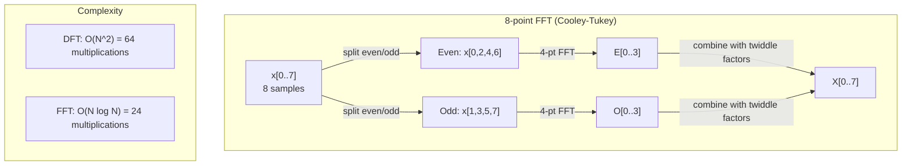
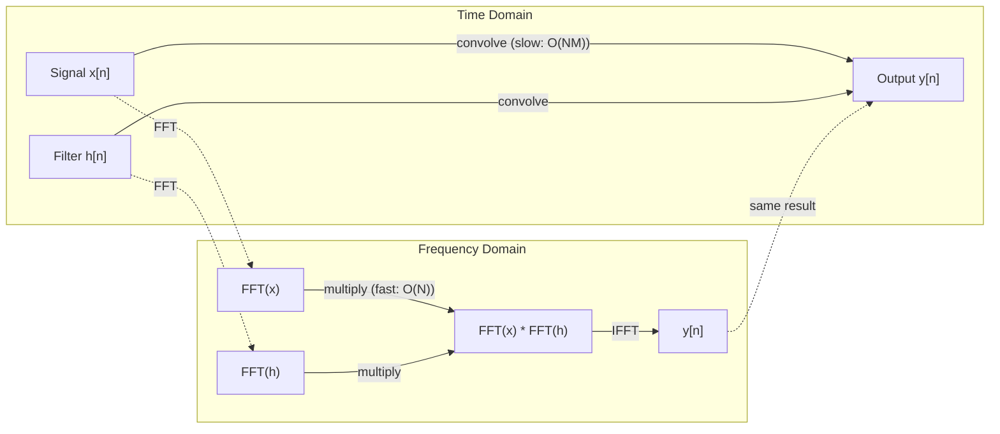

# Chuyển đổi Fourier

> Mỗi tín hiệu đều là sự lồng độ của sóng âm. Chuyển đổi Fourier sẽ cho bạn biết đó là gì.

**Type:** Build
**Language:**Python
**Prerequisites:** Phase 1, Lessons 01-04, 19 (complex numbers)
**Time:** ~90 分钟

## Học mục tiêu
- Từ零 thực hiện DFT,并用 $O(N \log N)$của Cooley-Tukey FFT 验证 nó
- Nghĩ các tỷ lệ tần số: từ tín hiệu 中提取 amplitude、phase 和 power spectrum
- 应用 convolution theorem, thông qua nhân FFT  thực hiện convolution
- Để phân hủy tần số Fourier với các mã hóa vị trí biến đổi và các lớp convolution CNN  liên kết

## 问题
Một đoạn âm thanh ghi âm là một loạt các giá trị đo áp suất thay đổi theo thời gian. Giá cổ phiếu là một loạt các giá trị theo trật tự.

Nhưng nhiều mô hình trong phạm vi thời gian là không thể nhìn thấy. Các tín hiệu âm thanh này là âm thanh thanh tinh khiết hay hợp âm?

Chuyển đổi Fourier sẽ chuyển dữ liệu từ miền thời gian  chuyển đổi sang miền tần số── nó nhận được một tín hiệu,并 sẽ phân chia thành sóng âm của tần số khác nhau── mỗi sóng âm có một cường độ (强度) và một giai đoạn (起始位置)── Chuyển đổi Fourier sẽ đồng thời cho bạn biết hai điều này──

Đây là điều quan trọng đối với ML, bởi vì tư duy về quận tần số 随处可见。 Các mạng thần kinh biến động 执行 convolution, còn convolution trong quận tần số là nhân nhânềnềnềnềnềnềnềnềnềnềnềnềnềnềnềnềnềnềnềnềnềnềnềnềnềnềnềnềnềnềnềnềnềnềnềnềnềnềnềnềnềnềnềnềnềnềnềnềnềnềnềnềnềnềnềnềnềnềnềnềnềnềnềnềnềnềnềnềnềnềnềnềnềnềnềnềnềnềnềnềnềnềnềnềnềnềnềnềnềnềnềnềnềnềnềnềnềnềnềnềnềnềnềnềnềnềnềnềnềnềnềnềnềnềnềnềnềnềnềnềnềnềnềnềnềnềnềnềnềnềnềnềnềnềnềnềnềnềnềnềnềnềnềnềnềnềnềnềnềnềnềnềnềnềnềnềnềnềnềnềnềnềnềnềnềnềnềnềnềnềnềnềnềnềnềnềnềnềnềnềnềnềnềnềnềnềnềnềnềnềnềnềnềnềnềnềnềnềnềnềnềnềnềnềnềnềnềnềnềnềnềnềnềnềnềnềnềnềnềnềnềnềnềnềnềnềnềnềnềnềnềnềnềnềnềnềnềnềnềnềnềnềnềnềnềnềnềnềnềnềnềnềnềnềnềnềnềnềnềnềnềnềnềnềnềnềnềnềnềnềnềnềnềnềnềnềnềnềnềnềnềnềnềnềnềnềnềnềnềnềnềnềnềnềnềnềnềnềnềnềnềnềnềnềnềnềnềnềnềnềnềnềnềnềnềnềnềnềnềnềnềnềnềnềnềnềnềnềnềnềnềnềnềnềnềnềnềnềnềnềnềnềnềnềnềnềnềnềnềnềnềnềnềnềnềnềnềnềnềnềnềnềnềnềnềnềnềnềnềnềnềnềnềnềnềnềnềnềnềnềnềnềnềnềnềnềnềnềnềnềnềnềnềnềnềnềnềnềnềnềnềnềnềnềnềnềnềnềnềnềnềnềnềnềnềnềnềnềnềnềnềnềnềnềnềnềnềnềnềnềnềnềnềnềnềnềnềnềnềnềnềnềnềnềnềnềnềnềnềnềnềnềnềnềnềnềnềnềnềnềnềnền

## 概念
### Định nghĩa DFT

给定 $N$个 mẫu $x[0], x[1], \ldots, x[N-1]$,Tạo ra chuyển đổi Fourier$N$个 tần số tần số $X[0], X[1], \ldots, X[N-1]$- Có thể là:

```math
X[k] = \sum_{n=0}^{N-1} x[n] \, e^{-2\pi i k n/N} \qquad \text{其中 } k = 0, 1, \ldots, N-1
```

Mỗi người$X[k]$Thành phố là một con số phức tạp.$\lvert X[k] \rvert$Với tần suất$k$∆αααααααααααααααααααααααααααααααααααααααααααααααααααααααααααααααααααααααααααααααααααααααααααααααααααααααααααααααααααααααααααααααααααααααααααααααααααααααααααααααααααααααααααααααααααααααααααααααααααααααααααααααααααααααααααααααααααααααααααααααααααααααααααααααααααααααααααααααααααααααααααααααααααααααααααααααααααααααααααααααααααααααααααααααααααααααααααααααααααααααααααααααααααααααααααααααααααααααααααααααααααααααααααααααααααααααααααααααααααααααααααααααααααααααααααααααααααααααααααααααααααααααααααααααααααααααααααα$A$Và đúng là rơi vào đống.$k$Ưu tiên của các âm nhạc$\lvert X[k] \rvert = AN/2$, vì vậy nên loại trừ$N/2$才能读出 amplitude.$\angle X[k]$Tự động hóa của tần số

关键洞见:$e^{-2\pi i k n/N}$là một trong số tần số $k$Phasor quay DFT  tính là tín hiệu và $N$个等间隔频率 中每个的相关性――如果信号在频率中$k$Ưu chứa năng lượng, tương quan rất lớn. Nếu không, nó gần như là không.

### Hóa học của mỗi hệ số

**$X[0]$: DC component。**Đây là tổng hợp của tất cả các mẫu, với tỷ lệ 成比例 trung bình. Nó biểu thị cho tín hiệu của liên tục (không tần số) của các định vị.

```math
X[0] = \sum_{n=0}^{N-1} x[n] \, e^0 = \text{全部 samples 之和}
```

**$X[k]$ for $1 \le k \le N/2$: positive frequencies。** $X[k]$表示每 $N$个 mẫu 中 $k$Tần số của các chu kỳ:$k$越大, tần số 越高(sự dao động 越快)

**$X[N/2]$: Nyquist frequency。**Đó là $N$个样本 能表示的最高频率── vượt quá tần số này, sẽ xuất hiện các tần số cao 伪装 thành tần số thấp──

**$X[k]$ for $N/2 < k < N$: negative frequencies。**Đối với các tín hiệu có giá trị thực,$X[N-k] = \overline{X[k]}$ Tần số tiêu cực là hình ảnh của các tần số tích cực.$N/2 + 1$个系数 中──

### DFT ngược

DFT ngược sẽ được tính từ các hệ số tần số 重建原始信号:

```math
x[n] = \frac{1}{N} \sum_{k=0}^{N-1} X[k] \, e^{2\pi i k n/N} \qquad \text{其中 } n = 0, 1, \ldots, N-1
```

Nó có sự khác biệt duy nhất với forward DFT là: biểu tượng giữa các biểu tượng là正 (không phải âm), và có một biểu tượng.$1/N$yếu tố bình thường hóa.

DFT ngược là một sự tái tạo hoàn hảo. Không mất bất kỳ thông tin nào. Bạn có thể từ miền thời gian đến miền tần số, quay lại lại, không tạo ra bất kỳ sai lầm nào.

### FFT: làm cho nó nhanh chóng

Như được định nghĩa trên DFT là $O(N^2)$: đối với $N$个 output coefficients 中的每个, phải đối với $N$个 nhập khẩu mẫu 求和──当 $N$= 1 triệu, đó là$10^{12}$Các hoạt động tiếp theo.

Chuyển đổi Fourier nhanh (FFT) 会以 $O(N \log N)$计算同样结果──当$N$= 1 triệu lần, đó là khoảng 2 triệu lần hoạt động, chứ không phải là một tỷ lần.

Cooley-Tukey thuật toán ((最常见的 FFT) sử dụng chia và chinh phục:

1. sẽ phân chia tín hiệu thành các mẫu được lập chỉ số và các mẫu được lập chỉ số không.
2. 递归计算每一半的 DFT──
3. Sử dụng "những yếu tố đôi" $e^{-2\pi i k/N}$合并两个 DFT nửa kích thước.

```math
\begin{aligned}
X[k] &= E[k] + e^{-2\pi i k/N} \, O[k] && \text{其中 } k = 0, \ldots, N/2 - 1 \\
X[k + N/2] &= E[k] - e^{-2\pi i k/N} \, O[k] && \text{其中 } k = 0, \ldots, N/2 - 1 \\[6pt]
\text{其中 } E &= \text{偶数索引 samples 的 DFT} \\
O &= \text{奇数索引 samples 的 DFT}
\end{aligned}
```

Sự đối xứng này có nghĩa là mỗi lớp của sự chuyển tiếp được thực hiện.$O(N)$làm việc, và có$\log_2(N)$层――总计:$O(N \log N)$



Trong đó, xích cực 2 FFT trong chiều dài tín hiệu là 2 của  thời gian nhanh nhất.`dft`Vì vậy, để tăng tốc, tín hiệu thường sẽ không có pad đến 2 của tiếp theo.`numpy.fft`Trong các bộ FFT sử dụng các thuật toán gốc hỗn hợp có thể xử lý bất kỳ chiều dài nào, nhưng chỉ chứa các yếu tố nhỏ trong chiều dài.

### Phân tích quang phổ

**power spectrum** $\lvert X[k] \rvert^2$, cũng là kích thước vuông của mỗi tần số hệ số. Nó cho thấy mỗi tần số có nhiều năng lượng.

**phase spectrum** $\angle X[k]$,也就是每个频率的相对应──对于大多数分析任务,你关心的是电源谱,并会忽略相──

```math
\begin{aligned}
\text{频率 } k \text{ 处的 Power：} \quad P[k] &= |X[k]|^2 = \mathop{\mathrm{Re}}(X[k])^2 + \mathop{\mathrm{Im}}(X[k])^2 \\
\text{频率 } k \text{ 处的 Phase：} \quad \phi[k] &= \mathop{\mathrm{atan2}}(\mathop{\mathrm{Im}}(X[k]), \mathop{\mathrm{Re}}(X[k]))
\end{aligned}
```

### Phân giải tần số

Độ phân giải tần số của DFT  phụ thuộc vào mẫu số lượng $N$和 tỷ lệ lấy mẫu$f_s$

```math
\begin{aligned}
\text{bin } k \text{ 对应的频率：} \quad & f_k = k \cdot f_s / N \\
\text{频率分辨率：} \quad & \Delta f = f_s / N \\
\text{最高频率：} \quad & f_{\max} = f_s / 2 \quad \text{(Nyquist)}
\end{aligned}
```

Để phân biệt hai tần số rất gần, bạn cần nhiều mẫu hơn. Để bắt được tần số cao, bạn cần tỷ lệ lấy mẫu cao hơn.

### Tiến lý convolution

Đây là một trong những kết quả quan trọng nhất trong xử lý tín hiệu, và liên quan trực tiếp đến CNN.

**time domain 中的 convolution 等于 frequency domain 中的 pointwise multiplication。**

```math
\begin{aligned}
& x * h = \text{IFFT}(\text{FFT}(x) \cdot \text{FFT}(h)) \\[4pt]
& \text{其中 } * \text{ 表示 convolution，} \cdot \text{ 表示 element-wise multiplication}
\end{aligned}
```

Tại sao điều này quan trọng:

- 两个长度为 $N$和 $M$Các tín hiệu  trực tiếp biến chuyển  cần $O(NM)$Các hoạt động
- 基于FFT的卷曲 需要 $O(N \log N)$:transform 两者、乘、转回──
- Đối với các hạt nhân lớn, sự xoay quanh FFT sẽ nhanh hơn.
- Đây chính là những gì xảy ra trong các lớp convolutional có các lĩnh vực thụ hưởng lớn.

chú ý:DFT  tính là vòng xoắn vòng tròn (signal 会 wrap around) ・・・ Đối với vòng xoắn tuyến tính (liner convolutions)  không bao quanh, hãy tính trước sẽ có hai tín hiệu không pad đến độ dài$N + M - 1$



### Đường cửa sổ

DFT 假设 tín hiệu là định kỳ của,也就是把 $N$个样本 视为一个无限重复信号的周期――如果信号的起点和终点不是相同的值,就会在边界产生间断,并表现为虚假的高频内容――这称为光谱泄漏――

Windows 会在计算 DFT 前将信号 两端 减到零,从而减少泄漏.

常见 cửa sổ:

| Window | Shape | Main lobe width | Side lobe level | Use case |
|--------|-------|----------------|-----------------|----------|
| Rectangular | 平坦（无 window） | 最窄 | 最高 (-13 dB) | 当 signal 在 N 个 samples 中正好 periodic 时 |
| Hann | Raised cosine | 中等 | 低 (-31 dB) | 通用 spectral analysis |
| Hamming | Modified cosine | 中等 | 更低 (-42 dB) | Audio processing、speech analysis |
| Blackman | Triple cosine | 宽 | 非常低 (-58 dB) | 当 side lobe suppression 至关重要时 |

```math
\begin{aligned}
\text{Hann window:} \quad & w[n] = 0.5 \left(1 - \cos\frac{2\pi n}{N-1}\right) \\
\text{Hamming window:} \quad & w[n] = 0.54 - 0.46 \cos\frac{2\pi n}{N-1}
\end{aligned}
```

Trước khi DFT, sẽ mở cửa sổ với tín hiệu làm nhân tố thông minh để áp dụng cửa sổ:`X = DFT(x * w)`

### Các tính chất DFT

| Property | Time Domain | Frequency Domain |
|----------|-------------|-----------------|
| Linearity | $ax + by$ | $aX + bY$ |
| Time shift | $x[n - k]$ | $X[f] e^{-2\pi i f k/N}$ |
| Frequency shift | $x[n] e^{2\pi i f_0 n/N}$ | $X[f - f_0]$ |
| Convolution | $x * h$ | $X \cdot H$ (pointwise) |
| Multiplication | $x \cdot h$ (pointwise) | $X * H$ (circular convolution, scaled by $1/N$) |
| Parseval's theorem | $\sum \lvert x[n] \rvert^2$ | $\frac{1}{N} \sum \lvert X[k] \rvert^2$ |
| Conjugate symmetry (real input) | $x[n]$ real | $X[k] = \overline{X[N-k]}$ |

Lý thuyết Parseval cho thấy tổng năng lượng trong hai lĩnh vực là giống nhau.

### Liên hệ với mã hóa vị trí

原始 Transformer 使用 mã hóa vị trí chân lưng:

```math
\begin{aligned}
PE(pos, 2i) &= \sin\left(pos / 10000^{2i/d_{\text{model}}}\right) \\
PE(pos, 2i+1) &= \cos\left(pos / 10000^{2i/d_{\text{model}}}\right)
\end{aligned}
```

Mỗi kích thước$(2i, 2i+1)$Các tần số từ high ((dimension 0,1) đến low ((last dimensions) theo khoảng cách hình học 排列── điều này cho phép mỗi vị trí trên tất cả các băng tần số có mô hình duy nhất, giống như hệ số Fourier 如何唯一识别一个信号──

Nó cung cấp các tính chất quan trọng:

- **Uniqueness:**Bất kỳ hai vị trí nào sẽ có mã hóa tương tự.
- **Bounded values:**Sin 和 cos 始终在 $[-1, 1]$Trong
- **Relative position:**vị trí $p+k$                                                                                                                                                                                                                                                              $p$处 mã hóa của hàm tuyến tính;; mô hình có thể học tập để quan tâm đến các vị trí tương đối;;

### Kết nối với CNN

Cột biến chuyển  thông qua trong tín hiệu hoặc hình ảnh 上滑动一个学习过器 (tự nhiên được học tập) sẽ được áp dụng cho đầu vào.

Theo định lý convolution, đây là:
1. Đối với đầu vào  thực hiện FFT
2. Đối với hạt nhân  thực hiện FFT
3. Trong phạm vi tần số nhân
4. Đối với kết quả thực hiện IFFT

标准 CNN 实现使用直 convolution () 对于小型3x3 kernel 更快)  Nhưng đối với các kernel lớn hoặc convolution toàn cầu, dựa trên FFT phương pháp sẽ显著更快──$O(N \log N)$Không$O(N^2)$Sự phức tạp 下 đạt được độ chính xác có cạnh tranh.

### Phân quang và chuyển đổi Fourier thời gian ngắn

单次 FFT sẽ cung cấp nội dung tần số của toàn bộ tín hiệu, nhưng không thể cho bạn biết các tần số này khi nào xuất hiện. p tần số 随着 thời gian tăng tín hiệu) và hợp âm (tất cả tần số cùng lúc tồn tại) có thể có cùng một quang phổ lớn.

Short-Time Fourier Transform (STFT) 通过在信号的重叠窗户上计算 FFT来解决这个问题──结果是谱谱: một hình thức đại diện 2D, trong đó một trục là thời gian, một trục khác là tần số── mỗi điểm biểu thị cường độ của thời gian trên tần số── năng lượng của tần số.

```
STFT procedure:
1. Choose a window size (e.g., 1024 samples)
2. Choose a hop size (e.g., 256 samples -- 75% overlap)
3. For each window position:
   a. Extract the windowed segment
   b. Apply a Hann/Hamming window
   c. Compute FFT
   d. Store the magnitude spectrum as one column of the spectrogram
```

Spectrogram là đại diện đầu vào tiêu chuẩn của các mô hình âm thanh ML.

### Tác giả

Nếu tín hiệu 包含高于 $f_s/2$(Phần số Nyquist) của tần số, $f_s$lấy mẫu sẽ tạo ra các bản sao ẩn danh. Một tín hiệu 90 Hz lấy mẫu 100 Hz trông giống với tín hiệu 10 Hz. Chỉ có các mẫu không thể phân biệt chúng.

```
Example:
  True signal: 90 Hz sine wave
  Sampling rate: 100 Hz
  Apparent frequency: 100 - 90 = 10 Hz

  The samples from the 90 Hz signal at 100 Hz sampling rate
  are identical to the samples from a 10 Hz signal.
  No amount of math can recover the original 90 Hz.
```

Đó là lý do tại sao các bộ chuyển đổi analog sang kỹ thuật số sẽ chứa các bộ lọc chống liên kết, trong việc lấy mẫu trước khi di chuyển cao hơn tần số của Nyquist. Trong ML, khi không có bộ lọc thấp thích hợp về các bản đồ tính năng giảm mẫu, sẽ xuất hiện các bộ lọc; một số kiến trúc sử dụng các lớp hợp nhất chống liên kết để xử lý vấn đề này.

### Null padding sẽ không nâng cao độ phân giải

Một hiểu lầm thường thấy là: trong FFT trước đối với tín hiệu  thực hiện việc đệm bằng không 会 nâng cao độ phân giải tần số. Nó sẽ không.

Độ phân giải tần số thực sự chỉ phụ thuộc vào thời gian quan sát .$T = N / f_s$ phải phân biệt sự khác biệt $\Delta f$Trong hai tần số, ít nhất bạn cần $T = 1 / \Delta f$秒的数据── dù làm gì nhiều không đệm,都无法改变这个基本的限制──


```figure
fourier-synthesis
```

##  xây dựng nó
### 步骤 1: DFT từ đầu

$O(N^2)$DFT trực tiếp từ định nghĩa:

```python
import math

class Complex:
    ...

def dft(x):
    N = len(x)
    result = []
    for k in range(N):
        total = Complex(0, 0)
        for n in range(N):
            angle = -2 * math.pi * k * n / N
            w = Complex(math.cos(angle), math.sin(angle))
            xn = x[n] if isinstance(x[n], Complex) else Complex(x[n])
            total = total + xn * w
        result.append(total)
    return result
```

### 步骤 2: DFT ngược

结构 giống nhau, đối tượng 为正,并除以 $N$

```python
def idft(X):
    N = len(X)
    result = []
    for n in range(N):
        total = Complex(0, 0)
        for k in range(N):
            angle = 2 * math.pi * k * n / N
            w = Complex(math.cos(angle), math.sin(angle))
            total = total + X[k] * w
        result.append(Complex(total.real / N, total.imag / N))
    return result
```

### 步骤 3: FFT (Cooley-Tukey)

FFT tái phát  yêu cầu độ dài为 2 的──拆分为 genap 和 偶,递归, sau đó sử dụng các yếu tố 合并──

```python
def fft(x):
    N = len(x)
    if N <= 1:
        return [x[0] if isinstance(x[0], Complex) else Complex(x[0])]
    if N % 2 != 0:
        return dft(x)

    even = fft([x[i] for i in range(0, N, 2)])
    odd = fft([x[i] for i in range(1, N, 2)])

    result = [Complex(0)] * N
    for k in range(N // 2):
        angle = -2 * math.pi * k / N
        twiddle = Complex(math.cos(angle), math.sin(angle))
        t = twiddle * odd[k]
        result[k] = even[k] + t
        result[k + N // 2] = even[k] - t
    return result
```

### 步骤 4: Phân tích quang phổ trợ giúp

```python
def power_spectrum(X):
    return [xk.real ** 2 + xk.imag ** 2 for xk in X]

def convolve_fft(x, h):
    N = len(x) + len(h) - 1
    padded_N = 1
    while padded_N < N:
        padded_N *= 2

    x_padded = x + [0.0] * (padded_N - len(x))
    h_padded = h + [0.0] * (padded_N - len(h))

    X = fft(x_padded)
    H = fft(h_padded)

    Y = [xk * hk for xk, hk in zip(X, H)]

    y = idft(Y)
    return [y[n].real for n in range(N)]
```

## Sử dụng nó
Trong thực tế, sử dụng Numpy của FFT, nó được hỗ trợ bởi các thư viện C tối ưu hóa cao.

```python
import numpy as np

signal = np.sin(2 * np.pi * 5 * np.arange(256) / 256)
spectrum = np.fft.fft(signal)
freqs = np.fft.fftfreq(256, d=1/256)

power = np.abs(spectrum) ** 2

positive_freqs = freqs[:len(freqs)//2]
positive_power = power[:len(power)//2]
```

Đối với phân tích quang phổ cửa sổ và cao hơn:

```python
from scipy.signal import windows, stft

window = windows.hann(256)
windowed = signal * window
spectrum = np.fft.fft(windowed)
```

 Đối với sự xoay quanh:

```python
from scipy.signal import fftconvolve

result = fftconvolve(signal, kernel, mode='full')
```

Đối với các quang phổ:

```python
from scipy.signal import stft

frequencies, times, Zxx = stft(signal, fs=sample_rate, nperseg=256)
spectrogram = np.abs(Zxx) ** 2
```

hình dạng của spectrogram Matrix là (n_frequencies, n_time_frames)。 mỗi hàng đều là một cửa sổ thời gian trên của quang phổ năng lượng。 đây là mô hình âm thanh ML 作为输入 消费的内容。

## 交付 nó
运行 `code/fourier.py`生成 `outputs/prompt-spectral-analyzer.md`

## 练习
1. **Pure tone identification。**创建一个信号,其中包含一个未知频率(1到50 Hz 之间) 的单个阴影波,以 128 Hz lấy mẫu 1秒――使用你的DFT 识别频率――验证答案是否匹配――现在加入标准偏差为0.5 的Gaussian noise,并重复――噪音 如何影响光谱?

2. **FFT vs DFT verification。**生成一个长度为64的随机信号――同时计算 DFT($O(N^2){}$(v) và FFT。 xác nhận tất cả các hệ số trong 1e-10 以内匹配── trên độ dài 256、512、1024 và 2048 tín hiệu trên phân chia thời gian hai chức năng── vẽ DFT thời gian với tỷ lệ thời gian FFT。

3. **Convolution theorem proof by example。**创建信号 x = [1, 2, 3, 4, 0, 0, 0, 0] 和过 h = [1, 1, 1, 0, 0, 0, 0, 0]──直接计算它们的圆形卷积 (圈圈)──然后通过FFT 计算(转换、乘、逆转转)──验证结果匹配──现在通过适当的零 执行线形卷积──

4. **Windowing effects。** tạo ra một tín hiệu, nó là 10 Hz và 12 Hz( rất gần) hai sóng âm của和──以 128 Hz lấy mẫu 1 giây──分别在无窗、汉窗 和汉明窗 下计算电源谱──哪个窗是最容易区分两个峰?为什么?

5. **Positional encoding analysis。**为 d_model = 128 和 max_pos = 512 生成 sinusoidal positional encoding──对每一对位置 $(p_1, p_2)$, tính toán các mã hóa của sản phẩm điểm ☐ giải thích sản phẩm điểm chỉ phụ thuộc vào$\lvert p_1 - p_2 \rvert$Không phụ thuộc vào vị trí tuyệt đối. Khi khoảng cách tăng lên, điểm sản phẩm sẽ xảy ra gì?

### 提示

**练习 1。**Trong 1 giây lấy 128 lần, Bin $k$Đối với$k$Vì vậy, đối với tần số nguyên tử, chỉ số giá trị lớn nhất trong bin 1 đến 63 là tần số này.`generate_signal`和 `magnitude_spectrum` Sau khi gia nhập tiếng ồn, kiểm tra giá trị đỉnh có vẫn ở trong cùng một thùng, và giá trị của các thùng khác có tăng lên một chút

**练习 2。**Sử dụng 2 次长度, vì `fft`会将信号对半分分. 对全部系数.`max(abs(a - b))`◊ mất thời gian hơn nên lớn gọn gàng$N / \log_2 N$增长──

**练习 3。**Đối với vòng xoắn, bàn tay$n$= 0 、1 、2 时的$y[n] = \sum_k h[k] x[(n-k) \bmod 8]$,并比较 `convolve_direct`和 `convolve_fft`Các giá trị trước ba: Độ dài của sự xoắn thẳng là 4 + 3 - 1 = 6, vì vậy hãy kiểm tra trước độ dài 8 là không đã đủ.

**练习 4。**Sử dụng `hann_window``hamming_window``apply_window`和 `power_spectrum`,并统计 9 đến 13 Hz có một số điểm phân biệt của đỉnh. 10 Hz và 12 Hz trong 1 giây đều hoàn thành một loạt các chu kỳ, vì vậy không thêm cửa sổ có thể trông tốt nhất.

**练习 5。**Sử dụng `positional_encoding(pos, 128)`计算每个编码──比较位置 (0, 10) 的点产量 和位置 (100, 110) 的点产量:差距必须在约1e-10 以内──然后固定一个 $p_1$, vẽ điểm sản phẩm 随 $\lvert p_1 - p_2 \rvert$变化的曲线──

## 关键术语
| Term | What it means |
|------|---------------|
| DFT (Discrete Fourier Transform) | 将 $N$ 个 time-domain samples 转换为 $N$ 个 frequency-domain coefficients。每个 coefficient 都是与该 frequency 上 complex sinusoid 的 correlation |
| FFT (Fast Fourier Transform) | 用于计算 DFT 的 $O(N \log N)$ algorithm。Cooley-Tukey algorithm 递归拆分 even/odd indices |
| Inverse DFT | 从 frequency coefficients 重建 time-domain signal。公式与 DFT 相同，但 exponent sign 相反，并带有 $1/N$ scaling |
| Frequency bin | DFT output 中的每个 index $k$ 表示 frequency $k f_s/N$ Hz。"bin" 是离散的 frequency slot |
| DC component | $X[0]$，zero-frequency coefficient。与 signal mean 成比例 |
| Nyquist frequency | $f_s/2$，在 sampling rate $f_s$ 下可表示的最大 frequency。高于它的 frequencies 会 alias |
| Power spectrum | $\lvert X[k] \rvert^2$，每个 frequency coefficient 的 squared magnitude。显示 energy 在 frequencies 上的分布 |
| Phase spectrum | $\angle X[k]$，每个 frequency component 的 phase offset。在 analysis 中通常会忽略 |
| Spectral leakage | 将 non-periodic signal 当作 periodic 处理导致的虚假 frequency content。可通过 windowing 减少 |
| Window function | 在 DFT 前应用的 tapering function（Hann、Hamming、Blackman），用于减少 spectral leakage |
| Twiddle factor | FFT butterfly computation 中用于合并 sub-DFTs 的 complex exponential $e^{-2\pi i k/N}$ |
| Convolution theorem | time domain 中的 convolution 等于 frequency domain 中的 pointwise multiplication。它是 signal processing 和 CNNs 的基础 |
| Circular convolution | signal 会 wrap around 的 convolution。这是 DFT 自然计算的内容 |
| Linear convolution | 没有 wraparound 的标准 convolution。通过在 DFT 前 zero-padding 实现 |
| Parseval's theorem | 总 energy 在 Fourier transform 中保持不变。$\sum \lvert x[n] \rvert^2 = \frac{1}{N} \sum \lvert X[k] \rvert^2$ |
| Aliasing | 当 sampling rate 不足时，高于 Nyquist 的 frequencies 表现为较低 frequencies |

## 延伸阅读
- [Cooley & Tukey: An Algorithm for the Machine Calculation of Complex Fourier Series (1965)](https://www.ams.org/journals/mcom/1965-19-090/S0025-5718-1965-0178586-1/)- 改变计算 的原始 FFT 论文
- [3Blue1Brown: But what is the Fourier Transform?](https://www.youtube.com/watch?v=spUNpyF58BY)-  Về những biến đổi Fourier tốt nhất
- [Lee-Thorp et al.: FNet: Mixing Tokens with Fourier Transforms (2021)](https://arxiv.org/abs/2105.03824)- Trong các biến thể Trung sử dụng FFT thay thế sự chú ý tự
- [Smith: The Scientist and Engineer's Guide to Digital Signal Processing](http://www.dspguide.com/)- 免费在线教材, sâu vào bao gồm FFT, cửa sổ và phân tích quang phổ
- [Vaswani et al.: Attention Is All You Need (2017)](https://arxiv.org/abs/1706.03762)- Từ Fourier tần số phân hủy 派生出 sinusoidal vị trí mã hóa
- [Radford et al.: Whisper (2022)](https://arxiv.org/abs/2212.04356)- Sử dụng mel-spectrograms  như đại diện đầu vào của nhận dạng giọng nói
