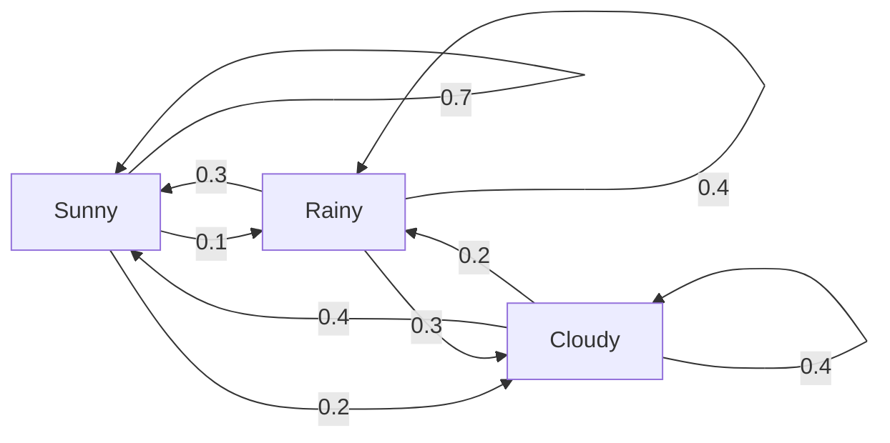
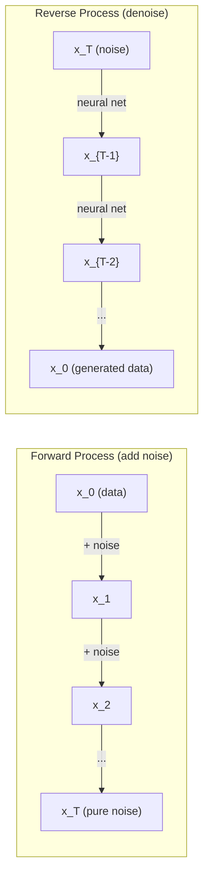

# Quá trình Stochastic

> 具有结构的随机性──随机走行、Markov链 和扩散模型 背后的数学──

**Type:** Learn
**Language:**Python
**Prerequisites:** Phase 1, Lessons 06-07（probability, Bayes）
**Time:** ~75 分钟

## Học mục tiêu
- 模拟 1D và 2D đi bộ ngẫu nhiên,并验证位移的 $\sqrt{n}$缩放规律
- 构建 Markov chain 模拟器,并通过自己的组合 计算其静止分布
- 实现 Metropolis-Hastings MCMC và động lực Langevin, được sử dụng từ mục tiêu phân bố
- Để kết nối quá trình phân tán về phía trước với chuyển động Brownian, và giải thích quá trình ngược  làm thế nào để tạo dữ liệu

## 问题
Nhiều hệ thống AI liên quan đến sự ngẫu nhiên của sự phát triển theo thời gian. Không phải sự ngẫu nhiên tĩnh, mà là sự ngẫu nhiên cấu trúc, sắp xếp, mỗi bước đều phụ thuộc vào những gì đã xảy ra trước đó.

Các mô hình ngôn ngữ một lần tạo ra một token. Mỗi token đều phụ thuộc vào bối cảnh trước. mô hình xuất ra một phân phối xác suất, từ từ trong, rồi tiếp tục. Đây là một quá trình stochastic.

Các mô hình phân phối dần dần hướng tới hình ảnh thêm tiếng ồn, cho đến khi nó trở thành âm thanh tĩnh thanh đơn thuần. Sau đó chúng trở lại quá trình này, từ chối dần, cho đến khi xuất hiện một hình ảnh mới.

Các đại lý học tập tăng cường trong môi trường thực hiện các hành động. Mỗi hành động đều có khả năng dẫn đến một trạng thái mới.

MCMC lấy mẫu là trụ cột của suy luận Bayesian, nó cấu thành một chuỗi Markov, phân bố tĩnh của nó là bạn muốn lấy kiểu sau.

Tất cả đều dựa trên bốn ý tưởng cơ bản:
1. Đi bộ ngẫu nhiên  最简单的 stochastic process
2. Dòng dây chuyền Markov  带有过渡矩阵的结构化随机性
3. Động lực Langevin  带噪音的渐进下降
4. Metropolis-Hastings  Từ phân bố tùy ý采样

## 概念
### Đi bộ ngẫu nhiên

Từ vị trí 0 开始── từng bước,抛一枚公平硬币──正面:向右移动(+1)──反面:向左移动(-1)──

经过 $n$步后, vị trí của bạn là $n$个随机 $\pm 1$值的总和──期望位置是0(这个行程是无偏的)──但距离原点的期望距离按 $\sqrt{n}$增长──

Đây là một bước đi không xa xôi, không có chiều hướng nào, nhưng theo thời gian nó sẽ rời khỏi điểm khởi đầu và đi xa hơn nữa.$n$Sự lệch chuẩn của bước sau là$\sqrt{n}$

```
Step 0:  Position = 0
Step 1:  Position = +1 or -1
Step 2:  Position = +2, 0, or -2
...
Step 100: Expected distance from origin ~ 10 (sqrt(100))
Step 10000: Expected distance from origin ~ 100 (sqrt(10000))
```

**在 2D 中**,làm đi 以相等概率向上向下向左或向右移动──距离原点同样遵循$\sqrt{n}$缩放规律──路径会描绘出类似碎形的模式──

**为什么是 $\sqrt{n}$？**Mỗi bước đều có tỷ lệ tương tự là +1 hoặc -1──$n$步后, vị trí $S_n = X_1 + X_2 + \cdots + X_n$, trong đó mỗi người $X_i$Thành phố là$\pm 1$❖ Mỗi bước khác nhau là 1, và mỗi bước khác nhau, vì vậy $\mathop{\mathrm{Var}}(S_n) = n$❖ Phác lệch chuẩn = $\sqrt{n}$ Theo định lý giới hạn trung tâm,$S_n / \sqrt{n}$收到 bình thường phân phối tiêu chuẩn.

Cái này$\sqrt{n}$缩放在 ML 中随处可见──SGD 噪音按1/sqrt(batch_size) 缩放──Embedding 维度按 $\sqrt{d}$缩放──平方根 là biểu tượng của tự do随机加和──

**与 Brownian motion 的联系。**取一个步骤尺为 $1/\sqrt{n}$、 mỗi giờ$n$步的随机走行──当$n$Khi đi gần như không có kết thúc, bước này sẽ nhận được chuyển động của Brown.$B(t)$Một quá trình liên tục thời gian, trong đó có$B(t)$服从平均值为 0 变量 为$t$Sự phân bố bình thường của nó.

Hành động Brownian là nền tảng toán học của sự phân tán. Nó mô tả sự biến động của các hạt trong cơ thể, cũng như các động thái âm thanh trong các mô hình phân tán.

**Gambler's ruin。**Một người đi bộ ngẫu nhiên từ vị trí $k$开始,在 0 和 $N$Có những rào cản hấp thụ.$N$Tỷ lệ có thể đạt đến 0 là bao nhiêu?$P(\text{到达 } N) = k/N$This is very simple and beautiful──它连接到martingales 理论  公平随机走 是一个martingale(đợi ý giá trị trong tương lai = giá trị hiện tại)。

### Dòng dây chuyền Markov

Dòng chuỗi Markov là một hệ thống, nó theo tỷ lệ cố định chuyển đổi giữa các tiểu bang.

```math
P(X_{t+1} = j \mid X_t = i, X_{t-1} = \ldots) = P(X_{t+1} = j \mid X_t = i)
```

Đó là thuộc tính Markov. Nó có nghĩa là bạn có thể sử dụng một matrix chuyển tiếp.$P$Mô tả toàn bộ động lực:

```math
P[i][j] = \text{从状态 } i \text{ 转移到状态 } j \text{ 的概率}
```

$P$Mỗi lần yêu cầu và vì 1... bạn phải đi đến một nơi nào đó.

**示例 —— Weather：**

```
States: Sunny (0), Rainy (1), Cloudy (2)

P = [[0.7, 0.1, 0.2],    (if sunny: 70% sunny, 10% rainy, 20% cloudy)
     [0.3, 0.4, 0.3],    (if rainy: 30% sunny, 40% rainy, 30% cloudy)
     [0.4, 0.2, 0.4]]    (if cloudy: 40% sunny, 20% rainy, 40% cloudy)
```

Từ bất kỳ trạng thái nào  bắt đầu. Sau nhiều chuyển đổi, phân phối của các quốc gia sẽ nhận được đến phân phối tĩnh.$\pi$, trong số đó $\pi P = \pi$ Đó là $P$Đáng giá riêng của 为 1 của cánh tay trái của riêng vector.

Đối với chuỗi thời tiết, phân phối cố định có thể là [0.53, 0.18, 0.29]  长期来看, bất kể trạng thái khởi đầu là gì, 53% thời gian là nắng.



**计算 stationary distribution。**Có hai cách:

1. **Power method**: sẽ bất kỳ phân bố ban đầu phản复乘以 $P$ đã trải qua đủ nhiều lần lặp lại  sau đó, nó sẽ nhận được 🏼
2. **Eigenvalue method**: tìm $P$của eigenvalue 为 1 của left eigenvector.$P^T$Đáng giá riêng của 为 1 của vector riêng của.

两种方法都要求链 满足收条件――

**收敛条件。**Nếu một chuỗi Markov  đáp ứng các điều kiện sau, nó sẽ nhận được phân phối tĩnh duy nhất:
- **Irreducible**Mỗi tiểu bang đều có thể đến từ bất kỳ tiểu bang nào khác
- **Aperiodic**: chuỗi không được định kỳ vòng lặp

Hầu hết các chuỗi mà bạn gặp trong ML đều đáp ứng cả hai điều kiện này.

**Absorbing states。**Nếu một khi vào một bang, sẽ không bao giờ rời khỏi đó.$P[i][i] = 1$), trạng thái này là hấp thụ của. Absorbing Markov chuỗi có thể được sử dụng để xây dựng với các trạng thái cuối cùng của quá trình.

**Mixing time。**需要多少步,chain 才会接近stationary distribution?形式化地说,就是总变距离与静止的距离降至某值以下的步数.$P$                                                                                                                                                                                                                                                              

### Liên hệ với Các mô hình ngôn ngữ

Mô hình ngôn ngữ 中的代币生成 近似是一个马科夫过程――给定当前文本,模型输出下一个代币 上的分布――温度 控制敏度:

```math
P(\text{token}_i) = \frac{\exp(\text{logit}_i / \text{temperature})}{\sum_j \exp(\text{logit}_j / \text{temperature})}
```

- Nhiệt độ = 1,0: Standard分布
- Nhiệt độ < 1,0:更尖(更 quyết định)
- Nhiệt độ > 1,0:更平坦(更随机)
- Nhiệt độ $\to 0$:argmax(cười tham)

Top-k lấy mẫu  cắt đến tỷ lệ cao nhất $k$个 token──Top-p(nucleus) sampling 截断到累积概率 超过 $p$集合──两者都会修改 Markov chuyển đổi xác suất──

### Động thái Brown

Random walk của giới hạn thời gian liên tục.$B(t)$Có ba tính chất:
1. $B(0) = 0$
2. $B(t) - B(s)$服从平均值为 0 变量 为$t - s$Sự phân bố bình thường của$t > s$(văn)
3. Không chồng lên trong các khu vực 相互独立

Quá trình Brown là liên tục, nhưng ở đó là không thể phân biệt được. Nó ở mỗi thước đều đang hoạt động.

Trong phân tán, bạn có thể làm như vậy gần giống như chuyển động Brownian:

```math
B(t + dt) = B(t) + \sqrt{dt} \, z, \quad \text{其中 } z \sim \mathcal{N}(0, 1)
```

$\sqrt{dt}$缩放 rất quan trọng. Nó xuất phát từ lý thuyết giới hạn trung tâm của ứng dụng cho đi bộ ngẫu nhiên.

### Langevin Dynamics

Gradient Descent 寻找 hàm của giá trị tối thiểu.$\exp(-U(x)/T)$Sự phân bố xác suất của tỷ lệ chính xác, trong đó $U$là chức năng năng lượng,$T$Là nhiệt độ.

```math
x_{t+1} = x_t - dt \, \nabla U(x_t) + \sqrt{2 T \, dt} \, z_t
```

Có hai tác dụng trên hạt:
1. **Gradient force**($-dt \cdot \nabla U$): Tăng xuống năng lượng thấp (tương tự như giảm độ)
2. **Random force**($\sqrt{2T dt} \cdot z$): Chuyển theo hướng khám phá

$T = 0$Trong thời gian, đây là sự giảm nhiệt độ cao, nó gần như là một bước đi ngẫu nhiên, trong nhiệt độ thích hợp, hạt sẽ khám phá cảnh quan năng lượng và dừng lại trong các vùng năng lượng thấp.

**与 diffusion models 的联系。**Phương pháp tiến triển của mô hình phân tán là:

```math
x_t = \sqrt{\alpha_t} \, x_{t-1} + \sqrt{1 - \alpha_t} \cdot \text{noise}
```

Đây là một chuỗi Markov liên kết dữ liệu với tiếng ồn.$x_T$Đó là tiếng ồn Gaussian.

Quá trình ngược từ tiếng  trở lại dữ liệu  cũng là một chuỗi Markov, nhưng khả năng chuyển đổi của nó được học bởi mạng Neural.



### MCMC: Markov Chain Monte Carlo

Đôi khi bạn cần một giá trị có thể được phép khác nhau một số thường) nhưng không thể trực tiếp lấy như phân phối .$p(x)$Trong khi đó, các hình ảnh hậu Bayesian là ví dụ điển hình. Bạn biết khả năng của nó được nhân lên trước, nhưng bình thường hóa liên tục là khó xử lý.

**Metropolis-Hastings**构建一个静止分布 为 $p(x)$của chuỗi Markov:

1. Từ một vị trí nào đó.$x$ bắt đầu
2. Từ phân phối đề xuất $Q(x' \mid x)$提议 một vị trí mới $x'$
3. 计算 tỷ lệ chấp nhận:$a = p(x') Q(x \mid x') / (p(x) Q(x' \mid x))$
4.               $\min(1, a)$ chấp nhận $x'$否则留在 $x$
5. Đổi lại

Nếu $Q$là đối xứng của(ví dụ $Q(x' \mid x) = Q(x \mid x') = \mathcal{N}(x, \sigma^2){}$), tỷ lệ có thể đơn giản hóa$a = p(x') / p(x)$ bạn chỉ cần tỷ lệ tỷ lệ  bình thường hóa liên tục 会相互抵消

Trong điều kiện ấm áp, chuỗi này đảm bảo nhận được.$p(x)$Nhưng nếu đề xuất 太小(random walk) hoặc quá lớn(高拒绝),收可能很慢──调节 đề xuất là nghệ thuật của MCMC──

**为什么它有效。**tỷ lệ chấp nhận  đảm bảo cân bằng chi tiết:$x$Không di chuyển đến$x'$                                                                                                                                                                                                                                                              $x'$Không di chuyển đến$x$概率──Tương đương chi tiết nghĩa là $p(x)$Đó là sự phân phối tĩnh của chuỗi. Vì vậy đã trải qua đủ nhiều bước.$p(x)$

**实践注意事项：**
- **Burn-in**: bỏ rơi trước$N$个样本――链 需要时间从起点到到静止分布――
- **Thinning**: mỗi phần$k$个样本保留一个, để giảm sự tương quan tự động.
- **Multiple chains**Từ các điểm khác nhau vận hành nhiều chuỗi. Nếu chúng được phân phối giống nhau, có bằng chứng về việc được phân phối.
- **Acceptance rate**Đối với:$d$维 Gaussian đề xuất, tỷ lệ chấp nhận tốt nhất 大约是 23% (Roberts & Rosenthal, 2001)  太高意味着链 几乎不移──太低意味着它几乎全部拒绝──

### Quá trình Stochastic trong AI

| Process | AI Application |
|---------|---------------|
| Random walk | RL 中的 exploration、Node2Vec embeddings |
| Markov chain | Text generation、MCMC sampling |
| Brownian motion | Diffusion models（forward process） |
| Langevin dynamics | Score-based generative models、SGLD |
| Markov decision process | Reinforcement learning |
| Metropolis-Hastings | Bayesian inference、posterior sampling |


```figure
random-walk-diffusion
```

##  xây dựng nó
### 步骤 1: Chế độ mô phỏng đi bộ ngẫu nhiên

```python
import numpy as np

def random_walk_1d(n_steps, seed=None):
    rng = np.random.RandomState(seed)
    steps = rng.choice([-1, 1], size=n_steps)
    positions = np.concatenate([[0], np.cumsum(steps)])
    return positions


def random_walk_2d(n_steps, seed=None):
    rng = np.random.RandomState(seed)
    directions = rng.choice(4, size=n_steps)
    dx = np.zeros(n_steps)
    dy = np.zeros(n_steps)
    dx[directions == 0] = 1   # right
    dx[directions == 1] = -1  # left
    dy[directions == 2] = 1   # up
    dy[directions == 3] = -1  # down
    x = np.concatenate([[0], np.cumsum(dx)])
    y = np.concatenate([[0], np.cumsum(dy)])
    return x, y
```

1D đi bộ  lưu trữ tổng cộng.$n$步后,位置就是总和──变量随$n$线性增长, do đó lệch chuẩn theo $\sqrt{n}$增长──

### 步骤 2: chuỗi Markov

```python
class MarkovChain:
    def __init__(self, transition_matrix, state_names=None):
        self.P = np.array(transition_matrix, dtype=float)
        self.n_states = len(self.P)
        self.state_names = state_names or [str(i) for i in range(self.n_states)]

    def step(self, current_state, rng=None):
        if rng is None:
            rng = np.random.RandomState()
        probs = self.P[current_state]
        return rng.choice(self.n_states, p=probs)

    def simulate(self, start_state, n_steps, seed=None):
        rng = np.random.RandomState(seed)
        states = [start_state]
        current = start_state
        for _ in range(n_steps):
            current = self.step(current, rng)
            states.append(current)
        return states

    def stationary_distribution(self):
        eigenvalues, eigenvectors = np.linalg.eig(self.P.T)
        idx = np.argmin(np.abs(eigenvalues - 1.0))
        stationary = np.real(eigenvectors[:, idx])
        stationary = stationary / stationary.sum()
        return np.abs(stationary)
```

phân phối cố định là $P$của eigenvalue 为 1 của left eigenvector.$P^T$Các vector chính để tìm nó (được chuyển đổi thành vector chính bên trái thành vector chính bên phải)

### 步骤 3: động lực Langevin

```python
def langevin_dynamics(grad_U, x0, dt, temperature, n_steps, seed=None):
    rng = np.random.RandomState(seed)
    x = np.array(x0, dtype=float)
    trajectory = [x.copy()]
    for _ in range(n_steps):
        noise = rng.randn(*x.shape)
        x = x - dt * grad_U(x) + np.sqrt(2 * temperature * dt) * noise
        trajectory.append(x.copy())
    return np.array(trajectory)
```

Thường độ$x$推向低能量──噪音──防止它陷入局部停滞──在平衡时,样本分布与$\exp(-U(x)/\text{temperature})$Đúng là vậy.

### 步骤 4: Metropolis-Hastings

```python
def metropolis_hastings(target_log_prob, proposal_std, x0, n_samples, seed=None):
    rng = np.random.RandomState(seed)
    x = np.array(x0, dtype=float)
    samples = [x.copy()]
    accepted = 0
    for _ in range(n_samples - 1):
        x_proposed = x + rng.randn(*x.shape) * proposal_std
        log_ratio = target_log_prob(x_proposed) - target_log_prob(x)
        if np.log(rng.rand()) < log_ratio:
            x = x_proposed
            accepted += 1
        samples.append(x.copy())
    acceptance_rate = accepted / (n_samples - 1)
    return np.array(samples), acceptance_rate
```

Các thuật toán đề xuất một điểm mới, kiểm tra xem nó có có khả năng cao hơn không, hoặc có tương ứng với tỷ lệ chấp nhận), sau đó lặp lại. Để có được sự trộn lẫn tốt, tỷ lệ chấp nhận nên khoảng 23-50% ∼.

## Sử dụng nó
Trong thực tế, bạn sẽ sử dụng các thư viện trưởng thành để thực hiện các thuật toán này. Nhưng hiểu cơ chế cho debugging và tuning rất quan trọng.

```python
import numpy as np

rng = np.random.RandomState(42)
walk = np.cumsum(rng.choice([-1, 1], size=10000))
print(f"Final position: {walk[-1]}")
print(f"Expected distance: {np.sqrt(10000):.1f}")
print(f"Actual distance: {abs(walk[-1])}")
```

### Sử dụng để chuyển đổi các matrix của numpy

```python
import numpy as np

P = np.array([[0.7, 0.1, 0.2],
              [0.3, 0.4, 0.3],
              [0.4, 0.2, 0.4]])

distribution = np.array([1.0, 0.0, 0.0])
for _ in range(100):
    distribution = distribution @ P

print(f"Stationary distribution: {np.round(distribution, 4)}")
```

将初始分布反复乘以$P$经过足够多的代, nó sẽ nhận được phân phối tĩnh, bất kể bạn bắt đầu từ đâu.

### Liên kết với khung thực tế

- **PyTorch diffusion：**Nhìn khuôn mặt `diffusers`Trung `DDPMScheduler`实现了前进和反转马科夫链
- **NumPyro / PyMC：**Sử dụng MCMC(NUTS mẫu, nó là một cải tiến đối với Metropolis-Hastings) để thực hiện suy luận Bayesian
- **Gymnasium (RL)：**chức năng bước môi trường  định nghĩa một quá trình quyết định Markov

### 验证 Sự hội tụ chuỗi Markov

```python
import numpy as np

P = np.array([[0.9, 0.1], [0.3, 0.7]])

eigenvalues = np.linalg.eigvals(P)
spectral_gap = 1 - sorted(np.abs(eigenvalues))[-2]
print(f"Eigenvalues: {eigenvalues}")
print(f"Spectral gap: {spectral_gap:.4f}")
print(f"Approximate mixing time: {1/spectral_gap:.1f} steps")
```

khoảng cách quang phổ  nói với bạn chuỗi  quên tốc độ trạng thái ban đầu của nó. khoảng cách là 0.2 có nghĩa là khoảng 5 bước即可混合. khoảng cách là 0.01 có nghĩa là khoảng 100 bước.

## 交付 nó
本课产 出:
- `outputs/prompt-stochastic-process-advisor.md` Một lời nhắc, để giúp xác định các vấn đề nhất định phù hợp với khung quy trình stochastic nào

## Kết nối

| Concept | Where it shows up |
|---------|------------------|
| Random walk | Node2Vec graph embeddings、RL 中的 exploration |
| Markov chain | LLMs 中的 Token generation、MCMC sampling |
| Brownian motion | DDPM 中的 forward diffusion process、SDE-based models |
| Langevin dynamics | Score-based generative models、stochastic gradient Langevin dynamics (SGLD) |
| Stationary distribution | MCMC convergence target、PageRank |
| Metropolis-Hastings | Bayesian posterior sampling、simulated annealing |
| Temperature | LLM sampling、RL 中的 Boltzmann exploration、simulated annealing |
| Mixing time | MCMC 的 convergence speed、spectral gap analysis |
| Absorbing state | End-of-sequence token、RL 中的 terminal states |
| Detailed balance | MCMC samplers 的 correctness guarantee |

Các mô hình phân tán 值得特别关注──DDPM(Ho et al., 2020) đã định nghĩa một chuỗi Markov phía trước:

```math
q(x_t \mid x_{t-1}) = \mathcal{N}\left(x_t; \sqrt{1-\beta_t} \, x_{t-1}, \beta_t I\right)
```

Trong số đó $\beta_t$Đó là một lịch trình tiếng ồn.$T$步后,$x_T$gần như$\mathcal{N}(0, I)$◊ quá trình ngược bởi một dự đoán tiếng ồn của mạng thần kinh 参数化:

```math
p_\theta(x_{t-1} \mid x_t) = \mathcal{N}\left(x_{t-1}; \mu_\theta(x_t, t), \sigma_t^2 I\right)
```

Mỗi bước của thế hệ là một bước trong chuỗi Markov học.

SGLD(Stochastic Gradient Langevin Dynamics) sẽ kết hợp các tập hợp nhỏ của Gradient Descent với tiếng ồn Langevin 结起来──你不计算完整的 Gradient,而是使用 stochastic estimate并添加校准的噪音──随着学习率的衰退,SGLD 会从优化 过渡到样品  你几乎免费得到近似的贝叶斯后样品──这是从神经网络 获得不确定性估计的最简单方式之一──

穿穿这些联系的关键洞见是: các quy trình stochastic không chỉ là các công cụ lý thuyết. Chúng là cơ chế tính toán trong hệ thống AI hiện đại. Khi bạn điều chỉnh nhiệt độ của LLM, bạn đang điều chỉnh một chuỗi Markov. Khi bạn đào tạo mô hình phân phối, bạn đang học ngược chuyển một quá trình giống như chuyển động Brownian. Khi bạn vận hành suy luận Bayesian, bạn đang xây dựng một chuỗi tiếp nhận cho phía sau.

## 练习
1. **模拟 1000 条 10000 步的 random walks。**绘制 vị trí cuối cùng của phân bố. 验证它 gần giống như trung bình 0  lệch tiêu chuẩn.$\sqrt{10000} = 100$của Gaussian.

2. **使用 Markov chain 构建 text generator。**Trong một tập thể nhỏ 上训练: đối với mỗi từ,统计 đến từ sau của chuyển tiếp.

3. **使用 Metropolis-Hastings 实现 simulated annealing。**Từ nhiệt độ cao  bắt đầu (quá chấp nhận tất cả nội dung), sau đó dần dần降温 (chỉ chấp nhận cải tiến)  Sử dụng nó để tìm các hàm tối thiểu của nhiều tối thiểu địa phương 

4. **比较不同 temperatures 下的 Langevin dynamics。**Từ tiềm năng của một cái cồn hai lần$U(x) = (x^2 - 1)^2$Trong khi đó, các mẫu được tập hợp trong một giếng. Trong khi đó, chúng được phân bố thành hai giếng.

5. **实现 forward diffusion process。**Từ một tín hiệu 1D (ví dụ sóng âm đạo) bắt đầu, sử dụng lịch trình tiếng ồn tuyến tính, dần dần thêm tiếng ồn trong 100 bước.

### 提示

**练习 1。**Đối với 1000 hạt giống khác nhau 调用 `random_walk_1d(10000, seed=i)`,并 giữ vị trí cuối cùng của mỗi lần. kiểm tra có nghĩa là có gần 0 không, lệch tiêu chuẩn có gần 100, cũng như có hay không vị trí cuối cùng có khoảng 68% rơi giữa -100 đến 100 không.

**练习 2。**统计 số lần xuất hiện của mỗi từ đối với các từ lân cận, tái phân bổ mỗi dòng bằng tổng cộng của dòng, làm cho mỗi dòng của nó và là 1  sẽ truyền vào矩阵 `MarkovChain(transition_matrix, state_names)`,并调用 `simulate`◊ kiểm tra mỗi đối tượng trong các từ trong các từ trong các từ trong các từ trong các từ trong các từ trong các từ trong các từ trong các từ trong các từ trong các từ trong các từ trong các từ trong các từ trong các từ trong các từ trong các từ trong các từ trong các từ trong các từ trong các từ trong các từ trong các từ trong các từ trong các từ trong các từ trong các từ trong các từ trong các từ trong các từ trong các từ trong các từ trong các từ trong các từ trong các từ trong các từ trong các từ trong các từ trong các từ trong các từ trong các từ trong các từ trong các từ trong các từ trong các từ trong các từ trong các từ trong các từ trong các từ trong các từ trong các từ trong các từ trong các từ trong các từ trong các từ trong các từ trong các từ trong các từ trong các từ trong các từ trong các từ trong các từ trong các từ trong các từ trong các từ trong các từ trong các từ trong các từ trong các từ trong các từ trong các từ trong các từ trong các từ trong các từ trong các từ trong các ngành.

**练习 3。**以 $\exp(-\Delta / T)$Ưu điểm của sự chấp nhận điểm khác nhau, và sau mỗi bước sẽ $T$Tử nghiệm trên một hàm tối thiểu được biết, và kết quả của tìm kiếm trên mạng nhỏ được kiểm tra.

**练习 4。**Gradient là $4x(x^2 - 1)$, sẽ truyền nó cho ta`langevin_dynamics(grad_U, x0, dt, temperature, n_steps)`$x = 0$n n n n n n n n n n n n n n n n n n n n n n n n n n n n n n n n n n n n n n n n n n n n n n n n n n n n n n n n n n n n n n n n n n n n n n n n n n n n n n n n n n n n n n n n n n n n n n n n$x$改变符号的次数, tìm ra số lần bắt đầu tăng nhiệt độ nhanh chóng.

**练习 5。**调用 `diffusion_forward(signal, 100)`,并将所有 $(1 - \beta_t)$Như vậy, chúng ta sẽ có được bước cuối cùng.$\bar{\alpha}$ Nếu $\bar{\alpha}$ vẫn xa 0, tín hiệu không phải là tiếng ồn đơn thuần, cần tăng `beta_end`▽先使用真实的噪音 测试 标签:此时$(x_t - \sqrt{1 - \bar{\alpha}_t} \epsilon)/\sqrt{\bar{\alpha}_t}$必须精确还原原始信号――

## 关键术语
| Term | What people say | What it actually means |
|------|----------------|----------------------|
| Random walk | “抛硬币式移动” | 一个 position 在每一步按随机 increments 改变的过程 |
| Markov property | “无记忆性” | future 只依赖当前 state，而不依赖 history |
| Transition matrix | “概率表” | $P[i][j]$ = 从 state $i$ 移动到 state $j$ 的概率 |
| Stationary distribution | “长期平均” | 满足 $\pi P = \pi$ 的分布 $\pi$ —— chain 的 equilibrium |
| Brownian motion | “随机抖动” | random walk 的 continuous-time limit，$B(t) \sim \mathcal{N}(0, t)$ |
| Langevin dynamics | “带噪声的 Gradient Descent” | 结合 deterministic Gradient 与 random perturbation 的 update rule |
| MCMC | “向目标行走” | 构造一个 stationary distribution 为你想要的分布的 Markov chain |
| Metropolis-Hastings | “提议并接受/拒绝” | 使用 acceptance ratios 来确保收敛的 MCMC algorithm |
| Temperature | “随机性旋钮” | 控制 exploration 与 exploitation 之间权衡的参数 |
| Diffusion process | “噪声进，噪声出” | Forward：逐渐添加 noise。Reverse：逐渐移除 noise。生成 data。 |

## 延伸阅读
- **Ho, Jain, Abbeel (2020)**  Tống chế các mô hình khả thi phân tán.   mở mô hình phân tán 革命的 DDPM 论文──清晰推导了前进和反转马科夫链──
- **Song & Ermon (2019)** Tình mẫu tổng thể bằng cách ước tính các gradient phân phối dữ liệu. Sử dụng động lực Langevin  tiến hành lấy mẫu 方法 dựa trên điểm số của 
- **Roberts & Rosenthal (2004)** General state space Markov chains and MCMC algorithms.                                                                                                                                                                                                                                                      
- **Norris (1997)** Markov Chains. 标准教材──涵盖 hội tụ, phân phối tĩnh và thời gian tấn công.
- **Welling & Teh (2011)**  Học Bayesian thông qua Stochastic Gradient Langevin Dynamics. 将 SGD với động lực Langevin 结结,用于可扩展 Bayesian inference。
