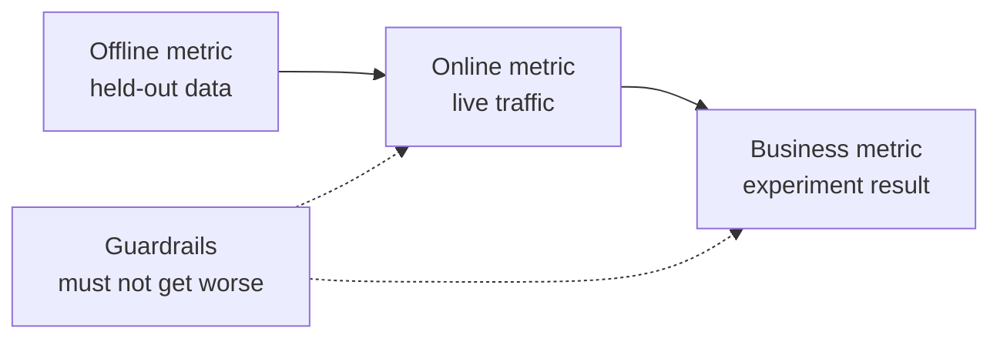

# 机器学习系统设计: từ vấn đề đến mô hình đã được triển khai

> Mô hình chỉ là một phần của hệ thống. Mô hình thiết kế quyết định dự đoán những gì, những người theo dự đoán sẽ hành động, chi phí là bao nhiêu, và cách xử lý khi thất bại.

**Type:** Build
**Languages:** Python
**Prerequisites:** 阶段 2，第 09 课（模型评估）和第 13 课（ML 流水线）
**Time:** 约 110 分钟

## Học mục tiêu

- Định nghĩa các vấn đề kinh doanh như ML  nhiệm vụ, xác định nội dung dự đoán, sử dụng dự đoán để đưa ra quyết định, cũng như nguyên nhân vì quy tắc không giải quyết được vấn đề
- 区分离线,线上,业务和护指标, so sánh từng mô hình với đơn giản
- Theo ước tính lưu lượng lượng và chi phí hàng ngày của ước tính hàng loạt và tính toán trực tuyến
- 选择发布方式(影子、金丝雀、A/B 测试),并为每种故障模式选择安全默认行为
- 识别模型如何通过决策改变下一版本训练数据的反循环
- 编写 ML 设计文档,并按固定检查清单评分

## 问题

Một công ty đăng ký yêu cầu làm một mô hình dự đoán 流失── một nhà khoa học dữ liệu đã đào tạo các phân loại nâng cấp độ, báo cáo AUC đạt 0,91── ba tháng sau, nhưng không ai sử dụng nó──

原因与算法无关――没有人决定分数应触发什么行动――分数每周只更新一次,但客户挽留团队每天都打电话――标签来自取消订阅表,而表还存储取消原因,因此某特征直接包含答案――也没有人把模型与客户团队原始规则比较:给连续两周不活跃客户打电话――

Những thất bại này đã bị chôn vùi trước khi bắt đầu đào tạo. Chúng là thất bại thiết kế, và một trang thiết kế tài liệu sẽ có thể theo dõi từng câu hỏi.

## 核心概念

### Từ mục tiêu kinh doanh đến nhiệm vụ ML

业务目标不等于 ML 任务.

1. 模型具体预测什么,预测对象是什么实体?
2.  Những quyết định nào sử dụng dự đoán, bởi ai hoặc hệ thống nào đưa ra quyết định?
3. Khi nào cần dự đoán, có dữ liệu nào có sẵn trong thời điểm đó?
4. Làm thế nào để đánh giá quyết định có cải thiện?

| 业务目标 | 预测 | 使用预测的决策 | ML 任务 |
|---|---|---|---|
| 减少流失 | 用户未来 30 天取消订阅的概率 | 每晚向风险最高的 5% 用户发送挽留优惠 | 二分类 |
| 减少欺诈损失 | 一笔支付属于欺诈的概率 | 在 100 ms 内批准、送审或阻止 | 二分类 |
| 保持货架有货 | 下周各门店每天的销售件数 | 各门店订货量 | 预测 |
| 展示相关商品 | （用户，商品）对的相关性分数 | 信息流中的商品顺序 | 排序 |

Thứ hai cần được xác định kỹ lưỡng. Không có cửa sổ thời gian rõ ràng, thực thể và hành động.

### 何时不应使用 ML

Quy tắc 1                                                                                                                                                                                                                                                                                                                                                                                                                                                                                                                           

- 简短规则可以达到目标,并能持续保持正确.
- Không có nhãn, cũng không có phương pháp thu thập thực tế có thể thực hiện.
- Không ai hành động theo dự đoán, vì vậy dự đoán chính xác hơn cũng không mang lại thay đổi.
- 预测时可用数据不含所需信号――
- Một lần sai lầm cũng không thể chấp nhận được, và không ai có thể kiểm tra xuất khẩu.
- Chi phí xây dựng và vận hành hệ thống cao hơn giá trị của các quyết định tốt hơn.

Khi các quy tắc trở nên dài và yếu, ML mới bắt đầu đáng để đầu tư. Quy tắc 3 của cùng hướng dẫn khuyên nên ưu tiên sử dụng ML thay vì các quy tắc khởi động phức tạp, vì mô hình được học dễ dàng hơn để cập nhật và bảo trì.

### 3 cấp chỉ số

Trong ba cấp độ đo ML 系统, đồng thời đặt một nhóm giới hạn:

| 层面 | 何时能测量 | 流失预测示例 |
|---|---|---|
| 离线指标 | 上线前，在留出的历史数据上 | 优惠阈值处的 F1、风险最高 5% 中的精确率 |
| 在线指标 | 上线期间，在真实流量上 | 优惠接受率、已评分用户比例、分数分布 |
| 业务指标 | 上线数周后，通过实验 | 干预组与保留对照组的 30 天流失率 |
| 护栏指标 | 始终监测 | 每挽留一名用户的优惠成本、退订率、p99 延迟 |



Các cấp thường đưa ra kết luận khác nhau. Các chỉ số trực tuyến đánh giá dữ liệu lịch sử, trong khi quá khứ không có mô hình của bạn. Chỉ số trực tuyến phụ thuộc vào phản ứng của người dân đối với quyết định.

选择与决策匹配的离线指标――如果任务联系风险最高的5%用户,就测量这个5%中的精确率――AUC đối với tất cả các 值综合评估, trong đó bao gồm cả 值 bạn không bao giờ sử dụng――规则 2 của cùng hướng dẫn 要求先设计并实现指标,再决定ML系统具体做什么――

### 基线

Chỉ số cách ly không có ý nghĩa. Nếu các thay thế tốt nhất chỉ 0,30, F1 đạt 0,56 thì rất tốt; nếu một quy tắc có thể đạt 0,60, nó rất kém.

- **简单基线。**始终预测多数类别,或始终预测训练集平均值──模型评估课使用过这种检查──
- **启发式基线。**Từ các quy tắc của kiến thức trong lĩnh vực, hoặc các đặc điểm đơn lẻ phù hợp trên dữ liệu đào tạo.
- **现有系统。**Cách đưa ra quyết định trước, ngay cả khi nó chỉ là một người sử dụng bảng điện tử.

升级量 là số điểm của mô hình giảm số điểm mạnh nhất của cơ sở. Trước khi xem kết quả, hãy đặt ra yêu cầu nâng cấp tối thiểu, và đảm bảo nó đủ để đáp ứng chi phí hệ thống bổ sung. 简单基线 thường rất yếu, khởi động chỉ là một đối thủ thực sự khó đánh bại.

### Số liệu và yêu cầu nhãn

训练前 trả lời những câu hỏi này:

- **标签来源。**ng ng ng ng ng ng ng ng ng ng ng ng ng ng ng ng ng ng ng ng ng ng ng ng ng ng ng ng ng ng ng ng ng ng ng ng ng ng ng ng ng ng ng ng ng ng ng ng ng ng ng ng ng ng ng ng ng ng ng ng ng ng ng
- **标签延迟。**预测后多久才知道真实结果? gian lận từ chối thanh toán có thể xuất hiện sau vài tuần thanh toán;流失标签 phải chờ 30 天预测窗口结束──
- **标签质量。**Ai đánh dấu, xuất lỗi thường xuyên cao hơn?
- **预测时的可用性。**Mỗi đặc điểm có tồn tại khi dự đoán xảy ra không? Kết quả xảy ra sau đó các đặc điểm được viết sẽ làm cho các nhãn được tiết lộ trong tập luyện.
- **各类样本量。**Có bao nhiêu mẫu thực? Chỉ có 200 mẫu thực, thường chỉ có thể sử dụng mô hình đơn giản.
- **时间切分。**留出最近的一段时间──时间序列课按时间分类数据也出于同样的原因──

### 延迟、 lượng tiêu thụ và ngân sách chi phí

三个数字约束 mỗi kiểu thiết kế dịch vụ:

- **延迟预算。**P99 延迟 là 99 trong 100 yêu cầu thấp hơn thời gian tiêu thụ.
- **峰值吞吐量。**按最忙一分钟而非日均流量配置系统──峰值 QPS(每秒请求数)往往是平均值的数倍──
- **成本预算。**Sử dụng chi phí đô la hàng ngày hoặc chi phí đô la dự đoán mỗi 1000 lần để chỉ, dễ so sánh các quy trình.

Các quy luật nhỏ sẽ liên kết hai thứ trước: số lượng yêu cầu trong xử lý bằng với lượng dung lượng nhân với sự chậm trễ. Nếu mỗi giây 400 yêu cầu, mỗi giờ mất 50 ms, thì trung bình có 20 yêu cầu trong xử lý.

###  Phân tích hàng loạt và phân tích trực tuyến

提供预测 có hai cách cơ bản:

- **批量推理。**定时任务为每实体评分,将分数写入表或键值存储――应用在收到请求时读取已存储分数――
- **在线推理。**应用在请求到达时把特征发送给模型服务,等分数回来──

| 属性 | 批量 | 在线 |
|---|---|---|
| 新鲜度 | 距离上次运行的时间，加上运行耗时 | 使用当前请求的数据 |
| 请求延迟 | 一次键值读取，几毫秒 | 特征获取时间加模型耗时 |
| 成本驱动因素 | 实体数乘以每天运行次数 | 按峰值 QPS 配置的副本数 |
| 新实体 | 下一次运行前没有分数 | 第一次请求时即可评分 |
| 故障时 | 旧分数仍可读取 | 请求失败或超时 |

Trong phần này, các công cụ sẽ ước tính cả hai chi phí. Chi phí hàng loạt tăng theo số lượng vật thể và số lần vận hành hàng ngày. Cho phép thời gian cũ càng ngắn, vận hành càng thường xuyên. Chi phí trực tuyến tăng theo giá trị lưu lượng cao nhất, vì một bản sao của khoảng trống giữa các đỉnh cũng phải trả.

混合设计很常见: giao dịch hàng đêm cho người dùng đã đánh giá, trên đường trực tuyến xử lý người dùng mới và yêu cầu dữ liệu mới.

### 部署模式

新模型分阶段接触用户:

1. **影子运行（Shadow）。**Mô hình mới nhận được một lượng lớn lưu lượng thực. Hệ thống ghi chép dự đoán, nhưng không sử dụng nó. So sánh với độ chậm, tỷ lệ sai lầm và phân bố dự đoán của mô hình mới.
2. **金丝雀发布（Canary）。**Mô hình mới cho một phần nhỏ lưu lượng thực sự đưa ra quyết định, thường từ 1% đến 5%  bắt đầu.
3. **A/B 测试。**随机分组的用户分别使用不同模型──使用统计检测测测业务指标,需要足够的流量和时间才能清晰差异──

Mỗi giai đoạn cần phải hoàn thành vòng quay trong vài phút.[影子与金丝雀发布课](../../../17-infrastructure-and-production/20-shadow-canary-progressive/docs/en.md)和 [A/B 测试课](../../../17-infrastructure-and-production/21-ab-testing-llm-features/docs/en.md)会针对语言模型讲解同样三种模式.

### Tròn vòng

Khi các quyết định của mô hình thay đổi dữ liệu đào tạo phiên bản sau, có một vòng phản .Sculley 等人 sẽ trực tiếp và ẩn lại vòng phản .

- **干预隐藏标签。**流失模型发送优惠,挽留了部分用户──下个月,高风险用户看起来很忠诚,重新训练的模型便学到这些特征无法预测流失──
- **被阻止的行动没有结果。** mô hình lừa đảo ngăn chặn một khoản thanh toán, khoản thanh toán này sẽ không bao giờ tạo ra nhãn từ chối.
- **曝光限制反馈。**Mô hình xếp hạng chỉ hiển thị hàng hóa xếp hạng trước, do đó chỉ có những hàng hóa này được nhận được click.

Ưu điểm chung của phương pháp sửa chữa là giữ lại một số dữ liệu chưa bị ảnh hưởng bởi mô hình. Ưu điểm duy trì một nhóm người dùng không bao giờ chấp nhận sự can thiệp; cho ít lượng lưu lượng phân phối tùy chọn; theo từng mẫu ghi chép số lượng và quyết định, để đào tạo tiếp theo có thể phân biệt dữ liệu bị ảnh hưởng và dữ liệu sạch.

### 障障模式与安全默认行为

Mỗi phần của hệ thống sẽ thất bại sớm hơn.

| 故障 | 没有预案时的结果 | 安全默认行为 |
|---|---|---|
| 模型服务超时 | 请求失败 | 使用启发式基线 |
| 夜间批任务失败 | 分数缺失或过旧 | 在固定期限内提供最近的正常分数，之后使用规则 |
| 特征缺失或越界 | 模型对坏输入评分 | 使用文档规定的默认值，并记录事件 |
| 新实体没有历史 | 没有分数 | 使用规则或总体均值 |
| 分数分布突然变化 | 大规模错误决策 | 暂停自动行动，并通知人工处理 |

Chỉ số phần của khởi động cũng là một phần của các cố vấn, vì vậy nên thực hiện nó trước tiên.

### 设计文档

设计文档在训练开始前集中记录上述决策――本课检查器为其 JSON 版本评分――其中六项检查具有阻塞性,因为任一缺失都会使系统不安全或无用:

| 章节 | 回答的问题 | 阻塞条件 |
|---|---|---|
| 问题 | 预测什么，哪项决策使用它，为什么规则不够？ | 必须明确决策 |
| 指标 | 适用哪些离线、在线、业务和护栏指标？ | 必须明确业务指标 |
| 基线 | 适用哪些简单、启发式和现有系统基线？ | 必须有启发式或现有系统基线 |
| 数据 | 标签来自哪里、延迟多久，每个特征预测时是否可用？ | 不得泄露标签 |
| 预算与服务 | 有哪些延迟、峰值 QPS、成本和陈旧时间限制，哪种模式满足它们？ | 无 |
| 发布 | 使用哪些影子、金丝雀及 A/B 阶段，如何回滚？ | 必须有影子或金丝雀阶段，以及回滚 |
| 反馈循环 | 模型如何改变未来数据，如何保留干净数据？ | 无 |
| 故障模式 | 每种故障的默认行动是什么？ | 每种故障都必须有默认行为 |
| 监控 | 上线后观察什么？ | 无 |

```figure
mlprod-serving-cost
```

## Từ 0 cấu trúc

`code/main.py`Chỉ sử dụng thư viện tiêu chuẩn, bao gồm ba công cụ: mô hình chi phí dịch vụ, so sánh cơ sở và kiểm tra tài liệu thiết kế.

### 第1 步: mô tả 工作负载和价格

工作负载保存流量与预算数字,成本模型保存价格──这些价格是实践使用的整数化示例,不是供应商报价──

```python
@dataclass(frozen=True)
class Workload:
    name: str
    entities: int
    requests_per_day: int
    peak_qps: float
    max_staleness_hours: float
    latency_budget_ms: float


@dataclass(frozen=True)
class CostModel:
    batch_dollars_per_million: float = 0.40
    batch_job_hours: float = 1.0
    lookup_dollars_per_million: float = 0.25
    lookup_latency_ms: float = 4.0
    replica_dollars_per_hour: float = 0.50
    replica_qps: float = 200.0
    min_replicas: int = 2
    online_latency_ms: float = 35.0
```

### Bước 2: Số lượng hàng hóa và chi phí dịch vụ trực tuyến

Các nhiệm vụ hàng loạt phải được hoàn thành trong thời gian cũ. Phân đoạn hai lần vận hành bằng với thời gian tối đa giảm nhiệm vụ. Bất kể có ai yêu cầu số lượng, mỗi lần vận hành sẽ được đánh giá cho tất cả các thực thể.

```python
def batch_plan(workload: Workload, costs: CostModel) -> ServingPlan:
    refresh_hours = workload.max_staleness_hours - costs.batch_job_hours
    if refresh_hours <= 0:
        return ServingPlan(
            "batch", False, math.inf, costs.lookup_latency_ms, math.inf, 0.0,
            "staleness limit is shorter than one batch job",
        )
    runs_per_day = 24.0 / refresh_hours
    predictions = workload.entities * runs_per_day
    dollars = (
        predictions / 1e6 * costs.batch_dollars_per_million
        + workload.requests_per_day / 1e6 * costs.lookup_dollars_per_million
    )
    ...
```

Dịch vụ trực tuyến cần phải trả phí để giữ đủ các bản để chịu giá trị cao nhất, và giữ ít nhất hai bản để đảm bảo khả dụng:

```python
def online_plan(workload: Workload, costs: CostModel) -> ServingPlan:
    replicas = max(costs.min_replicas, math.ceil(workload.peak_qps / costs.replica_qps))
    dollars = replicas * costs.replica_dollars_per_hour * 24.0
    feasible = costs.online_latency_ms <= workload.latency_budget_ms
    ...
```

`choose_serving` chọn đáp ứng sự chậm trễ và hạn chế thời gian cũ, trả lại cho người rẻ nhất. Không có quy trình khả thi khi trả lại.`None`, gợi ý bạn cần điều chỉnh ngân sách.

### 第3 步: So sánh mô hình với đường cơ bản

So sánh các thiết bị cùng một chỉ số đánh giá mô hình và tất cả các đường cơ sở. Nó tính toán tăng trưởng của đường cơ sở mạnh nhất và không phải yếu nhất.

```python
def compare_to_baselines(
    y_true: list,
    model_pred: list,
    baselines: dict[str, list],
    metric,
    metric_name: str,
    higher_is_better: bool = True,
    min_lift: float = 0.02,
) -> BaselineReport:
    if not baselines:
        raise ValueError("a model needs at least one baseline")
    scores = {name: metric(y_true, pred) for name, pred in baselines.items()}
    pick = max if higher_is_better else min
    best_name = pick(scores, key=scores.get)
    model_score = metric(y_true, model_pred)
    lift = model_score - scores[best_name] if higher_is_better else scores[best_name] - model_score
    return BaselineReport(metric_name, {"model": model_score, **scores}, best_name, lift, min_lift)
```

启发式基线是单特征规则──`fit_rule`Trong dữ liệu đào tạo, hãy xem mỗi giá trị của đặc điểm này theo cách theo giá trị, giữ lại giá trị tốt nhất của F1.

### 第4 步:为设计文档评分

Mỗi kiểm tra có chứa các khóa, trọng lượng, dấu chặn, tin nhắn và hàm kiểm tra.

```python
CheckItem("decision", 2, True, "name the action that uses each prediction", lambda d: _text(d, "problem.decision")),
CheckItem("baselines", 2, True, "add a heuristic or current-system baseline", check_baselines),
CheckItem("no_leakage", 2, True, "confirm every feature exists at prediction time",
          lambda d: get_path(d, "data.features_available_at_prediction_time") is True),
CheckItem("serving_fit", 1, False, "pick a serving mode that meets the staleness, latency, and cost budgets",
          check_serving_fit),
```

`check_serving_fit`复用成本模型,从文档读取负载数字,并估算选定模式的成本──如果该模式不能满足陈旧时间上限、延迟预算或每天成本预算,检查就失败──声明采用批但只允许三分钟陈旧时间的文档无法通过──成本模型没有混合方案,因此声明混合的文档也会失败,直到你加入该方案在练习1中──

`review_design_doc`Để thông qua các dự án, tăng trọng lượng, phân bổ lại với tổng trọng lượng. Chỉ có phần tử đạt 0,85 và tất cả các dự án cản trở được thông qua, kết luận chỉ là sẵn sàng để xem xét.

### 第5 步:运行

```bash
python3 code/main.py
```

```console
nightly churn scores
  ok batch        $0.91/day      4 ms  1.0 runs per day over 2,000,000 entities
  ok online      $24.00/day     35 ms  2 replicas sized for 40 peak QPS
  choose: batch

feed ranking, 2-hour freshness
  ok batch       $48.50/day      4 ms  24.0 runs per day over 5,000,000 entities
  ok online      $24.00/day     35 ms  2 replicas sized for 120 peak QPS
  choose: online

=== Model versus baselines (churn, metric F1) ===
  model                    0.564
  days_idle > 12.8688      0.500
  random at base rate      0.232
  majority class           0.000
  model beats the strongest baseline (days_idle > 12.8688) by +0.064
```

F1 của đa số các loại đường cơ sở là 0, vì nó không dự đoán được sự biến mất. Quy tắc sau đó được thiết kế là đối thủ cạnh tranh thực sự. Mô hình cao hơn nó là 0.064, vì vậy có lý do để sử dụng mô hình. Nếu các đặc điểm yếu hơn, quy tắc có thể thắng, thì quy tắc là hệ thống nên được triển khai.

设计文档评审会印缺少六阻塞项的薄弱文档,以及分 1.00的完整文档――传入路径可评审您自己的文档:

```bash
python3 code/main.py my_design_doc.json
```

## 使用现成工具

工具包各部分都应对团队在生产中使用的工具──

**基线。**scikit-learn sẽ thực hiện các đường đơn giản như là máy đánh giá, vì vậy chúng có thể được đặt cùng dòng chảy với mô hình:

```python
from sklearn.dummy import DummyClassifier, DummyRegressor
from sklearn.metrics import f1_score

majority = DummyClassifier(strategy="most_frequent").fit(X_train, y_train)
base_rate = DummyClassifier(strategy="stratified", random_state=0).fit(X_train, y_train)
mean_value = DummyRegressor(strategy="mean").fit(X_train, y_reg_train)

print(f1_score(y_test, majority.predict(X_test)))
```

`most_frequent`Đối với`majority_baseline`- Tôi không biết.`stratified`Đối với`base_rate_baseline`✿nếu học ✿ không có quy tắc bắt đầu, vì quy tắc bắt đầu đến từ lĩnh vực cụ thể của bạn✿

**批量服务。**Apache Airflow、Dagster 等工作流调度器运行评分任务,任务将分数写入数仓表,或Redis、DynamoDB 等键值存储──

**在线服务。**KServe、BentoML、NVIDIA Triton、TorchServe 等模型服务器将模型封装在 HTTP 或 gRPC端点后.

**发布。**Argo Rollouts 等 Kubernetes 工具为金丝雀发布分流──GrowthBook、Statsig 等实验平台 分派用户到 A/B 分组并计算统计量──

**设计评审。**Breck  et al. xuất bản ML Test Score  chứa 28 điều kiện kiểm tra và giám sát cần thiết để sản xuất ML  hệ thống.

## 交付成果

本课产 出 `outputs/skill-ml-design-review.md` Các kỹ năng này từng phần đánh giá ML  thiết kế tài liệu, ưu tiên cho các lỗ hổng cản, và sử dụng hàng loạt của bài học này và lựa chọn dịch vụ kiểm tra tính toán trực tuyến.

## 练习

1. Vì vậy`choose_serving`添加混合方案: lượng cho người dùng đã sử dụng đánh giá, trực tuyến cho người dùng mới đánh giá.
2.  sửa đổi dữ liệu bị mất, cho đến khi mô hình không còn vượt qua quy tắc  báo cáo làm cho số lượng tối thiểu biến mất của nâng lên thay đổi 
3. Trong kiểm tra thanh toán thêm `budgets.max_dollars_per_1k_predictions`项,并编写缺少项时会失败的测试──
4. Để trả tiền kiểm tra gian lận viết JSON  thiết kế tài liệu.
5. 模拟流失反循环: Di chuyển nhận nhận 优惠用户标签, tái tập luyện,并测量 F1 变化.

## 关键术语

| 术语 | 常见说法 | 实际含义 |
|------|----------------|----------------------|
| ML 任务 | “做一个流失模型” | 预测目标、实体、时间窗口，以及使用预测的决策 |
| 离线指标 | “模型分数” | 上线前在留出的历史数据上计算的指标 |
| 在线指标 | “实时数据” | 模型运行时在真实流量上测量的指标 |
| 业务指标 | “目标” | 决策必须改变、通过实验测量的公司业务结果 |
| 护栏指标 | “不要造成损害” | 新模型上线时不能变差的指标 |
| 基线 | “简单模型” | 模型必须以规定幅度超越的简单、启发式或现有系统预测器 |
| 批量推理 | “预先算好的分数” | 定时任务为每个实体评分并存储结果，供查询使用 |
| 在线推理 | “实时模型” | 每个请求到达时由模型评分 |
| 影子部署 | “暗发布” | 新模型对真实流量评分，但无人使用输出 |
| 金丝雀发布 | “逐步上线” | 新模型为逐渐扩大的小部分流量决策，同时备好回滚 |
| 反馈循环 | “模型训练自己” | 模型决策改变下一版本的训练数据 |

## 延伸阅读

- [Sculley et al., Hidden Technical Debt in Machine Learning Systems (NeurIPS 2015)](https://papers.nips.cc/paper/2015/hash/86df7dcfd896fcaf2674f757a2463eba-Abstract.html): phản  vòng lặp  lẫn nhau, cũng như chi phí hệ thống xung quanh mô hình
- [Google, Rules of Machine Learning](https://developers.google.com/machine-learning/guides/rules-of-ml): đầu tiên mô hình, chỉ dẫn và quy tắc thực tế về sự phù hợp của đào tạo và dịch vụ
- [Breck et al., The ML Test Score (IEEE Big Data 2017)](https://research.google/pubs/the-ml-test-score-a-rubric-for-ml-production-readiness-and-technical-debt-reduction/): đo lường sản xuất đã sẵn sàng của 28 项测试
- [Kohavi, Tang, and Xu, Trustworthy Online Controlled Experiments (Cambridge University Press, 2020)](https://experimentguide.com/): làm thế nào để vận hành có thể có được kết luận đáng tin cậy của A / B 测试
- [Sato, Wider, and Windheuser, Continuous Delivery for Machine Learning (2019)](https://martinfowler.com/articles/cd4ml.html): phiên bản hóa dữ liệu, mô hình và triển khai dòng chảy
- [Google Cloud, MLOps: Continuous delivery and automation pipelines in machine learning](https://cloud.google.com/architecture/mlops-continuous-delivery-and-automation-pipelines-in-machine-learning): ba cấp độ trưởng thành của việc đào tạo và tự động hóa dịch vụ
