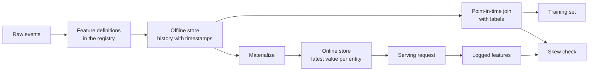

# Đặc điểm lưu trữ và đào tạo  dịch vụ khác biệt

> Một đặc điểm chỉ có một định nghĩa, nhưng có hai cách đọc. Trình luyện đọc giá trị lịch sử của từng thời điểm, dịch vụ trực tuyến đọc giá trị mới nhất.

**Type:** Build
**Languages:** Python
**Prerequisites:** Phase 2，第 08 课（特征工程）、第 13 课（机器学习流水线）、第 15 课（时间序列）和第 19 课（机器学习系统设计）
**Time:** ~100 分钟

## Học mục tiêu

- Giải thích ý nghĩa của lưu trữ không dây, lưu trữ trực tuyến, thời gian thực tế, sự kiện và TTL và các trách nhiệm của họ
- 实现时点正确的关联,并展示简单关联如何将未来值复制到训练数据中
- 列出训练服务偏差的四个原因: 两条代码路径、特征陈旧、默认值不同和时间穿越
-  xây dựng biểu tượng đăng ký, để xác định cùng một thời gian cho phương pháp đào tạo và phương pháp dịch vụ
- Trong ngày trước, bạn sẽ điền vào các tính năng mới, không đọc dữ liệu sau mỗi ngày
- Đối với cùng một thực thể và thời điểm, so sánh các đặc điểm trong lịch sử dịch vụ với các đặc điểm phát sinh từ các đường đào tạo, do đó kiểm tra sự phân biệt

## 问题

Một nhóm đã xây dựng mô hình người dùng bị mất đi. Mỗi nhãn cho biết người dùng đã mua không trong 30 ngày sau ngày đăng ký.`user_id`sẽ gắn kết với tính năng người dùng, dựa trên`days_since_last_purchase`训练一条规则──离线准确率 là 0.948──

Trong dòng chảy thực, mô hình này không giống như phiên bản cũ hơn, đơn giản hơn. Chữ tính năng lưu trữ giá trị mới nhất của mỗi người dùng, thời gian của nó chậm hơn ngày đăng ký vài tuần. Một người dùng mua hàng cuối cùng xảy ra vào ngày 115, đến ngày 175 trong ảnh chụp nhanh đã được đặt 60 ngày, vì vậy tính năng tự nó chứa các câu trả lời.

Hai lý do của hai lỗ hổng này là giống nhau: đào tạo và dịch vụ trực tuyến được tính toán theo hai cách khác nhau với cùng một tính năng. Bài học này sẽ được thực hiện từ các phần của kho lưu trữ tính năng xây dựng từ không. Bạn sẽ viết biểu đơn đăng ký, lấp đầy logic, thời điểm kết nối, lưu trữ trực tuyến của TTL, cũng như kiểm tra chênh lệch.

## 概念

### Hai cách đọc cùng một đặc điểm

 đào tạo và dịch vụ trực tuyến khác nhau về các yêu cầu về đặc điểm:

| 属性 | 训练（离线） | 服务（在线） |
|---|---|---|
| 问题 | “一千万个（实体，时间）组合各自对应的值是什么？” | “这个实体现在的值是什么？” |
| 时间 | 过去的多个时点 | 当前 |
| 数据量 | 每个任务数百万行 | 每次请求一行 |
| 延迟 | 可以接受数分钟 | 几毫秒 |
| 存储 | 离线存储：在列式文件或数据仓库中保存带时间戳的完整历史 | 在线存储：在键值数据库中保存每个实体的最新值 |

Đặc điểm lưu trữ theo cùng một nhóm đặc điểm được định nghĩa là lấp đầy hai loại lưu trữ.



### 实体、时间与 TTL

Mỗi dòng đặc điểm có thể được mô tả bằng bốn thuật ngữ:

- **实体（Entity）。**Đặc điểm mô tả các khóa đối tượng, ví dụ:`user_id`Hoặc`card_id`
- **事件时间戳（Event timestamp）。**Thời gian thành lập giá trị này.
- **创建时间戳（Created timestamp）。**系统写入该行时刻──今天执行的回填会写入事件时间早 hơn、创建时间为当前时间的行──
- **TTL（time to live，生存时间）。**Giá trị được phép đạt được độ tuổi tối đa.

具有相同实体、数据源和 TTL 的一组特征, thường được gọi là 特征视图(特征视图) 

### 时点正确的关联

Một dòng tập dữ liệu sẽ gắn kết các đặc điểm đã tồn tại trong mỗi nhãn với các đặc điểm đã tồn tại trong mỗi nhãn:

1. Tìm các đặc điểm của cùng một thực thể.
2. Chỉ giữ thời gian sự kiện không muộn hơn thời gian ghi dấu.
3. 取其中最新的一行.
4. Nếu thời gian ghi dấu giảm thời gian sự kiện vượt quá TTL, hãy bỏ qua.

Dưới đây là một biểu tượng của người dùng, cũng như các tính năng được tạo ra hàng tuần:

| 特征行日期 | `purchases_30d` | 时点关联 | 仅按 `user_id` 进行朴素关联 |
|---|---|---|---|
| 7 | 4 | | |
| 14 | 3 | 选中 | |
| 21 | 1 | 未来 | |
| 28 | 0 | 未来 | 选中 |

标签 để đánh giá người dùng đã mua bất kỳ hàng hóa nào trong ngày 17 đến ngày 46 ⋅ 28 ngày đã thống kê những ngày không mua sau ngày 标签 ⋅ Nó cho thấy số lần mua là 0, vì người dùng ngừng mua, và đó là sự kiện đo lường 标签 ⋅ đơn giản liên quan để sao chép câu trả lời vào nhập vào ⋅

时序列1课时分类数据, cũng vì cùng một lý do.

### 训练服务偏差的原因

Quy tắc học máy của Google sẽ định nghĩa sự khác biệt giữa dịch vụ đào tạo và dịch vụ trực tuyến như là sự khác biệt về hiệu suất trong thời gian đào tạo, và liệt kê ba lý do: hai cách xử lý dữ liệu dòng chảy khác nhau, sự thay đổi dữ liệu giữa đào tạo và dịch vụ, và ngược lại. Trong các tính năng dòng chảy dòng chảy, bốn lý do cụ thể sau đây xuất hiện lặp lại:

| 原因 | 发生的情况 | 演示中的例子 |
|---|---|---|
| 两条代码路径 | 训练与服务使用不同代码计算特征 | 服务窗口包含 `now - 30` 这一天，训练窗口却不包含 |
| 特征陈旧 | 服务读取的值与训练所用值的年龄不同 | 训练读取每周快照，而新服务计算实时的新值 |
| 默认值不同 | 两条路径对缺失值的填充方式不同 | 对“尚未购买”，训练使用 365，服务使用 -1 |
| 时间穿越 | 训练读取了标签时刻之后的值 | 朴素关联为每个标签读取最新快照 |

Quy tắc của Điều 32 của cùng một hướng dẫn yêu cầu càng nhiều có thể sử dụng mã số giữa đào tạo dòng nước và dòng nước dịch vụ.

### Đặc điểm đăng ký

Đăng ký là danh mục được định nghĩa bởi các tính năng. Mỗi mục chứa tên, thực thể, nguồn dữ liệu, thay đổi, cửa sổ, giá trị mặc định, TTL, người chịu trách nhiệm, phiên bản và mô tả.

两条规则 có thể đảm bảo an toàn của nó:

- 两条路径都从注册表读取定义――任何服务都不能自维护变换逻辑的副本――
- 修改定义时创建新版本──旧版本继续保留,让旧模型仍能使用训练时的特征──

### 回填

Đặc điểm mới không có lịch sử, nhưng tập luyện cần nó trong mỗi thời điểm của mỗi thời điểm lịch sử. Nó sẽ được thực hiện trong mỗi ngày trong quá khứ, được viết một dòng cho mỗi thực thể và ngày.

Chi phí tính toán được thực hiện theo số lượng thực thể và ngày càng tăng. Nó cũng có thể mang lại những lỗ hổng ẩn: ngày nay thực hiện được thực hiện trong thời gian xảy ra sự kiện, nhưng có thể đọc dữ liệu bị chậm hoặc dữ liệu được sửa đổi sau đó.

### 检测偏差

Theo quy định của Điều 29 của cùng một hướng dẫn, các đặc điểm được sử dụng trong việc ghi lại dịch vụ, và sẽ được sử dụng để đào tạo. Ngay cả khi ghi lại một số lượng nhỏ mẫu, cũng có thể kiểm tra sự phù hợp.

为了定位原因, so sánh:

1. Trong khi đó, các ứng dụng có thể được sử dụng để kiểm tra các kết quả của các bài học.
2. Kết quả tính toán lại thực tế có liên quan đến kết quả tập luyện.
3. Điều thứ hai là: Các đường bộ mã và kết quả tính toán lại thực tế.

```figure
mlprod-pit-join
```

## 动手构建

`code/main.py`Trong số đó chỉ sử dụng bộ nhớ tiêu chuẩn. Thời gian được biểu thị trong một vài ngày.

### 步骤 1: Chất tính được xác định và đăng ký

`FeatureDefinition`将变换表示为数据:聚合方式、窗口和默认值──其`compute`方法 sẽ không bao giờ đọc `as_of`后的事件──

```python
@dataclass(frozen=True)
class FeatureDefinition:
    name: str
    entity: str
    aggregate: str
    window_days: int | None
    default: float
    version: int = 1
    owner: str = "growth-team"
    description: str = ""

    def compute(self, events: list[Event], as_of: int) -> float:
        visible = [e for e in events if e.day <= as_of]
        if self.window_days is not None:
            visible = [e for e in visible if e.day > as_of - self.window_days]
        if self.aggregate == "count":
            return float(len(visible))
        if self.aggregate == "sum":
            return round(sum(e.amount for e in visible), 2)
        if self.aggregate == "days_since_last":
            return float(as_of - max(e.day for e in visible)) if visible else self.default
        raise ValueError(f"unknown aggregate {self.aggregate!r}")
```

`FeatureRegistry.register`允许重复注册相同定义, nhưng sẽ từ chối tên và phiên bản giống nhau, nội dung nhưng có một định nghĩa khác nhau.`fill_defaults`Vì sự thiếu giá trị của hai đường dẫn cung cấp cùng một giá trị mặc định.

模型通过 `spend_30d@1`Như vậy là một định nghĩa cố định.`compute`和 `fill_defaults`会解析引用,不含 `@`名称会读取最新版本──带有 `@`Nhưng không có phiên bản số của trích dẫn sẽ触发`ValueError`, vì vậy, chữ viết sai sẽ không đọc phiên bản mới nhất mà không có cảnh báo.

### 步骤 2: 填充离线存储

```python
def backfill(registry: FeatureRegistry, names: list[str], events: list[Event], days: list[int]) -> list[FeatureRow]:
    rows = []
    for entity, entity_events in sorted(group_events(events).items()):
        for day in days:
            rows.append(FeatureRow(entity, day, registry.compute(names, entity_events, day)))
    return rows
```

演示为 299 个用户在 25 个快照日回填三个特征,共生成 7475 行──

### 步骤 3:时点关联

Trước theo ngày, mỗi thực thể được xếp hạng một lần.`bisect_right`Tìm thấy thẻ ngày hôm đó hoặc trước đó cuối cùng của đường.

```python
def point_in_time_join(labels: list[LabelRow], rows: list[FeatureRow], ttl_days: int | None = None) -> list[JoinedRow]:
    by_entity: dict[str, list[FeatureRow]] = defaultdict(list)
    for row in rows:
        by_entity[row.entity].append(row)
    days_index = {}
    for entity, entity_rows in by_entity.items():
        entity_rows.sort(key=lambda r: r.day)
        days_index[entity] = [r.day for r in entity_rows]
    joined = []
    for label in labels:
        days = days_index.get(label.entity, [])
        pos = bisect.bisect_right(days, label.day) - 1
        match = by_entity[label.entity][pos] if pos >= 0 else None
        if match is not None and ttl_days is not None and label.day - match.day > ttl_days:
            match = None
        joined.append(JoinedRow(
            label.entity, label.day, label.label,
            match.day if match else None, match.values if match else None,
        ))
    return joined
```

### Bước 4: đo lường các lỗ hổng gây ra

`naive_latest_join`Chỉ theo vật thể liên kết, do đó, để mỗi nhãn trở lại các dòng mới nhất.

```console
  naive join used a snapshot from after the label day for 100% of rows
  offline accuracy, naive join: 0.948 (rule: idle > 53 days)
  offline accuracy, PIT join:   0.893 (rule: idle > 19 days)
  accuracy on day 145, trained with naive join: 0.763
  accuracy on day 145, trained with PIT join:   0.876
```

朴素关联的离线表现更好:0.948对0.893――但在新数据上更差:0.763对0.876――漏漏的特征将适应出置天数值从19天推至53天――

### Bước 5: lưu trữ trực tuyến và vật lý hóa

Trong kho lưu trữ trực tuyến, mỗi thực thể giữ một dòng, và từ chối vượt qua các dòng của TTL.`materialize`Chỉ viết vào ngày không muộn hơn nhiệm vụ.

```python
class OnlineStore:
    def __init__(self, ttl_days: int):
        self.ttl_days = ttl_days
        self._latest: dict[str, FeatureRow] = {}

    def write(self, row: FeatureRow) -> None:
        current = self._latest.get(row.entity)
        if current is None or row.day >= current.day:
            self._latest[row.entity] = row

    def read(self, entity: str, now: int) -> dict[str, float] | None:
        row = self._latest.get(entity)
        if row is None or row.day > now or now - row.day > self.ttl_days:
            return None
        return dict(row.values)
```

TTL là 10 天时, đọc của 145 天 sẽ quay lại với 140 天的行. Nếu không có vật lý hóa mới, đọc của 160 天 sẽ quay lại với giá trị mặc định, vì bài viết đã có 20 天的历史.

### Bước 6: Kiểm tra sự khác biệt

`detect_skew`So sánh hai`(entity, day)`Đối với các hình ảnh quan trọng, nó báo cáo tỷ lệ không phù hợp của mỗi đặc điểm và tỷ lệ trung bình tuyệt đối khác biệt, khi giá trị khác nhau trên 1% đánh dấu đặc điểm. Nếu hai hình ảnh quan trọng khác nhau hoặc không có bất kỳ khóa nào, nó sẽ kích hoạt.`ValueError` Việc yêu cầu thiếu sót có thể che giấu sự khác biệt, nhưng việc kiểm tra không yêu cầu không thể giải thích bất kỳ vấn đề nào.

```python
def detect_skew(
    training: dict[tuple[str, int], dict[str, float]],
    serving: dict[tuple[str, int], dict[str, float]],
    features: list[str],
    tolerance: float = 1e-6,
    max_mismatch_rate: float = 0.01,
) -> list[SkewReport]:
    if set(training) != set(serving):
        raise ValueError(f"{len(set(training) ^ set(serving))} keys are in only one view: log and compare the same requests")
    if not training:
        raise ValueError("no requests to compare")
    keys = sorted(training)
    reports = []
    for feature in features:
        diffs = [abs(training[k][feature] - serving[k][feature]) for k in keys]
        mismatches = sum(1 for d in diffs if d > tolerance)
        rate = mismatches / len(keys)
        mean_diff = sum(diffs) / len(keys)
        reports.append(SkewReport(feature, len(keys), rate, mean_diff, rate > max_mismatch_rate))
    return reports
```

演示记录第141到第150天的请求,并运行概念部分介绍的三组比较――请求池中包含了20 người dùng mới không có hồ sơ lịch sử──

```bash
python3 code/main.py
```

```console
=== Skew checks on 383 logged requests, days 141 to 150 ===
  online store read  vs  training join (one definition, same snapshots)
    ok   days_since_last_purchase   mismatch   0.0%  mean |diff|    0.00
    ok   purchases_30d              mismatch   0.0%  mean |diff|    0.00
    ok   spend_30d                  mismatch   0.0%  mean |diff|    0.00
  fresh compute      vs  training join (staleness only)
    SKEW days_since_last_purchase   mismatch  83.0%  mean |diff|    2.77
    SKEW purchases_30d              mismatch  30.5%  mean |diff|    0.38
    SKEW spend_30d                  mismatch  37.1%  mean |diff|   16.77
  second code path   vs  fresh compute (code differences only)
    SKEW days_since_last_purchase   mismatch   5.5%  mean |diff|   20.07
    SKEW purchases_30d              mismatch  12.5%  mean |diff|    0.13
    SKEW spend_30d                  mismatch  12.5%  mean |diff|    5.09
```

Lần sau đọc 3 khối xuất:

- **同一定义、相同快照。**Trong khi đó, các công nghệ lưu trữ và đào tạo trực tuyến có cùng một tính chất hóa học, do đó sự phân biệt là 0.
- **陈旧性。**Trong hầu hết các yêu cầu, giá trị tính toán thực thời gian khác với giá trị nhanh hàng tuần.
- **代码差异。**Các đường bộ mã hóa thứ hai khác nhau trên số lượng cửa sổ 12,5%, vì cửa sổ của nó chứa nhiều ngày.`days_since_last_purchase`Có sự khác biệt, nhưng sự khác biệt rất lớn: - 1 đối với 365 

## Sử dụng các công cụ hiện có

Lễ là nguồn mở của các đặc điểm lưu trữ. Từ phần nào trong việc thực hiện, tất cả đều có thể tìm thấy các đối tượng trong Lễ:

| 从零实现 | Feast |
|---|---|
| `FeatureDefinition`、`FeatureRegistry` | 特征仓库中的 `Entity`、`FeatureView` 和 `Field`，通过 `feast apply` 注册 |
| `FeatureRow` 历史记录 | 离线存储，例如基于 Parquet 文件的 `FileSource` 或数据仓库表 |
| 带 TTL 的 `point_in_time_join` | `store.get_historical_features(entity_df=..., features=[...])` |
| `materialize` | `feast materialize-incremental <end time>` |
| `OnlineStore.read` | `store.get_online_features(features=[...], entity_rows=[...])` |
| 创建时间戳检查 | 数据源上的 `created_timestamp_column` 和 `filter_by_created_timestamp=True` |

定义如下──这些代码遵循节日快速入门指南,运行本课不需要它们──

```python
from datetime import timedelta

from feast import Entity, FeatureView, Field, FileSource
from feast.types import Float32, Int64

user = Entity(name="user", join_keys=["user_id"])

user_activity_source = FileSource(
    name="user_activity_source",
    path="data/user_activity.parquet",
    timestamp_field="event_timestamp",
    created_timestamp_column="created",
)

user_activity = FeatureView(
    name="user_activity",
    entities=[user],
    ttl=timedelta(days=10),
    schema=[
        Field(name="purchases_30d", dtype=Int64),
        Field(name="spend_30d", dtype=Float32),
        Field(name="days_since_last_purchase", dtype=Int64),
    ],
    source=user_activity_source,
)
```

Sau đó, đào tạo với dịch vụ trực tuyến đọc cùng một đặc điểm:

```python
from feast import FeatureStore

store = FeatureStore(repo_path=".")

training_df = store.get_historical_features(
    entity_df=labels_df,
    features=["user_activity:purchases_30d", "user_activity:days_since_last_purchase"],
    filter_by_created_timestamp=True,
).to_df()

online = store.get_online_features(
    features=["user_activity:purchases_30d", "user_activity:days_since_last_purchase"],
    entity_rows=[{"user_id": 42}],
).to_dict()
```

`labels_df`Để mỗi nhãn lưu giữ một dòng, bao gồm `user_id``event_timestamp`Và các biểu tượng.  Feast 文档指出,TTL 相对实体数据框中的每时,而不是查询时.`point_in_time_join`Trung 检查一致──同一页还介绍了 `filter_by_created_timestamp=True`, nó có thể ngăn chặn sự rò rỉ giá trị vào dữ liệu đào tạo. Không phải tất cả các bộ nhớ không dây đều hỗ trợ tùy chọn này.

Tecton、Hopsworks 和 các nền tảng học máy đám mây lớn cũng sử dụng các tính năng lưu trữ, cũng như phân công phân công phân công trực tuyến và phân công trực tuyến.

## 交付成果

本课产 出 `outputs/skill-feature-skew-audit.md` Các kỹ năng kiểm toán đặc điểm trong dòng chảy nước trong thời gian qua và đào tạo  dịch vụ phân biệt, sau đó kiểm tra các logic liên quan  định nghĩa  giá trị mặc định  tính mới của dữ liệu của các tuyến đường, cũng như các nhật ký cần thiết để kiểm tra phân biệt.

## 练习

1. 将快照间隔从 7 天改为 1 天――重新运行陈旧性比较,并解释结果――
2. Để định nghĩa TTL là 3 ngày.
3. Vì vậy`FeatureRow`添加创建日期──让关联忽略标签日后写入的行──
4. sẽ`spend_7d`Đăng ký`spend_30d`                                                                                                                                                                                                                                                              
5. 修复 `legacy_serving_features`, cho đến khi nhóm thứ ba kiểm tra phân biệt qua.

## 关键术语

| 术语 | 常见说法 | 实际含义 |
|------|----------------|----------------------|
| 特征存储 | “存特征的数据库” | 根据同一组定义计算特征，并同时提供给训练与在线服务的系统 |
| 离线存储 | “训练数据” | 带事件时间戳的完整特征历史，由训练任务和回填任务读取 |
| 在线存储 | “特征缓存” | 每个实体的最新值，供服务路径以毫秒级延迟读取 |
| 实体 | “ID” | 特征所描述对象的键，例如用户或银行卡 |
| 事件时间戳 | “何时发生” | 特征值成立的时刻 |
| 时点关联 | “截至某时刻的关联” | 为每个标签匹配标签时刻当天或之前的最新特征行 |
| TTL | “有效期” | 特征值在被读取方视为缺失之前允许达到的最大年龄 |
| 物化 | “同步到线上” | 将最新特征值从离线存储复制到在线存储的任务 |
| 回填 | “计算历史” | 在过去的日期执行特征定义，以生成其历史记录 |
| 训练—服务偏差 | “离线时明明有效” | 训练与在线服务中的特征或行为差异 |

## 延伸阅读

- [Feast：时点关联](https://docs.feast.dev/getting-started/concepts/point-in-time-joins):TTL 语义与创建时间过
- [Feast 文档](https://docs.feast.dev/): Chất tính: hình ảnh, lưu trữ không dây, lưu trữ trực tuyến và vật lý hóa
- [Google：《机器学习规则》](https://developers.google.com/machine-learning/guides/rules-of-ml)Chương 29 đến Chương 37 Luật đào tạo  dịch vụ
- [Breck 等：《机器学习的数据验证》（SysML 2019）](https://research.google/pubs/data-validation-for-machine-learning/)Google's Data Verification, bao gồm đào tạo dịch vụ
- [TensorFlow Data Validation 指南](https://www.tensorflow.org/tfx/guide/tfdv): mô hình kiểm tra, phân biệt kiểm tra và di chuyển kiểm tra
- [Sculley 等：《机器学习系统中隐藏的技术债》（NeurIPS 2015）](https://papers.nips.cc/paper/2015/hash/86df7dcfd896fcaf2674f757a2463eba-Abstract.html)Mô hình: Dữ liệu xung quanh phụ thuộc vào dòng chảy
