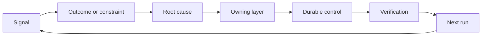

#  xây dựng vòng quay chống tròn của cơ chế nhập cư và退役

> Việc phát hành mã hóa kết thúc vòng xây dựng của thời gian hiện tại, đồng thời mở ra vòng học tập lâu dài.

**Type:** Learn + Build
**Languages:** Python (stdlib)
**Prerequisites:** Phase 14 lessons 46 and 53
**Time:** ~75 minutes

## Học mục tiêu

- Việc chuyển đổi sự cố, đánh giá dữ liệu, hành vi người dùng và điều chỉnh ngược lại thành hành động thuộc về trách nhiệm.
- Để xác định các tín hiệu khác nhau từ đường đến các bài viết dưới đây, các tập hợp đánh giá, các chiến lược an toàn, thời gian vận hành hoặc nhu cầu chờ đợi.
-  Định vị ưu tiên đối với rủi ro tái phát dựa trên mức độ nghiêm trọng và thường xuyên tái phát.
- Đối với mỗi cơ chế kiểm soát hệ thống thiết lập xác định các điều kiện退役 (Retirement Condition)
- 沟通交付决策, cung cấp bằng chứng, cân nhắc, kiểm soát và xác định những người quyết định có trách nhiệm.

## 反本身也是基础设施

Một nhóm có thể thu thập rất nhiều hệ thống liên kết theo dõi (trước) 评测记录, hỗ trợ đơn và nhật ký cố tình, nhưng hoàn toàn không lấy bất kỳ bài học nhận thức nào từ đó.**晋级通道（Promotion）**Từ quan sát thực tế, hướng đến có trách nhiệm rõ ràng, chứng minh hệ thống duy trì của chứng minh thay đổi đường cố định.

Chuyện kết thúc của phản ứng Ratchet là:

1. 观测到具体实测信号;
2. Kết nối với kết quả sản xuất dự kiến, điều kiện buộc hoặc giả định đặt trước;
3. 识别 đối với các yếu tố chịu trách nhiệm thuộc về cấp hệ thống cấp dưới nhất;
4. 实施受控的持久化改进;
5. 验证 tỷ lệ mắc bệnh này đã được giảm xuống;
6. 定期复审该控制机制是否应继续保留──

## 精准路由至应对责任层级

| 信号类型 | 归属目的地 |
|---|---|
| 误报、功能倒退、错误输出结果 | 评测集（Evaluation）或自动化测试 |
| 上下文缺失、重复劳动、过时事实 | 上下文数据源或检索路由策略 |
| 不安全操作或越权漏洞 | 安全策略（Policy）或权限硬边界 |
| 超时、重试风暴、依赖服务不可用 | 运行时控制（Runtime Control） |
| 新的产品需求或尚未决断的权衡取舍 | 经过规范成型（Shaped）的待办项 |

Khi các quyền tự động hóa kiểm tra hoặc cứng đủ để làm cho lỗi hoàn toàn không thể xảy ra, đừng bao giờ thêm một đoạn gợi ý trong Prompt.



## 责任归属本身就是控制机制的一部分

Mỗi chương trình hoạt động cần phải có rõ ràng:

- 唯一的人类责任人 (tổ chức)
- Ưu tiên dựa trên đánh giá tổng thể về hậu quả thiệt hại và tần suất tái phát;
- 拟修改的目标系统组件(Điều vật);
-  chứng minh chương trình chứng minh thực tế của sửa đổi;
- 复审或自动失效窗口;
- 明确的退役条件(Cả kiện nghỉ hưu)

Một chương trình cải tiến vô người được nhận thức, đầy đủ chỉ là một đoạn bài viết về những quan điểm nhỏ bé.

## 果断退役过时的控制机制

Trong những trường hợp sau đây, nên có cơ chế kiểm soát và kiểm soát chủ động và hoàn thành:

- Hệ thống cấu trúc hoặc dòng công việc kinh doanh đã có những thay đổi cơ bản;
- Cơ chế không thay đổi của tầng dưới đã hoàn toàn thay thế các lệnh văn bản của tầng trên;
- Trong cửa sổ thời gian dự kiến, bị cố tình không bao giờ xuất hiện trở lại;
- Các quy tắc kiểm soát cản trở tần suất tiến hành kinh doanh bình thường, đã vượt quá lợi ích của nó trong phòng ngừa nguy hiểm.

退役控制项 cũng cần thực chứng支,绝不能 chỉ vì 看起来年头太久就随手删除

## 打通 sản phẩm xây dựng và mã hóa đại lý của phản  kết thúc

Một cơ chế bánh răng rắn có thể phục vụ cùng lúc trong kinh doanh sản phẩm và phát triển trí tuệ hai tuyến:

- 产品业务实证驱动预期产出框架"",假设图谱"",mặt nhất cắt hoặc kế hoạch đo lường tiến bộ;
- Việc điều chỉnh hoạt động của Cử nhân mã hóa hoặc điều khiển kiểm tra tự động hóa                                                                                                                                                                                                                                                      
- 线上真故障既能促成产品功能边界调整,也能促成代理工作台的加固──

Đó là lý do tại sao khung nhiệm vụ không phải là giai đoạn kết thúc trước khi lập trình được công bố, nó trải qua mỗi lần được hệ thống chấp nhận trong sự thay đổi.

## 动手实现

Trong thí nghiệm này, các tín hiệu thực nghiệm được phân loại, tạo ra các chương trình hành động liên quan đến trách nhiệm, theo thứ tự ưu tiên, và xuất`outputs/feedback-backlog.json`

```bash
python3 code/main.py
python3 -m unittest discover code/tests -v
```

尝试添加一个运行时超时信号,验证它 sẽ được chính xác chuyển từ tầng kiểm soát thời gian vận hành, chứ không phải là tổng hợp vào danh sách chờ đợi nhu cầu chung.

## Thực hành thực hành: chịu trách nhiệm quyết định sau khi thất bại

Từ các dự án tập hợp các tác phẩm của bạn, chọn một dòng công việc.[职业交付模板](https://github.com/rohitg00/ai-engineering-from-scratch/blob/main/phases/14-agent-engineering/54-build-the-feedback-ratchet/outputs/career-delivery-evidence.md)Ở giữa.

Python 实验 sẽ tạo ra các ví dụ chờ hành động. Nó sẽ không quan sát người dùng, đo lường hiệu quả dự phòng, cũng không chứng minh bạn đã có khả năng chiến thắng trong nghề.

### 1. Đúng là đã xảy ra gì.

记录用户,任务, hiện tại dòng chảy làm việc, cũng như kết quả bạn muốn cải thiện. 链接 đến ghi chép quan sát thông qua sự đồng ý, ghi chép hỗ trợ đã bị mất nhạy cảm, hoặc đường ray nhiệm vụ có thể thực hiện.

Tìm ra một thất bại: giả thuyết thất bại, kết quả không thể sử dụng, chi phí bất ngờ, hoặc sự chậm trễ của giao tiếp.

Nếu không thể tiếp cận người dùng, hãy cùng với đồng nghiệp thực hiện mô phỏng của các dấu hiệu rõ ràng, hoặc dựa trên mô phỏng của các tình huống rõ ràng.

### 2. Trong phạm vi quyền hạn tiến hành

列出未知项目, chọn成本最低,可逆,且有望解决影响最重大未知项目行动――说明 những gì bạn có thể quyết định, những lựa chọn nào bị ràng buộc, những hoạt động nào cần được cấp phép trước để thực hiện――

Ví dụ, trong khi chờ đợi sự cho phép sử dụng dữ liệu khách hàng, bạn có thể chuẩn bị trước cho việc phát hành trực tuyến đã bị mất cấp. Tiến hành chủ động có nghĩa là hoàn thành công việc được ủy quyền, và sẽ bị cản trở quyết định nói rõ; nó sẽ không mở rộng quyền truy cập hoặc quyền phê duyệt của bạn.

### 3. So sánh các quy trình và hướng tới trách nhiệm quyết định

Vì không cần biết chi tiết thực hiện, người viết một bản báo ngắn về quyết định bao gồm:

- Các vấn đề của người dùng, cũng như bằng chứng về kế hoạch thay đổi;
- Ít nhất hai loại chương trình; khi có khả năng hợp lý, đưa vào chương trình nhân công chi phí thấp hơn hoặc chương trình không cần phát triển;
- - chất lượng, giao dịch thiết kế, lượng công việc, chi phí vận hành và cân bằng rủi ro;
- Những lời khuyên của bạn, những bất ổn còn sót lại, cũng như những quyết định cần đưa ra;
-  người chịu trách nhiệm quyết định, các bên liên quan bị ảnh hưởng, và ngày cần đưa ra quyết định.

Xin đồng hành đại diện cho một người liên quan quan bị ảnh hưởng,质疑其中之一权衡――记录异议,并说明 nó thay đổi như thế nào, hoặc tại sao không thay đổi đề xuất của bạn―― sẽ đóng vai trò chống đánh dấu như giả; nó không thể thay thế sự đồng ý của người liên quan thực sự――

### 4.  tiến hành các thí nghiệm rõ ràng về biên giới

根据需要答题,选择原型、试点或生产阶段工作──在收集结果之前,明确受众、数据、授权、持续时间、回滚方案,以及继续、调整或停止的条件──

Từ khi người dùng bắt đầu đến khi hoàn thành nhiệm vụ, đi qua toàn bộ quá trình giao tiếp.

Việc kiểm tra và sửa chữa nhân tạo sẽ được tính vào toàn bộ quy trình công việc.

### 5. So sánh kết quả với kinh tế

Sử dụng các chỉ số xác định, tổng thể nhiệm vụ, phương pháp thu thập và cửa sổ quan sát có thể so sánh, ghi lại các kết quả tiếp theo và kết quả tiếp theo.

 Đưa vào một kết quả người dùng  một chỉ số chất lượng hoặc an toàn, cũng như tổng số lượng kiểm tra nhân tạo.

Ước tính chi phí hoàn thành thành công mỗi nhiệm vụ, tính vào mô hình điều chỉnh, thử nghiệm lại, dịch vụ phụ trợ và kiểm toán nhân tạo.

 Thông qua đã có [LLM FinOps 课程](https://aiengineeringfromscratch.com/lesson?path=phases/17-infrastructure-and-production/27-finops-llms), học thêm chi phí thuộc về tính kinh tế đơn vị. Thay đổi mô hình chỉ là một trong những cách ứng phó có thể; thu hẹp phạm vi lưu lượng công việc hoặc giữ lại các bước nhân tạo, có thể là quyết định sản phẩm tốt hơn.

### 6. 完成闭环

Theo tiêu chuẩn của tuyên bố trước đó, khuyến nghị tiếp tục, điều chỉnh hoặc dừng lại. Nếu bằng chứng vẫn chưa xác định, chỉ ra sự thiếu hụt quan sát, cũng như các xét nghiệm rõ ràng bên dưới. ghi lại phản ứng của người quyết định chịu trách nhiệm; nếu chưa đưa ra quyết định, hãy giữ lại cho trạng thái chờ đợi.

 chọn một cải tiến cho quá trình giao hàng: khung nhiệm vụ rõ ràng hơn, người dùng tìm kiếm sớm hơn, kiểm tra tốt hơn, đơn vị giao dịch nhỏ hơn, hoặc các trường hợp đánh giá nhắm mục tiêu hơn, chỉ định người chịu trách nhiệm và thời gian kiểm tra lại.

Khi kiểm tra lại, quyết định giữ lại, sửa đổi hay loại bỏ sự cải tiến này.

## 交付物

sẽ[career-delivery-evidence.md](https://github.com/rohitg00/ai-engineering-from-scratch/blob/main/phases/14-agent-engineering/54-build-the-feedback-ratchet/outputs/career-delivery-evidence.md)复制 vào dự án của riêng bạn, và sử dụng chứng cứ liên kết để lấp đầy. 让仓库中的模板保持可复制. 将决策简报,交互走查,量度比较,以及有明确责任归属后续行动,并纳入你的职业作品集交付物品.

## 验证

Với đồng nghiệp sử dụng các tiêu chuẩn nhận nhân tạo sau đây.**met**(đã được thỏa mãn)**needs work**(đáng cải tiến) hoặc **not observed**( chưa xem xét),并提供证据链接或具体缺失的观测──填好了字段,并不能证明判断合理──

| 检查项 | 满足标准的证据 |
|---|---|
| 工作流有事实依据 | 可追溯的观测支持问题定义；他人报告、推断和模拟均有标记。 |
| 遵守授权边界 | 下一项可逆工作明确，任何受限操作都等待真正的决策责任人授权。 |
| 权衡沟通清晰 | 记录可信的替代方案、利益相关方的异议、建议，以及明确的决策请求。 |
| 交互经过测试 | 走查覆盖成功、失败、恢复，以及人工审核工作量。 |
| 结果经过比较 | 基线与后续度量的定义一致；样本、护栏指标、成本和比较局限清晰可见。 |
| 对挫折承担责任 | 证据改变了继续、调整或停止的决策，并导向一项有明确责任人的后续行动。 |
| 流程得到改进 | 一项工作流改进具备责任人、复审日期，以及基于证据的保留、修改或退役决定。 |

Ngay cả khi mỗi bước mô phỏng đều được thông qua, hành vi người dùng thực sự chưa được quan sát vẫn là một sự thiếu hụt bằng chứng. Trong kết luận tập hợp các tác phẩm, vẫn giữ được biên giới này, và rõ ràng cần có những gì quan sát để lấp đầy sự thiếu hụt.

## 课后练习

1. Một số vụ vi phạm trong thời gian gần đây và một vụ phàn nàn thực sự của người dùng, được chuyển thành các hoạt động cụ thể.
2. Chỉ định có thể ngăn chặn sự tái phát của nó từ cơ bản ở cấp độ hệ thống cơ bản nhất.
3. Để thực hiện các lệnh kiểm tra tự động hoặc chỉ số quan sát thực hiện thực tế.
4. Để một quy tắc chiến lược an ninh hiện có thiết lập các điều kiện hoàn toàn rõ ràng.
5. Để đưa một bài học được hệ thống chấp nhận, ngược theo dõi và hòa nhập vào khung nhiệm vụ tiếp theo.

## 延伸阅读

- [Basili, Caldiera, and Rombach, The Goal Question Metric Approach](https://www.cs.toronto.edu/~sme/CSC444F/handouts/GQM-paper.pdf), tìm hiểu cách thực hiện các cơ chế đo lường hướng tới mục tiêu để đạt được nhận thức liên tục ở cấp độ tổ chức.
- [Fagerholm et al., Building Blocks for Continuous Experimentation](https://doi.org/10.1145/2601248.2601276), phân tích sẽ chứng minh thực tế bằng chứng liên kết với các sản phẩm liên tục nghiên cứu và phát triển của các công nghệ và tổ chức kết thúc.
- [Nuseibeh and Easterbrook, Requirements Engineering: A Roadmap](https://www.cs.toronto.edu/~sme/papers/2000/ICSE2000.pdf), giải thích nhu cầu được xem như trong suốt toàn bộ hệ thống chu kỳ sinh hoạt động tiến triển từ góc độ kỹ thuật.

## 交付物沉

Bảo trì`outputs/feedback-backlog.json`作为路由示例,并保留你完成的职业交付证据,记录自己的决策──两者共同为产品判断力与交付──产品判断和交付) 学习路径结尾,并为下一个预期产出框架提供依据──
