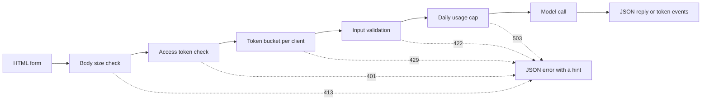

# 模型演示界面: từ hàm đến ứng dụng chia sẻ

> 模型演示 có một quy định:输入、模型调用和输出── 在分享链接之前,先为每部分设定限制──

**Type:** Build
**Languages:** Python
**Prerequisites:** Phase 11 · 13（构建生产级 LLM 应用）、Phase 17 · 08（推理指标）、Phase 17 · 19（AI 网关）
**Time:** ~90 分钟

## Học mục tiêu

- 写出演示的输入、模型调用和输出约定,并设定限制为每部分.
- Sử dụng thư viện tiêu chuẩn xây dựng một ứng dụng HTTP, chứa một trang HTML, một điểm kết nối JSON và một điểm kết nối chuyển dữ liệu của máy chủ.
- 按成本从低到高验证输入,并返回能够告诉用户下一步操作的 JSON 错误――
- Sử dụng mỗi buồng lệnh khách hàng, giới hạn hàng ngày và các lệnh truy cập có thể chọn, bảo vệ biểu diễn công cộng.
- 编写不保留输入文本和客户端地址的请求日志──
- So sánh trình bày của bộ tiêu chuẩn với hai phiên bản khung, và chỉ ra trình bày phải được nâng cấp thành tín hiệu của sản phẩm.

## 问题

Mô hình của bạn đã được chạy trong sổ ghi chép. Bây giờ, một nhà đánh giá muốn thử 10 loại nhập, một khách hàng muốn xem kết quả trên điện thoại.

notebook 单元格 không giới hạn nhập, cũng không có tiến bộ hiển thị. Nó báo cáo lỗi thời đã đưa ra một loạt các bài phát hành, chỉ có bạn có thể đọc được. Nó cũng sử dụng chứng chỉ và ngân sách của bạn. Nếu không sửa đổi, bạn có thể đặt đơn vị này vào phía sau URL công khai, bạn có thể dự đoán các lỗi sau:

- Người dùng dán một tài liệu 40.000 chữ cái.
- Một kịch bản trong một phút gửi 500 yêu cầu. Mỗi yêu cầu đều kích hoạt một lần trả phí mô hình điều chỉnh.
- 页面八秒没有显示任何内容,于是用户再次点击四次按──
- 服务器日志 giữ lại mỗi lần nhập, bao gồm cả số nhập có tài khoản khách hàng.

演示界面使用少量代码就能防止这些故障. 本课先使用Python 标准库构建一个演示,让你看清每个部分;再使用两个流行框架构建相同演示,比较各自默认行为.

## 概念

### 演示就是一份约定

Mỗi biểu diễn có ba phần. Nhập là nội dung mà người dùng có thể gửi; mô hình调用 sẽ chuyển đổi vào thành đầu ra; đầu ra là nội dung người dùng thấy, cũng bao gồm lỗi.

Trước khi viết trang, hãy viết bản thỏa thuận này:

| 部分 | 需要回答的问题 | 本课的答案 |
|------|--------------------|-----------------------|
| 输入 | 什么类型、多大、允许哪些字符？ | 长度为 1 到 500 个字符的字符串，不含控制字符 |
| 模型调用 | 一次调用需要多久、成本多少？ | 一个不到一毫秒即可运行完毕、没有调用费用的玩具关键词模型 |
| 输出 | 成功和失败时，用户分别看到什么？ | 标签、分数和回复，或带有操作提示的 JSON 错误 |

notebook không đặt bất kỳ giới hạn nào cho ba phần này.



检查按照成本从低到高的顺序执行――无效请求将在第一次未经过检查处停止,因此几乎不消耗服务器资源――模型调用放在最后,因为它是唯一需要付费的步骤――

### Trong mô hình vận hành trước khi kiểm tra

浏览器 có thể kiểm tra nhập vào trước khi gửi bất kỳ nội dung nào trên 文本区域`maxlength`和 `required`属性, không cần thiết mạng调用就能向用户提供反──这些检查只能帮助遵守规则的用户──任何客户端都可以绕过页面发送请求,因此服务器必须重复每次检查──

Để kiểm tra máy chủ theo chi phí từ thấp đến cao排列:

1. 读取 `Content-Length`Trong khi đọc yêu cầu, từ chối vượt quá giới hạn yêu cầu.
2. 解析 JSON 请求体──拒绝不是 JSON对象的请求体──
3. 检查字段──拒绝空文本、超长文本和控制字符──
4. Chỉ cần thông qua tất cả các yêu cầu kiểm tra, để tiêu thụ một mô hình调用.

| 未通过的检查 | HTTP 状态 | 错误代码 |
|--------------|-------------|------------|
| 请求体超过 4,096 字节 | 413 Content Too Large（内容过大） | `body_too_large` |
| 尚未收到 `Content-Length` 指定的字节数，请求体就停止传输 | 408 Request Timeout（请求超时） | `request_timeout` |
| 内容类型不是 JSON | 415 Unsupported Media Type（不支持的媒体类型） | `unsupported_media_type` |
| 请求体不是 JSON 对象 | 400 Bad Request（错误请求） | `bad_json` |
| 文本缺失、为空、过长或含有控制字符 | 422 Unprocessable Content（无法处理的内容） | `missing_text`、`empty_text`、`text_too_long`、`control_characters` |

RFC 9110 đã định nghĩa các mã trạng thái và tên gọi.

Ví dụ cũng là một phần trong thiết kế đầu vào. Ví dụ cho người dùng hiển thị đầu vào phù hợp là gì, cũng để các nhà đánh giá chỉ cần nhấp vào một lần để có thể tiến hành thử nghiệm.

### 让用户知道模型正在工作

模型调用可能需要几秒钟. Nếu không có phản ứng, người dùng không thể phân biệt giữa mô hình chậm và page bị hỏng.

Trang của bài học cung cấp bốn loại phản:

- Ứng dụng: Ứng dụng: Ứng dụng: Ứng dụng: Ứng dụng: Ứng dụng: Ứng dụng: Ứng dụng: Ứng dụng: Ứng dụng: Ứng dụng: Ứng dụng: Ứng dụng: Ứng dụng: Ứng dụng: Ứng dụng: Ứng dụng: Ứng dụng: Ứng dụng: Ứng dụng: Ứng dụng: Ứng dụng: Ứng dụng: Ứng dụng: Ứng dụng: Ứng dụng: Ứng dụng: Ứng dụng: Ứng dụng: Ứng dụng: Ứng dụng: Ứng dụng: Ứng dụng: Ứng dụng: Ứng dụng: Ứng dụng: Ứng dụng: Ứng dụng: Ứng dụng: Ứng dụng: Ứng dụng: Ứng dụng: Ứng dụng: Ứng dụng: Ứng dụng: Ứng dụng: Ứng dụng: Ứng dụng: Ứng dụng: Ứng dụng: Ứng dụng: Ứng dụng: Ứng dụng: Ứng dụng: Ứng dụng: Ứng dụng: Ứng dụng: Ứng dụng: Ứng dụng: Ứng dụng: Ứng dụng:
- 显示 đã dùng thời gian, mỗi 100 毫秒 được cập nhật một lần.
- Điểm đầu tiên đến, hiển thị Điểm đầu tiên thời gian.
- Xin kết thúc, cho thấy tổng tiêu tốn thời gian.

Trong học tập[推理指标](../../08-inference-metrics-goodput/)时,首代币 时间(TTFT) là chỉ số máy chủ.

### Trong hình thức chuyển tiếp xuất khẩu

语言模型 từng token 生成回复. Nếu máy chủ chờ đến token cuối cùng để gửi, người dùng phải chờ suốt quá trình tạo. Nếu máy chủ gửi ngay mỗi token, người dùng nhận token đầu tiên để bắt đầu đọc.

服务器发送事件(Server-Send Events,SSE) là một kiểu tiêu chuẩn của hành vi này.`text/event-stream` Mỗi sự kiện được tạo ra bởi một nhóm`event:`和 `data:`行组成,并以一个空行结束──WHATWG HTML 标准定义了这个格式──

```text
event: token
data: {"index":0,"text":"Label:"}

event: token
data: {"index":1,"text":" positive."}

event: done
data: {"label":"positive","score":1.0,"tokens":11}
```

浏览器提供用于 SSE 的 `EventSource`接口, nhưng nó chỉ gửi GET yêu cầu. GET yêu cầu sẽ được nhập vào URL, còn Web  máy chủ và đại diện sẽ viết URL vào truy cập日志.`fetch()`和 `response.body.getReader()`读取响应,并自行解析事件格式──

流式响应存在单次 JSON 回复没有问题: máy chủ đã gửi mã trạng thái 200 trước khi token đầu tiên  Nếu mô hình sau đó thất bại, máy chủ không thể thay đổi mã trạng thái lại.`error`事件,由页面将该事件显示为错误――

Trong xây dựng[生产级 LLM 应用](../../../11-llm-engineering/13-production-app/)Trong khi đó, framework thay vì bạn thông qua SSE  gửi token.

###  biên tập thông tin sai lầm của người dùng có thể theo hành động này

误信息 có hai nhiệm vụ: nói cho người dùng biết chuyện gì đã xảy ra, và nói cho người dùng tiếp theo biết phải làm gì. Đối với những người không quen thuộc với hệ thống, việc theo dõi không thể hoàn thành bất kỳ một trong số đó.

Trong bài trình bày này, mỗi lỗi đều sử dụng cấu trúc JSON giống nhau:

```json
{
  "error": {
    "code": "text_too_long",
    "message": "The text has 812 characters. The limit is 500.",
    "hint": "Shorten the text to 500 characters or fewer.",
    "request_id": "a8f3c2b435e3"
  }
}
```

- `code`là tên, mã khách hàng và thử sử dụng nó để so sánh.
- `message`陈述事实,并附上用户需求的数值──
- `hint` Đưa ra một người dùng có thể thực hiện các hoạt động.
- `request_id`将用户报告关联到一日志记录.

RFC 9457 đã định nghĩa các định dạng sai lầm tiêu chuẩn của API HTTP, được gọi là vấn đề chi tiết vấn đề.

### An toàn chia sẻ biểu diễn công khai

Công cộng sẽ thay đổi nhóm người có thể gửi yêu cầu.

| 风险 | 本演示中的控制措施 | 面向更多受众的控制措施 |
|------|----------------------|-------------------------------|
| 单个客户端发送过多请求 | 每客户端一个令牌桶，配合 429 和 `Retry-After` | 登录后按用户限流 |
| 陌生人发现链接 | `Authorization` 请求头中的可选访问令牌 | 通过身份提供方实现单点登录 |
| 总成本无限增长 | 每日用量上限，配合 503 和 `Retry-After` | 模型提供方的支出限制和告警 |
| 输入非常大或异常 | 请求体大小限制、文本长度限制、控制字符检查 | 输入与输出的内容审核 |
| 日志保留私人输入 | 只记录输入长度和客户端的带密钥哈希 | 日志保留期限与访问控制 |

Làm cho các đơn hàng sử dụng hai giá trị số. Khả năng quyết định một khách hàng có thể gửi nhiều hơn; tốc độ bổ sung quyết định tốc độ yêu cầu dài hạn.

```text
tokens = min(capacity, tokens + refill_rate * seconds_since_last_request)
accept the request if tokens >= 1, then subtract 1
```

桶为空时, máy chủ quay lại `429 Too Many Requests`RFC 6585 đã định nghĩa mã trạng thái 429,并允许服务器附带`Retry-After`响应头──本演示始终添加该响应头,给出距离下一个令牌可用还需要等待的数秒──页面读取响应头,并此期间禁用按──

演示 sử dụng địa chỉ IP của khách hàng như một chìa khóa. Ở phía sau bên ngược, mỗi yêu cầu đều đến từ địa chỉ đại lý, vì vậy tất cả người dùng sẽ chia sẻ một cái桶.

Trong học tập[AI 网关](../../19-ai-gateways/)Trong khi đó, các mạng lưới cũng cần kiểm soát tương tự, chỉ cần quy mô nhỏ hơn. Các mạng lưới chỉ cần kiểm soát từng khách hàng, nhưng không kiểm soát tổng số. Một trăm khách hàng thậm chí không vượt quá giới hạn của họ, vẫn có thể tiêu tốn hết ngân sách.

Giới thiệu và nhập cũng cần phải cẩn thận xử lý.`http.server`处理器 sẽ ghi vào địa chỉ IP của khách hàng và yêu cầu là một sai lầm tiêu chuẩn. Nếu nhập nằm trong URL, nhập cũng sẽ vào日志.

告诉用户您保留哪些信息──演示页面说明, máy chủ giữ dài văn bản, nhưng không bao giờ giữ bản văn bản bản bản thân──

### 演示何时成为产品

演示由一个进程提供服务,面向已知的人群和短时会话.

- Những người bên ngoài đội sẽ sử dụng nó mỗi tuần.
- Người ta đề xuất mục tiêu có thể đạt được, hoặc báo cáo dịch vụ bị gián đoạn.
- Người dùng yêu cầu đăng nhập, lưu lại kết quả hoặc xem lịch sử.
- Chi phí mô hình hàng tuần trở thành một dự án trong ngân sách.
- 输入包含受合约或法律约束的数据──

| 属性 | 演示 | 产品 |
|----------|------|---------|
| 用户 | 已知人群，短时会话 | 未知人群，每日使用 |
| 状态 | 无 | 账户、历史、已保存的结果 |
| 可用性 | 尽力而为，单进程 | 书面目标、副本、值班责任人 |
| 成本控制 | 一个每日用量上限 | 每用户配额和计费 |
| 可观测性 | 每请求一条日志 | 链路跟踪、指标和告警 |

Khi thấy những tín hiệu này, nên chuyển trình sang sản xuất cấp LLM  ứng dụng trong các khóa học sản xuất ∙∙ ∙ ∙ ∙ ∙ ∙ ∙ ∙ ∙ ∙ ∙ ∙ ∙ ∙ ∙ ∙ ∙ ∙ ∙ ∙ ∙ ∙ ∙ ∙ ∙ ∙ ∙ ∙ ∙ ∙ ∙ ∙ ∙ ∙ ∙ ∙ ∙ ∙ ∙ ∙ ∙ ∙ ∙ ∙ ∙ ∙ ∙ ∙ ∙ ∙ ∙ ∙ ∙ ∙ ∙ ∙ ∙ ∙ ∙ ∙ ∙ ∙ ∙ ∙ ∙ ∙ ∙ ∙ ∙ ∙ ∙ ∙ ∙ ∙ ∙ ∙ ∙ ∙ ∙ ∙ ∙ ∙ ∙ ∙ ∙ ∙ ∙ ∙ ∙ ∙ ∙ ∙ ∙ ∙ ∙ ∙ ∙ ∙ ∙ ∙ ∙ ∙ ∙ ∙ ∙ ∙ ∙ ∙ ∙ ∙ ∙ ∙ ∙ ∙ ∙ ∙ ∙ ∙ ∙ ∙ ∙ ∙ ∙ ∙ ∙ ∙ ∙ ∙ ∙       ∙ ∙       ∙     ∙ ∙            ∙                                                                                                                                                                                           

```figure
demo-token-bucket
```

## 动手构建

Chỉ có một tài liệu thôi.`code/main.py`, ngoài tiêu chuẩn không cần bất kỳ phụ thuộc nào.

```bash
python3 code/main.py
```

Bản kiểm tra kiểm tra chứng minh, lệnh, dòng hình, cũng như một lần thực tế HTTP 往返通信. Nó khởi động máy chủ trên cổng trống, gửi ba yêu cầu, dừng máy chủ, sau đó rời khỏi. Chỉ cần truy cập trình duyệt để khởi động máy chủ:

```bash
python3 code/main.py --serve
```

Trong trình duyệt mở `http://127.0.0.1:8000`❖ Ctrl + C 停止服务器。

### 第 1 步:模型调用

Mô hình là một máy tính tính keyword, sẽ đánh dấu văn bản là chữ chính, tiêu cực hoặc trung tính. Nó cũng sẽ tạo ra một đoạn ngắn gọn, mỗi lần xuất ra một token.

```python
def classify(text):
    words = WORD_RE.findall(text.lower())
    positive = sum(1 for word in words if word in POSITIVE)
    negative = sum(1 for word in words if word in NEGATIVE)
    score = (positive - negative) / max(1, positive + negative)
    if score > 0:
        label = "positive"
    elif score < 0:
        label = "negative"
    else:
        label = "neutral"
    return {"label": label, "score": round(score, 3), "positive_cues": positive,
            "negative_cues": negative, "words": len(words)}


def generate(text):
    result = classify(text)
    reply = (
        f"Label: {result['label']}. Positive cues: {result['positive_cues']}. "
        f"Negative cues: {result['negative_cues']}. Words read: {result['words']}."
    )
    parts = reply.split(" ")
    yield parts[0]
    for part in parts[1:]:
        yield " " + part
```

换成真实模型时, chỉ cần thay thế `generate` trong đó đặt vào API 调用或本地模型──保持函数签名不变:输入字符串,输出代币──验证器、限制和页面都保持不变──

### Bước 2: chứng minh và phản ứng sai

Một loại bất thường chứa tất cả các lỗi. Nó chứa HTTP  trạng thái mã, ổn định lỗi mã, tin nhắn, các gợi ý hoạt động và các câu trả lời có thể chọn.

```python
class DemoError(Exception):
    def __init__(self, status, code, message, hint, headers=None):
        super().__init__(message)
        self.status = status
        self.code = code
        self.message = message
        self.hint = hint
        self.headers = dict(headers or {})


def validate_text(payload, max_chars=MAX_CHARS):
    if "text" not in payload:
        raise DemoError(422, "missing_text", 'The field "text" is missing.', 'Add a "text" field with your input.')
    text = payload["text"]
    if not isinstance(text, str):
        raise DemoError(422, "text_not_string", 'The field "text" is not a string.', "Send the input as a string.")
    text = text.strip()
    if not text:
        raise DemoError(422, "empty_text", "The text is empty.", "Type a sentence or pick an example.")
    if len(text) > max_chars:
        raise DemoError(422, "text_too_long", f"The text has {len(text)} characters. The limit is {max_chars}.",
                        f"Shorten the text to {max_chars} characters or fewer.")
    if CONTROL_RE.search(text):
        raise DemoError(422, "control_characters", "The text contains control characters.",
                        "Remove the hidden characters, then send the text again.")
    return text
```

验证器 đầu tiên bỏ đầu尾空白── chỉ chứa các văn bản空白 được đánh giá là không, gợi ý thông tin sẽ cho người dùng biết nên nhập gì──`check_body_size`和 `parse_json_body`Đối với 411、413、415 và 400 形 sử dụng cùng một mô hình.`error_body`会将 bất cứ điều gì `DemoError`转换为概念部分展示的 JSON 结构──

### 第 3 步:令牌桶

```python
class TokenBucket:
    def __init__(self, capacity, refill_per_second, now):
        if capacity < 1:
            raise ValueError("capacity must be at least 1")
        if refill_per_second <= 0:
            raise ValueError("refill_per_second must be positive")
        self.capacity = float(capacity)
        self.refill_per_second = float(refill_per_second)
        self.tokens = float(capacity)
        self.updated = now

    def take(self, now, cost=1.0):
        elapsed = max(0.0, now - self.updated)
        self.tokens = min(self.capacity, self.tokens + elapsed * self.refill_per_second)
        self.updated = now
        if self.tokens >= cost:
            self.tokens -= cost
            return 0.0
        return (cost - self.tokens) / self.refill_per_second
```

`take`接受请求时返回0.0; nếu không, quay lại khoảng cách từ桶内令牌足够还需要等待的秒数.`Retry-After`

`RateLimiter`Trong `OrderedDict`Trung vì mỗi khách hàng lưu trữ một thùng.`ThreadingHTTPServer`Trong một cách độc lập, xử lý mỗi yêu cầu, do đó sử dụng khóa bảo vệ văn bản này.`max_clients`Khi, giới hạn sẽ di chuyển khách hàng không được gửi yêu cầu lâu nhất. Khi khách hàng được di chuyển lần tiếp theo yêu cầu, sẽ nhận được một cái đầy.`max_clients`设置 cao hơn số lượng khách hàng hoạt động bạn mong đợi.

限流器 chấp nhận một `clock`参数──测试传入 `FakeClock`Vì vậy, không cần phải chờ đợi thực sự, chúng ta có thể tiến lên thời gian 10 giây.`UsageCap`Sử dụng cùng một mô hình đồng hồ xử lý tổng số lượng hàng ngày: với 86,400 giây điều tra cửa sổ cố định, số lần quay lại khoảng cách từ cửa sổ tiếp theo cũng cần phải chờ đợi số giây khi sử dụng hết.

### 第4 步: sự kiện

```python
def sse_event(event, data):
    payload = json.dumps(data, separators=(",", ":"), ensure_ascii=False)
    return f"event: {event}\ndata: {payload}\n\n".encode("utf-8")


def stream_events(text, generate_fn=generate, delay=0.0, sleep=time.sleep):
    count = 0
    try:
        for token in generate_fn(text):
            yield sse_event("token", {"index": count, "text": token})
            count += 1
            if delay:
                sleep(delay)
    except Exception:
        yield sse_event("error", MODEL_ERROR)
        return
    result = classify(text)
    yield sse_event("done", {"label": result["label"], "score": result["score"], "tokens": count})
```

`json.dumps`会把字符串中的换行写成`\n`Vì vậy, mỗi sự kiện chỉ có một dòng dữ liệu, trong đó không có các biến động gốc trong dữ liệu.

生成器捕获模型故障,并发送 `error`Sự kiện, vì máy chủ đã gửi trạng thái.`delay`和 `sleep`Các tham số có thể làm chậm dòng chảy trong trình duyệt, đồng thời để kiểm tra giữ tốc độ nhanh.

### 第5 步: yêu cầu xử lý

`DemoHandler`继承自`BaseHTTPRequestHandler` POST  xử lý theo khái niệm phần được mô tả:

```python
def do_POST(self):
    app = self.server.app
    request_id = uuid.uuid4().hex[:12]
    client_id = self.client_address[0]
    started = time.perf_counter()
    route = self.path if self.path in self.routes else "other"
    status, code, chars = 200, None, 0
    try:
        declared = self.headers.get("Content-Length")
        try:
            if route == "other":
                raise DemoError(404, "not_found", "This endpoint does not exist.",
                                "Send requests to /api/predict or /api/stream.")
            size = check_body_size(declared, app.config.max_body_bytes)
        except DemoError:
            self.drain(int(declared) if declared and declared.isdigit() else 0)
            raise
        try:
            body = self.rfile.read(size)
        except TimeoutError:
            self.close_connection = True
            raise DemoError(408, "request_timeout", "The request body did not arrive in time.",
                            "Send the request again with the full body.") from None
        app.admit(client_id, self.headers.get("Authorization"))
        text = app.read_text(self.headers.get("Content-Type"), body)
        chars = len(text)
        app.charge()
        if route == "/api/predict":
            self.send_json(200, predict(text), request_id)
        else:
            code = self.send_stream(text, request_id)
    except DemoError as err:
        status, code = err.status, err.code
        self.send_error_json(err, request_id)
    except TimeoutError:
        status, code = 408, "request_timeout"
        self.close_connection = True
    except Exception:
        status, code = 500, "internal_error"
        self.send_error_json(DemoError(500, "internal_error", "The server failed on this request.",
                                       "Try again. Quote the request id if you report the problem."), request_id)
    finally:
        latency_ms = (time.perf_counter() - started) * 1000
        app.log.record(request_id, route, client_id, status, chars, latency_ms, code)
```

`admit`检查访问令牌和令牌桶。`charge`kiểm tra hàng ngày giới hạn, và thực hiện cuối cùng, do đó chỉ có yêu cầu hiệu quả là tính toán vào giới hạn.`finally`块中写入一条日志, bao gồm cả yêu cầu bị từ chối.`route`, không phải là đường dẫn nguyên thủy, vì đường dẫn có thể có chứa các chuỗi truy vấn của văn bản người dùng.

Bốn chi tiết có thể ngăn ngừa dễ bị bỏ qua lỗi:

-  xử lý 类上`timeout = 10`Sẽ dừng gửi trên máy chủ, rồi sẽ đóng kết nối. Nếu không có nó, tuyên bố gửi 100 字节 nhưng chỉ gửi 10 字节, sẽ chiếm hữu vĩnh viễn một tuyến máy chủ.
- `log_message`直接返回,不输出内容──This will remove containing client-end address and requested default日志──
- `drain`RFC 1122 chỉ ra, khi kết nối của cơ quan chủ vẫn còn chưa được đọc dữ liệu, TCP sẽ gửi lại; khách hàng có thể nhận được đến 413 回复.
- `send_stream` bắt giữ `BrokenPipeError`Không đóng máy tạo. Người dùng đóng thẻ khi, mô hình dừng lại, yêu cầu này cũng không còn tăng chi phí.

`BaseHTTPRequestHandler`默认使用 HTTP/1.0── do đó, máy chủ đóng kết nối vào thời điểm đó đã biểu hiện kết thúc của dòng phản ứng.

### 第6 步: trang

`render_page`返回一个HTML文档, trong đó内嵌样式和脚本──页面不载任何外部脚本、字体或图片──脚本按以下方式读取流:

```javascript
const reader = response.body.getReader();
const decoder = new TextDecoder();
let buffer = "";
while (true) {
  const chunk = await reader.read();
  if (chunk.done) { break; }
  buffer += decoder.decode(chunk.value, { stream: true });
  let cut = buffer.indexOf("\n\n");
  while (cut >= 0) {
    const frame = parseFrame(buffer.slice(0, cut));
    buffer = buffer.slice(cut + 2);
    cut = buffer.indexOf("\n\n");
    if (frame.event === "token") { output.textContent += frame.data.text; }
  }
}
```

网络数据块可能在事件中结束.`buffer`Trong khi đó, cho đến khi nhận được空行.

页面使用 `textContent`写入模型输出,绝不使用 `innerHTML` mô hình xuất phát là không thể tin được văn bản.`onerror`属性元素, 属性就可能在用户浏览器中执行代码──

服务器 cũng sẽ gửi đi `default-src 'none'`của `Content-Security-Policy`响应头―― Chiến lược này chỉ cho phép một bản ghi chép nhúng và một kiểu ghi chép nhúng, và thông qua các bản ghi chép nhúng của riêng mình SHA-256 哈希识别它们── trình duyệt sẽ từ chối tất cả các bản ghi chép khác, bao gồm cả bản ghi chép của kẻ tấn công vào trang──

```python
def csp_hash(source):
    digest = hashlib.sha256(source.encode("utf-8")).digest()
    return "'sha256-" + base64.b64encode(digest).decode("ascii") + "'"
```

### Bước 7: Làm nó, cố gắng làm nó sai

 khởi động máy chủ, sau đó sử dụng từ cuối thứ hai `curl`❖ Các máy chủ khởi động liên tục gửi bảy yêu cầu. ❖ Tùng chứa 5令牌, mỗi 2 giây bổ sung một令牌:

```bash
for i in 1 2 3 4 5 6 7; do
  curl -s -o /dev/null -w '%{http_code} ' -X POST http://127.0.0.1:8000/api/predict \
    -H 'Content-Type: application/json' -d '{"text": "ok"}'
done
```

```text
200 200 200 200 200 429 429
```

Wait10 seconds, rồi gửi thư không:

```bash
curl -s -X POST http://127.0.0.1:8000/api/predict \
  -H 'Content-Type: application/json' -d '{"text": ""}'
```

```json
{"error": {"code": "empty_text", "message": "The text is empty.", "hint": "Type a sentence or pick an example.", "request_id": "e3e3599feaea"}}
```

Sử dụng关闭输出缓冲的 `curl -N`观察事件流:

```bash
curl -N -X POST http://127.0.0.1:8000/api/stream \
  -H 'Content-Type: application/json' -d '{"text": "The screen is bright."}'
```

Nếu bạn muốn yêu cầu truy cập lệnh, đặt trước khi khởi động máy chủ `DEMO_ACCESS_TOKEN`△ trang sau đó sẽ hiển thị một令牌输入框。

```bash
export DEMO_ACCESS_TOKEN="$(python3 -c 'import secrets; print(secrets.token_urlsafe(24))')"
echo "$DEMO_ACCESS_TOKEN"
python3 code/main.py --serve
```

运行测试:

```bash
python3 -m unittest discover -s code/tests -v
```

HTTP 测试在端口 0 上启动服务器, bởi hệ điều hành chọn空端口。`tearDown`停止服务器,并 kiểm tra xem kết nối của nó đã kết thúc không.

## 使用框架

Gradio và Streamlit hai Python framework có thể sử dụng ít code hơn để xây dựng cùng loại mô tả.`main.py`导入约定, do đó các chứng thực và mô hình vẫn không thay đổi.`main.py`Hoặc thử, không cần phải cài đặt bất kỳ khung nào trong đó.

###  xung quanh một cấu trúc chức năng

Gradio 为一个Python 函数包装 Web界面──输入和输出组件描述约定,生成器函数发送部分输出──

```python
import os

import gradio as gr

from main import EXAMPLES, MAX_CHARS, DemoError, classify, generate, validate_text


def label_text(text):
    try:
        clean = validate_text({"text": text})
    except DemoError as err:
        raise gr.Error(f"{err.message} {err.hint}")
    label = classify(clean)["label"]
    reply = ""
    for token in generate(clean):
        reply += token
        yield reply, label


demo = gr.Interface(
    fn=label_text,
    inputs=gr.Textbox(label="Text to label", lines=5, max_length=MAX_CHARS),
    outputs=[gr.Textbox(label="Reply"), gr.Textbox(label="Label")],
    examples=list(EXAMPLES),
    flagging_mode="never",
)

if __name__ == "__main__":
    demo.queue(max_size=20).launch(auth=("demo", os.environ["DEMO_PASSWORD"]))
```

Mỗi lần`yield`Thành phố sẽ thay thế toàn bộ giá trị đầu ra. Do đó, hàm này mỗi bước đều xuất hiện cho đến hiện tại.

Trong chia sẻ liên kết trước,明确设置 `flagging_mode` Mô hình默认 sẽ hiển thị dấu ấn按── người dùng按──Gradio sẽ nhập và xuất văn bản CSV 文件 trên máy chủ  giá trị`"never"`会移除这个按──

`queue(max_size=20)`限制等待中的请求数量──默认并发限制是每个事件只运行一个调用──在你提高限制之前,慢模型一次只服务一个用户──Gradio vẫn sẽ trong khi ứng dụng khởi động tạo API 端点,让脚本无需通过页面就能调用演示──你的限流也必须覆盖这些端点──

### Mỗi lần nhập đều sẽ được tái chạy

Người dùng mỗi lần thay đổi kiểm soát, Streamlit sẽ chạy lại toàn bộ kịch bản từ đầu đến cuối.

```python
import streamlit as st

from main import EXAMPLES, MAX_CHARS, DemoError, classify, generate, validate_text

st.title("Toy sentiment demo")
st.caption("Do not paste private data.")

example = st.selectbox("Start from an example", ["", *EXAMPLES])
with st.form("demo"):
    text = st.text_area("Text to label", value=example, max_chars=MAX_CHARS)
    submitted = st.form_submit_button("Run model")

if submitted:
    try:
        clean = validate_text({"text": text})
    except DemoError as err:
        st.error(f"{err.message} {err.hint}")
    else:
        st.write_stream(generate(clean))
        st.write(f"Label: {classify(clean)['label']}")
```

`st.write_stream`直接接受生成器, viết ra nó trong mỗi khối dữ liệu đến khi đến.`@st.cache_resource`Lên mô hình thực tế, vì mỗi lần gửi đều sẽ tái chạy bản văn.

### Hành vi cố định của các chương trình

| 需求 | 标准库（本课） | Gradio | Streamlit |
|------|--------------------------------|--------|-----------|
| 表单、示例、结果区域 | 自己编写 HTML | `Interface` 根据组件和 `examples` 构建 | 使用 `st.text_area`、`st.selectbox` 等控件 |
| 输入长度限制 | 页面上的 `maxlength` 加服务器检查 | `Textbox` 上的 `max_length` | `st.text_area` 上的 `max_chars` |
| 部分输出 | 自己编写 SSE 和流读取器 | 使用生成器函数，每次 `yield` 替换输出 | `st.write_stream` 配合数据块生成器 |
| 进度显示 | 自己编写计时器 | 输出区域的进度显示，由 `show_progress` 设置 | `st.write_stream` 在每个数据块到达时显示它 |
| 面向用户的错误 | 带有 `code`、`message`、`hint`、`request_id` 的 JSON | `raise gr.Error(...)` 显示消息 | `st.error(...)` 显示消息 |
| 并发 | 每请求一个线程，无上限 | 队列，默认每个事件只运行一个调用 | 每次交互都会为该会话重新运行脚本 |
| 公开链接 | 自己运行服务器和管理域名 | `launch(share=True)` 提供一周后过期的链接 | 自己将应用部署到服务器 |
| 登录 | Bearer 令牌检查 | `launch(auth=...)` 使用用户名和密码 | `st.login()` 配合 OpenID Connect 提供方 |
| 限流与成本上限 | 令牌桶和每日上限 | 自己编写代码，通过请求获取客户端地址 | 自己编写代码 |
| 工具写入磁盘的输入信息 | 日志中只有输入长度 | 被标记的样本写入 CSV 文件，除非设置 `flagging_mode="never"` | 由自己的代码决定 |

框架在页面方面省省的工作最多:表单,示例,进度显示和部分输出. 它们在公开链接风险方面省省工作较少. Trong ba phiên bản, hạn流,成本上限和日志隐私 đều thuộc về bạn. 标准库版本展示这些部分,让你知道在使用框架时应检查什么.

## 交付 nó

本课产 出 `outputs/skill-demo-interface-checklist.md` cung cấp cho nó các mô hình mô hình trình bày hoặc mã, nó sẽ đánh giá các quy định, phản, sai lầm và các biện pháp kiểm soát của các liên kết công khai, và đưa ra kết luận thông qua hoặc không thông qua.

## 练习

1. sẽ`BUCKET_CAPACITY`设置为 2,将 `REFILL_PER_SECOND`设置为1──预测七请求循环的输出,再实际运行并比较──
2. Trong yêu cầu trong yêu cầu`language`字段, chỉ chấp nhận `"en"`◊ 422  lỗi đối với bất kỳ giá trị nào khác trở lại với các gợi ý hoạt động,并添加两个测试――
3. Tìm ra một câu trong một bài viết, ví dụ như "The screen is not good".
4. Trên máy của bạn, sẽ được hiển thị để ngược lại phía sau đại diện.`trust_proxy`选项, chỉ đọc được từ địa chỉ đại lý `X-Forwarded-For`❖ ❖ ❖ ❖ ❖ ❖ ❖ ❖ ❖ ❖ ❖ ❖ ❖ ❖ ❖ ❖ ❖ ❖ ❖ ❖ ❖ ❖ ❖ ❖ ❖ ❖ ❖ ❖ ❖ ❖ ❖ ❖ ❖ ❖ ❖ ❖ ❖ ❖ ❖ ❖ ❖ ❖ ❖ ❖ ❖ ❖ ❖ ❖ ❖ ❖ ❖ ❖ ❖ ❖ ❖ ❖ ❖ ❖ ❖ ❖ ❖ ❖ ❖ ❖ ❖ ❖ ❖ ❖ ❖ ❖ ❖ ❖ ❖ ❖ ❖ ❖ ❖ ❖ ❖ ❖ ❖ ❖ ❖ ❖ ❖ ❖ ❖ ❖ ❖ ❖ ❖ ❖ ❖ ❖ ❖ ❖ ❖ ❖ ❖ ❖ ❖ ❖ ❖ ❖ ❖ ❖ ❖ ❖ ❖ ❖ ❖ ❖ ❖ ❖ ❖ ❖ ❖ ❖ ❖ ❖ ❖ ❖ ❖ ❖ ❖ ❖ ❖ ❖ ❖ ❖ ❖ ❖ ❖ ❖ ❖ ❖ ❖ ❖ ❖ ❖ ❖ ❖ ❖ ❖ ❖ ❖ ❖ ❖ ❖ ❖ ❖ ❖ ❖ ❖ ❖ ❖ ❖ ❖ ❖ ❖ ❖ ❖ ❖ ❖ ❖ ❖ ❖ ❖ ❖ ❖ ❖ ❖ ❖ ❖ ❖ ❖ ❖ ❖ ❖ ❖ ❖ ❖ ❖ ❖    ❖ ❖                                                                                                                                       
5. sẽ`generate`替换为对流式返回代币的模型 API调用──保持验证器、限制和事件形式不变── 较量页面上的首代币 时间与服务器日志中的延迟──

## 关键术语

| 术语 | 人们常说 | 实际含义 |
|------|-----------------|------------------------|
| 演示约定 | “UI” | 输入限制、模型调用，以及包含错误在内的输出结构 |
| 令牌桶 | “限流器” | 每客户端一个计数器，按固定速率补充，最多达到容量上限；每个请求消耗一个令牌 |
| Retry-After | “稍后再试” | 响应头，指定客户端多久之后，或在哪个日期之后，可以再次尝试 |
| 服务器发送事件 | “流式传输” | 由 `event:` 和 `data:` 行组成的 `text/event-stream` 响应，每个事件后有一个空行 |
| 首 token 时间 | “延迟” | 从发出请求到第一个 token 显示在用户屏幕上的时间 |
| 用量上限 | “预算” | 一个时间窗口内所有客户端合计的模型调用次数上限 |
| 带密钥哈希 | “匿名 ID” | 使用秘密盐值对客户端地址计算 HMAC（基于哈希的消息认证码）；它只是化名，任何持有盐值的人都能检验某个已知地址 |
| 内容安全策略 | “CSP” | 响应头，告诉浏览器页面允许使用哪些脚本、样式和连接 |

## 延伸阅读

- [Python `http.server` 文档](https://docs.python.org/3/library/http.server.html): server class 默认 HTTP/1.0 默认日志, cũng như mô-đun này không phù hợp với cảnh báo môi trường sản xuất
- [WHATWG HTML 标准：服务器发送事件](https://html.spec.whatwg.org/multipage/server-sent-events.html): sự kiện`EventSource`接口.
- [MDN：使用服务器发送事件](https://developer.mozilla.org/en-US/docs/Web/API/Server-sent_events/Using_server-sent_events)Ví dụ về các event format và trình duyệt API:
- [MDN：使用可读流](https://developer.mozilla.org/en-US/docs/Web/API/Streams_API/Using_readable_streams): làm thế nào để từng phần đọc `fetch()`响应体.
- [MDN：使用 Fetch API](https://developer.mozilla.org/en-US/docs/Web/API/Fetch_API/Using_Fetch):带 JSON 请求体的请求及响应处理──
- [MDN：429 Too Many Requests](https://developer.mozilla.org/en-US/docs/Web/HTTP/Reference/Status/429)和 [MDN：Retry-After](https://developer.mozilla.org/en-US/docs/Web/HTTP/Reference/Headers/Retry-After): giới hạn trạng thái và phản ứng
- [MDN：内容安全策略](https://developer.mozilla.org/en-US/docs/Web/HTTP/Guides/CSP):内嵌脚本的哈希和 `default-src`Chỉ thị.
- [RFC 6585](https://www.rfc-editor.org/rfc/rfc6585.html): 新增 HTTP 状态码, bao gồm 429 ⋅
- [RFC 9110](https://www.rfc-editor.org/rfc/rfc9110.html):HTTP 语义, bao gồm 413、415 和 422。
- [RFC 9457](https://www.rfc-editor.org/rfc/rfc9457.html): vấn đề详情,即 HTTP API's standard JSON 错误格式──
- [RFC 1122](https://www.rfc-editor.org/rfc/rfc1122.html)Các yêu cầu chủ yếu, bao gồm việc đóng lại các kết nối có dữ liệu chưa được đọc xảy ra khi TCP tái đặt (§ 4.2.2.13 节)
- [Gradio：分享应用](https://gradio.app/guides/sharing-your-app): chia sẻ liên kết, chứng nhận, API trang và giới hạn dòng.
- [Gradio：流式输出](https://gradio.app/guides/streaming-outputs): thông qua các hàm tạo cung cấp phần输出。
- [Gradio：Interface](https://gradio.app/docs/gradio/interface)- Có thể là:`examples``flagging_mode`和 `concurrency_limit`
- [Gradio：使用标记功能](https://gradio.app/guides/using-flagging): được đánh dấu mẫu trong vị trí lưu trữ trên đĩa.
- [Streamlit：基本概念](https://docs.streamlit.io/get-started/fundamentals/main-concepts): tái运行的数据流――
- [Streamlit：st.write_stream](https://docs.streamlit.io/develop/api-reference/write-magic/st.write_stream)和 [Streamlit：缓存](https://docs.streamlit.io/develop/concepts/architecture/caching): phần xuất, cũng như chỉ tải một lần mô hình.
- [Streamlit：st.login](https://docs.streamlit.io/develop/api-reference/user/st.login): Thông qua OpenID Connect  cung cấp đăng nhập.
