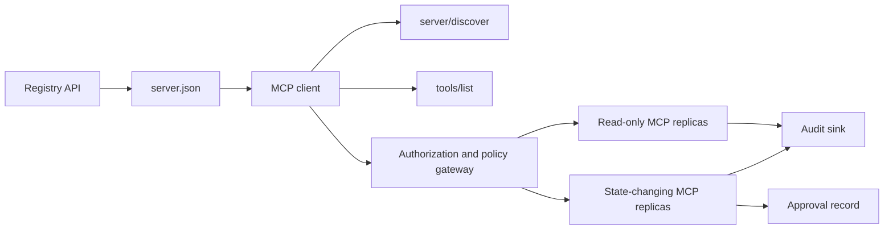

# 综合实战项目 13:带 Registry và quản lý không trạng thái MCP Server

> MCP cấp sản xuất không phải là một quá trình máy chủ đơn giản đơn giản. Nó là một bộ hợp đồng chuỗi: có thể phát hành dữ liệu sẵn, phát hiện dịch vụ thực tế, không có yêu cầu trạng thái.

**Type:** Capstone
**Languages:** Python 与 TypeScript 参考模型；支持任何生产级编程语言
**Prerequisites:** Phase 11, Phase 13, Phase 14, Phase 17 与 Phase 18
**必修 MCP 进阶课：** [Lesson 28: Tool Contracts](../../../13-tools-and-protocols/28-mcp-tool-contracts-and-content/docs/en.md)- [Lesson 29: 可靠性与流控](../../../13-tools-and-protocols/29-mcp-reliability-cancellation-and-flow-control/docs/en.md)- [Lesson 30: Registry 供应链](../../../13-tools-and-protocols/30-mcp-registry-supply-chain-and-drift/docs/en.md), 及 [Lesson 31: 一致性工程](../../../13-tools-and-protocols/31-mcp-conformance-versioning-and-operations/docs/en.md)
**目标协议规范：**MCP `2026-07-28`
**Time:** ~25 小时

## Học mục tiêu

- 实现合规的无状态 MCP 请求与结果 封面
- Để tìm thấy sự phân biệt nghiêm ngặt giữa Registry 静态元数据 và thực tế giao ước trong thời gian vận hành.
- 构建具备确定性排序与缓存感知工具发现体系──
- Đối với mỗi công cụ 调用强制执行签发者 (Mối quan trọng) 收藏人 (những người được xem) 作用域 (kháp diện) 及审批策略 (kháp diện) 及审批策略)
- 部署无 Session 亲和性绑定的流动 HTTP 集群──
- Trong các mạng lưới, cấp phép, chiến lược, đăng ký và kiểm toán biên giới cung cấp bằng chứng kỹ thuật đầy đủ.

## 必須修 MCP 前置路径

Trong khi dự án này được xem như đã sẵn sàng sản xuất, phải theo sau hoàn thành các chương trình bốn giai đoạn của giai đoạn 13 liên quan:

1. [Lesson 28](../../../13-tools-and-protocols/28-mcp-tool-contracts-and-content/docs/en.md): định nghĩa này Server  phải được lộ ra Công cụ Ưu điểm  cấu trúc nội dung  phân trang  tự động hoàn toàn  đường dẫn  lỗi phân loại 契约。
2. [Lesson 29](../../../13-tools-and-protocols/29-mcp-reliability-cancellation-and-flow-control/docs/en.md): định nghĩa取消竞态、截止期限、等性、背压、重试与断线重连行为──
3. [Lesson 30](../../../13-tools-and-protocols/30-mcp-registry-supply-chain-and-drift/docs/en.md): definição nomeacion espacial归属、来源追踪、准入锁定、Registry 状态、漂移检测、账本记录与回滚凭证──
4. [Lesson 31](../../../13-tools-and-protocols/31-mcp-conformance-versioning-and-operations/docs/en.md)Định nghĩa: định nghĩa tiêu chuẩn vàng và ngược chiều chuyển tiếp trường hợp sử dụng, phiên bản nghiêm ngặt thời đại, SDK  hành vi khác biệt, kiểm tra, chứng chỉ mạng đại diện, dữ liệu nhạy cảm, kiểm soát sức khỏe và ngăn chặn phát hành.

Dự án này chịu trách nhiệm tập hợp chặt chẽ các yếu tố cấp sản xuất này, không thể được xây dựng bằng một thử nghiệm SDK đơn giản.

## 问题背景

企业内部平台需要一套只读数据工具和少量具有状态变更能力的写操作工具――开发人员必须能够发现该服务器,了解如何连接,检查其实时运行能力,并且只能调用其被明确授权访问的操作――

Trọng tâm thực sự không phải là đăng ký một hàm, mà là làm thế nào để giữ được độ phù hợp của 6 bộ thực tế sau đây:

1. `server.json`声明 Server ở đâu cài đặt hoặc qua bất kỳ kết nối mạng nào truy cập;
2. `server/discover`声明 khả năng hỗ trợ thực tế cho các quá trình thực hiện đang hoạt động;
3. Mỗi yêu cầu xác định rõ ràng phiên bản giao dịch được sử dụng và tuyên bố khả năng của khách hàng;
4. 授权系统将调用方与合法的签发者、资源指示器(Resource Indicator) và phạm vi 绑定;
5. 策略引擎 độc lập quyết định liệu hoạt động cụ thể có sẵn sàng được thực hiện hay không;
6. 审计日志 trung thành ghi lại mọi giao tiếp vượt biên giới, và không bao giờ tiết lộ các nhánh hoặc mật khẩu chứng minh.

Bất kỳ một phần nào xảy ra di chuyển, nền tảng có thể thể hiển thị không thể kết nối Server孤儿, lỗi đường không phù hợp của Khách hàng, sai sử dụng các token được phát hành cho các nguồn khác, hoặc tiết lộ các hoạt động phá hoại trong trường hợp đánh giá không dự kiến.

## 两层发现机制 (Two Discovery Layer)

Registry 静态索引与实时的 MCP Server  trả lời là một câu hỏi hoàn toàn khác biệt:

| 发现层次 | 交互契约 | 回答的核心问题 |
|---|---|---|
| 发布层 (Publication) | `server.json` 与 Registry API | 该 Server 是什么？其代码包或远程网络端点在哪里？如何进行配置？ |
| 运行时 (Runtime) | `server/discover` | 该运行进程当前实际支持哪些协议版本、能力特性、扩展及 Server 身份？ |

官方 Registry 采用带版本控制的 `server.json`Chế hoạch. Một mục từ xa có thể tuyên bố Streamable HTTP địa chỉ:

```json
{
  "$schema": "https://static.modelcontextprotocol.io/schemas/2025-12-11/server.schema.json",
  "name": "com.example/internal-readonly",
  "title": "Internal Read-Only Tools",
  "description": "Read-only incident and data lookup tools.",
  "version": "1.0.0",
  "remotes": [
    {
      "type": "streamable-http",
      "url": "https://mcp.internal.example.com/readonly"
    }
  ]
}
```

Registry Schema 版本与 MCP 协议版本完全独立, đừng để làm cho hai người đồng nhất mà thay đổi một ngày trong số đó.

具備合规 Schema 不代表拥有命名空间所有权──对 `example.com`完成验证的发布者使用反向 DNS 命名空间 `com.example/*`或其子命名空间──Registry 的认证流程负责证明这一所有权──若按普通顺序书写域名标签,则指向的是另一个不同的命名空间──

标准库模型中的 `validate_registry_document`函数刻意只是一个部分的远程配置校验器──它检查官方必填的 函数刻意只是一个部分的远程配置校验器──它检查官方必填的 函数刻意只是一个部分的远程配置校验器.`name``description`Với`version`字段,可选的 `title`, tên và độ dài đã được phát hành, hình thức của phiên bản cụ thể, cũng như mỗi `streamable-http`Hoặc`sse`远端点的 HTTP(S) URL 格式──由于本综合项目总会对远端点做实时探测,它还额外要求`remotes`列表非空──`validate_publisher_namespace`单独对照已验证的发行者域名检查名称, và `validate_runtime_alignment`则将发布名称与版本同实时的 则将发布名称与版本同实时的`serverInfo`进行比较──官方方案还支持仅含代码包的记录以及更多远程字段──发布前,请使用锁定版本的官方 JSON方案或 `mcp-publisher`校验整个文档; đừng coi tập hợp phụ thuộc này như là một chương trình hoàn chỉnh 校验.

Server phải được thực hiện`server/discover`Khách hàng có thể phát triển nó trước khi sử dụng nó chủ động.

```json
{
  "resultType": "complete",
  "supportedVersions": ["2026-07-28"],
  "capabilities": {
    "tools": {
      "listChanged": false
    }
  },
  "_meta": {
    "io.modelcontextprotocol/serverInfo": {
      "name": "com.example/internal-readonly",
      "version": "1.0.0"
    }
  },
  "ttlMs": 3600000,
  "cacheScope": "public"
}
```

Các danh mục riêng có thể chỉ số quyền sở hữu, đánh giá hoặc dữ liệu chu kỳ đời, nhưng không thể giả định dữ liệu này là MCP 线路字段 hoặc`server.json`根字段──组织策略应与已发布记录并列存──当确实需要公开自定义元数据时,使用登记的 `_meta.io.modelcontextprotocol.registry/publisher-provided`扩展,并保持在其 4 KB 上限之内──

## 无状态 MCP 核心(Stateless MCP Core)

MCP `2026-07-28`Hoàn toàn di chuyển thỏa thuận`initialize`- `notifications/initialized`握手,同时移除 `Mcp-Session-Id`

Mỗi yêu cầu đều trong `params._meta`Trung携带协议上下文:

```json
{
  "io.modelcontextprotocol/protocolVersion": "2026-07-28",
  "io.modelcontextprotocol/clientCapabilities": {},
  "io.modelcontextprotocol/clientInfo": {
    "name": "internal-platform-client",
    "version": "1.0.0"
  }
}
```

版本与能力 là thực tế ở cấp độ yêu cầu, chứ không phải là thực tế ở cấp độ kết nối.  tải cân bằng có thể không lo lắng sẽ tiếp tục yêu cầu phân phát cho các bản sao khác nhau, bởi vì bất kỳ bản sao nào đều có thể hoàn toàn tự xác minh và xử lý yêu cầu từ bản báo cáo.

常规成功结果返回 `resultType: "complete"`, và Server 应在每个结果的`_meta.io.modelcontextprotocol/serverInfo`中标明身份──协议版本缺失或不是字符串时返回 Không hợp lệ Params 错误码 `-32602`-`-32022`Chỉ dùng để cung cấp các phiên bản không được hỗ trợ, dữ liệu của nó phải đúng`{"supported": ["2026-07-28"], "requested": "..."}`

### 可缓存的服务发现

Đối với cùng một tập hợp công cụ hiệu quả,`tools/list`必须是确定性的──其结果包含:

- `ttlMs`: Façãu hướng khách hàng của sự mới mẻ缓存提示;
- `cacheScope`- Có thể là:`public`( công cộng cộng) hoặc `private`(上下文私有);
-  nghiêm ngặt ổn định tool-sequencing, để các danh sách tương tự có thể sử dụng lại mô hình kết thúc của Quick Cache;
- `resultType: "complete"`Với Server Identity:

 Kiểm soát quyền hạn đối với người dùng cụ thể, thường nên xuất `cacheScope: "private"`, không thể thực hiện các công cụ của người dùng có thể được nhìn thấy trong kho lưu trữ chung của công chúng.

## HTTP 传输 được phát trực tuyến

面向网络的服务器 暴露单一的 POST 端点──每个 JSON-RPC 请求或通知均为独立的 POST──

针对请求,Server 返回单个 JSON 响应或针对该次请求启动的请求作用域 SSE 流――长周期的变更通知通过 `subscriptions/listen`建立长连接流,承载选择订阅的变更通知──当前传输中不存在独立的 GET流、Session DELETE、Session 请求头或 `Last-Event-ID`Trả lại

Mỗi yêu cầu bao gồm:

- `MCP-Protocol-Version`: phù hợp với yêu cầu của dữ liệu;
- `Mcp-Method`: với JSON-RPC 方法名一致;
- `Mcp-Name`: dùng `tools/call``resources/read`Với`prompts/get`-
- `Accept: application/json, text/event-stream`

使用规定的 `-32020`错误拒绝不一致的镜像请求头――校验 `Origin`, sẽ phát triển Server  bị ràng buộc vào địa chỉ vòng quay, xác nhận Client từ xa,并将已关闭的请求作用域 SSE 响应视为取消──



```figure
cf-mcp-gate
```

## 认证与策略决策

传输层元数据绝对不等于权限凭证.

对于远程服务器:

1. 动态发现受保护资源元数据;
2. Để lựa chọn tài nguyên đối phó với Server được ủy quyền;
3. 优先 sử dụng Tài liệu thông tin kim tự nhiên của khách hàng (CIMD) 注册 khách hàng,将动态 Khách hàng注册 (Dynamic Client Registration)视为兼容性支持;
4. Trong quá trình ủy quyền gửi chỉ số nguồn lực;
5. 验证 trở lại của `iss`Có hay không với tài liệu được ủy quyền của Server 致;
6. 按发行人 隔离存储 凭据客户,绝不跨发行人 复用;
7. Trong MCP Server 侧验证 Token của người phát hành, người nhận, quá hạn thời gian và mục tiêu;
8. Thực hiện các quyết định chiến lược hai lần cho các công cụ cụ thể và các tham số thực tế.

`readOnlyHint`Với`destructiveHint`等工具注解帮助客户 呈现风险, nhưng chúng không phải là phương tiện kiểm soát quyền hạn đáng tin cậy.

### Việc phê duyệt nhân tạo là hồ sơ chứng minh, chứ không phải phạm vi phép thuật

状态变更调用需要一个结构化的人工审批凭证 (Bản ghi phê duyệt),与操作员、工具名、规范化参数哈希值 (Hành trướng) 、目标环境、过期时间及单次/多次使用策略深度绑定──单独一条聊天消息绝不能充当审批凭证──

Python mô hình sẽ làm cho các quy định của khóa xếp hạng JSON 计算哈希,并将该 Digest và Token Subject、工具名、服务器 URL 和过期时间绑定──改哪怕一个参数段,该审批记录也会在处理器运行之前重放失败──审批记录是独立证书证书,而不是添加到Access Token中的 Scope──

Khi có thể làm giảm ảnh hưởng về chất lượng, việc đặt các công cụ rủi ro cao lên bề mặt độc lập của các đánh giá độc lập. Chỉ khi chứng cứ, chiến lược, triển khai và kiểm toán cũng được phân tách, phân chia này có ý nghĩa.

## 动手构建

### 1. 建模发布元数据

创建 `server.json`并完成 Schema 校验──在发行者已认证的命名空间内使用稳定的名称,并包含版本、描述、适用时的官方`repository`Hoặc`packages`元数据,以及远程或工作室传输配置――密钥 chỉ có thể được nhập vào như một định dạng môi trường của tuyên bố, không thể được viết vào chữ面值――

### 2. 实现实时服务发现

Trong bất kỳ doanh nghiệp RPC  trước khi thực hiện `server/discover`◊ công bố được hỗ trợ phiên bản giao thức  khả năng tập hợp  mở rộng với Server Identity,并添加一个使用 `-32022`版本拒绝使用例:

### 3. 实现无状态信封 (Bên thư)

Mỗi yêu cầu phải mang theo phiên bản hợp đồng với khả năng của khách hàng; mỗi kết quả đều được trả về .`resultType`Với Server 身份──移除初始化状态、按连接缓存的能力集以及 Session 标识符──

### 4. 构建工具 bề mặt

Từ hai công cụ chỉ đọc và một công cụ thay đổi trạng thái bắt đầu. Đối với mỗi công cụ cung cấp một Schema JSON có giới hạn, mô tả chính xác, kết quả kết quả kết quả và kết quả kết quả kết quả.

### 5. 添加缓存感知的列表

以稳定顺序返回工具,并附带 `ttlMs`Với`cacheScope`❖ phân biệt kiểm tra dự phòng quá hạn với hành vi thông báo thay đổi danh sách

### 6. 添加认证与策略

校验发发发发发发发发发发发发发发发发发发发发发发发发发发发发发发发发发发发发发发发发发发发发发发发发发发发发发发发发发发发发发发发发发发发发发发发发发发发发发发发发发发发发发发发发发发发发发发发发发发发发发发发发发发发发发发发发发发发发发发发发发发发发发发发发发发发发发发发发发发发发发发发发发发发发发发发发发发发发发发发发发发发发发发发发发发发发发发发发发发发发发发发发发发发发发发发发发发发发发发发发发发发发发发发发发发发发发发发发发发发发发发发发发发发发发发发发发发发发发发发发发发发发发发发发发发发发发发发发发发发发发发发发发发发发发发发发发发发发发发发发发发发发发发发发发发发发发发发发发发发发发发发发发发发发发发发发发发发发发发发发发发发发发发发发发发发发发发发发发发发发发发发发发发发发发发发发发发发发发发发发发发发发发发发发发发发发发发发发发发发发发发发发发发发发发发发发发发发发发发发发发发发发发发发发发发发发发发发发发发发发发发发发发发发发发发发发发发发发发发发发发发发发发发发发发发发发发发发发发发发发发发发发发发发发发发发发发发发发发发发发发发发发发发发发发发发发发发发发发发发发发发发发发发发

### 7. Chia tách Registry với vận hành thời gian học

Chuyên gia tình trạng`server.json`记录, tái sử dụng `server/discover`探测远程端点── khi các phát hành đã phát hành về các kết quả từ xa, danh tính, phiên bản hoặc khả năng cần thiết không phù hợp với quá trình thực tế, trên báo漂移──

### 8. 添加审计证据

记录操作者、发发发发发发发发发发发发发发发发发发发发发发发发发发发发发发发发发发发发发发发发发发发发发发发发发发发发发发发发发发发发发发发发发发发发发发发发发发发发发发发发发发发发发发发发发发发发发发发发发发发发发发发发发发发发发发发发发发发发发发发发发发发发发发发发发发发发发发发发发发发发发发发发发发发发发发发发发发发发发发发发发发发发发发发发发发发发发发发发发发发发发发发发发发发发发发发发发发发发发发发发发发发发发发发发发发发发发发发发发发发发发发发发发发发发发发发发发发发发发发发发发发发发发发发发发发发发发发发发发发发发发发发发发发发发发发发发发发发发发发发发发发发发发发发发发发发发发发发发发发发发发发发发发发发发发发发发发发发发发发发发发发发发发发发发发发发发发发发发发发发发发发发发发发发发发发发发发发发发发发发发发发发发发发发发发发发发发发发发发发发发发发发发发发发发发发发发发发发发发发发发发发发发发发发发发发发发发发发发发发发发发发发发发发发发发发发发发发发发发发发发发发发发发发发发发发发发发发发发发发发发发发发发发发发发发发发发发发发发发发发发发发发发发发发发发发发发发发发发发发发发发发发发发

### 9. 验证水平扩展

Trong load balancer đặt hai bản sao không trạng thái sau khi gửi ít nhất 100 并发请求, chứng minh sự chính xác không phụ thuộc vào tính thân thuộc. Nếu một công cụ cần phải xuyên điều chỉnh trạng thái, tạo ra một cụm từ không minh bạch rõ ràng, và sẽ lưu trữ nó trong hệ thống duy trì chung.

### 10. 跨越真实线路

针对真实服务器 二进制运行一致性检查――捕获请求头与JSON请求体,而不仅仅是SDK对象――覆盖错误版本、请求头不匹配、缺少 Scope、受众错误、参数形、Handler 失败、取消与缓存过期等用例──

## 必备证据包(Dòng chứng)

 Các tài liệu nộp phải bao gồm tất cả 5 loại chứng cứ sau đây, nếu không thì xem vì không hoàn chỉnh:

| 证据类别 | 最低验证标准 | 来源课程 |
|---|---|---|
| 网络线路 (Wire) | 正向与反向用例的脱敏原始请求头与 JSON-RPC 请求体，覆盖元数据类型错误、请求头不匹配、不受支持的版本、缺失或未知的 `resultType`、通知无响应以及响应 ID 匹配 | [Lesson 31](../../../13-tools-and-protocols/31-mcp-conformance-versioning-and-operations/docs/en.md) |
| 代理网络 (Proxy) | 同一稳定用例分别直连与经过已部署的中间层运行，记录入口、源站与出口的状态码及响应体摘要；证明协议错误未被折叠为通用 500 响应，且流式传输未被缓冲 | [Lessons 29](../../../13-tools-and-protocols/29-mcp-reliability-cancellation-and-flow-control/docs/en.md) 与 [31](../../../13-tools-and-protocols/31-mcp-conformance-versioning-and-operations/docs/en.md) |
| 准入管理 (Admission) | 已验证的发布者命名空间、不可变的 Registry 记录摘要、产物或远程端点来源证明、实时 `server/discover` 身份与能力观测、描述符锁定、当前 Registry 状态以及准入账本事件 | [Lesson 30](../../../13-tools-and-protocols/30-mcp-registry-supply-chain-and-drift/docs/en.md) |
| 重试与取消 (Retry) | 取消与完成的竞态、显式超时、安全的只读重试、写操作幂等键、重连后重新拉取，以及证明请求取消不会悄然变成持久任务取消 | [Lesson 29](../../../13-tools-and-protocols/29-mcp-reliability-cancellation-and-flow-control/docs/en.md) |
| 发布回滚 (Rollback) | 确切的先前版本、准入与产物摘要、描述符锁定、当前生效的 Registry 状态、当前健康窗口、路由恢复结果以及脱敏的决策证据 | [Lessons 30](../../../13-tools-and-protocols/30-mcp-registry-supply-chain-and-drift/docs/en.md) 与 [31](../../../13-tools-and-protocols/31-mcp-conformance-versioning-and-operations/docs/en.md) |

随版本一并保存脱敏证据包的摘要──只要缺少任意一类,就暂缓发布──不要从进程内分发器推断代理行为,不要从注册表中存在该条目推断准入,不要从新的JSON-RPC ID推断重试安全,也不要从上次部署推断回滚就绪──

## 本地参考模型运行

Trong trường hợp không mở bất kỳ gói kết nối mạng nào, mô hình Python đã trình bày Registry 元数据、反向 DNS 发行者命名空间校验、发布与运行时身份验证、实时发现、确定性工具列表、 từng yêu cầu元数据、可信签发发发发发发发发发发发发发发发发发发发发发发发发发发发发发发发发发发发发发发发发发发发发发发发发/过期时间/Scope 检查、绑定操作审批、 một phần của một tài liệu chi tiết Registry 校验器、策略以及审核:

```bash
cd phases/19-capstone-projects/13-mcp-server-with-registry
python3 code/main.py
python3 -m unittest discover -s code/tests -v
```

TypeScript 项目在不借助 MCP SDK, thông qua studio 暴露无状态 JSON-RPC 结构──其`tools/call`路径执行与 `tools/list`Các công bố cùng một giới hạn nhập Schema; đối với các công cụ được biết nhập bất hợp pháp tham số, trở lại `isError: true`Kết quả hoàn chỉnh, và không điều chỉnh trình thực hiện:

```bash
cd phases/19-capstone-projects/13-mcp-server-with-registry/code/ts
npm install
npm run typecheck
npm test
npm run demo
```

Những mô hình này chứng minh là bản địa hợp đồng logic, không thể chứng minh HTTP yêu cầu đầu tiên, OAuth  trao đổi, Registry  phát hành, OPA 集成, tải trọng cân bằng hoặc thu thập kết nối tiếp nhận.

## 线路协议报文范例

```http
POST /mcp HTTP/1.1
Host: mcp.internal.example.com
Content-Type: application/json
Accept: application/json, text/event-stream
MCP-Protocol-Version: 2026-07-28
Mcp-Method: tools/call
Mcp-Name: postgres.readonly
Authorization: Bearer REDACTED

{
  "jsonrpc": "2.0",
  "id": 42,
  "method": "tools/call",
  "params": {
    "name": "postgres.readonly",
    "arguments": {"sql": "SELECT 1"},
    "_meta": {
      "io.modelcontextprotocol/protocolVersion": "2026-07-28",
      "io.modelcontextprotocol/clientCapabilities": {},
      "io.modelcontextprotocol/clientInfo": {
        "name": "internal-platform-client",
        "version": "1.0.0"
      }
    }
  }
}
```

## 交付物

交付一个包含以下内容的代码仓库:

- 通过 Schema 校验的 `server.json`-
- Chỉ đọc và trạng thái thay đổi hai loại Server 表面;
- `server/discover`、 xác định `tools/list`, và các chiến lược được kiểm soát.`tools/call`-
- 带有两个可互换副本的流动 HTTP 部署;
- 认证与审批集成;
- Registry  publisher hoặc Private Registry API 适配器;
-  định nghĩa chiến lược và ghi chép phê duyệt các hoạt động liên kết;
- 脱敏的审计输出和追踪传播;
- 线路与代理故障证书;
- 准入、重试、健康与回滚证据, cũng như bản tóm tắt của gói chứng minh thiếu nhạy cảm.

| 权重 | 评分标准 | 证据 |
|---:|---|---|
| 25 | 协议正确性 | 无状态请求元数据、服务发现、结果、请求头与反向用例 |
| 20 | 授权 | 签发者、受众、过期时间、Scope 与绑定操作的审批用例 |
| 15 | Registry 完整性 | 合法的 `server.json`、发布记录、实时发现探测与漂移报告 |
| 15 | 策略与安全 | 允许、拒绝、畸形、过期审批与敏感数据用例 |
| 15 | 扩展性与可靠性 | 两个副本、无亲和性依赖、取消、超时与恢复 |
| 10 | 可审计性 | 接收端脱敏审计与追踪证据 |

## 练习与思考

1.  sửa đổi URL từ xa đã được phát hành, đồng thời giữ thực thời Server không thay đổi, để Registry 校验报告确切漂移──
2. Và cả hai lần nhập và gửi đều giống nhau.`tools/list`, chứng minh các công cụ顺序字节级稳定; rồi让 `ttlMs`过期并刷新──
3. 发送一个合法请求体, nhưng `MCP-Protocol-Version`Xin lỗi, xin lỗi, xin lỗi.`-32020`, và không sử dụng chiến lược hoặc công cụ.
4. Để chỉ đọc máy chủ  gửi một token và sẽ hiển thị nó cho trạng thái thay đổi máy chủ, chứng minh người nhận đã thử nghiệm trong người xử lý 运行前失败。
5. Việc kết nối một phê duyệt với một bản tóm tắt quy định, sửa đổi một đoạn trong số đó, chứng minh rằng phê duyệt không thể được tái xuất.
6. Sẽ tiếp tục được sử dụng để thay đổi các đường từ các phiên bản khác nhau.
7. Trungrup a request作用域的 SSE 连接,并使用新的 JSON-RPC 请求 ID 重试,验证没有使用任何 `Last-Event-ID`恢复路径。

## 核心专业术语

| 术语 | 行业俗称 | 规范真实定义 |
|---|---|---|
| 无状态 MCP (Stateless MCP) | “到处都没有状态” | 协议层不存在 Session；跨调用状态是显式的，并由 Server 管理 |
| `server.json` | “工具清单” | Registry 静态元数据，用于定义发布命名、代码打包、配置项与传输端点 |
| `server/discover` | “传统握手” | 强制实现的常规 RPC，用于获取实时版本与能力，而非 Session 初始化器 |
| 缓存作用域 (Cache scope) | “能不能缓存？” | 标识可缓存结果是否可以被跨上下文公共复用（`public`）或仅限当前上下文（`private`） |
| 策略决策 (Policy decision) | “Token 允许就能调” | 针对调用者主体、工具、操作目标、参数载荷及外部上下文的细粒度二次判定 |
| 审批凭证 (Approval record) | “有人点了同意” | 在过期策略下绑定到一个操作者与一项重大操作的证据 |
| 显式句柄 (Explicit handle) | “Session ID” | 用于命名由 Server 管理之状态的普通应用数据，而非协议连接状态 |

## 延伸阅读

- [MCP 2026-07-28 核心变更](https://modelcontextprotocol.io/specification/2026-07-28/changelog)
- [Streamable HTTP 传输规范](https://modelcontextprotocol.io/specification/2026-07-28/basic/transports/streamable-http)
- [MCP 服务发现](https://modelcontextprotocol.io/specification/2026-07-28/server/discover)
- [MCP 鉴权与授权规范](https://modelcontextprotocol.io/specification/2026-07-28/basic/authorization)
- [官方 Registry server.json 要求](https://github.com/modelcontextprotocol/registry/blob/main/docs/reference/server-json/official-registry-requirements.md)
- [官方 Registry OpenAPI 契约](https://registry.modelcontextprotocol.io/openapi.yaml)
