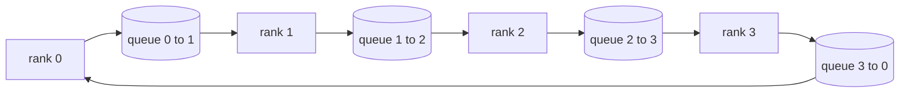

# Từ zero thực hiện các hoạt động tập thể

> 支分布式训练的四种集体通信(集体)操作是所有减少,广播,所有聚集和减少_散散的――训练框架提供的其他原语几乎是四者的包装――先在`multiprocessing.Queue`mesh 上实现一遍,再对照参考实现做验证, đoạn đường 剩下的部分只是连线――

**Type:** Build
**Languages:** Python
**Prerequisites:** Phase 19 Track C lessons 42-49
**Time:** ~90 分钟

## Học mục tiêu

- Sử dụng hai lần thuật toán để thực hiện vòng allreduce, reduce-scatter, re-allgather, và chứng minh mỗi cấp độ của số lượng giao tiếp là mỗi yếu tố.$2(N-1)/N$字节。
- Trong `multiprocessing.Queue`上的点对点 gửi 之上实现 phát sóng、allgather 和 reduce_scatter。
- Đối với cùng một đầu vào, sử dụng`torch.distributed`n n n n n n n n n n n n n n n n n n n n n n n n n n n n n n n n n n n n n n n n n n n n n n n n n n n n n n n n n n n n n n n n n n n n n n n n n n n n n n n n n n n n n n n n n n n n n n n
- Từ hình dạng tập thể, độ chậm và độ rộng xuất phát, chứng cứ phải chọn vòng còn là cây.

## 问题

Trong N 个级 上做朴素 allreduce, sẽ đưa张量向根发送 N 次,再广播回来 N 次.$O(N)$ mở rộng, gốc  biến thành chai   tường钟时间下限是最慢链路乘以N.$2(N-1)$个大小为 $T/N$của phần, đến là mỗi cấp độ của chữ số giảm xuống $2T(N-1)/N$, N 增大趋近$2T$且永不超出, không liên quan đến quy mô cluster.$\log_2(N)$跳, thay vì $2(N-1)$                                                                                                                                                                                                                                                              

Bạn sẽ đọc trong mỗi khuôn khổ tập luyện phân tán trên đường này, tất cả phụ thuộc vào bốn ngôn ngữ nguyên thủy này. PyTorch DDP sử dụng mỗi bộ phận tham số một lần allreduce để cùng bước tiến. ZeRO sử dụng reduce_scatter 分片优化器状态, sử dụng lại allgather 广播更新后的参数. FSDP Đưa toàn bộ về phía trước thành allgather 加减少_scatter.

## 概念



### 两遍完成的环 allreduce

Đặt 张量 chia thành N 个等的大块,索引为 0..N-1── mỗi bậc 拥有与自身级 号相同的块索引──第 1 遍就是减少散射,跑 N-1 步──在第 1 步,排列 r 把块$(r - s) \bmod N$发给 cấp $(r + 1) \bmod N$,并从级 $(r - 1) \bmod N$接收 phần $(r - s - 1) \bmod N$, đưa phần nhận được 累加到本本. 经过N-1步骤后,rank r 持有部分 r的完整求和. 第二遍是全部集合,再跑N-1步步,把完成的部分绕环旋转,直到每个级都持有每个部分的完整求和.

| 原语 | 每 rank 字节数 | 步数 | 何时使用 |
|-----------|---------------|-------|-------------|
| Ring allreduce | 2T(N-1)/N | 2(N-1) | 大 T、同构 fat-pipe 集群 |
| Tree allreduce | T log2(N) | 2 log2(N) | 小 T 或高延迟链路 |
| Broadcast | T | log2(N) tree | 参数初始化、标量配置 |
| Allgather | T(N-1)/N | N-1 | 分片 forward、ZeRO unshard |
| Reduce_scatter | T(N-1)/N | N-1 | ZeRO 梯度分片 |

### 用 queue mesh thay thế NCCL

NCCL chạy trên PCIe và NVLink, về về về có thể phần cứng gỡ bỏ trên CPU không có những cái này trên vòng trên mỗi bên một`multiprocessing.Queue`, có thể có được một thứ tự điểm đối với điểm chuyển giao, và chỉ có một người sản xuất và một người tiêu dùng duy nhất.

### Để kiểm tra xem làm chứng

Mỗi ngôn ngữ nguyên thủy đều có đơn vị thử nghiệm: trên cùng một kích thước thế giới  cùng một lượng, đưa ra nó với sử dụng gloo 后端初始化 `torch.distributed`Đối với đối với, nếu tất cả các vòng giảm so với độ phân biệt của gloo vượt quá float32 epsilon, test thất bại. đối với các liên quan để thực hiện thực hiện kiểm tra không thể thỏa hiệp.

```figure
ci-ring-allreduce
```

##  xây dựng nó

`code/main.py`实现:

- `Mesh`类:把 N 个 `multiprocessing.Queue`接成环,并按级 暴露 `send(dst, tensor)`Với`recv(src)`
- `ring_allreduce(mesh, rank, world_size, tensor)`: chạy hai lần toán học
- `broadcast(mesh, rank, world_size, tensor, src)`Đi vào một số cây.
- `allgather(mesh, rank, world_size, tensor)`: dùng N-1 次轮转――
- `reduce_scatter(mesh, rank, world_size, tensor)`Như tất cả giảm đi của phần trước.
- `_gloo_reference(op, world_size, tensor)`:把相同输入送进带 gloo 的 `torch.distributed`,做字节级对比──

运行:

```bash
python3 code/main.py
```

输出:按原语对比队列-mesh 与 gloo 输出验证表,以及证明 $2T(N-1)/N$缩放的每级 字节计数器──

## Thực hành trong môi trường sản xuất

Có 3 phương pháp để làm cho các ngôn ngữ gốc này trở nên cứng rắn đến mức có thể lên mạng.

**allreduce 前先对梯度分桶。**Một mô hình tham số 10 tỷ có hàng ngàn thang 张量── mỗi张量 một lần tất cả giảm, phải trả N 倍延迟下限── DDP Đặt thang vào một cái thùng khoảng 25 MB, mỗi cái thùng 发发一次 tất cả giảm;小张量搭大张量后面──不分桶时,延迟开销会主导 toàn bộ bước──

**让通信与计算重叠。**Lại ngược theo tầng ngược ngược theo tầng tính toán 梯度. ∙ Lớp cuối 梯度 ∙ ∙ ∙ ∙ ∙ ∙ ∙ ∙ ∙ ∙ ∙ ∙ ∙ ∙ ∙ ∙ ∙ ∙ ∙ ∙ ∙ ∙ ∙ ∙ ∙ ∙ ∙ ∙ ∙ ∙ ∙ ∙ ∙ ∙ ∙ ∙ ∙ ∙ ∙ ∙ ∙ ∙ ∙ ∙ ∙ ∙ ∙ ∙ ∙ ∙ ∙ ∙ ∙ ∙ ∙ ∙ ∙ ∙ ∙ ∙ ∙ ∙ ∙ ∙ ∙ ∙ ∙ ∙ ∙ ∙ ∙ ∙ ∙ ∙ ∙ ∙ ∙ ∙ ∙ ∙ ∙ ∙ ∙ ∙ ∙ ∙ ∙ ∙ ∙ ∙ ∙ ∙ ∙ ∙ ∙ ∙ ∙ ∙ ∙ ∙ ∙ ∙ ∙ ∙ ∙ ∙ ∙ ∙ ∙ ∙ ∙ ∙ ∙ ∙ ∙ ∙ ∙ ∙ ∙ ∙ ∙ ∙ ∙ ∙ ∙ ∙ ∙ ∙ ∙ ∙ ∙ ∙ ∙ ∙ ∙ ∙ ∙ ∙ ∙ ∙ ∙ ∙ ∙ ∙ ∙ ∙ ∙ ∙ ∙ ∙ ∙ ∙ ∙ ∙ ∙ ∙ ∙ ∙ ∙ ∙ ∙ ∙ ∙ ∙ ∙ ∙ ∙ ∙ ∙ ∙ ∙ ∙ ∙ ∙ ∙ ∙ ∙ ∙ ∙ ∙ ∙ ∙ ∙ ∙ ∙ ∙ ∙ ∙ ∙ ∙ ∙ ∙ ∙ ∙ ∙ ∙ ∙ ∙ ∙ ∙ ∙ ∙ ∙ ∙ ∙ ∙ ∙ ∙ ∙ ∙ ∙ ∙ ∙ ∙ ∙ ∙ ∙ ∙ ∙ ∙ ∙ ∙ ∙ ∙ ∙ ∙ ∙ ∙ ∙ ∙ ∙ ∙ ∙ ∙ ∙ ∙ ∙ ∙ ∙ ∙ ∙ ∙ ∙ 

**按消息大小选 ring 或 tree，不要教条。**NCCL tự带拓检测: khoảng 1 MB hơn 选择环,以下选树──交叉点是带宽对延迟超过 1 MB 时带宽项 $2T(N-1)/N$占主导,ring 胜出; dưới 1 MB 时$\log_2(N)$跳数占优――写死一种拓,会在错误的消息大小上损失吞吞――

## Sử dụng nó

生产中的使用法:

- **PyTorch DDP。**Trở lại  sau đó đối với phân桶梯度调调`dist.all_reduce`◊ bucket 大小可调;100Gbit 以太网下默认 25 MB 合理。
- **DeepSpeed ZeRO。**发 reduce_scatter 分片梯度,forward 前再所有重建完整参数──本课的原语正是 ZeRO 实际发射调用──
- **FSDP。**Trước tiên tất cả tập hợp Đặt lớp này không chia, tính toán hoàn thành sử dụng lại giảm_scatter 归约并丢掉 không chia.

## 交付 nó

Trong bài học 7781  học tập sử dụng những queue-mesh này 原语。第 77 课把 allreduce 接到DDP。第 78 课把 reduce_scatter 接到ZERO。第 79 课用点对点发送/recv(而不是集体) 传递管道 激活。第 81 课把四者组成端到端演示。

## 练习

1. 增加 tree allreduce 变体,并按消息大小在 ring 与树之间切换──测出交叉点──
2. 增加 `recv_timeout_ms`Hãy để cấp bậc của bạn 抛 ra sai lầm, thay vì mãi mãi đằng sau.
3. Hãy đưa ra bốn ngôn ngữ gốc của `multiprocessing.Queue`换成 TCP socket──同一套测试,真实线路──
4. 加带宽探测 hook,把每位字节计数器记到JSONL.
5. Trong 4 thứ tự trên, đối với 1KB、1MB、16MB 张量比较环与树的墙钟时间──用实测为交叉点辩护──

## 关键术语

| 术语 | 人们常说 | 实际含义 |
|------|----------------|------------------------|
| Allreduce | “跨 rank 求和” | 调用结束后每个 rank 持有相同的归约张量 |
| Ring | “更快的拓扑” | N-1 个大小为 T/N 的 chunk 绕环流两圈 |
| Tree | “对数拓扑” | 归约沿二叉树进行；深度为 log2(N) 跳 |
| Allgather | “拼接分片” | 每个 rank 最终持有所有其他 rank 的分片 |
| Reduce_scatter | “把求和切开” | 每个 rank 最终只持有某一个 chunk 的求和 |
| Bucket | “融合小张量” | 把 N 次小 allreduce 合并成一次大的 |

## 延伸阅读

- [PyTorch Distributed: NCCL collectives](https://pytorch.org/docs/stable/distributed.html#collective-functions)
- [Horovod ring allreduce paper](https://arxiv.org/abs/1802.05799)
- [NCCL topology and algorithm selection](https://docs.nvidia.com/deeplearning/nccl/user-guide/docs/index.html)
- [Patarasuk and Yuan, Bandwidth optimal allreduce algorithms](https://www.cs.fsu.edu/~xyuan/paper/09jpdc.pdf)
- Giai đoạn 10 Bài học 05 - tổng quan về đào tạo phân phối
- Giai đoạn 19 Bài học 77 - DDP được cáp trên đầu những nguyên thủy này
