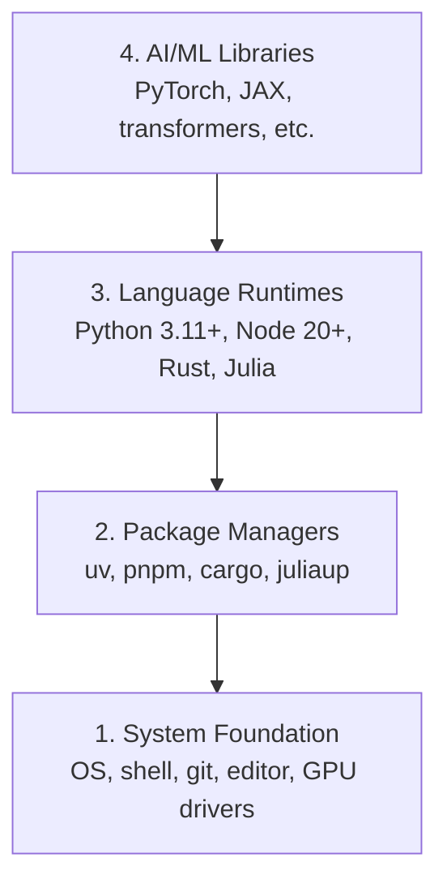

# 开发环境

> 你的工具会塑造你的思考方式.

**Type:** Build
**Languages:** Python, Node.js, Rust
**Prerequisites:** None
**Time:** ~45 分钟

## 学习目标

- 从零构建Python 3.11+、Node.js 20+ 和Rust 工具链
- 配置虚拟环境和包管理器,保证可复制的构建
- 用 CUDA/MPS 验证GPU 访问,并跑一次测试张量运算
- 了解四层技术:系统、包管理、运行时、AI库

## 问题

你将使用Python,TypeScript,Rust 和 Julia学习500+节的AI工程课程. 如果环境坏,每个课程都会变成工具链架,而不是学习.

许多人会跳过环境构建. 然后花几个小时去调试进口错误.版本冲突和缺失.

## 概念

一个人工智能工程环境有四层:



我们自从安装了. 每层都依赖于下层.

```figure
s0-env-stack
```

## 构建它

### 步骤1:系统基础

检查你的系统并安装基础组件.

```bash
# macOS
xcode-select --install
brew install git curl wget

# Ubuntu/Debian
sudo apt update && sudo apt install -y build-essential git curl wget unzip

# Windows (use WSL2)
wsl --install -d Ubuntu-24.04
```

### 步骤 2:使用使用安装Python

我们使用`uv`它比快10100倍,并且会自动处理虚拟环境.

```bash
curl -LsSf https://astral.sh/uv/install.sh | sh

uv python install 3.12

uv venv
source .venv/bin/activate  # or .venv\Scripts\activate on Windows

uv pip install numpy matplotlib jupyter
```

验证:

```python
import sys
print(f"Python {sys.version}")

import numpy as np
print(f"NumPy {np.__version__}")
a = np.array([1, 2, 3])
print(f"Vector: {a}, dot product with itself: {np.dot(a, a)}")
```

### 步骤3:使用 pnpm 安装 Node.js

通过TypeScript课程 (经纪人,MCP服务器,网络应用程序)

```bash
curl -fsSL https://fnm.vercel.app/install | bash
fnm install 22
fnm use 22

npm install -g pnpm

node -e "console.log('Node', process.version)"
```

首先检查`unzip`缺少时时`Not installing fnm due to missing dependencies.`退出:在Linux上它需要解压一个Zip 归档,在macOS上则通过家庭安装――macOS自带`unzip`现在,我们需要一个程序,一个程序,一个程序,一个程序.`sudo apt install -y unzip`

**macOS / Apple Silicon（M1/M2/M3/M4）：**如果安装程序因`Error: Cannot install under Rosetta 2 in ARM default prefix (/opt/homebrew)`停止,说明你的终端运行在罗塞塔2下面`arch`输出`i386`),而家是原生的 arm64 构建.强制以 arm64 安装fnm,把它连接到你的,然后从`fnm install 22`开始重新运行上述命令:

```bash
arch -arm64 brew install fnm
echo 'eval "$(fnm env --use-on-cd)"' >> ~/.zshrc
source ~/.zshrc
```

### 步骤 4: 

为了使用对性能敏感的课程 (论系统)

```bash
curl --proto '=https' --tlsv1.2 -sSf https://sh.rustup.rs | sh

rustc --version
cargo --version
```

### 步骤 5:朱莉可选)

为了让朱莉亚更拿手的偏数学课程.

```bash
curl -fsSL https://install.julialang.org | sh

julia -e 'println("Julia ", VERSION)'
```

### 步骤 6:GPU 设置(如果你有)

**NVIDIA（Linux / Windows）：**

```bash
nvidia-smi

# Install PyTorch with CUDA
uv pip install torch torchvision torchaudio --index-url https://download.pytorch.org/whl/cu124
```

**macOS / Apple Silicon（M1/M2/M3/M4）：**没有任何问题,这是预期情况,不是故障.**不要**传入`--index-url .../cuXXX`(这些轮子只适用于Linux/Windows,安装会失败) ――安装普通构建即可,它包含果的MPS(金属)GPU后端:

```bash
uv pip install torch torchvision torchaudio
```

验证(适用于任何平台):

```python
import torch
print(f"CUDA available: {torch.cuda.is_available()}")           # False on macOS — expected
print(f"MPS available:  {torch.backends.mps.is_available()}")   # True on Apple Silicon
if torch.cuda.is_available():
    print(f"GPU: {torch.cuda.get_device_name(0)}")
```

没有GPU?没有问题. 大多数课程都能在CPU上运行.

### 步骤7:验证你要开始的路线

现在,我们在这个课程中每一个命令都从仓库根目录运行,也就是包含.`README.md`和 `phases/`预检查只开始检查所选路线需要的内容. 它默认跳过后续才使用的工具,

开始完整的入门序列:

```bash
python3 phases/00-setup-and-tooling/01-dev-environment/code/verify.py --route beginner
```

或许你只要查看你想走的路线:

```bash
python3 phases/00-setup-and-tooling/01-dev-environment/code/verify.py --route ml-foundations
python3 phases/00-setup-and-tooling/01-dev-environment/code/verify.py --route llm-engineering
python3 phases/00-setup-and-tooling/01-dev-environment/code/verify.py --route agents
python3 phases/00-setup-and-tooling/01-dev-environment/code/verify.py --route mcp
python3 phases/00-setup-and-tooling/01-dev-environment/code/verify.py --route agent-skills
python3 phases/00-setup-and-tooling/01-dev-environment/code/verify.py --route certification
```

如果想让同一预检也检查后续课程使用可选工具和依赖,加上`--show-later`缺少后续工具绝不会阻选路.

每次失败的必需检查都会给出检查的路径或导入错误,以及一个确切的修复命令. 经理技能和认证路线也会显示需要手动完成的宿主检查,因为Python脚本无法证明AI宿主已经发现了某种技能,也无法证明你选择的技能作用域可写.

在入门预检通过时,将印出第一项可运行课程的确切命令:

```text
Ready to start Beginner course.
Next: python3 phases/01-math-foundations/01-linear-algebra-intuition/code/vectors.py
```

## 使用它

你的环境已经开始了你检查的路线. 后续工具等课程需要重新安装,不必让整个技术阻你的第一课程. 下面是整个课程中所用的内容:

| Language | Used In | Package Manager |
|----------|---------|-----------------|
| Python | Phases 1-12 (ML, DL, NLP, Vision, Audio, LLMs) | uv |
| TypeScript | Phases 13-17 (Tools, Agents, Swarms, Infra) | pnpm |
| Rust | Phases 12, 15-17 (Performance-critical systems) | cargo |
| Julia | Phase 1 (Math foundations) | Pkg |

## 交付它

本课程产出了任何人都可以运行的验证脚本,用于检查自己的环境.

查看`outputs/prompt-env-check.md`帮助人工智能诊断环境问题.

## 练习

1. 运行验证脚本并修复任何失败项
2. 为本课程创建一个Python 虚拟环境,并安装PyTorch
3. 用四种语言写一个"好世界",并逐个运行

### 提示

**练习 1。**在仓库根目录运行`python3 phases/00-setup-and-tooling/01-dev-environment/code/verify.py --route beginner`首先修复第一个失败项,再查看下一个项.

**练习 2。**在仓库根目录中使用`uv venv`创建环境并激活,再使用步骤 6 中适合您的硬件的命令安装 PyTorch── 在该环境中运行 `python -c "import torch; print(torch.__version__)"`输出版本号就表示安装成功.

**练习 3。**使用概念部分技术中的四种运行时:Python、运行到 Node.js 的TypeScript、Rust 和 Julia──分别编写一个小文件,用`python3`,我知道.`npx tsx`(Node.js 不能直接运行 `.ts`文件)`cargo run`或`rustc`,我知道.`julia`每次运行都必须打印你的消息,并以退出码0结束.
