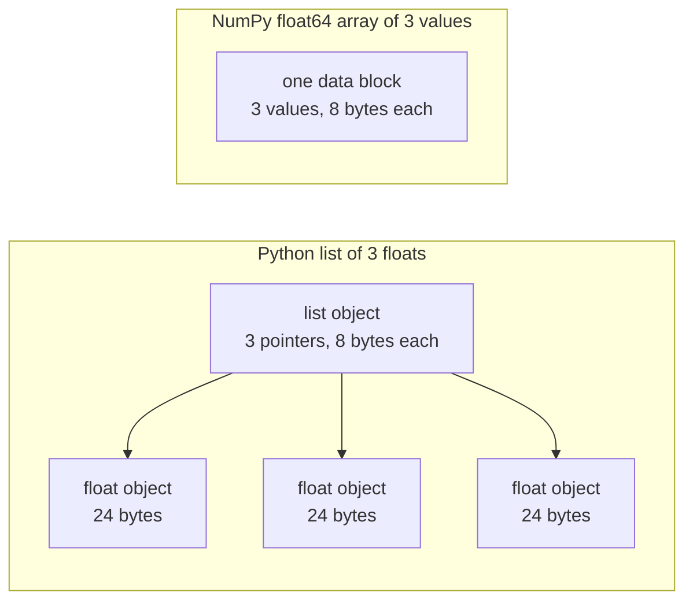

# 面向人工智能工程的Python

> 在后续数学和模型课程上,首先掌握它们.

**Type:** Build
**Languages:** Python
**Prerequisites:** 开发环境、Python 环境
**Time:** ~120 分钟

## 学习目标

- 阅读课程代码中最常见的习惯使用法,从解包和f字符串到数据类和推导式.
- 找出三种不会报错但会产生错误结果的Python问题:共享列表,可变默认值和已耗尽的生成器.
- 仅使用标准库,构建CSV和JSON加载器,带随机种子的数据分类以及小批量生成器.
- 编写点积、平均值和标准差计算,并测量速度和内存量.
- 解释为什么遍历数值的纯Python循环较慢,以及NumPy 广播如何将循环转移到编译后的代码中.

## 问题

在本阶段后的课程中,使用普通Python实现数学运算和模型.`dataclasses`另外,187个文件调用`random.seed`或创建`random.Random`成器.如果你不熟悉这些习惯,你会在想理解数学时忙于理解语法.

字符串还有一些不会提供错误信息,但会导致错误结果的行为.两个名称可以指向同一列表,因此通过一个名称修改列表,也会改变另一个名称看到的内容.默认参数将在多次调用之间保留其值.

最后一个问题是速度. 在我们的测试笔记本电脑上,纯字thon循环对百万个浮点数计算积分,需要大约30毫秒;NumPy 完成相同的计算不到一毫秒.

## 概念

### 课程代码使用哪些写法

我们使用`ast`模块解析了`phases/*/*/code/`中的全部541个Python文件. 下表统计至少使用过一次相应结构文件的数量.

| 结构 | 文件数 | 占比 |
|-----------|-------|-------|
| 函数定义 | 541 | 100% |
| `if __name__ == "__main__":` | 529 | 98% |
| f 字符串 | 517 | 96% |
| 元组解包 | 448 | 83% |
| 类 | 379 | 70% |
| 列表推导式 | 375 | 69% |
| 函数类型标注 | 342 | 63% |
| 生成器表达式 | 326 | 60% |
| 切片 | 314 | 58% |
| `lambda` | 175 | 32% |
| `try` 与 `except` | 120 | 22% |
| `with` 语句 | 96 | 18% |
| 字典推导式 | 93 | 17% |
| 使用 `yield` 的生成器函数 | 14 | 3% |

导入情况反映了哪些标准模块最重要.`from __future__ import annotations`开头,276个导入`dataclasses`,我知道.`math`,我知道.`random`和 `json`模块分别出现在187、175 和126个文件中.`collections`现在有70份文件,`itertools`现在只出现在4个文件中.

没有课程调用`map()`或`filter()`推导式承担这些工作.`sorted`,我知道.`min`,我知道.`max`或`.sort`时使用了`key=`函数――本课会将花费最多时间在这些列表中排名,根据前例的习惯法.

### 名称引用对象

在Python中,变量是引用对象的名称.赋值将名称绑定到对象,不复制对象.当两个名称引用一个列表时,通过任一名称的修改,对两个名称都可见.数字,字符串和元组不可变,因此这条规则不会给它们带来问题.列表,字典和集合可变,因此需要独立版本时应创建副本.

### 列表保存指针,数组保存数值

字符串列表不是直接存储数值,而是存储指标,每个指标引用一个完整的字符串对象. 在64位CPython中,每个指标占有8字节,每个指标占有8字节.`float`象占24个字节.`float64`数组则将原始的8字节值并排存放在一个内存块中.



列表循环处理每一个元素时必须做很多工作.解释器逐条执行字节码指令.

NumPy对原始数值运行编译后循环,完成相同运算.它只为整个数组检查一次数据类型,不会为每个元素创建Python对象.`(x - mean) / std`根据本课程的向量函数也遵循这个原则:每个函数只完成一个数组操作,然后可以将其替换为一次NumPy调用.

### 列表保存全部元素,生成器每次保存一个

列表推导式会在执行下一行之前构建全部元素.生成器则在调用者每次请求下一个元素时,才构建一个元素.列表内存量随着元素数量增长而增长;不管有多少元素,生成器内存量都大致不变.

发电器只能经历一次. 经过最后一个元素,每次请求都会触发.`StopIteration`现在,我在第二个子里.`for`循环不到任何元素――训练代码每轮都会读取一次数据集,因此必须为每轮创建新的生成器――

课程代码中很少出现生成器函数,但深度学习课程使用的数据加载器都是按批量提供数据的可代的对象,因此这一想法存在于每个训练循环中.

```figure
s0-list-vs-generator
```

## 你需要掌握的习惯使用法

任何代码块都可以独立运行.`python3`运行:代码块需要Python 3.11或更新版本,这是我们在开发环境课程中安装的版本.

### 1. 价值,容器和解包

字符串有四种内置容器.

| 类型 | 示例 | 有序 | 可变 | 在课程中的典型用途 |
|------|---------|---------|------------|---------------------------|
| `list` | `[0.5, 1.2]` | 是 | 是 | 样本、损失、权重 |
| `tuple` | `(32, 784)` | 是 | 否 | 形状、固定记录、字典键 |
| `dict` | `{"lr": 0.01}` | 按插入顺序 | 是 | 配置、词表、JSON 行 |
| `set` | `{"cat", "dog"}` | 否 | 是 | 唯一 token、重叠检查 |

下面的代码显示赋值不会复制列表.

```python
weights = [0.5, -1.2, 3.0]
alias = weights
alias[0] = 99.0
print(weights)

independent = list(weights)
independent[1] = 0.0
print(weights, independent)

grid = [[0] * 3] * 2
grid[0][0] = 1
print(grid)

grid = [[0] * 3 for _ in range(2)]
grid[0][0] = 1
print(grid)
```

```text
[99.0, -1.2, 3.0]
[99.0, -1.2, 3.0] [99.0, 0.0, 3.0]
[[1, 0, 0], [1, 0, 0]]
[[1, 0, 0], [0, 0, 0]]
```

表达式`[[0] * 3] * 2`创建一个外部层列表,其中两个引用都指向同一层内列表.推导式则为每一行创建新的内部层列表.

解包在一行中将序列元素赋予多个名称――带星号的名称收集剩余元素――f 字符串将表达的值嵌入字符串,也可以在冒号之后指定格式――

```python
shape = (32, 784)
batch_size, n_features = shape
first, *middle, last = [1, 2, 3, 4, 5]
x, y = 1.0, 3.0
x, y = y, x

config = {"lr": 0.01, "epochs": 5}
config["seed"] = 7
tokens = ["the", "cat", "sat", "on", "the", "mat"]
vocab = set(tokens)

print(batch_size, n_features, first, middle, last, x, y)
print(config.get("momentum", 0.9), "cat" in vocab, len(vocab))
print(f"lr={config['lr']:.0e} loss={0.123456:.3f} n={60_000:,} {batch_size=}")
```

```text
32 784 1 [2, 3, 4] 5 3.0 1.0
0.9 True 5
lr=1e-02 loss=0.123 n=60,000 batch_size=32
```

关键不存在时,`dict.get`返回默认值――无论集合大小如何,集合上的`in`检查所需时间都大致相同.`{batch_size=}`形式同时打印名称和值,有助于调试──

切片 `a[start:stop:step]`包含`start`没有包含`stop`△负索引从末尾开始计数──列表的切片是一个新列表,因此对大型列表切片,会复制切片范围内的所有指针──

```python
tokens = ["<s>", "the", "cat", "sat", "on", "the", "mat", "</s>"]
print(tokens[1:-1])
print(tokens[:3], tokens[-3:])
print(tokens[::2])
print(tokens[::-1][:2])
windows = [tokens[i:i + 3] for i in range(len(tokens) - 2)]
print(len(windows), windows[0])
```

```text
['the', 'cat', 'sat', 'on', 'the', 'mat']
['<s>', 'the', 'cat'] ['the', 'mat', '</s>']
['<s>', 'cat', 'on', 'mat']
['</s>', 'mat']
6 ['<s>', 'the', 'cat']
```

### 2. 推导式

推导式通过一个表达式,从可代对象构建列表,字典或集合――它的读法接近其描述的数学运算――

```python
scores = [0.91, 0.42, 0.77, 0.15, 0.66]
labels = [1 if s >= 0.5 else 0 for s in scores]
high = [s for s in scores if s > 0.6]
squares = {i: i * i for i in range(4)}
lengths = {len(word) for word in ["a", "bb", "cc", "ddd"]}
sum_sq = sum(s * s for s in scores)

matrix = [[1, 2, 3], [4, 5, 6]]
transposed = [list(column) for column in zip(*matrix)]
flat = [v for row in matrix for v in row]

print(labels, high, squares, lengths, round(sum_sq, 4))
print(transposed, flat)
```

```text
[1, 0, 1, 0, 1] [0.91, 0.77, 0.66] {0: 0, 1: 1, 2: 4, 3: 9} {1, 2, 3} 2.0555
[[1, 4], [2, 5], [3, 6]] [1, 2, 3, 4, 5, 6]
```

末尾的`if`只有部分元素保留.`for`前面的表达式可以是条件表达式,即`a if condition else b`两个`for`运行顺序与两个嵌套循环相同.

圆括号创建生成器表达式──在`sum(s * s for s in scores)`在中,`sum`每次读取一个平方值,Python 不会构建列表.`zip(*matrix)`中,星号将每行作为独立参数传入,`zip`将相同位置的元素配对.

### 3. 函数、参数与闭包

默认值让参数变为可选的. 关键字实参在调用时明确指定形参名称.`*`后面的参数只能通过关键字传输.

```python
def clip(value, low=0.0, high=1.0):
    return max(low, min(high, value))


def train(data, *, lr=0.01, epochs=3):
    return f"{len(data)} samples, lr={lr}, epochs={epochs}"


def make_scaler(factor):
    def scale(values):
        return [v * factor for v in values]
    return scale


print(clip(1.7), clip(-3.0, low=-1.0), clip(0.4, high=0.3))
print(train([1, 2, 3], lr=0.1))
to_percent = make_scaler(100)
print(to_percent([0.25, 0.5]))
```

```text
1.0 -1.0 0.3
3 samples, lr=0.1, epochs=3
[25.0, 50.0]
```

使用仅限关键字的参数时,`train(data, 0.1, 3)`这样调用会触发`TypeError`调用者必须写出`lr=0.1`因此两个数值不会意在外交位置上.

内部函数`scale`使用创建它的函数中`factor`只是要`scale`仍然存在,Python就会保留`factor`△保留创始人变量函数称为闭包──动手构建部分的标准化器使用闭包保存训练统计量──

`lambda`没有名称,只包含一个表达式函数.`key=`函数,第8部分会介绍这种用法──

Python 在执行中`def`语句时,只计算一次默认值. 每次使用默认值调调,得到的都是同一个对象.

```python
def add_bad(item, bucket=[]):
    bucket.append(item)
    return bucket


def add_good(item, bucket=None):
    if bucket is None:
        bucket = []
    bucket.append(item)
    return bucket


add_bad("a")
print(add_bad("b"))
add_good("a")
print(add_good("b"))
```

```text
['a', 'b']
['b']
```

列表、字典或集合的默认值应使用`None`函数内部创建新对象.

### 4. 类与数据类

`@dataclass`装饰器根据带类型标注的字段,生成 `__init__`,我知道.`__repr__`和 `__eq__`设置`frozen=True`后,对象创建后不可修改,可以用作字典键或放入集合.

```python
from dataclasses import dataclass, field


@dataclass(frozen=True)
class Example:
    features: tuple[float, ...]
    label: int


@dataclass
class TrainConfig:
    lr: float = 0.01
    epochs: int = 5
    hidden: list[int] = field(default_factory=lambda: [64, 32])

    def describe(self):
        return f"lr={self.lr} epochs={self.epochs} hidden={self.hidden}"


ex = Example((1.5, 2.0), 1)
print(ex)
print(ex == Example((1.5, 2.0), 1), len({ex, Example((1.5, 2.0), 1)}))
print(TrainConfig(epochs=10).describe())
try:
    ex.label = 0
except AttributeError as err:
    print(type(err).__name__)
```

```text
Example(features=(1.5, 2.0), label=1)
True 1
lr=0.01 epochs=10 hidden=[64, 32]
FrozenInstanceError
```

`field(default_factory=...)`为了每个例子提供一个新的列表. 它解决了数据类内部和第三部分类似的共享默认值问题.

特殊方法将类与Python语法连接起来──`len(ds)`调用`__len__`没有任何`ds[2]`调用`__getitem__`,我知道.

```python
class SquaresDataset:
    def __init__(self, n):
        self.n = n

    def __len__(self):
        return self.n

    def __getitem__(self, index):
        if not 0 <= index < self.n:
            raise IndexError(index)
        return index, index * index


ds = SquaresDataset(4)
print(len(ds), ds[2])
print(list(ds))
```

```text
4 (2, 4)
[(0, 0), (1, 1), (2, 4), (3, 9)]
```

即使没有`__iter__`方法,`list(ds)`内部的`for`循环也能工作. 字thon 根据 0、1、2等索引调用.`__getitem__`直到收到`IndexError`PyTorch的映射式数据集也使用了两种方法:`__len__`和 `__getitem__`,我知道.

### 5. 代器与生成器

可代对象是任何可以被被`for`循环接受的对象――`iter()`通过获取代器,`next()`代器请求一个元素. 代器没有更多元素,会触发.`StopIteration`,我知道.`for`循环替你调用`next()`他遇到了`StopIteration`时停止.

```python
numbers = [10, 20, 30]
it = iter(numbers)
print(next(it), next(it), next(it))
try:
    next(it)
except StopIteration:
    print("no more items")


def countdown(n):
    while n > 0:
        yield n
        n -= 1


gen = countdown(3)
print(type(gen).__name__)
print(list(gen))
print(list(gen))
```

```text
10 20 30
no more items
generator
[3, 2, 1]
[]
```

函数体中包含`yield`函数就是生成器函数.调用它不会执行函数体中的任何代码,而是返回一个生成器对象.`next()`城市将运行到下一个函数体`yield`没有停留在那里.`list(gen)`为空,因为第一次调用已经耗尽了生成器.

生成器可以逐行读取文件.

```python
import os
import tempfile


def read_rows(path):
    with open(path, encoding="utf-8") as fh:
        header = fh.readline().rstrip("\n").split(",")
        for line in fh:
            yield dict(zip(header, line.rstrip("\n").split(",")))


with tempfile.TemporaryDirectory() as tmp:
    path = os.path.join(tmp, "rows.csv")
    with open(path, "w", encoding="utf-8") as fh:
        fh.write("x,label\n")
        fh.writelines(f"{i * 0.5},{i % 2}\n" for i in range(5))
    rows = read_rows(path)
    print(next(rows))
    print(sum(1 for _ in rows))
```

```text
{'x': '0.0', 'label': '0'}
4
```

`read_rows`每次只保留在内存中的文件一行.`read_rows`为了简单说明,这里直接按逗号切分.`csv`模块──

```python
import sys

as_list = [i * i for i in range(1_000_000)]
as_generator = (i * i for i in range(1_000_000))
print(sys.getsizeof(as_list), sys.getsizeof(as_generator))
print(sum(as_list) == sum(as_generator))
```

在 64 位CPython上,列表报告约8 MB,生成器约200字节.`sys.getsizeof`仅仅统计列表本身的指标,整数对象也占据额外内存.`tracemalloc`测量实际峰值,我们已经在调试和性能分析课程中使用它.

### 6. 上下文管理器与异常

`with`语句先执行准备代码,再运行语句体,最后执行清理代码――即使语句体抛出异常,清理也会执行――`open()`返回文件的对象是一个负责关闭文件的下文管理器.

在调试与性能分析课程中,我们写了一个带.`__enter__`和 `__exit__`的`Timer`类:`contextlib.contextmanager`装饰器可以从生成器创建同类对象.`yield`之前的代码负责准备,`finally`块负责清理.

```python
import time
from contextlib import contextmanager


@contextmanager
def timer(label):
    start = time.perf_counter()
    try:
        yield
    finally:
        print(f"{label}: {(time.perf_counter() - start) * 1000:.1f} ms")


def parse_label(text):
    try:
        return int(text)
    except ValueError:
        raise ValueError(f"label must be an integer, got {text!r}") from None


with timer("sum of squares"):
    total = sum(i * i for i in range(200_000))

print(parse_label("3"))
try:
    parse_label("cat")
except ValueError as err:
    print("rejected:", err)
```

```text
sum of squares: 9.4 ms
3
rejected: label must be an integer, got 'cat'
```

你的机器测量时间会不同.`except`字中,写明预期的具体异常,例如`ValueError`或`KeyError`〔不指定异常类型〕`except:`也会被捕`KeyboardInterrupt`因此,Ctrl+C可能无法停止包含其循环.输入错误时,应抛出带清晰消息的异常.`from None`,我知道.

### 7. 标签类型,模块与主程序保护

类型标签告诉读者函数接受什么,返回什么. 字符号运行时不会检查这些标签.

```python
from __future__ import annotations

from collections.abc import Iterable, Sequence


def mean(values: Sequence[float]) -> float:
    if not values:
        raise ValueError("mean() needs at least one value")
    return sum(values) / len(values)


def count_tokens(docs: Iterable[str]) -> int:
    return sum(len(doc.split()) for doc in docs)


def main() -> None:
    print(mean([1.0, 2.0, 4.0]))
    print(count_tokens(["the cat sat", "on the mat"]))
    print(mean.__annotations__)


if __name__ == "__main__":
    main()
```

```text
2.3333333333333335
6
{'values': 'Sequence[float]', 'return': 'float'}
```

使用 `from __future__ import annotations`时,Python 将每个标记保存为字符串,如最后一行所示.`Sequence`表示任何支持`len()`和索引的对象,例如列表或元组;`Iterable`表示任何可以被 `for`循环接受的对象.`typing`导入这些相同的名称,也同样有效.

每个`.py`文件都是一个模块.`python3 file.py`运行文件时,Python将其运行`__name__`设置为`"__main__"`另一个文件导入它时,`__name__`则是模块名称.`main()`因此,`code/tests/`中的测试可以导入`main.py`没有启动演示.

### 8. 文件、JSON、CSV 与排序

`pathlib.Path`用`/`拼接路径,并能通过一次调用读取或写入整个文件.`encoding="utf-8"`默认编码取决于操作系统.

```python
import csv
import json
import tempfile
from pathlib import Path

rows = [
    {"text": "great movie", "label": 1, "score": 0.93},
    {"text": "boring plot", "label": 0, "score": 0.12},
    {"text": "fine acting", "label": 1, "score": 0.58},
]

with tempfile.TemporaryDirectory() as tmp:
    json_path = Path(tmp) / "reviews.json"
    json_path.write_text(json.dumps(rows, indent=2), encoding="utf-8")
    from_json = json.loads(json_path.read_text(encoding="utf-8"))

    csv_path = Path(tmp) / "reviews.csv"
    with csv_path.open("w", newline="", encoding="utf-8") as fh:
        writer = csv.DictWriter(fh, fieldnames=["text", "label", "score"])
        writer.writeheader()
        writer.writerows(rows)
    with csv_path.open(newline="", encoding="utf-8") as fh:
        from_csv = list(csv.DictReader(fh))

print(from_json == rows)
print(from_csv[0])

by_score = sorted(rows, key=lambda r: r["score"], reverse=True)
print([r["text"] for r in by_score])
print(max(rows, key=lambda r: r["score"])["text"])
print([r["text"] for r in sorted(rows, key=lambda r: (-r["label"], r["text"]))])
```

```text
True
{'text': 'great movie', 'label': '1', 'score': '0.93'}
['great movie', 'fine acting', 'boring plot']
great movie
['fine acting', 'great movie', 'boring plot']
```

 JSON 会将数值保留为数值──CSV 返回的每个字段都是字符串,因此你必须转换各字段──按照`csv`文档要求,打开CSV文件时应指定`newline=""`,我知道.

`key=`函数返回Python 用于比较每个元素的值.`sorted`,我知道.`min`和 `max`通过第一个值排序,只使用第二值在相等等时. 负号让较大的标签排序在前面.

### 9. 计数,分组与代码工具

这两个模块提供了普通列表和字典无数据结构和代码工具.

```python
from collections import Counter, defaultdict, deque
from itertools import chain, islice, product

labels = ["cat", "dog", "cat", "bird", "cat", "dog"]
counts = Counter(labels)
print(counts.most_common(2))

positions = defaultdict(list)
for i, label in enumerate(labels):
    positions[label].append(i)
print(dict(positions))

recent = deque(maxlen=3)
for loss in [2.0, 1.5, 1.2, 1.1, 0.9]:
    recent.append(loss)
print(list(recent), round(sum(recent) / len(recent), 3))

print(list(product([0.1, 0.01], [16, 32])))
print(list(chain([1, 2], [3], [4, 5])))
print(list(islice(range(100), 5, 10)))
```

```text
[('cat', 3), ('dog', 2)]
{'cat': [0, 2, 4], 'dog': [1, 5], 'bird': [3]}
[1.2, 1.1, 0.9] 1.067
[(0.1, 16), (0.1, 32), (0.01, 16), (0.01, 32)]
[1, 2, 3, 4, 5]
[5, 6, 7, 8, 9]
```

`Counter`统计标签、代币等可哈希元素──第一次使用新键时,`defaultdict(list)`会创建空列表,因此分组循环无需检查键是否存在.`deque(maxlen=3)`添加第四个元素时,它会移除最旧的元素,从而形成一个保存最近损失的滑动窗口.`enumerate`为每一个元素提供索引.

`product`生成输入的全部组合,也就是超参数网格.`chain`将可代对象首尾相接.`islice`可以使用任何代器的小批量生成器,包括生成器.`islice`,我知道.

### 10. 为什么数值循环很慢

`dis`模块打印解释器执行某个函数时运行的字节码指令.

```python
import dis


def dot(a, b):
    total = 0.0
    for x, y in zip(a, b):
        total += x * y
    return total


dis.dis(dot)
```

从`FOR_ITER`到跳回命令,将为每个元素执行一次.

循环中以字节码执行的步骤越少,速度越快.`sum`,我知道.`map`和 `zip`等内置函数使用C编写――动手构建部分将在纯Python中测量这种效果;使用现成工具部分则将整个循环移入NumPy――

## 动手构建

现在构建后续课程需要的组件.`code/main.py`通过`code/tests/test_main.py`测试──下方每个代码块都可以独立运行──

### 第1步:记录类型和数据集装载器

加载器将 CSV 或 JSON 文件读取为同样的结构:浮点特征元组,加一个整数标签.

```python
import csv
import json
import tempfile
from dataclasses import dataclass
from pathlib import Path


@dataclass(frozen=True)
class Record:
    features: tuple[float, ...]
    label: int


def row_to_record(row, names, label_field="label"):
    if label_field not in row:
        raise ValueError(f"row has no {label_field!r} field: {row}")
    if set(row) != {*names, label_field}:
        raise ValueError(f"row fields {list(row)} do not match {[*names, label_field]}")
    return Record(tuple(float(row[name]) for name in names), int(row[label_field]))


def load_records(path, label_field="label"):
    path = Path(path)
    if path.suffix == ".json":
        rows = json.loads(path.read_text(encoding="utf-8"))
    elif path.suffix == ".csv":
        with path.open(newline="", encoding="utf-8") as fh:
            rows = list(csv.DictReader(fh))
    else:
        raise ValueError(f"unsupported file type: {path.suffix!r}")
    if not rows:
        return []
    names = [key for key in rows[0] if key != label_field]
    return [row_to_record(row, names, label_field) for row in rows]


with tempfile.TemporaryDirectory() as tmp:
    csv_path = Path(tmp) / "data.csv"
    csv_path.write_text("x1,x2,label\n1.5,60,1\n1.8,82.5,0\n", encoding="utf-8")
    json_path = Path(tmp) / "data.json"
    json_path.write_text('[{"x1": 1.5, "x2": 60, "label": 1}]', encoding="utf-8")
    print(load_records(csv_path))
    print(load_records(json_path))
```

```text
[Record(features=(1.5, 60.0), label=1), Record(features=(1.8, 82.5), label=0)]
[Record(features=(1.5, 60.0), label=1)]
```

第一行确定特征名称及其顺序.`DictReader`和 `json.loads`保存文件中的键序列,字典也保留键的插入序列.`row_to_record`按第一行确定的顺序,按名称读取每一行.标签缺失,特征缺失或余额,或文件类型未知时,将抛出带消息.`ValueError`让无效文件在运行开始时就阻止后续处理.`main.py`提供`save_records`为了写出两种形式.

### 第2步:随机种子的训练集和测试集分

```python
import random


def train_test_split(items, test_fraction=0.2, seed=0):
    if not 0.0 < test_fraction < 1.0:
        raise ValueError(f"test_fraction must be between 0 and 1, got {test_fraction}")
    if len(items) < 2:
        raise ValueError(f"need at least 2 items to split, got {len(items)}")
    order = list(range(len(items)))
    random.Random(seed).shuffle(order)
    n_test = min(max(1, round(len(items) * test_fraction)), len(items) - 1)
    test = [items[i] for i in order[:n_test]]
    train = [items[i] for i in order[n_test:]]
    return train, test


items = list(range(10))
print(train_test_split(items, seed=1))
print(train_test_split(items, seed=1) == train_test_split(items, seed=1))
print(train_test_split(items, seed=2)[1])
print(items)
```

```text
([9, 7, 5, 3, 0, 4, 1, 2], [6, 8])
True
[5, 9]
[0, 1, 2, 3, 4, 5, 6, 7, 8, 9]
```

`random.Random(seed)`创建私有随机数生成器.`random.seed(seed)`重置所有模块共享的全局生成器,因此在其他库中的一次调用就可能改变你的序列.`random.seed`创建96个`random.Random`△新代码中应使用私有生成器──

函数打乱是索引列表,因此输入列表保持不变.`ValueError`在标准化等任何需要从数据学习的步骤之前,先划分数据. 在调试和性能分析课程中,我们已经看到,训练数据和测试数据重叠会导致测试分数虚高.

### 第3步:小批量生成器

```python
from itertools import islice


def batches(items, batch_size, drop_last=False):
    if batch_size < 1:
        raise ValueError(f"batch_size must be at least 1, got {batch_size}")
    return _batch_iter(iter(items), batch_size, drop_last)


def _batch_iter(iterator, batch_size, drop_last):
    while True:
        batch = list(islice(iterator, batch_size))
        if not batch or (drop_last and len(batch) < batch_size):
            return
        yield batch


print(list(batches(range(10), 4)))
print(list(batches(range(10), 4, drop_last=True)))
squares = (i * i for i in range(7))
print([len(b) for b in batches(squares, 3)])

for epoch in range(2):
    sizes = [len(b) for b in batches(range(10), 4)]
    print(f"epoch {epoch}: {sizes}")
```

```text
[[0, 1, 2, 3], [4, 5, 6, 7], [8, 9]]
[[0, 1, 2, 3], [4, 5, 6, 7]]
[3, 3, 1]
epoch 0: [4, 4, 2]
epoch 1: [4, 4, 2]
```

`islice`代器中最多的东西`batch_size`个元素.`batches`只有需要`iter()`对于需要固定批量形状的模型,总长度不算批量大小的整数倍,最后批量会更小.`drop_last=True`现在我们要把这个批量移除.

这将将工作分成两个函数,因为生成器函数在第一次`next()`如果将检查放在生成器内部,`batches(data, 0)`由于外层是普通函数,因此能够立即检查参数.`batches()`由于生成器只提供一次元素.

### 第四步:向量数学与标准化器

```python
import math


def dot(a, b):
    return sum(x * y for x, y in zip(a, b, strict=True))


def mean(values):
    if not values:
        raise ValueError("mean() needs at least one value")
    return sum(values) / len(values)


def std(values):
    mu = mean(values)
    return math.sqrt(sum((v - mu) ** 2 for v in values) / len(values))


def make_standardizer(rows):
    columns = list(zip(*rows))
    means = [mean(c) for c in columns]
    scales = [s if s > 0 else 1.0 for s in (std(c) for c in columns)]

    def standardize(row):
        return [(v - m) / s for v, m, s in zip(row, means, scales, strict=True)]

    return standardize


print(dot([1.0, 2.0, 3.0], [4.0, 5.0, 6.0]))
values = [2.0, 4.0, 4.0, 4.0, 5.0, 5.0, 7.0, 9.0]
print(mean(values), std(values))

train_rows = [(1.0, 100.0), (2.0, 300.0), (3.0, 500.0)]
standardize = make_standardizer(train_rows)
print([[round(v, 3) for v in standardize(r)] for r in train_rows])
print([round(v, 3) for v in standardize((4.0, 700.0))])
```

```text
32.0
5.0 2.0
[[-1.225, -1.225], [0.0, 0.0], [1.225, 1.225]]
[2.449, 2.449]
```

设置`strict=True`后,两向量长度不同时,`zip`会抛出`ValueError`没有它,`zip`由于不太久的输入结束,并没有声音,返回错误答案.`strict`参数需要Python 3.10或更新版本.

`std`除了`n`由于这些问题,`statistics.pstdev`一致――使用样本估计更大的总体分离程度时,应除以`n - 1`,我知道.

`make_standardizer`只有从训练中计算一次平均值和标准差,再通过`standardize`保存这些统计量. 如果用同一个函数来测试行,测试数据就不会影响统计量.常量列的标准差为0,因此标准化器对它使用1作为缩小因子.

### 第五步:完整运行

`code/main.py`接连这些组件. 它从两个组件中生成400条记录,保存为CSV和JSON,再将两个文件加载回来.

最近质量分类器保存每个类别的平均特征向量,并预测平均值距离输入最近类别.`fit_centroids`逐批加上各行,因此不需要将完整的训练集存储在内存中.`predict`使用带`key=`函数的`min()`找到最新的质心.

```bash
python3 phases/00-setup-and-tooling/13-python-for-ai-engineering/code/main.py
```

```text
Python for AI engineering: a standard-library toolkit
data     400 records, CSV and JSON load back unchanged: True
split    320 train, 80 test, records in both: 0
batches  size 48: [48, 48, 48, 48, 48, 48, 32]
scale    train feature means after standardizing: [0.0, 0.0]
model    nearest-centroid test accuracy: raw 0.86, standardized 0.89
speed    dot product of 200,000 floats, best of 5:
           index loop         6.60 ms
           zip generator      5.93 ms
           map + mul          2.89 ms
memory   peak bytes to sum 100,000 squares:
           list              4,000,616
           generator               472
```

两种特征的尺度差距很大. 第二个特征的分离程度是第一个的十倍,因此主导了原始距离,使未标准化的准确率更低.

### 第6步:测量速度与内存

```python
import operator
import random
import time
import tracemalloc


def dot_index_loop(a, b):
    total = 0.0
    for i in range(len(a)):
        total += a[i] * b[i]
    return total


def dot_zip(a, b):
    return sum(x * y for x, y in zip(a, b, strict=True))


def dot_map(a, b):
    return sum(map(operator.mul, a, b))


def best_time(fn, *args, repeat=5):
    times = []
    for _ in range(repeat):
        start = time.perf_counter()
        fn(*args)
        times.append(time.perf_counter() - start)
    return min(times)


def peak_bytes(fn):
    tracemalloc.start()
    try:
        fn()
        return tracemalloc.get_traced_memory()[1]
    finally:
        tracemalloc.stop()


rng = random.Random(0)
a = [rng.random() for _ in range(1_000_000)]
b = [rng.random() for _ in range(1_000_000)]
for fn in (dot_index_loop, dot_zip, dot_map):
    print(f"{fn.__name__:15} {best_time(fn, a, b) * 1000:7.2f} ms")

print(peak_bytes(lambda: sum([i * i for i in range(100_000)])))
print(peak_bytes(lambda: sum(i * i for i in range(100_000))))
```

`best_time`报告多次运行中最快的一次――机器上的其他程序只会增加耗时,因此最小值最接近实际成本――`timeit`模块文档也给出了相同的建议.

在安装Python 3.11的测试笔记本电脑上,索引循环耗时约33ms,zip版本约30ms,`map`版本约14 ms──三者完成相同运算──`map`版本更快,是因为`map`和 `operator.mul`用C编写,每个元素执行的字节码指令更少──内存结果也与图表一致:列表约4 MB,生成器不到1 KB──

## 使用现成工具

### 标准库版本

你构建的大多数组件,在标准库中都有经过测试的版本.

| 自己构建的组件 | 标准库 | 说明 |
|-----------|------------------|------|
| `mean`、`std` | `statistics.fmean`、`statistics.pstdev` | 测试会与这些函数比较 |
| `dot` | `math.sumprod` | Python 3.12 或更新版本 |
| `batches` | `itertools.batched` | Python 3.12 或更新版本，返回元组 |
| `best_time` | `timeit.repeat` | 运行期间还会关闭垃圾回收 |
| `peak_bytes` | `tracemalloc` | 相同模块，支持快照和逐行统计 |

```python
import statistics
import sys

values = [2.0, 4.0, 4.0, 4.0, 5.0, 5.0, 7.0, 9.0]
print(statistics.fmean(values), statistics.pstdev(values))

if sys.version_info >= (3, 12):
    import math
    from itertools import batched

    print(math.sumprod([1.0, 2.0, 3.0], [4.0, 5.0, 6.0]))
    print(list(batched(range(10), 4)))
```

```text
5.0 2.0
32.0
[(0, 1, 2, 3), (4, 5, 6, 7), (8, 9)]
```

课程支持Python 3.11,因此`main.py`用自己实现的`dot`和 `batches`在Python 3.11上,该代码块只会打印第一行.

### 用编译后数组执行相同的数学运算

在Python环境课程中建立的虚拟环境中安装NumPy,例如使用`uv pip install numpy`△课程代码和测试不需要它──

```python
import time

import numpy as np

n = 1_000_000
rng = np.random.default_rng(0)
a = rng.random(n)
b = rng.random(n)
a_list, b_list = a.tolist(), b.tolist()

start = time.perf_counter()
slow = sum(x * y for x, y in zip(a_list, b_list))
python_ms = (time.perf_counter() - start) * 1000

start = time.perf_counter()
fast = float(a @ b)
numpy_ms = (time.perf_counter() - start) * 1000

print(f"pure Python {python_ms:8.2f} ms")
print(f"NumPy       {numpy_ms:8.2f} ms")
print(f"difference  {abs(slow - fast):.1e}")
print(a.dtype, a.itemsize, a.nbytes)
```

在测试笔记本电脑上,NumPy 使用时间不到1ms,纯Python版本约30ms――两个结果的最后数字不同,因为两个版本按不同的顺序累加乘积――浮点加法在不同的顺序下得到了略有差异的结果――

现在,我们有三个原因:

- 数组将原始 `float64`值保存在于同一块内存中,每个值占8字节.
- 循环在编译后的代码中运行――NumPy只为整个数组检查一次数据类型,而不是为每个元素创建Python对象――
- 内存中相邻数值让NumPy可以使用 SIMD(单指令多数据) 指令,一条指令处理多个值──

对于非常小数组,一次使用NumPy的固定开销可能超过一个简短的Python循环.练习4会发现NumPy在你的机器上开始更快的数据规模.

### 广播

广播让NumPy 能够组合不同形状的数组,而无需在你的代码中写循环.`make_standardizer`同样.

```python
import numpy as np

X = np.array([[1.0, 100.0], [2.0, 300.0], [3.0, 500.0]])
mu = X.mean(axis=0)
sigma = X.std(axis=0)
Z = (X - mu) / sigma
print(X.shape, mu.shape, Z.shape)
print(Z.round(3))

norms = np.sqrt((X ** 2).sum(axis=1, keepdims=True))
print(norms.shape, (X / norms).shape)
```

```text
(3, 2) (2,) (3, 2)
[[-1.225 -1.225]
 [ 0.     0.   ]
 [ 1.225  1.225]]
(3, 1) (3, 2)
```

从最后一个维度向前比较两个形状――两个维度大小相同,或者其中一个为1时,它们就兼容――缺失的前导维度按1处理――大小为1的维度会沿着大维度重复使用,NumPy不会复制数据――

| `X` 的形状 | 另一个数组的形状 | 结果 |
|--------------|--------------------------|--------|
| `(3, 2)` | `(2,)`，各列均值 | `(3, 2)` |
| `(3, 2)` | `(3, 1)`，使用 `keepdims=True` 的各行范数 | `(3, 2)` |
| `(3, 2)` | `(3,)`，未使用 `keepdims` 的各行范数 | `ValueError` |

最后一行是常见错误. 数比较最后2和3的数,而两者都不是1. 按行归约后,如果还要将结果与原数组合结合,请保留.`keepdims=True`△归约是沿着指定轴将多个值汇总为较小的值,例如求和或计算范数.

## 交付它

本课产出发 `outputs/prompt-python-review.md`△它面向AI和数据项目Python代码的评审提示词. △向它提供文件或差异,它会检查本课程介绍的习惯用法和默默错误:

- 共享引用与可变默认参数
- 第二轮读取已耗尽的生成器
- 没有设置种子,或仅使用全局种子的随机数
- 来自测试集的统计量
- 穿越大型数值数组的纯字thon循环

它将为每一个发现的问题报告位置,问题说明和修复方法.

## 练习

1. 运行`main.py`中中 `run_demo(seed=8)`找出哪些输出行变化,哪些保持不变,并解释为什么分开后的变化.
2. 纯粹使用Python编写`median(values)`△使用奇数长度和偶数长度列表,与`statistics.median`为了照顾测试.
3. 编写`stream_records(path)`作为生成器,从CSV文件中每次输出一个`Record`创建一个包含200,000行文件,使用`tracemalloc`比较`stream_records`和 `load_records`值内存
4. 分别使用纯Python和NumPy编写`matvec(matrix, vector)`△使用`best_time`测量大小为4、64和1024 时的两个实现,找到在你的机器上开始更快的规模.
5. 编写概念部分所述的语法结构扫描机.对`phases/*/*/code/*.py`中的每个文件使用`ast.parse`和 `ast.walk`统计包含`ast.ListComp`,我知道.`ast.Yield`和 `ast.With`文件数,并与表格比较.

### 提示

**练习 1。**从`code/main.py`导入`run_demo`分别使用`seed=7`和 `seed=8`调用,再通过`format_report`打印两个结果. 来自随机数据的值会变化; 分类大小只取决于`n`和 `test_fraction`为了保持不变.

**练习 2。**排列前列表的副本,奇数长度时取中元素,偶数长度时取中两个元素的平均值.`[3, 1, 2]`,我知道.`[4, 1, 3, 2]`等列表与`statistics.median`相比之下,两者必须提供相同的数值.

**练习 3。**阅读 `code/main.py`中中 `load_records`保留解析步骤,但不要将每个步骤.`Record`添加到列表,而是使用`yield`产出它.`make_dataset(200_000)`配合`save_records`创建文件,再比较`peak_bytes(lambda: load_records(path))`和 `peak_bytes(lambda: sum(1 for _ in your_generator(path)))`应在传输可调用对象内部消费生成器中使用,否则`peak_bytes`测量只是生成器的创建――生成器版本应报告小得多的峰值――

**练习 4。**纯Python版本以`dot`为范本,对每一行调用一次;NumPy 版本使用`np.array(matrix) @ np.array(vector)`用`best_time`在比较时间结束之前,两个结果必须相等.

**练习 5。**用`Path.read_text`读取每份文件,通过`ast.parse`解析,再使用`any(isinstance(node, ast.ListComp) for node in ast.walk(tree))`检测一种结构. 每个文件只计一次,因为概念部分的表格统计是文件数量.

## 关键术语

| 术语 | 人们常说 | 含义 |
|------|----------------|----------------------|
| 可迭代对象 | “可以循环遍历的东西” | `iter()` 接受的对象，例如列表、文件或生成器 |
| 迭代器 | “游标” | `__next__` 方法每次调用返回一个元素，并在结束时抛出 `StopIteration` 的对象 |
| 生成器 | “惰性列表” | 来自 `yield` 函数或生成器表达式的迭代器，按需生成每个元素，且只能遍历一次 |
| 推导式 | “单行循环” | 从可迭代对象构建列表、字典或集合的表达式，可以附带筛选条件 |
| 闭包 | “函数里的函数” | 保留创建它的函数中变量的函数 |
| 数据类 | “结构体” | Python 根据带类型标注的字段，生成 `__init__`、`__repr__` 和 `__eq__` 方法的类 |
| 上下文管理器 | “with 块” | 在 `with` 块开始时运行准备代码、结束时运行清理代码的对象，即使发生异常也会清理 |
| 种子 | “随机数” | 伪随机生成器的起始值；相同种子产生相同序列 |
| 向量化代码 | “快速代码” | 将一个操作应用于整个数组，由编译后的代码执行循环的代码 |
| 广播 | “自动形状匹配” | NumPy 通过重复使用大小为 1 的维度、无需复制数据，来组合不同形状数组的规则 |

## 延伸阅读

- [Python 教程：数据结构](https://docs.python.org/3/tutorial/datastructures.html)列表,元组,集合,字典与推导式
- [Python 教程：类](https://docs.python.org/3/tutorial/classes.html)作用域类 代器与生成器
- [dataclasses](https://docs.python.org/3/library/dataclasses.html)装饰器的全部选项,包括`frozen`和 `field`,我知道.
- [collections](https://docs.python.org/3/library/collections.html)其他:`Counter`,我知道.`defaultdict`,我知道.`deque`及其他容器类型──
- [itertools](https://docs.python.org/3/library/itertools.html)其他:`islice`,我知道.`chain`,我知道.`product`,我知道.`batched`它们的组合以及配方.
- [排序技巧](https://docs.python.org/3/howto/sorting.html)关键函数、稳定排序和多键排序──
- [timeit](https://docs.python.org/3/library/timeit.html)如何测量小段代码以及为什么应报告最小值.
- [random](https://docs.python.org/3/library/random.html)总局生成器`random.Random`实例与可复现性
- [PEP 255：简单生成器](https://peps.python.org/pep-0255/)引入`yield`提案及其设计理由.
- [NumPy：广播](https://numpy.org/doc/stable/user/basics.broadcasting.html)完整的形状规则与图示
- [Harris 等，Array programming with NumPy，Nature 585，2020](https://doi.org/10.1038/s41586-020-2649-2)号码的设计及其速度优势的原因
