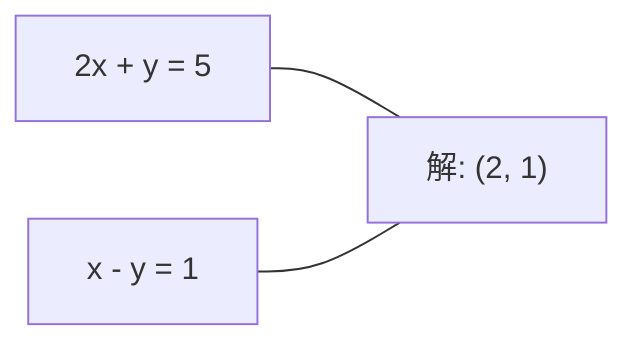
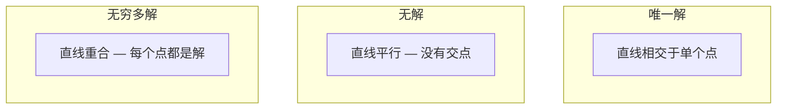

# 线性系统

> 求解$Ax = b$它是数学中最古老的问题之一,

**Type:** Build
**Language:**字符串
**前置要求：**阶段1课程01 (线性代数直观),02 (向量和矩阵),03 (矩阵转变)
**Time:** ~120 minutes

## 学习目标
- 使用带部分旋转和后置的高斯消除求解$Ax = b$
- 使用 LU、QR 和 Cholesky 分解矩阵,并解释每种方法适用的场景
- 推导最小方体的正常方程,并将其与线性回归和脊坡回归联系起来
- 使用条件号 诊断不良条件的系统,并应用规范化 使其稳定

## 问题
每次训练线性回归时,你都在寻求解决一个线性系统. 每次计算最小平方的适应时,你都在寻求解决一个线性系统. 每次神经网络层计算.`y = Wx + b`当你加入规律化时,你正在修改这个系统时,你正在分解一个矩阵时,你正在分解一个矩阵时,为马哈拉诺比距离寻求对等矩阵的逆转时,你正在寻求解答一个线性系统时,

方程 $Ax = b$无处不在.$A$是已知数组组成的矩阵.$b$是已知输出构成的向量.$x$是你想找到的未知量向量.$A$是你的数据矩阵,$b$是你的目标向量,$x$是重量向量.整个模型可以归结为:找到.$x$让$Ax$尽可能接近$b$,我知道.

本课程将从零构建到解方程的所有主要方法. 你会理解为什么有些方法是快速的,而其他方法是更稳定的,为什么有些方法只适用于方形系统,而其他方法可以处理过分的系统,以及为什么矩阵的条件数决定了你的答案是否有意义.

## 概念
### 什么意思在几何上

一个线性方程系统 具有几何解释――每个方程 定义一个超平面――解就是所有超平面 相交的点(或点集) ――

```
2x + y = 5          2D 中的两条直线。
x - y  = 1          它们相交于 x=2, y=1。
```



可能出现三个情况:



在矩阵形式中",一个解决方案"意味着$A$系统是不一致的. 系统是不一致的.$A$没有精确解的类别,因为你的方程 (数据点) 比未知 (参数) 更多.

### 列图与行图

有两种方法可以理解.$Ax = b$,我知道.

**Row picture.** $A$每一行定义一个方程. 每一个方程都是一个超平面.

**Column picture.** $A$问题变成了:$A$的列的线性组合能产生$b$现在,我们要去.

```
A = | 2  1 |    b = | 5 |
    | 1 -1 |        | 1 |

Row picture: 同时求解 2x + y = 5 和 x - y = 1。

Column picture: 找到 x1, x2，使得：
  x1 * [2, 1] + x2 * [1, -1] = [5, 1]
  2 * [2, 1] + 1 * [1, -1] = [4+1, 2-1] = [5, 1]   check.
```

列图更根本.$b$位于$A$系统就有解答.$b$在其中,你就找到了列空间中离它最近的点.

### 盖斯的消除

盖斯的消除将$Ax = b$转换为上方三角形系统$Ux = c$现在,我们可以用后置替换来解答.

算法:

```
1. 对每一列 k（pivot column）：
   a. 在第 k 行及其下方，找到 column k 中最大的 entry（partial pivoting）。
   b. 将该行与第 k 行交换。
   c. 对 k 下方的每一行 i：
      - 计算 multiplier m = A[i][k] / A[k][k]
      - 从第 i 行中减去 m 倍的第 k 行。
2. Back substitute：从最后一个 equation 向上求解。
```

示例:

```
Original:
| 2  1  1 | 8 |       R2 = R2 - (2)R1     | 2  1   1 |  8 |
| 4  3  3 |20 |  -->  R3 = R3 - (1)R1 --> | 0  1   1 |  4 |
| 2  3  1 |12 |                            | 0  2   0 |  4 |

                       R3 = R3 - (2)R2     | 2  1   1 |  8 |
                                       --> | 0  1   1 |  4 |
                                           | 0  0  -2 | -4 |

Back substitute:
  -2 * x3 = -4    -->  x3 = 2
  x2 + 2  = 4     -->  x2 = 2
  2*x1 + 2 + 2 = 8 --> x1 = 2
```

盖斯的消除的计算成本为$O(n^3)$为了$1000 \times 1000$系统,这大约是10亿次浮点操作.$A$求解多个系统,还可以做得更好.

### 部分转向:为什么重要

没有旋转,高斯的消除可能失败或产生垃圾结果. 如果旋转元素为零,你会除以零. 如果它很小,你会增加圆形错误.

```
Bad pivot:                       With partial pivoting:
| 0.001  1 | 1.001 |            先交换行：
| 1      1 | 2     |            | 1      1 | 2     |
                                 | 0.001  1 | 1.001 |
m = 1/0.001 = 1000              m = 0.001/1 = 0.001
R2 = R2 - 1000*R1               R2 = R2 - 0.001*R1
| 0.001  1     | 1.001   |      | 1      1     | 2     |
| 0     -999   | -999.0  |      | 0      0.999 | 0.999 |

x2 = 1.000（正确）              x2 = 1.000（正确）
x1 = (1.001 - 1)/0.001          x1 = (2 - 1)/1 = 1.000（正确）
   = 0.001/0.001 = 1.000        稳定，因为 multiplier 很小。
```

在精度有限的浮点算术中,未旋转的版本可能会丢失显著数字.

### 化

化将$A$分解为下方三角矩阵$L$和上方三角矩阵$U$其他:$A = LU$,我知道.$L$矩阵存储 高斯消除中的乘法──$U$矩阵是消除的结果.

```
A = L @ U

| 2  1  1 |   | 1  0  0 |   | 2  1   1 |
| 4  3  3 | = | 2  1  0 | @ | 0  1   1 |
| 2  3  1 |   | 1  2  1 |   | 0  0  -2 |
```

为什么要考虑,而不是直接消除?$L$和 $U$针对任何新$b$求解$Ax = b$只有需要$O(n^2)$其他:

```math
\begin{aligned}
Ax &= b \\
LUx &= b \\
&\text{令 } y = Ux\text{:} \\
Ly &= b \quad \text{（前代，} O(n^2)\text{）} \\
Ux &= y \quad \text{（回代，} O(n^2)\text{）}
\end{aligned}
```

$O(n^3)$后面每次解决都是$O(n^2)$如果你需要使用相同的$A$、不同$b$运输量 求解 1000 个系统,LU 会让总工作量节省约 1000/3 倍.

使用部分转时,你得到$PA = LU$在其中$P$是记录行交换的变量矩阵.

### 清理器分解

化将$A$分解为直角矩阵$Q$和上方三角矩阵$R$其他:$A = QR$,我知道.

具有直角矩阵$Q^T Q = I$的性质――它的列是正规向量――乘以$Q$会保持长度和角落.

```
A = Q @ R

Q has orthonormal columns: Q^T Q = I
R is upper triangular

To solve Ax = b:
  QRx = b
  Rx = Q^T b    (只需乘以 Q^T，不需要 inversion)
  Back substitute to get x.
```

在求解最小平方数问题时,QR比LU在数值稳定上更好.$Q$其他:

```
Given columns a1, a2, ... of A:

q1 = a1 / ||a1||

q2 = a2 - (a2 . q1) * q1        (减去到 q1 上的 projection)
q2 = q2 / ||q2||                (normalize)

q3 = a3 - (a3 . q1) * q1 - (a3 . q2) * q2
q3 = q3 / ||q3||

R[i][j] = qi . aj    for i <= j
```

每一步都会移除一切前面.$q$只有留下新的直角方向.

### 乔莱斯基的分解

当 当$A$是对称的$A = A^T$) 且正确的定义 (),所有自值都为正)$A = L L^T$在其中$L$这就是乔莱斯基的分解.

```
A = L @ L^T

| 4  2 |   | 2  0 |   | 2  1 |
| 2  5 | = | 1  2 | @ | 0  2 |

L[i][i] = sqrt(A[i][i] - sum(L[i][k]^2 for k < i))
L[i][j] = (A[i][j] - sum(L[i][k]*L[j][k] for k < j)) / L[j][j]    for i > j
```

乔莱斯基比LU快两倍,而且只需要半个储存空间. 它只适用于对称正确的确定矩阵,但这种矩阵经常出现:

- 合变矩阵是对称正面半确的 (通过规范可变为正确的)
- 高斯过程中内核矩阵是对称正确的定义.
- 曲函数在最小处的赫西式是对称正确的定义.
- $A^T A$总是对称正面半确的.

在高斯过程中,你用Cholesky 分解内核矩阵$K$然后求解$K \alpha = y$查莱斯基因子还会给出边际概率的日志决定因素:$\log \det(K) = 2 \sum \log(\mathop{\mathrm{diag}}(L))$,我知道.

### 最小方体:当 Ax = b 没有精确解时

如果$A$是 $m \times n$且$m > n$(方程多于未知),系统就是过分确定.

```
minimize ||Ax - b||^2

这是 squared residuals 的总和：
  sum((A[i,:] @ x - b[i])^2 for i in range(m))
```

最小化 满足正常方程:

```math
A^T A x = A^T b
```

推导:展开$\lVert Ax - b \rVert^2 = (Ax - b)^T (Ax - b) = x^T A^T A x - 2 x^T A^T b + b^T b$对对$x$求分数并令其为零:$2 A^T A x - 2 A^T b = 0$,我知道.

```
Original system (overdetermined, 4 equations, 2 unknowns):
| 1  1 |         | 3 |
| 1  2 | x     = | 5 |       没有精确的 x 能满足全部 4 个 equations。
| 1  3 |         | 6 |
| 1  4 |         | 8 |

Normal equations:
A^T A = | 4  10 |    A^T b = | 22 |
        | 10 30 |            | 63 |

Solve: x = [1.5, 1.7]

这就是 linear regression。x[0] 是 intercept，x[1] 是 slope。
```

### 常态方程 =线性回归

在线性回归中,数据矩阵$X$每一行对应一个样本,每一列对应一个特征――目标向量$y$每个输入对应一个样本.$w$满足:

```math
\begin{aligned}
X^T X w &= X^T y \\
w &= (X^T X)^{-1} X^T y
\end{aligned}
```

这是线性回归的闭式解决方案.`sklearn.linear_model.LinearRegression.fit()`通过QR或SVD计算等价结果)

向矩阵 添加规范化术语$\lambda I$你得到了脊坡回归:

```math
\begin{aligned}
(X^T X + \lambda I) w &= X^T y \\
w &= (X^T X + \lambda I)^{-1} X^T y
\end{aligned}
```

调节会让矩阵的调节更好(更容易准确求逆),并通过将重量向零缩小以防止过度适应──当$\lambda > 0$时,矩阵$X^T X + \lambda I$总是对称正确的,因此可以用乔莱斯基求解.

### 伪逆 (摩尔-罗斯)

伪逆$A^+$将矩阵逆转推广到非正方形和单一矩阵.$A$其他:

```math
\begin{aligned}
x &= A^+ b \\[4pt]
\text{其中 } A^+ &= V \Sigma^+ U^T \quad \text{（通过 SVD 计算）}
\end{aligned}
```

$\Sigma^+$通过对每个非零单一值 取相互并转置结果构成──如果$A = U \Sigma V^T$现在,$A^+ = V \Sigma^+ U^T$,我知道.

```
A = U Sigma V^T        (SVD)

Sigma = | 5  0 |       Sigma+ = | 1/5  0  0 |
        | 0  2 |                | 0  1/2  0 |
        | 0  0 |

A+ = V Sigma+ U^T
```

假逆向 给出最小标准最小平方的解决方案――如果系统有:
- 唯一解:$A^+ b$给出这个解答.
- 无解:$A^+ b$给出最小平方的解决方案.
- 无穷多解:$A^+ b$给出$\lVert x \rVert$最小的解答.

许多人`np.linalg.lstsq`和 `np.linalg.pinv`内部都使用SVD──

### 条件号码

条件数 测量解决方案对输入的微小变化有多敏感.$A$条件号是:

```math
\kappa(A) = \lVert A \rVert \cdot \lVert A^{-1} \rVert = \frac{\sigma_{\max}}{\sigma_{\min}}
```

其中$\sigma_{\max}$和 $\sigma_{\min}$分别是最大和最小的单数值.

```
Well-conditioned (kappa ~ 1):        Ill-conditioned (kappa ~ 10^15):
b 中的小变化 -->                    b 中的小变化 -->
x 中的小变化                         x 中的巨大变化

| 2  0 |   kappa = 2/1 = 2          | 1   1          |   kappa ~ 10^15
| 0  1 |   safe to solve            | 1   1+10^(-15) |   solution is garbage
```

经验法则:
- $\kappa < 100$安全,解决方案 准确.
- $\kappa \approx 10^k$您大约会从浮点算法中损失$k$位精度──
- $\kappa \approx 10^{16}$对于 float64):解决方案没有意义.

在ML中,不良条件发生在几乎直线的特征中.$\lambda I$) 将将条件号码从 $\sigma_{\max} / \sigma_{\min}$改善为$(\sigma_{\max} + \lambda) / (\sigma_{\min} + \lambda)$,我知道.

### 复制方法:结合梯度

对于非常大的稀疏系统 (数百万未知的),LU或Cholesky这样的直接方法 成本过高.

结合梯度 (CG) 在$A$是对称正确的定义$Ax = b$,它在精确的算法中最多.$n$现在找出一个确切的答案,但如果$A$自己的价值 聚集,通常会更快收──

```
Algorithm sketch:
  x0 = initial guess (often zero)
  r0 = b - A x0           (residual)
  p0 = r0                 (search direction)

  For k = 0, 1, 2, ...:
    alpha = (rk . rk) / (pk . A pk)
    x_{k+1} = xk + alpha * pk
    r_{k+1} = rk - alpha * A pk
    beta = (r_{k+1} . r_{k+1}) / (rk . rk)
    p_{k+1} = r_{k+1} + beta * pk
    if ||r_{k+1}|| < tolerance: stop
```

 CG 用于:
- 大规模优化 (Newton-CG方法)
- 求解 PDE 分
- 核心方法,其中的核心矩阵太大无法因素
- 作为其他反复解决器的预先条件

变化率取决于条件数量.

### 完整的图片:何时使用哪种方法

| Method | Requirements | Cost | Use case |
|--------|-------------|------|----------|
| Gaussian elimination | Square, nonsingular $A$ | $O(n^3)$ | 对 square system 的一次性求解 |
| LU decomposition | Square, nonsingular $A$ | $O(n^3)$ factor + $O(n^2)$ solve | 使用相同 $A$ 的多次求解 |
| QR decomposition | Any $A$ ($m \ge n$) | $O(mn^2)$ | Least squares，numerically stable |
| Cholesky | Symmetric positive definite $A$ | $O(n^3/3)$ | Covariance matrices，Gaussian processes，ridge regression |
| Normal equations | Overdetermined ($m > n$) | $O(mn^2 + n^3)$ | Linear regression（小 $n$） |
| SVD / pseudoinverse | Any $A$ | $O(mn^2)$ | Rank-deficient systems，minimum-norm solutions |
| Conjugate gradient | Symmetric positive definite, sparse $A$ | $O(n \cdot k \cdot \text{nnz})$ | Large sparse systems，$k$ = iterations |

### 与 ML 连接

本课程中的每种方法都出现在生产级 ML 中:

**Linear regression.**求解正常方程$X^T X w = X^T y$,这可以通过Cholesky如果$n$很小) 、QR(如果数值稳定性很重要) 或SVD(如果矩阵可能是缺陷的) 完成。

**Ridge regression.**向$X^T X$添加$\lambda I$△规范化系统$(X^T X + \lambda I) w = X^T y$总是可以通过Cholesky 求解,因为当$\lambda > 0$时,$X^T X + \lambda I$是对称正确的.

**Gaussian processes.**预测平均值需要求解$K \alpha = y$在其中$K$是核矩阵.对.$K$做乔莱斯基因数是标准方法――Log边际概率 使用 $\log \det(K) = 2 \sum \log(\mathop{\mathrm{diag}}(L))$,我知道.

**Neural network initialization.**基于线程的初始化使用QR分解 创建列为线程的重量矩阵――这可以防止深度网络中信号崩――

**Preconditioning.**大规模优化器 使用不完整的Cholesky 或不完整的 LU 作为结合梯度溶解器的先决条件──

**Feature engineering.** $X^T X$条件号码 告诉你特征 是否结线.$\kappa$很大,删除功能或添加规律化.


```figure
linear-system-conditioning
```

## 构建它
### 步骤1: 部分旋转的高斯式消除

```python
import numpy as np

def gaussian_elimination(A, b):
    n = len(b)
    Ab = np.hstack([A.astype(float), b.reshape(-1, 1).astype(float)])

    for k in range(n):
        max_row = k + np.argmax(np.abs(Ab[k:, k]))
        Ab[[k, max_row]] = Ab[[max_row, k]]

        if abs(Ab[k, k]) < 1e-12:
            raise ValueError(f"Matrix is singular or nearly singular at pivot {k}")

        for i in range(k + 1, n):
            m = Ab[i, k] / Ab[k, k]
            Ab[i, k:] -= m * Ab[k, k:]

    x = np.zeros(n)
    for i in range(n - 1, -1, -1):
        x[i] = (Ab[i, -1] - Ab[i, i+1:n] @ x[i+1:n]) / Ab[i, i]

    return x
```

### 步骤 2: LU分解

```python
def lu_decompose(A):
    n = A.shape[0]
    L = np.eye(n)
    U = A.astype(float).copy()
    P = np.eye(n)

    for k in range(n):
        max_row = k + np.argmax(np.abs(U[k:, k]))
        if max_row != k:
            U[[k, max_row]] = U[[max_row, k]]
            P[[k, max_row]] = P[[max_row, k]]
            if k > 0:
                L[[k, max_row], :k] = L[[max_row, k], :k]

        for i in range(k + 1, n):
            L[i, k] = U[i, k] / U[k, k]
            U[i, k:] -= L[i, k] * U[k, k:]

    return P, L, U

def lu_solve(P, L, U, b):
    n = len(b)
    Pb = P @ b.astype(float)

    y = np.zeros(n)
    for i in range(n):
        y[i] = Pb[i] - L[i, :i] @ y[:i]

    x = np.zeros(n)
    for i in range(n - 1, -1, -1):
        x[i] = (y[i] - U[i, i+1:] @ x[i+1:]) / U[i, i]

    return x
```

### 步骤3: 乔莱斯基的分解

```python
def cholesky(A):
    n = A.shape[0]
    L = np.zeros_like(A, dtype=float)

    for i in range(n):
        for j in range(i + 1):
            s = A[i, j] - L[i, :j] @ L[j, :j]
            if i == j:
                if s <= 0:
                    raise ValueError("Matrix is not positive definite")
                L[i, j] = np.sqrt(s)
            else:
                L[i, j] = s / L[j, j]

    return L
```

### 步骤 4:通过正常方程的最小方体

```python
def least_squares_normal(A, b):
    AtA = A.T @ A
    Atb = A.T @ b
    return gaussian_elimination(AtA, Atb)

def ridge_regression(A, b, lam):
    n = A.shape[1]
    AtA = A.T @ A + lam * np.eye(n)
    Atb = A.T @ b
    L = cholesky(AtA)
    y = np.zeros(n)
    for i in range(n):
        y[i] = (Atb[i] - L[i, :i] @ y[:i]) / L[i, i]
    x = np.zeros(n)
    for i in range(n - 1, -1, -1):
        x[i] = (y[i] - L.T[i, i+1:] @ x[i+1:]) / L.T[i, i]
    return x
```

### 步骤5:条件号码

```python
def condition_number(A):
    U, S, Vt = np.linalg.svd(A)
    return S[0] / S[-1]
```

## 使用它
将这些部分组合起来,在真实数据上进行线性回归和脊坡回归:

```python
np.random.seed(42)
X_raw = np.random.randn(100, 3)
w_true = np.array([2.0, -1.0, 0.5])
y = X_raw @ w_true + np.random.randn(100) * 0.1

X = np.column_stack([np.ones(100), X_raw])

w_ols = least_squares_normal(X, y)
print(f"OLS weights (ours):    {w_ols}")

w_np = np.linalg.lstsq(X, y, rcond=None)[0]
print(f"OLS weights (numpy):   {w_np}")
print(f"Max difference: {np.max(np.abs(w_ols - w_np)):.2e}")

w_ridge = ridge_regression(X, y, lam=1.0)
print(f"Ridge weights (ours):  {w_ridge}")

from sklearn.linear_model import Ridge
ridge_sk = Ridge(alpha=1.0, fit_intercept=False)
ridge_sk.fit(X, y)
print(f"Ridge weights (sklearn): {ridge_sk.coef_}")
```

## 交付它
本课产出:
- `code/linear_systems.py`包含从零实现的高斯消除,LU分解,Cholesky分解,最小方体和脊回归
- 一个可运行的演示,展示正常方程和 sklearn 的线性回归 产生相同的重量

## 练习
1. 用你的高斯式消除,用你的 LU 溶剂和`np.linalg.solve`求解系统`[[1,2,3],[4,5,6],[7,8,10]] x = [6, 15, 27]`△验证三者在浮点宽容内给出相同的答案──

2. 生成一个50x5随机矩阵 X 和目标 y = X @ w_true + noise──分别使用正常方程、QR(通过 `np.linalg.qr`通过SVD`np.linalg.svd`) 和 `np.linalg.lstsq`求解 w──比较四个解决方案──测量$X^T X$解释它如何影响你的信任的方法.

3. 通过让两个列几乎相同来创建一个几乎单一的矩阵 (例如,列2 =列1 + 1e-10 *噪音) ⋅计算它的条件数量――分别在有规律化和无规律化的情况下求解$Ax = b$加入$0.01 I$解释为什么规律化有帮助.

4. 为一个100x100随机对称正确矩阵实现结合梯度算法――统计它收到耐受性 1e-8 需要多少次代――与$n$进行比较的理论最大值的代.

5. 在大小为10、50、200、500的对称正确矩阵上,对你的乔莱斯基溶解器,你的LU溶解器和`np.linalg.solve`计时――绘制结果――验证 乔莱斯基大约比卢快2倍――

### 提示

**练习 1。**调用`gaussian_elimination(A, b)`调用`lu_decompose(A)`并继续调用`lu_solve(P, L, U, b)`最后调用`np.linalg.solve(A, b)`△使用`np.allclose(A @ x, b)`检查每个解,并用 `np.allclose`比较这些三种解答.

**练习 2。**对正常方程使用`least_squares_normal`其他方法使用应对的三个NumPy 函数――四个解都应接近`w_true`比较`condition_number(X.T @ X)`和 `condition_number(X)`后者是后者的平方,因此正常方程的精度最大.

**练习 3。**预期条件数 会超过 $10^{9}$△分别使用`np.linalg.solve`和 `ridge_regression(A, b, 0.01)`求解,再比较各自的`np.linalg.norm(x)`和残留规则――两个残留都可能很小,但未经规范化的解通常包含很大的分量――

**练习 4。**使用 `B @ B.T + n * np.eye(n)`构建对称正确的定义矩阵,保证每个自值都为正确.`conjugate_gradient`循环中加入计数器,然后检查最终残余标准是否小于1e-8,代次数是否不超过100──

**练习 5。**三种溶剂 使用相同的`B @ B.T + n * np.eye(n)`矩阵,并用`time.perf_counter`测量每次求解的耗时,获得多次运行中的最佳结果. 乔莱斯基所需的算术运算量约为LU的一半,因此在较大的矩阵尺寸下,这个比例最明显.

## 关键术语
| Term | What people say | What it actually means |
|------|----------------|----------------------|
| Linear system | "Solve for x" | 一组 linear equations $Ax = b$。找到 $x$ 意味着找到在 transformation $A$ 下产生 output $b$ 的 input。 |
| Gaussian elimination | "Row reduce" | 使用 row operations 系统性地将 diagonal 下方的 entries 置零，产生可通过 back substitution 求解的 upper triangular system。$O(n^3)$。 |
| Partial pivoting | "Swap rows for stability" | 在 column $k$ 中进行 elimination 前，将该 column 中 absolute value 最大的行交换到 pivot 位置。防止除以很小的数。 |
| LU decomposition | "Factor into triangles" | 写成 $A = LU$，其中 $L$ 是 lower triangular（存储 multipliers），$U$ 是 upper triangular（eliminated matrix）。将 $O(n^3)$ 成本摊销到多次求解中。 |
| QR decomposition | "Orthogonal factorization" | 写成 $A = QR$，其中 $Q$ 的 columns 是 orthonormal，$R$ 是 upper triangular。对于 least squares，比 LU 更稳定。 |
| Cholesky decomposition | "Square root of a matrix" | 对 symmetric positive definite $A$，写成 $A = LL^T$。成本是 LU 的一半。用于 covariance matrices、kernel matrices 和 ridge regression。 |
| Least squares | "Best fit when exact is impossible" | 当 system overdetermined（equations 多于 unknowns）时，最小化 squared residuals 的总和 $\lVert Ax - b \rVert^2$。 |
| Normal equations | "The calculus shortcut" | $A^T A x = A^T b$。将 $\lVert Ax - b \rVert^2$ 的 Gradient 设为零。这就是 linear regression 的 closed-form solution。 |
| Pseudoinverse | "Inversion for non-square matrices" | $A^+ = V \Sigma^+ U^T$ via SVD。对于任意 Matrix，无论 square 或 rectangular、singular 与否，给出 minimum-norm least-squares solution。 |
| Condition number | "How trustworthy is this answer" | $\kappa = \sigma_{\max} / \sigma_{\min}$。衡量对 input perturbations 的敏感性。大约损失 $\log_{10}(\kappa)$ 位精度。 |
| Ridge regression | "Regularized least squares" | 求解 $(X^T X + \lambda I) w = X^T y$。添加 $\lambda I$ 改善 conditioning，并将 weights 向零收缩。防止 overfitting。 |
| Conjugate gradient | "Iterative Ax=b for big matrices" | 用于 symmetric positive definite systems 的 iterative solver。最多 $n$ 步收敛。适合 factorization 成本过高的大型 sparse systems。 |
| Overdetermined system | "More data than parameters" | 在 $m\text{-by-}n$ system 中 $m > n$。不存在精确解。Least squares 找到最佳近似。这就是每个 regression problem。 |
| Back substitution | "Solve from the bottom up" | 给定 upper triangular system，先求解最后一个 equation，然后向后 substitute。$O(n^2)$。 |
| Forward substitution | "Solve from the top down" | 给定 lower triangular system，先求解第一个 equation，然后向前 substitute。$O(n^2)$。用于 LU solves 中的 L step。 |

## 延伸阅读
- [MIT 18.06: Linear Algebra](https://ocw.mit.edu/courses/18-06-linear-algebra-spring-2010/)关于线性系统和矩阵因数化的权威课程
- [Numerical Linear Algebra](https://people.maths.ox.ac.uk/trefethen/text.html)了解数值稳定性,条件化以及算法为什么失败标准参考
- [Matrix Computations](https://www.cs.cornell.edu/cv/GolubVanLoan4/golubandvanloan.htm)包含各种矩阵算法的百科式参考
- [3Blue1Brown: Inverse Matrices](https://www.3blue1brown.com/lessons/inverse-matrices)- 求解$Ax = b$几何意义的可视化直觉
