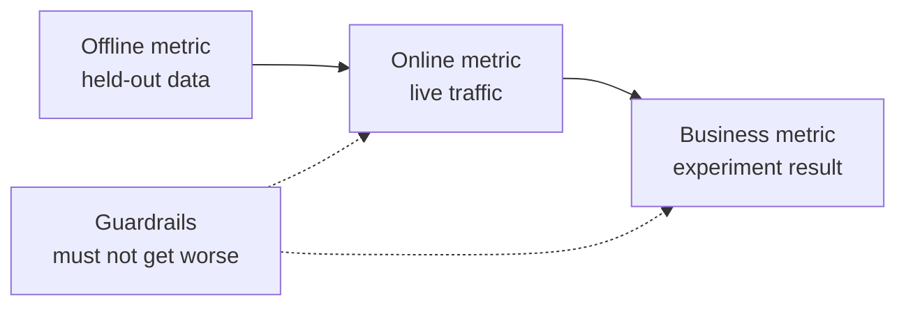

# 机器学习系统设计:从问题到已部署的模型

> 模型只是系统的一部分.设计决定模型预测什么.谁根据预测采取行动,多少钱,以及如何处理失败.

**Type:** Build
**Languages:** Python
**Prerequisites:** 阶段 2，第 09 课（模型评估）和第 13 课（ML 流水线）
**Time:** 约 110 分钟

## 学习目标

- 定义业务问题为 ML 任务,明确预测内容,使用预测的决策以及规则不足以解决问题的原因
- 区分离线,线上,业务和护理标志,并将每个模型与简单的线和启动的线进行比较
- 根据流量估计量推算和在线推算的每日成本、延迟及数据陈旧程度
- 选择发布方式 ((影子、金丝雀、A/B 测试),并为每种故障模式选择安全默认行为
- 识别模型如何通过决策改变下一个版本的训练数据的反循环
- 编写 ML 设计文档,并按固定检查清单评分

## 问题

一家订阅公司要求做一个流失预测模型. 数据科学家训练了升级分类器,报告AUC 达到0.91――三个月后,没有人使用它.

原因与算法无关. 没有人决定分数应触发什么行动. 分数每周才更新一次,但客户保留团队每天都打电话. 标签来自取消订阅表,而表还存储取消原因,因此某个特征直接包含答案.

这些失败在训练开始之前已经埋葬了.它们都是设计失败,而一个页面设计文档就能逐步追问.

## 核心概念

### 从业务目标到 ML 任务

业务目标不等于 ML 任务.

1. 模型具体预测什么,预测对象是什么实体?
2. 预测是哪些决策的使用,由谁或什么系统做出决策?
3. 什么时候需要预测,那时有什么数据可用?
4. 如何判断决策有所改善?

| 业务目标 | 预测 | 使用预测的决策 | ML 任务 |
|---|---|---|---|
| 减少流失 | 用户未来 30 天取消订阅的概率 | 每晚向风险最高的 5% 用户发送挽留优惠 | 二分类 |
| 减少欺诈损失 | 一笔支付属于欺诈的概率 | 在 100 ms 内批准、送审或阻止 | 二分类 |
| 保持货架有货 | 下周各门店每天的销售件数 | 各门店订货量 | 预测 |
| 展示相关商品 | （用户，商品）对的相关性分数 | 信息流中的商品顺序 | 排序 |

第二列最需要仔细的定义. 预测流失没有明确的时间窗口. 实体和行动. 预测这个用户是否会在未来30天内取消订阅,让今晚的任务决定谁收到优惠.

### 何时不应使用ML

机器学习需要数据,简单启动式规则往往已经能解决部分问题.

- 简短规则可以实现目标,并能持续保持正确.规则运行,测试和解释成本更低.
- 没有标签,也没有实际可行的收集方法.
- 没有人根据预测采取行动,因此预测更准确也不会带来变化.
- 预测时可用的数据不含所需信号――
- 一次错误也不能接受,没有人可以检查输出.
- 构建和运行系统的成本高于更好的决策带来的价值.

当规则变得冗长而脆弱时,ML才开始值得投入.同一个指导规则3建议优先使用ML而不是复杂的启动规则,因为学习模型更容易更新和维护.

### 三层指标

在三个层面衡量ML系统,同时设置一组限制:

| 层面 | 何时能测量 | 流失预测示例 |
|---|---|---|
| 离线指标 | 上线前，在留出的历史数据上 | 优惠阈值处的 F1、风险最高 5% 中的精确率 |
| 在线指标 | 上线期间，在真实流量上 | 优惠接受率、已评分用户比例、分数分布 |
| 业务指标 | 上线数周后，通过实验 | 干预组与保留对照组的 30 天流失率 |
| 护栏指标 | 始终监测 | 每挽留一名用户的优惠成本、退订率、p99 延迟 |



网络指标通常会产生不同的结论. 离线指标评估历史数据,而过去没有你的模型.

选择与决策匹配的离线指标. 如果任务与风险最高的5%的用户联系,就测量这一5%中精确率.

### 基线

孤立指标没有意义. 如果最佳替代方案只有0.30,F1 达到0.56,就很好;如果一条规则能达到0.60,就很差.

- **简单基线。**始终预测多数类别,或始终预测训练集平均值――模型评估课程使用了这种检查――
- **启发式基线。**基于领域知识规则,或适合训练数据的单一特征值.
- **现有系统。**现在的决策方法,即使它只是一个使用电子表格的人.

升级量是模型分数减去最强基线分数――在查看结果前设定最低升级要求,并确保它足以覆盖额外系统成本――简单基线通常很弱,启动基线才是真正难以击败的对手――

### 数据和标签要求

训练前回答这些问题:

- **标签来源。**谁负责什么事件的标签?
- **标签延迟。**预测后多久才知道真实结果?欺诈拒绝付款可能在支付数周后出现;流失标签要等30天预测窗口结束――
- **标签质量。**谁标记,出错频率多高?
- **预测时的可用性。**预测发生时是否存在每个特征?
- **各类样本量。**只有200个正确的样本,通常只能使用简单的模型.
- **时间切分。**留出最近的一段时间. 时间序列课程按时间分类数据也是因为同样的原因.

### 延迟,吞吐量和成本预算

三个数字约束每一种服务设计:

- **延迟预算。**延迟是100个请求中99个比耗时低.支付检查可能需要50ms.夜间报表则可以运行数小时.
- **峰值吞吐量。**按最忙的分钟而不是日均流量配置系统――峰值QPS(每秒请求数) 通常是平均值的数倍――
- **成本预算。**通过每天美元成本或每1000次预测的美元成本表示,比较方案很容易.

较小的定律将前两种联系起来:处理中请求数等于吞吐量乘以延迟.

### 批量推算与在线推算

提供预测有两种基本方法:

- **批量推理。**定时任务为每个实体评分,将分数写入表或键值存储.
- **在线推理。**应用在请求到达时将特征发送给模型服务,等分数回复.

| 属性 | 批量 | 在线 |
|---|---|---|
| 新鲜度 | 距离上次运行的时间，加上运行耗时 | 使用当前请求的数据 |
| 请求延迟 | 一次键值读取，几毫秒 | 特征获取时间加模型耗时 |
| 成本驱动因素 | 实体数乘以每天运行次数 | 按峰值 QPS 配置的副本数 |
| 新实体 | 下一次运行前没有分数 | 第一次请求时即可评分 |
| 故障时 | 旧分数仍可读取 | 请求失败或超时 |

本课程工具包将估计两者的成本――批量成本随实体数量和每天运行次数的增长而增加――允许陈旧时间越来越短,运行越来越频繁――在线成本随着峰值流量增长而增加,因为高峰之间空的副本也必须付费――一个耗时一小时的批量任务,无论花费多少钱,都不能满足短于一小时的陈旧时间限制――

混合设计很常见:夜间批量任务给已使用者评分,在线路径处理新用户和需要新数据的请求.

### 部署模式

新模型分阶段接触用户:

1. **影子运行（Shadow）。**新模型接收了真流量的副本――系统记录预测,但没有使用它――比较新模型的延迟、误率和预测分布――
2. **金丝雀发布（Canary）。**新模型为一小部分流量做出真实的决策,通常从1%到5%开始.
3. **A/B 测试。**随着分组的用户分别使用不同的模型.

每个阶段都需要在几分钟内完成回滚. 通过配置切换流量,保留已部署的旧模型版本.[影子与金丝雀发布课](../../../17-infrastructure-and-production/20-shadow-canary-progressive/docs/en.md)和 [A/B 测试课](../../../17-infrastructure-and-production/21-ab-testing-llm-features/docs/en.md)对于语言模型讲解同样三种模式.

### 反循环

当模型的决策改变下一个版本的训练数据时,出现反循环.

- **干预隐藏标签。**流失模型发送优惠,挽留部分用户──下个月,高风险用户看起来很忠诚,重新训练的模型便学到这些特征无法预测流失──
- **被阻止的行动没有结果。**欺诈模型阻止支付,这个支付就永远不会产生拒绝标签.
- **曝光限制反馈。**排序模型只显示排名前的商品,因此只有这些商品得到点击.

修复方法的共同思想是保留一些未受模型影响的数据──随时保留一小组永远不接受干预的用户;给少量流量随机分配决策;随着每个样本记录分数和决策,使后续训练能够区分受影响的数据和干净的数据──

### 障碍模式与安全默认行为

系统的每个部分都会迟早失败. 应在设计阶段而不是事故期间决定各类故障的默认行为:

| 故障 | 没有预案时的结果 | 安全默认行为 |
|---|---|---|
| 模型服务超时 | 请求失败 | 使用启发式基线 |
| 夜间批任务失败 | 分数缺失或过旧 | 在固定期限内提供最近的正常分数，之后使用规则 |
| 特征缺失或越界 | 模型对坏输入评分 | 使用文档规定的默认值，并记录事件 |
| 新实体没有历史 | 没有分数 | 使用规则或总体均值 |
| 分数分布突然变化 | 大规模错误决策 | 暂停自动行动，并通知人工处理 |

标志部分的启动基线也是大多数故障的默认方案,所以应先实现它.

### 设计文档

设计文档在训练开始前集中记录上述决策. 本课程检查器为其JSON版本评分. 其中六项检查具有阻塞性,因为任一缺失都会使系统不安全或无用:

| 章节 | 回答的问题 | 阻塞条件 |
|---|---|---|
| 问题 | 预测什么，哪项决策使用它，为什么规则不够？ | 必须明确决策 |
| 指标 | 适用哪些离线、在线、业务和护栏指标？ | 必须明确业务指标 |
| 基线 | 适用哪些简单、启发式和现有系统基线？ | 必须有启发式或现有系统基线 |
| 数据 | 标签来自哪里、延迟多久，每个特征预测时是否可用？ | 不得泄露标签 |
| 预算与服务 | 有哪些延迟、峰值 QPS、成本和陈旧时间限制，哪种模式满足它们？ | 无 |
| 发布 | 使用哪些影子、金丝雀及 A/B 阶段，如何回滚？ | 必须有影子或金丝雀阶段，以及回滚 |
| 反馈循环 | 模型如何改变未来数据，如何保留干净数据？ | 无 |
| 故障模式 | 每种故障的默认行动是什么？ | 每种故障都必须有默认行为 |
| 监控 | 上线后观察什么？ | 无 |

```figure
mlprod-serving-cost
```

## 从零构建

`code/main.py`仅使用标准库,包含三个工具:服务成本模型,基线比较器和设计档案检查器.

### 第1步:工作负载和价格的描述

工作负载保存流量与预算数字,成本模型保存价格――这些价格是实践使用的整数化示例,而不是供应商报价――

```python
@dataclass(frozen=True)
class Workload:
    name: str
    entities: int
    requests_per_day: int
    peak_qps: float
    max_staleness_hours: float
    latency_budget_ms: float


@dataclass(frozen=True)
class CostModel:
    batch_dollars_per_million: float = 0.40
    batch_job_hours: float = 1.0
    lookup_dollars_per_million: float = 0.25
    lookup_latency_ms: float = 4.0
    replica_dollars_per_hour: float = 0.50
    replica_qps: float = 200.0
    min_replicas: int = 2
    online_latency_ms: float = 35.0
```

### 第二步:计算批量和在线服务成本

批量任务必须在旧时间上限内完成. 两次运行的间隔等于上限减去任务耗时.

```python
def batch_plan(workload: Workload, costs: CostModel) -> ServingPlan:
    refresh_hours = workload.max_staleness_hours - costs.batch_job_hours
    if refresh_hours <= 0:
        return ServingPlan(
            "batch", False, math.inf, costs.lookup_latency_ms, math.inf, 0.0,
            "staleness limit is shorter than one batch job",
        )
    runs_per_day = 24.0 / refresh_hours
    predictions = workload.entities * runs_per_day
    dollars = (
        predictions / 1e6 * costs.batch_dollars_per_million
        + workload.requests_per_day / 1e6 * costs.lookup_dollars_per_million
    )
    ...
```

网上服务需要支付费用,以确保可用性,保持足够的副本承受峰值,并至少保留两个副本:

```python
def online_plan(workload: Workload, costs: CostModel) -> ServingPlan:
    replicas = max(costs.min_replicas, math.ceil(workload.peak_qps / costs.replica_qps))
    dollars = replicas * costs.replica_dollars_per_hour * 24.0
    feasible = costs.online_latency_ms <= workload.latency_budget_ms
    ...
```

`choose_serving`选择满足延迟和陈旧时间限制方案,返回最便宜的.`None`提示你需要调整预算.

### 第3步:模型与基线的比较

较器用同一个指标评估模型和所有基线.

```python
def compare_to_baselines(
    y_true: list,
    model_pred: list,
    baselines: dict[str, list],
    metric,
    metric_name: str,
    higher_is_better: bool = True,
    min_lift: float = 0.02,
) -> BaselineReport:
    if not baselines:
        raise ValueError("a model needs at least one baseline")
    scores = {name: metric(y_true, pred) for name, pred in baselines.items()}
    pick = max if higher_is_better else min
    best_name = pick(scores, key=scores.get)
    model_score = metric(y_true, model_pred)
    lift = model_score - scores[best_name] if higher_is_better else scores[best_name] - model_score
    return BaselineReport(metric_name, {"model": model_score, **scores}, best_name, lift, min_lift)
```

启发式基线是单特征规则.`fit_rule`在训练数据中,将每个特征的值按为值,保留F1最好的值.

### 第四步:为设计文档评分

每个检查项包含键,权重,阻塞标志,消息和检查函数.

```python
CheckItem("decision", 2, True, "name the action that uses each prediction", lambda d: _text(d, "problem.decision")),
CheckItem("baselines", 2, True, "add a heuristic or current-system baseline", check_baselines),
CheckItem("no_leakage", 2, True, "confirm every feature exists at prediction time",
          lambda d: get_path(d, "data.features_available_at_prediction_time") is True),
CheckItem("serving_fit", 1, False, "pick a serving mode that meets the staleness, latency, and cost budgets",
          check_serving_fit),
```

`check_serving_fit`复用成本模型,从文档读取负载数字,并估计选定模式的成本. 如果该模式不能满足旧时间上限,延迟预算或每天成本预算,检查就失败. 声明采用批,但只允许三分钟旧时间的文档无法通过. 成本模型没有混合方案,因此声明混合的文档也会失败,直到你加入该方案在练习1中.

`review_design_doc`只有分数达到0.85 并且所有阻塞项通过,结论才是准备好进行审查(可进入评审)

### 第五步:运行

```bash
python3 code/main.py
```

```console
nightly churn scores
  ok batch        $0.91/day      4 ms  1.0 runs per day over 2,000,000 entities
  ok online      $24.00/day     35 ms  2 replicas sized for 40 peak QPS
  choose: batch

feed ranking, 2-hour freshness
  ok batch       $48.50/day      4 ms  24.0 runs per day over 5,000,000 entities
  ok online      $24.00/day     35 ms  2 replicas sized for 120 peak QPS
  choose: online

=== Model versus baselines (churn, metric F1) ===
  model                    0.564
  days_idle > 12.8688      0.500
  random at base rate      0.232
  majority class           0.000
  model beats the strongest baseline (days_idle > 12.8688) by +0.064
```

由于它从未预测流失. 后的规则才是真正的竞争者. 模型比它高0.064,因此有理由使用模型. 如果特征较弱,规则可能会胜利,则规则才应该部署系统.

设计文档评审会印出缺少六项阻碍项的薄弱文档,以及1.00分的完整文档――传入路径可评审您自己的文档:

```bash
python3 code/main.py my_design_doc.json
```

## 使用现成工具

工具包各部分都应对团队在生产中使用的工具.

**基线。**简单基线将实现为估计器,因此它们可以与模型放入同一流水线:

```python
from sklearn.dummy import DummyClassifier, DummyRegressor
from sklearn.metrics import f1_score

majority = DummyClassifier(strategy="most_frequent").fit(X_train, y_train)
base_rate = DummyClassifier(strategy="stratified", random_state=0).fit(X_train, y_train)
mean_value = DummyRegressor(strategy="mean").fit(X_train, y_reg_train)

print(f1_score(y_test, majority.predict(X_test)))
```

`most_frequent`应对`majority_baseline`没有任何`stratified`应对`base_rate_baseline`◎小学学习 没有启发式基线,因为启动式规则来自你的具体领域──

**批量服务。**任务将分数写入数仓表,或Redis、DynamoDB等关键值存储.

**在线服务。**模型服务器将模型封装在HTTP或gRPC端点后.

**发布。**广告发行平台,广告发行平台,广告发行平台,广告发行平台,广告发行平台,广告发行平台,广告发行平台,广告发行平台,广告发行平台,广告发行平台,广告发行平台,广告发行平台,广告发行平台,广告发行平台,广告发行平台,广告发行平台,广告发行平台,广告发行平台,广告发行平台,广告发行平台,广告发行平台,广告发行平台,广告发行平台,广告发行平台,广告发行平台,广告发行平台,广告发行平台,广告发行平台,广告发行平台,广告发行平台,广告发行平台,广告发行平台,广告发行平台,广告发行平台,广告发行平台,广告发行平台等.

**设计评审。**布雷克等发表的ML测试成绩包含生产ML系统所需的28项测试和监控要求.

## 交付成果

本课产出发 `outputs/skill-ml-design-review.md`△ 技能逐节评审 ML 设计文档,优先指出阻塞性缺口,并使用本课程的批量及在线成本算术检查服务选择.

## 练习

1. 为`choose_serving`添加混合方案:批量为已使用者评分,在线为新用户评分――比较每天成本――
2. 修改流失数据,直到模型不再超过规则.
3. 在检查清单添加`budgets.max_dollars_per_1k_predictions`项,并编写缺少项时会失败的测试.
4. 为支付欺诈检查编写JSON设计文档,运行检查器,修复每个阻塞项.
5. 模拟流失反循环:移除收到优惠用户标签,重新训练,并测量F1的变化.

## 关键术语

| 术语 | 常见说法 | 实际含义 |
|------|----------------|----------------------|
| ML 任务 | “做一个流失模型” | 预测目标、实体、时间窗口，以及使用预测的决策 |
| 离线指标 | “模型分数” | 上线前在留出的历史数据上计算的指标 |
| 在线指标 | “实时数据” | 模型运行时在真实流量上测量的指标 |
| 业务指标 | “目标” | 决策必须改变、通过实验测量的公司业务结果 |
| 护栏指标 | “不要造成损害” | 新模型上线时不能变差的指标 |
| 基线 | “简单模型” | 模型必须以规定幅度超越的简单、启发式或现有系统预测器 |
| 批量推理 | “预先算好的分数” | 定时任务为每个实体评分并存储结果，供查询使用 |
| 在线推理 | “实时模型” | 每个请求到达时由模型评分 |
| 影子部署 | “暗发布” | 新模型对真实流量评分，但无人使用输出 |
| 金丝雀发布 | “逐步上线” | 新模型为逐渐扩大的小部分流量决策，同时备好回滚 |
| 反馈循环 | “模型训练自己” | 模型决策改变下一版本的训练数据 |

## 延伸阅读

- [Sculley et al., Hidden Technical Debt in Machine Learning Systems (NeurIPS 2015)](https://papers.nips.cc/paper/2015/hash/86df7dcfd896fcaf2674f757a2463eba-Abstract.html)模型周边的系统成本
- [Google, Rules of Machine Learning](https://developers.google.com/machine-learning/guides/rules-of-ml)首个模型,指标及训练与服务一致性的实用规则
- [Breck et al., The ML Test Score (IEEE Big Data 2017)](https://research.google/pubs/the-ml-test-score-a-rubric-for-ml-production-readiness-and-technical-debt-reduction/)测量生产的28项测试
- [Kohavi, Tang, and Xu, Trustworthy Online Controlled Experiments (Cambridge University Press, 2020)](https://experimentguide.com/)如何运行能够得出可靠结论的A/B测试
- [Sato, Wider, and Windheuser, Continuous Delivery for Machine Learning (2019)](https://martinfowler.com/articles/cd4ml.html)版本化数据,模型和部署流水线
- [Google Cloud, MLOps: Continuous delivery and automation pipelines in machine learning](https://cloud.google.com/architecture/mlops-continuous-delivery-and-automation-pipelines-in-machine-learning)培训和服务自动化的三个成熟层次
