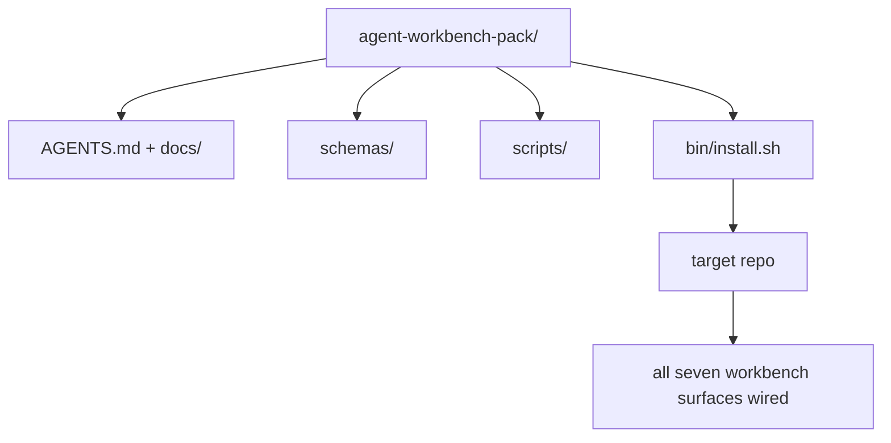

# 交付可复用代理工作台包

> 这部小曲子是可以放进任何一个备忘录包的.`cp -r`接下来第二天早上让代理稳定工作. 这里是课程真正交付的艺术品.

**类型：**建立
**语言：**字符串 (stdlib)
**前置要求：**阶段14 · 31 到14 · 41
**时间：**七十五分钟

## 学习目标

- 将七个工作桌面面包装成一个可以直接放入的目录.
- 固定方案、脚本和模板,让新 repo 获得已知可用的基线.
- 添加一个安装脚本,用等方式放置这个包.
- 决定哪些内容留在包装中,哪些内容留在外面,并为每个人辩护.
- 展示经纪人协助完成的仓库变更,并提供审计人员能够复现的证据.

## 问题

一个存在于Google文档,聊天历史和三个只被模糊记忆的脚本中的工作台,一个每季度都会重建的工作台.

在课结束时,你将在磁盘上交付.`outputs/agent-workbench-pack/`另外一个可以放入任何目标的存储器.`bin/install.sh`,我知道.

## 概念



### 包装布局

```
outputs/agent-workbench-pack/
├── AGENTS.md
├── docs/
│   ├── agent-rules.md
│   ├── reliability-policy.md
│   ├── handoff-protocol.md
│   └── reviewer-rubric.md
├── schemas/
│   ├── agent_state.schema.json
│   ├── task_board.schema.json
│   └── scope_contract.schema.json
├── scripts/
│   ├── init_agent.py
│   ├── run_with_feedback.py
│   ├── verify_agent.py
│   └── generate_handoff.py
├── bin/
│   └── install.sh
└── README.md
```

### 什么留下,什么放在外面

留下:

- 表面的图案――它们就是合约――
- 上面的四个脚本.
- 它们是规则和条例.

放在外面:

- 项目特定任务――任务属于目标 repo 的董事会,不属于包.
- 供应商 SDK 调用――这个包与框架无关――
- 包装 文案. 这个包装 放在团队已经有上机 旁边,而不是放在其中.

### 安装器

一个简短的`bin/install.sh`(或 `bin/install.py`):

1. 没有`--force`时,拒绝覆盖安装到已有包装上.
2. 将包装复制成目标 repo.
3. 如果存在`.github/workflows/`接入了CI.
4. 打印后续步骤:填写板、设置接受命令、运行 init脚本──

### 版本管理

这个包带一个`VERSION`文件──需要迁移的方案和脚本 变更会大──只需要文件的变更会补丁──目标 repo 的`agent_state.json`记录它初始化时对应的包装版本.


```figure
wb-pack-install
```

## 构建它

`code/main.py`现在,我们要把包装放在课旁边.`outputs/agent-workbench-pack/`作为种子,我使用了这部小曲的前面课程的方案和脚本,以及你已经写的文档.

运行它:

```
python3 code/main.py
```

这个脚本会复制并固定表面,写入 README,打印包树,然后以零退出.

## 真实生产中的模式

一个包只能在经受叉的更新和不友好的上游时才有价值.

**`VERSION` 是 contract，不是 marketing。**需要状态迁移. 小的需要重新运行检查器.`.workbench-version`写入目标 repo;如果目标的锁与包装的 `VERSION`不一致`lint_pack.py`我拒绝交付.`npm`,我知道.`Cargo`和 `pyproject.toml`能经历10年的炼方式;代理不会改变这些规则.

**跨工具分发的单一来源。**提供一个`nx ai-setup`单个配置 放置`AGENTS.md`,我知道.`CLAUDE.md`,我知道.`.cursor/rules/`,我知道.`.github/copilot-instructions.md`和一个MCP服务器──这个包也应该这样做;安装器输出链接(`ln -s AGENTS.md CLAUDE.md`让单一事实来源分发到每个编码代理.

**`uninstall.sh` 会在存在非平凡 state 时拒绝执行。**卸载这个包 不能删除用户的`agent_state.json`,我知道.`task_board.json`或`outputs/`◎ 装置将删除方案,脚本,doc 和 `AGENTS.md`带`--keep-agents-md`否则,如果该状态文件有任何未提交变更,就拒绝继续.

**Skill-as-publishable。SkillKit-style 分发。**这个包作为SkillKit技能交付:`skillkit install agent-workbench-pack`从单个来源把它放在32个AI代理中――包装备是事实来源;SkillKit是发送道――卖家锁定会消失;七个表面保持不变――

## 使用它

包会在三个地方交付:

- **作为一个你放进 repo 的目录。** `cp -r outputs/agent-workbench-pack /path/to/repo`,我知道.
- **作为一个公开 template repo。**叉和定制,并用 `VERSION`控制漂移.
- **作为一个 SkillKit skill。**接入你的代理 产品,让一个命令完成放置.

每次安装都是一个服务.

## 交付它

`outputs/skill-workbench-pack.md`根据团队历史变得更清晰,全球范围将匹配备,分类尺寸将扩展一个领域特定条目.

## 练习

1. 为了取代辩护而,
2. 用Python 重写安装器,并添加 `--dry-run`标与标的比较.
3. 添加一个`bin/uninstall.sh`没有任何特殊的历史,拒绝执行.
4. 添加一个`lint_pack.py`包装 偏离`VERSION`时失败. 把它连接到自己的存储器中.
5. 写一个从手工工作台 迁移到这个包的运行簿――什么操作顺序可以最大限度地减少停机时间?

## 职业实践:证明一次仓库变更

打包演示证明组装程序能够运行并生成文件――它不能证明你的代理能完成新任务――生成的检查能够验证该任务,或已部署的系统能够正常工作――请区分这些结论――

在你拥有或获准修改的仓库中,选择一个真正的小任务――使用一个你已经访问的编程代理 即可――修复缺陷、实现界限明确的功能,或改进运维流程都可以;安装多个代理 不是本练习内容――

除了打包实验外,另一个预留一次工作时间.`learning-artifacts/`目录中──保留库存中已有的模板和包装,作为参考资料──

### 1. 明确任务并选择自主程度

使用第43课任务框架和第44课证据计划.记录起始版本.可观测的目标,非目标,允许修改的路径,以及验收证据.

选择一种工作模式:逐步指导,带检查点实现,或边界明确的自主执行.说明不确定性,潜在后果和可逆性为什么支持这一选择.

设定实际耗时预算;如果代理提供相关功能,还应设定代币或费用上限.

### 2. 准备最小且有用的环境

查找相关实现,调用方,测试和本地指令.记录每个来源为什么应进入上下文,以及哪些现有证据能够推翻过去的笔记.

对于每种相关扩展,确定选择:技能 (技能) 提供可重复使用的流程;MCP (工具) 提供访问能力;子 (子) 执行确定性检查;插件 (插件) 打包提供能力――只保留任务确实需要的扩展,并仅授予使其正常工作所需的最小权限――

记录你拒绝的新项目会带来的下文或维护成本. 再审核过往记忆或指令. 如果证据支持退役或更换,就在你自己管理的学习环境中执行.

### 3. 记录基线并实现

编辑之前,运行最相关的现有检查,展示所需行为现状――保留命令,版本,结果和证据位置――尚未存在的功能也有基线:记录实际观察的反应或未支持的操作――

让代理在任务约定中实现变化.保留干预日志,说明每次纠正,权限变化或计划调整的原因. 委托是可选的;如果确实有用,在增加另一个执行者之前,先应应用第45课的责任归属与集成约定.

### 4. 质疑证据

选择能够观察变化界面的验证方式――对于UI,重建,并在相关视野宽度下检查实际提供服务的用户流程――对于API,检查请求和序列化后的响应――对于CLI,运行构建后的命令,检查退出码和输出――选择任务所需的检查,并说明它们的局限性――

根据任务约定独立写预期结果,不要从代理的实现反推中引入一个具体的错误结果,例如接受无效或遗漏的响应段段.

如果检查依旧通过,先强化断言或观测方式,再信任它――恢复正确实现,并重新运行至通过――保留两次执行凭证――语法错误或损坏的测试环境,不算检测到了归功缺陷――

根据原始目标和允许修改的路径,评审最终差异,包括测试的变化. 请同伴或独立评审会在未修改实现的前提下,质疑最弱的证据.最终判断仍然由你负责;另一个代理的认可不是执行证据.

### 5. 演练运行与恢复

在一次性本地环境或预发布环境中运行变化后的交付物品.`local`,我知道.`staging`或`live`已注明确版本或交付物标识.本地演习只支持本地结论;本地演习不要求部署到生产环境中.

选择一个与任务相关的失败信号,设定值、观测窗口和责任人──说明应如何应对过值时的反应──在练习中安全触发该信号,并保留观察日志、标志或响应──

练回滚到已知可用交付物,并检查先前行为是否恢复.

### 6. 改进下一次执行并交接

结果与基线相比,包括实际耗时,可获取的量数据和人工干预. 一次任务只能说明该任务发生了什么,不能证明某个代理总体更快或更可靠.

根据第46课,将一次实际发生的纠正转化为测试,更小的权限边界,自动化流程或更清晰的示例.

### 人工评审标准

请评审员检查证据文件,并至少复现最弱的验收检查.`demonstrated`已证明`needs revision`需要修改`unverified`作为状态,同时给出证据位置和理由.

| 维度 | 评审者应质疑的证据 |
|---|---|
| 任务与自主程度 | 初始行为、边界明确的目标、合理的权限与预算，以及可执行的停止规则 |
| 上下文与环境 | 相关来源、合理的工具访问权限，以及经过重新核查的退役决定 |
| 验证 | 变更前后的实际行为，以及相同检查能够拒绝的、刻意引入的错误结果 |
| 评审与运行 | 已检查的差异、独立质疑、标明环境的运行观测，以及演练过的恢复流程 |
| 迭代与交接 | 一项经过验证的改进、如实说明的局限、干净的最终状态，以及可复现的下一步行动 |

在宣传任务完成之前,解决标记为`needs revision`问题:无法获得的证据应保留`unverified`集团展示了你在一个界限明确的任务中做工程判断力,并不能保证获得就业或具备部署条件.

## 交付物品

保存可复制的包装,以及你完成的.[career-agent-evidence.md](https://github.com/rohitg00/ai-engineering-from-scratch/blob/main/phases/14-agent-engineering/42-agent-workbench-capstone/outputs/career-agent-evidence.md)副本──该模板将任务框架,执行计划,运行证书,审核,恢复演习和交互整合为可审核的案例研究──

## 关键术语

| 术语 | 人们常说 | 它实际含义 |
|------|----------------|------------------------|
| Workbench pack | “starter kit” | 一个带版本的目录，携带全部七个 surface |
| Installer | “Setup script” | 以幂等方式放置 pack 的 `bin/install.sh` |
| Pack version | “VERSION” | schema/script 变更使用 major bump，仅 doc 变更使用 patch |
| Drop-in pack | “cp -r and go” | Pack 在第一天无需按 repo 定制即可工作 |
| Forkable template | “GitHub template” | GitHub 的 “Use this template” 可以从中 clone 的公开 repo |

## 延伸阅读

- 阶段14 · 31 到14 · 41  这个包装 打包的每个表面
- [SkillKit](https://github.com/rohitg00/skillkit) 在32个人工智能代理中安装这个技能
- [Nx Blog, Teach Your AI Agent How to Work in a Monorepo](https://nx.dev/blog/nx-ai-agent-skills) 跨六种工具的单一来源发电机
- [agents.md — the open spec](https://agents.md/) 您的包的路由器必须实现内容
- [HKUDS/OpenHarness](https://github.com/HKUDS/OpenHarness)包装等效的参考实现
- [Augment Code, A good AGENTS.md is a model upgrade](https://www.augmentcode.com/blog/how-to-write-good-agents-dot-md-files)包装文件的质量门
- [Anthropic, Effective harnesses for long-running agents](https://www.anthropic.com/engineering/effective-harnesses-for-long-running-agents)
- [Anthropic, Harness design for long-running application development](https://www.anthropic.com/engineering/harness-design-long-running-apps)
- 阶段14 · 30  消费这个包的验证门的评估驱动代理开发
- 阶段14 · 41  该包必须改进前/后的基准
