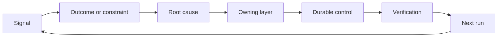

# 构建归属退役机制的反棘轮

> 代码发布结束了当前的构建循环,同时开启了长期的学习循环.

**Type:** Learn + Build
**Languages:** Python (stdlib)
**Prerequisites:** Phase 14 lessons 46 and 53
**Time:** ~75 minutes

## 学习目标

- 将故障事件,评测数据,用户行为和纠错转化为具有责任归属性的行动项.
- 将不同信号精准路由至下文,评测集,安全策略,运行时间或需要的待遇.
- 根据重度和复现频率进行重发风险优先排序.
- 为每一个系统控制机制设定明确退役条件 (退休条件)
- 沟通交付决策,提供证据,权衡取舍及明确负责决策者.

## 反本身也是基础设施

一个团队可以收集大量的系统链接追踪 (痕) 评测记录,支持工单和故障日志,但完全没有从中汲取任何认知教训.**晋级通道（Promotion）**证据的持久化系统的变化,

棘轮反轮反轮的关闭环节是:

1. 观测到具体实测信号;
2. 关联到预期产出结果,约束条件或预置假设;
3. 识别对诱因承担归属责任的最底层系统层次;
4. 实施受控的持续改进;
5. 验证该故障复发的概率已切实降低;
6. 定期审查该控制机制是否应继续保留.

## 精准路由至应对责任层次

| 信号类型 | 归属目的地 |
|---|---|
| 误报、功能倒退、错误输出结果 | 评测集（Evaluation）或自动化测试 |
| 上下文缺失、重复劳动、过时事实 | 上下文数据源或检索路由策略 |
| 不安全操作或越权漏洞 | 安全策略（Policy）或权限硬边界 |
| 超时、重试风暴、依赖服务不可用 | 运行时控制（Runtime Control） |
| 新的产品需求或尚未决断的权衡取舍 | 经过规范成型（Shaped）的待办项 |

在能够从根本上解决问题的最底层进行修复时,当自动化测试或硬性权限足以使错误完全无法发生时,绝不要在 Prompt 中再添加一个提示词.



## 责任归属本身就是控制机制的一部分

每个轮流行动项目必须明确:

- 唯一的人类责任人 (唯一的人类责任人)
- 基于破坏后果和复发频率综合评价的优先级;
- 拟修改的目标系统组件(艺术品);
- 证明修改实效的验证方案;
- 复审或自动失效窗口;
- 明确的退役条件

没有人知道的所谓的改进方案,充满其量只是一个排版的小观观观废话.

## 断退役过时的控制机制

对于沉重系统的不断积累策略和控制项,这些规则可能会变得相互矛盾且成本高昂.

- 系统架构或业务工作流发生了根本性的变化;
- 底层的不变量机制已经彻底取代了上层的文字指示;
- 在预设的时间窗口内,被防范故障从未再次出现;
- 控制规则阻碍正常业务推进的频率,已经超过了其防范危害带来的收益.

退役控制项也需要实证支,绝不能仅仅因为看起来年过久就随手删除

## 打通产品构建与编码代理的反关闭环

同一个棘手轮机制可以同时服务于产品业务和智能体研发的两条轨道:

- 产品业务实证驱动预期产出框架"",假设图谱"",最小切片或量度计划的发展;
- 编码代理的运行纠正或驱动自动化测试,上下文加载,操作作用域,自动化脚本或交通信机制的优化;
- 线上真实故障既能促成产品功能边界调整,也能推动代理工作台的加强.

这也是为什么任务框架的理念绝对不是编码前宣告结束阶段,

## 动手实现

本实验对实测信号进行分类,创建附带责任归属的棘轮行动项目,按优先级排序,并输出`outputs/feedback-backlog.json`,我知道.

```bash
python3 code/main.py
python3 -m unittest discover code/tests -v
```

尝试添加一个运行时超时信号,验证它将正确通过运行时控制层,而不是泛化混入通用需求待定列表.

## 实践实验:为受挫后的决策负责人

在你的职业学习路径中,选择一个工作流程,围绕它完成一次决策,一次小实验和一次复审.[职业交付模板](https://github.com/rohitg00/ai-engineering-from-scratch/blob/main/phases/14-agent-engineering/54-build-the-feedback-ratchet/outputs/career-delivery-evidence.md)在中.

 Python 实验会生成实例待操作项. 它不会观察用户的干预效果,也不会证明你已经有职业胜任力.

### 1. 明确发生了什么事

记录用户,任务,当前工作流以及你希望改善的结果. 链接到经过同意的观察记录. 已脱的支持记录.

找出一次挫折:失效假设、无法使用的结果、意外成本,或延误的交往――解释哪些证据改变了你的理解――挫折需要回应和决策,而不是被包装成一个成功故事――

如果无法与用户接触,请与同事进行明确标记模拟,或基于明确场景进行模拟.

### 2. 在权限范围内推进

列出未知项目,选择成本最低,可逆,且有望解决影响最重大未知项目行动.说明哪些事情可以由你决定,哪些选择受到既定约束,哪些操作需要先获得授权才能执行.

例如,在等待使用客户数据的许可时,你可以先准备已关闭的离线回放.主动推进意味着完成授权工作,并将被阻碍的决策明确;它不会扩大你的访问权限或审批权限.

### 3. 方案和决策责任人简报

为不需要了解实现细节的人写一个简短的决策简报.

- 用户问题以及改变计划的证据;
- 至少有两种方案;在合理可行的情况下,包括成本较低的人工方案或无需开发方案;
- 质量"",互联设计"",工作量"",运营成本和风险的权衡;
- 您的建议,剩余的不确定性以及需要做出决策;
- 决策责任人,受影响利益相关者以及需要做出决策的日期

请同伴代表受影响利益相关者质疑其中一个权力――记录异议,并说明它如何改变,或为什么没有改变你的建议――将角色扮演反标记为模拟;它不能取代真正利益相关者的同意――

### 4. 开展明确边界实验

根据需要的答案,选择原型,试点或生产阶段的工作. 在收集结果之前,明确受众,数据,授权,持续时间,回滚方案以及继续,调整或停止的条件.

从用户的起点到任务完成,走查整个交互过程――进入错误输出或数据缺失的情况――观察用户是否能发现失败、纠正问题,并在没有你暗中帮助的情况下恢复――

模型响应更快,可能让整个任务变慢,或让结果更难获得信任.

### 5. 与经济性相比

使用相同的指标定义,任务总体,采集方法和可比观测窗口,记录基线和后续结果. 将样本数量,排除项和证据链接放在数值旁边.

包含一个用户结果、一个质量或安全护指标,以及总人工审核工作量──即使结果未达到目标,也应该如实记录──小样本或模拟样本只支持有限的学习结论,不能证明业务影响──

估计每项任务的成功完成成本,包括模型调用,重试,配套服务和人工审核,说明人力单价假设,区分实用量与估值值,将成本与人工替代方案或项目背后的价值假设进行比较.

通过已有的[LLM FinOps 课程](https://aiengineeringfromscratch.com/lesson?path=phases/17-infrastructure-and-production/27-finops-llms)改造模型只是可能的应对方式之一;缩小工作流范围或保留人工步骤,可能是更好的产品决策.

### 6. 完成闭环

根据预示标准,建议继续调整或停止. 如果证据尚无定论,指出缺失的观测,以及下一个明确的边界测试.

选择一个对交付过程本身的改进:更清晰的任务框架"",更早的用户走查"",更好的审核清单"",更小的代理人"交付单元,或更有针对性的评审案例――指定负责人和审核日期――

复审时,决定保留、修改还是退役改进的证据.

## 交付物品

将[career-delivery-evidence.md](https://github.com/rohitg00/ai-engineering-from-scratch/blob/main/phases/14-agent-engineering/54-build-the-feedback-ratchet/outputs/career-delivery-evidence.md)复制到自己的项目,并使用证据链接填写. 让仓库中的模板保持可复制性. 将决策简报,交互走查,量度比较以及对归属的明确责任后续行动,并纳入你的职业作品集交付物品.

## 验证

随同伴使用以下人工接受标准.**met**已满足**needs work**(需要改进) 或**not observed**没有证据,没有证据,没有证据,没有证据,没有证据.

| 检查项 | 满足标准的证据 |
|---|---|
| 工作流有事实依据 | 可追溯的观测支持问题定义；他人报告、推断和模拟均有标记。 |
| 遵守授权边界 | 下一项可逆工作明确，任何受限操作都等待真正的决策责任人授权。 |
| 权衡沟通清晰 | 记录可信的替代方案、利益相关方的异议、建议，以及明确的决策请求。 |
| 交互经过测试 | 走查覆盖成功、失败、恢复，以及人工审核工作量。 |
| 结果经过比较 | 基线与后续度量的定义一致；样本、护栏指标、成本和比较局限清晰可见。 |
| 对挫折承担责任 | 证据改变了继续、调整或停止的决策，并导向一项有明确责任人的后续行动。 |
| 流程得到改进 | 一项工作流改进具备责任人、复审日期，以及基于证据的保留、修改或退役决定。 |

即使每个模拟步骤都通过,未观察的真实用户行为仍然存在证据缺陷.

## 课后练习

1. 随着近期故障和一个用户真实投诉,分别转化为具体的棘轮行动项目.
2. 明能够从根本上防止其再次复发的最底层系统层次.
3. 为实验输出的行动项补充实实行自动化验证命令或观测指标.
4. 为一个现有的安全策略规则制定明确退役条件.
5. 系统接受的纠正偏好训练,反向追踪并融入下一个任务框架中.

## 延伸阅读

- [Basili, Caldiera, and Rombach, The Goal Question Metric Approach](https://www.cs.toronto.edu/~sme/CSC444F/handouts/GQM-paper.pdf)探讨如何通过目标导向的测量机制实现组织层面的持续认知沉重性.
- [Fagerholm et al., Building Blocks for Continuous Experimentation](https://doi.org/10.1145/2601248.2601276)分析将实证实与产品的持续研发与技术与组织的联系.
- [Nuseibeh and Easterbrook, Requirements Engineering: A Roadmap](https://www.cs.toronto.edu/~sme/papers/2000/ICSE2000.pdf)解释将需求视为整个系统生命周期动态发展的工程视角.

## 交付物沉

留下`outputs/feedback-backlog.json`作为路由示例,并保留你完成的职业交付证据,记录自己的决策──两者共同为产品判断力和交付 (产品判断和交付) 学习路径结尾,并为下一个预期产出框架提供依据──
