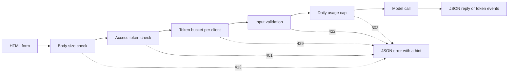

# 模型演示界面:从函数到可分享的应用

> 模型演示有一个约定:输入,模型调用和输出. 在分享链接之前,先为每个部分设定限制.

**Type:** Build
**Languages:** Python
**Prerequisites:** Phase 11 · 13（构建生产级 LLM 应用）、Phase 17 · 08（推理指标）、Phase 17 · 19（AI 网关）
**Time:** ~90 分钟

## 学习目标

- 写出出示的输入,调用和输出约定,并设定每个部分的限制.
- 使用标准库构建一个HTTP应用程序,包含一个HTML页面,一个JSON端点和一个服务器发送事件端点.
- 根据成本从低到高验证输入,并返回能够告诉用户下一步操作的JSON 错误.
- 使用每户端令牌桶,每日使用量上限和可选的访问令牌,保护公开演示.
- 编写不保留输入文本和客户端地址的请求日志──
- 将标准库演示与两个框架版本进行比较,并指出演示必须升级为产品的信号.

## 问题

你的模型已经在笔记本中运行了.现在,一位评审员想尝试10种输入,一位客户想在手机上查看一次结果.

单元格没有输入限制,也没有进步显示. 它报错时给出的堆跟踪,只有你能读懂. 它还使用你的凭据和预算运行.

- 用户粘贴了40,000字符的文档.
- 一本脚本在一分钟内发送500个请求.
- 页面八秒没有显示任何内容,因此用户再次点击四次按.
- 服务器日志保留每条输入,包括包含客户账户号码的输入.

演示界面使用少量代码就能防止这些故障. 本课程先使用Python 标准库构建一个演示,让你看清每个部分;再使用两个流行框架构建相同的演示,比较各自的默认行为.

## 概念

### 演示就是一个约定

每个演示都有三个部分.输入是用户可以发送的内容;调用模型将输入转换为输出;输出是用户看到的内容,也包括错误.

在编写页面之前,先写下这个约定:

| 部分 | 需要回答的问题 | 本课的答案 |
|------|--------------------|-----------------------|
| 输入 | 什么类型、多大、允许哪些字符？ | 长度为 1 到 500 个字符的字符串，不含控制字符 |
| 模型调用 | 一次调用需要多久、成本多少？ | 一个不到一毫秒即可运行完毕、没有调用费用的玩具关键词模型 |
| 输出 | 成功和失败时，用户分别看到什么？ | 标签、分数和回复，或带有操作提示的 JSON 错误 |

没有任何限制对这三个部分设置.



检查按照成本从低到高的顺序执行. 无效请求将在第一次未经过检查处停止,因此几乎不消耗服务器资源.

### 在模型运行之前验证

浏览器可以在发送任何内容之前检查输入.`maxlength`和 `required`属性,无需网络调用就能向用户提供反──这些检查只能帮助用户遵守规则──任何客户端都可以绕过页面发送请求,因此服务器必须重复每一次检查──

将服务器按成本检查从低到高排列:

1. 读取`Content-Length`在读取请求之前,拒绝超过上限的请求.
2. 解析 JSON 请求体──拒绝不是 JSON 对象的请求体──
3. 检查字段──拒绝空文本、超长文本和控制字符──
4. 只有通过全部检查的请求才能消耗一次调用模型.

| 未通过的检查 | HTTP 状态 | 错误代码 |
|--------------|-------------|------------|
| 请求体超过 4,096 字节 | 413 Content Too Large（内容过大） | `body_too_large` |
| 尚未收到 `Content-Length` 指定的字节数，请求体就停止传输 | 408 Request Timeout（请求超时） | `request_timeout` |
| 内容类型不是 JSON | 415 Unsupported Media Type（不支持的媒体类型） | `unsupported_media_type` |
| 请求体不是 JSON 对象 | 400 Bad Request（错误请求） | `bad_json` |
| 文本缺失、为空、过长或含有控制字符 | 422 Unprocessable Content（无法处理的内容） | `missing_text`、`empty_text`、`text_too_long`、`control_characters` |

标准规则 9110 定义了这些状态码及其名称.

示例也是输入设计的一部分.示例向用户展示了合适的输入是什么样子,也让评审员只需单击一次就能进行测试.

### 让用户知道模型正在工作

调用模型可能需要几秒钟. 如果没有反,用户无法区分模型缓慢和页面损坏.

本课页面提供四种反:

- 申请运行期间禁用提交按──
- 显示已使用时间,每100毫秒更新一次.
- 第一个标志到达时,显示第一个标志时间.
- 请结束时,显示总耗时.

在学习[推理指标](../../08-inference-metrics-goodput/)时,首代标志 时间(TTFT) 是服务器标志.演示页面向用户展示相同的标志,但改为浏览器中测量.

### 以流形式发送输出

语言模型个别代币 生成回复. 如果服务器等到最后一个代币才发送,用户就必须等待整个生成过程.

服务器发送事件 (服务器发送事件,SSE) 是实现这一行为的标准形式.`text/event-stream`,每一个事件由一组组成.`event:`和 `data:`行组成,并以一个空行结束.

```text
event: token
data: {"index":0,"text":"Label:"}

event: token
data: {"index":1,"text":" positive."}

event: done
data: {"label":"positive","score":1.0,"tokens":11}
```

浏览器提供用于 SSE 的 `EventSource`接口,但它只发送GET 请求――GET 请求会将输入放入URL,而Web 服务器和代理会将URL写入访问日志――因此,本演示改用JSON 请求体的POST 请求――页面通过`fetch()`和 `response.body.getReader()`读取响应,并自行解析事件格式──

流式响应存在单次 JSON 回复没有问题:服务器在第一个代币之前就发送了状态码200――如果模型随后失败,服务器无法再更改状态码――因此,服务器将在流中发送一个.`error`事件,由页面将该事件显示为错误.

在构建中[生产级 LLM 应用](../../../11-llm-engineering/13-production-app/)时,框架替你通过SSE发送代币. 本课写同样的协议,让你能够看到服务器发送的每一行.

### 编写用户能够根据此操作的错误信息

错误信息有两个任务:告诉用户发生了什么,并告诉用户接下来该怎么做.

在本演示中每个错误都使用相同的JSON 结构:

```json
{
  "error": {
    "code": "text_too_long",
    "message": "The text has 812 characters. The limit is 500.",
    "hint": "Shorten the text to 500 characters or fewer.",
    "request_id": "a8f3c2b435e3"
  }
}
```

- `code`是稳定的名称,客户端代码和测试使用它作为比较.
- `message`陈述事实,并附上用户需要的数值.
- `hint`给一个用户执行操作.
- `request_id`将用户报告关联到一日志记录.

RFC 9457 定义了 HTTP API 的标准错误格式,称为问题详细问题详细) ⋅本演示使用更精简的结构实现相同目的.

### 安全地分享公开演示

对于每种风险设计一个控制措施:

| 风险 | 本演示中的控制措施 | 面向更多受众的控制措施 |
|------|----------------------|-------------------------------|
| 单个客户端发送过多请求 | 每客户端一个令牌桶，配合 429 和 `Retry-After` | 登录后按用户限流 |
| 陌生人发现链接 | `Authorization` 请求头中的可选访问令牌 | 通过身份提供方实现单点登录 |
| 总成本无限增长 | 每日用量上限，配合 503 和 `Retry-After` | 模型提供方的支出限制和告警 |
| 输入非常大或异常 | 请求体大小限制、文本长度限制、控制字符检查 | 输入与输出的内容审核 |
| 日志保留私人输入 | 只记录输入长度和客户端的带密钥哈希 | 日志保留期限与访问控制 |

令牌桶使用两个数值――容量决定一个客户端最多能突发发送多少请求;补充速率决定长期请求速率――每个请求消耗一个令牌,桶内令牌持续补充,但不超过容量:

```text
tokens = min(capacity, tokens + refill_rate * seconds_since_last_request)
accept the request if tokens >= 1, then subtract 1
```

桶为空时,服务器返回`429 Too Many Requests`△RFC 6585 定义了状态码 429,并允许服务器附带`Retry-After`响应头. 本演示始终添加响应头,给出距离下一个令牌可用的还需要等待的数秒.

演示使用客户端IP地址作为桶的键. 在反向代理后面,每个请求都来自代理地址,因此所有用户将共享一个桶.

在学习中[AI 网关](../../19-ai-gateways/)时,网关按租户执行限流.演示也需要同样的控制,只是规模较小.限流控制单个客户端,但没有控制总量. 一百个客户端即使没有超出各自的限制,仍然可能耗尽全部预算.

需要谨慎处理.`http.server`处理器将客户端IP地址和请求行入标准错误. 如果输入位于URL中,输入也会进入日志. 本演示取代了这个日志. 每个请求只写一个记录,包含路由,状态码,错误代码,延迟和输入长度.

告诉用户你保留的信息. 演示页面说明,服务器保留文本长度,但从未保留文本本身.

### 演示何时成为产品

演示由一个过程提供服务,面向已知的人群和短时会话.

- 团队外的人每周都会使用它.
- 有人提出可用性目标,或报告服务中断.
- 用户要求登录,保存结果或查看历史.
- 每周的模型成本成为预算中的一个项目.
- 输入包含受合同或法律约束的数据.

| 属性 | 演示 | 产品 |
|----------|------|---------|
| 用户 | 已知人群，短时会话 | 未知人群，每日使用 |
| 状态 | 无 | 账户、历史、已保存的结果 |
| 可用性 | 尽力而为，单进程 | 书面目标、副本、值班责任人 |
| 成本控制 | 一个每日用量上限 | 每用户配额和计费 |
| 可观测性 | 每请求一条日志 | 链路跟踪、指标和告警 |

看到这些信号,应将演示转移到生产级 LLM 应用课程中的生产技术──该技术增加了真正的身份验证,备用模型,链路跟踪和每个用户成本跟踪──

```figure
demo-token-bucket
```

## 动手构建

代码只有一个文件`code/main.py`没有任何依赖,除了标准库之外.

```bash
python3 code/main.py
```

自检会检查验证器、令牌桶、流格式,以及一次真实的HTTP往返通信──它在空端口启动服务器,发送三个请求,停止服务器,然后退出──只需要浏览器访问时启动服务器:

```bash
python3 code/main.py --serve
```

在浏览器中打开`http://127.0.0.1:8000`△按Ctrl+C 停止服务器──

### 第1步:模型调用

模型是一个玩具关键词计数器,将文本标记为正面,负面或中性――它也会产生一个简短回复,每次输出一个代币――

```python
def classify(text):
    words = WORD_RE.findall(text.lower())
    positive = sum(1 for word in words if word in POSITIVE)
    negative = sum(1 for word in words if word in NEGATIVE)
    score = (positive - negative) / max(1, positive + negative)
    if score > 0:
        label = "positive"
    elif score < 0:
        label = "negative"
    else:
        label = "neutral"
    return {"label": label, "score": round(score, 3), "positive_cues": positive,
            "negative_cues": negative, "words": len(words)}


def generate(text):
    result = classify(text)
    reply = (
        f"Label: {result['label']}. Positive cues: {result['positive_cues']}. "
        f"Negative cues: {result['negative_cues']}. Words read: {result['words']}."
    )
    parts = reply.split(" ")
    yield parts[0]
    for part in parts[1:]:
        yield " " + part
```

换成真实模型时,只需要换成`generate`△在其中放入API调用或本地模型──保持函数签名不变:输入字符串,输出代币──验证器、限制和页面都保持不变──

### 第2步:验证与错误响应

一个异常类型包含所有错误.它包含HTTP状态码,稳定的错误代码,消息,操作提示和可选的响应头.

```python
class DemoError(Exception):
    def __init__(self, status, code, message, hint, headers=None):
        super().__init__(message)
        self.status = status
        self.code = code
        self.message = message
        self.hint = hint
        self.headers = dict(headers or {})


def validate_text(payload, max_chars=MAX_CHARS):
    if "text" not in payload:
        raise DemoError(422, "missing_text", 'The field "text" is missing.', 'Add a "text" field with your input.')
    text = payload["text"]
    if not isinstance(text, str):
        raise DemoError(422, "text_not_string", 'The field "text" is not a string.', "Send the input as a string.")
    text = text.strip()
    if not text:
        raise DemoError(422, "empty_text", "The text is empty.", "Type a sentence or pick an example.")
    if len(text) > max_chars:
        raise DemoError(422, "text_too_long", f"The text has {len(text)} characters. The limit is {max_chars}.",
                        f"Shorten the text to {max_chars} characters or fewer.")
    if CONTROL_RE.search(text):
        raise DemoError(422, "control_characters", "The text contains control characters.",
                        "Remove the hidden characters, then send the text again.")
    return text
```

验证器首先删除首尾空白. 仅包含空空的文本会被判为空,提示信息会告诉用户应输入什么.`check_body_size`和 `parse_json_body`对于411、413、415 和 400 形状使用相同模式.`error_body`会将任何东西`DemoError`转换为概念部分展示的JSON结构.

### 第3步:令牌桶

```python
class TokenBucket:
    def __init__(self, capacity, refill_per_second, now):
        if capacity < 1:
            raise ValueError("capacity must be at least 1")
        if refill_per_second <= 0:
            raise ValueError("refill_per_second must be positive")
        self.capacity = float(capacity)
        self.refill_per_second = float(refill_per_second)
        self.tokens = float(capacity)
        self.updated = now

    def take(self, now, cost=1.0):
        elapsed = max(0.0, now - self.updated)
        self.tokens = min(self.capacity, self.tokens + elapsed * self.refill_per_second)
        self.updated = now
        if self.tokens >= cost:
            self.tokens -= cost
            return 0.0
        return (cost - self.tokens) / self.refill_per_second
```

`take`接受请求时返回0.0;否则,返回距离桶内令牌足够需要等待的秒数.`Retry-After`,我知道.

`RateLimiter`在`OrderedDict`由于每个客户端保存一个桶.`ThreadingHTTPServer`在独立线程中处理每个请求,因此使用锁保护这个字典.`max_clients`时,限流器将移除最长未发出请求的客户端.`max_clients`设置高于您预期的活跃客户端数量.

限流器接受一个`clock`参数――测试传入`FakeClock`没有必要等待,就能把时间推进前进10秒.`UsageCap`用相同的时钟模式处理每天总量:以86,400秒的固定窗口统计调用,尽量使用时回归距离下一个窗口还需要等待的秒数.

### 第四步:事件流

```python
def sse_event(event, data):
    payload = json.dumps(data, separators=(",", ":"), ensure_ascii=False)
    return f"event: {event}\ndata: {payload}\n\n".encode("utf-8")


def stream_events(text, generate_fn=generate, delay=0.0, sleep=time.sleep):
    count = 0
    try:
        for token in generate_fn(text):
            yield sse_event("token", {"index": count, "text": token})
            count += 1
            if delay:
                sleep(delay)
    except Exception:
        yield sse_event("error", MODEL_ERROR)
        return
    result = classify(text)
    yield sse_event("done", {"label": result["label"], "score": result["score"], "tokens": count})
```

`json.dumps`字符串中的字符串变化成字符串`\n`因此,每个事件只有一行数据,其中没有原始变行符.

生成器捕获模型故障,并发送 `error`事件,因为服务器已经发送了状态行.`delay`和 `sleep`参数可以在浏览器演示中放缓流速,同时让测试保持快速.

### 第五步:请求处理器

`DemoHandler`继承自`BaseHTTPRequestHandler`△POST 处理器按概念部分所述的顺序执行检查:

```python
def do_POST(self):
    app = self.server.app
    request_id = uuid.uuid4().hex[:12]
    client_id = self.client_address[0]
    started = time.perf_counter()
    route = self.path if self.path in self.routes else "other"
    status, code, chars = 200, None, 0
    try:
        declared = self.headers.get("Content-Length")
        try:
            if route == "other":
                raise DemoError(404, "not_found", "This endpoint does not exist.",
                                "Send requests to /api/predict or /api/stream.")
            size = check_body_size(declared, app.config.max_body_bytes)
        except DemoError:
            self.drain(int(declared) if declared and declared.isdigit() else 0)
            raise
        try:
            body = self.rfile.read(size)
        except TimeoutError:
            self.close_connection = True
            raise DemoError(408, "request_timeout", "The request body did not arrive in time.",
                            "Send the request again with the full body.") from None
        app.admit(client_id, self.headers.get("Authorization"))
        text = app.read_text(self.headers.get("Content-Type"), body)
        chars = len(text)
        app.charge()
        if route == "/api/predict":
            self.send_json(200, predict(text), request_id)
        else:
            code = self.send_stream(text, request_id)
    except DemoError as err:
        status, code = err.status, err.code
        self.send_error_json(err, request_id)
    except TimeoutError:
        status, code = 408, "request_timeout"
        self.close_connection = True
    except Exception:
        status, code = 500, "internal_error"
        self.send_error_json(DemoError(500, "internal_error", "The server failed on this request.",
                                       "Try again. Quote the request id if you report the problem."), request_id)
    finally:
        latency_ms = (time.perf_counter() - started) * 1000
        app.log.record(request_id, route, client_id, status, chars, latency_ms, code)
```

`admit`检查访问令牌和令牌桶.`charge`检查每天的上限,最后执行,因此只有有效的请求才会计入上限.`finally`块中写入一条日志,包括被拒绝的请求.`route`路径可能包含用户文本的查询字符串.

为了防止容易被忽视的故障:

- 处理器类上`timeout = 10`会在客户端停止发送时关闭连接.没有它,声明发送100字节,但只发送10字节的客户端,将永久占用一个服务器线程.处理器发送带请求 ID的408 JSON 错误,然后关闭连接.如果流已开始后才过时,则只关闭连接,因为状态行已经发送了.
- `log_message`直接返回,不输出内容.
- `drain`最多读取并丢弃被拒绝请求体中的64 KiB 数据.RFC 1122指出,主机关关仍有未读数据连接时,TCP会发送重置;客户端因此可能不收到413 回复.
- `send_stream`捕获`BrokenPipeError`并关闭生成器──用户关闭标签页面,模型停止,这个请求也不再增加成本──

`BaseHTTPRequestHandler`默认使用HTTP/1.0──因此,服务器关闭连接时就表示流式响应体结束──使用HTTP/1.1的服务器通过分块传输编码发送响应体,以实现相同目的──

### 第六步:页面

`render_page`返回一个HTML文档,其中内嵌样式和脚本──页面不载任何外部脚本、字体或图片──脚本按以下方式读取流:

```javascript
const reader = response.body.getReader();
const decoder = new TextDecoder();
let buffer = "";
while (true) {
  const chunk = await reader.read();
  if (chunk.done) { break; }
  buffer += decoder.decode(chunk.value, { stream: true });
  let cut = buffer.indexOf("\n\n");
  while (cut >= 0) {
    const frame = parseFrame(buffer.slice(0, cut));
    buffer = buffer.slice(cut + 2);
    cut = buffer.indexOf("\n\n");
    if (frame.event === "token") { output.textContent += frame.data.text; }
  }
}
```

网络数据块可能在事件中结束.`buffer`在空行之前.

页面使用`textContent`写入模型输出,绝不使用 `innerHTML`△模型输出是不可信的文本──假设页面将回复作为HTML插入,而回复包含带`onerror`属性元素,该属性就可能在用户浏览器中执行代码.

服务器还会发送带`default-src 'none'`的`Content-Security-Policy`响应头. 这个策略只允许一个内嵌脚本和一个内嵌样式,并通过各自的SHA-256 哈希识别它们.

```python
def csp_hash(source):
    digest = hashlib.sha256(source.encode("utf-8")).digest()
    return "'sha256-" + base64.b64encode(digest).decode("ascii") + "'"
```

### 第7步:运行它,并试图使它出错

启动服务器,然后从第二端使用`curl`△刚启动的服务器连续发送7个请求.桶容量为5个令牌,每2秒补充一个令牌:

```bash
for i in 1 2 3 4 5 6 7; do
  curl -s -o /dev/null -w '%{http_code} ' -X POST http://127.0.0.1:8000/api/predict \
    -H 'Content-Type: application/json' -d '{"text": "ok"}'
done
```

```text
200 200 200 200 200 429 429
```

等十秒,然后发送空文本:

```bash
curl -s -X POST http://127.0.0.1:8000/api/predict \
  -H 'Content-Type: application/json' -d '{"text": ""}'
```

```json
{"error": {"code": "empty_text", "message": "The text is empty.", "hint": "Type a sentence or pick an example.", "request_id": "e3e3599feaea"}}
```

使用关闭输出缓冲的 `curl -N`观察事件流:

```bash
curl -N -X POST http://127.0.0.1:8000/api/stream \
  -H 'Content-Type: application/json' -d '{"text": "The screen is bright."}'
```

如果要要求访问令牌, 在启动服务器之前设置`DEMO_ACCESS_TOKEN`△页面后面会显示一个令牌输入框──

```bash
export DEMO_ACCESS_TOKEN="$(python3 -c 'import secrets; print(secrets.token_urlsafe(24))')"
echo "$DEMO_ACCESS_TOKEN"
python3 code/main.py --serve
```

运行测试:

```bash
python3 -m unittest discover -s code/tests -v
```

测试在端口0上启动服务器,由操作系统选择空端口.`tearDown`停止服务器,并检查它的线程是否已结束.

## 使用框架

两种Python框架可以使用更少的代码构建和类型演示.`main.py`导入约定,因此验证器和模型保持不变.`main.py`或测试,不需要安装其中任何一个框架.

### 围绕一个函数组织组件

级为一个Python 函数包装 网界面――输入和输出组件描述约定,生成器函数发送部分输出――

```python
import os

import gradio as gr

from main import EXAMPLES, MAX_CHARS, DemoError, classify, generate, validate_text


def label_text(text):
    try:
        clean = validate_text({"text": text})
    except DemoError as err:
        raise gr.Error(f"{err.message} {err.hint}")
    label = classify(clean)["label"]
    reply = ""
    for token in generate(clean):
        reply += token
        yield reply, label


demo = gr.Interface(
    fn=label_text,
    inputs=gr.Textbox(label="Text to label", lines=5, max_length=MAX_CHARS),
    outputs=[gr.Textbox(label="Reply"), gr.Textbox(label="Label")],
    examples=list(EXAMPLES),
    flagging_mode="never",
)

if __name__ == "__main__":
    demo.queue(max_size=20).launch(auth=("demo", os.environ["DEMO_PASSWORD"]))
```

每次`yield`因此,这个函数每一步都产生到目前的完整回复.

在分享链接之前,明确设置`flagging_mode`△默认模式将显示标记按──用户按时,Gradio将输入输出写入服务器上的CSV文件──值`"never"`现在,我会把这个按移除.

`queue(max_size=20)`限制等待中的请求数量――默认并发发限制是每个事件只运行一个调用――在你提高限制之前,慢模型一次只服务一个用户―― 格拉迪还会在应用启动时创建API端点,让脚本无需通过页面就能调用演示――你的限流也必须覆盖这些端点――

### 每次输入都会重新运行脚本

用户每次更改控制时,Streamlit将从头到尾重新运行整个脚本.表单会收集控制值,并根据用户按提交按一次性批量发送.

```python
import streamlit as st

from main import EXAMPLES, MAX_CHARS, DemoError, classify, generate, validate_text

st.title("Toy sentiment demo")
st.caption("Do not paste private data.")

example = st.selectbox("Start from an example", ["", *EXAMPLES])
with st.form("demo"):
    text = st.text_area("Text to label", value=example, max_chars=MAX_CHARS)
    submitted = st.form_submit_button("Run model")

if submitted:
    try:
        clean = validate_text({"text": text})
    except DemoError as err:
        st.error(f"{err.message} {err.hint}")
    else:
        st.write_stream(generate(clean))
        st.write(f"Label: {classify(clean)['label']}")
```

`st.write_stream`直接接受生成器,在每个数据块到达时写出来.`@st.cache_resource`装饰器让所有会话共用一个模型实例.

### 各方案的默认行为

| 需求 | 标准库（本课） | Gradio | Streamlit |
|------|--------------------------------|--------|-----------|
| 表单、示例、结果区域 | 自己编写 HTML | `Interface` 根据组件和 `examples` 构建 | 使用 `st.text_area`、`st.selectbox` 等控件 |
| 输入长度限制 | 页面上的 `maxlength` 加服务器检查 | `Textbox` 上的 `max_length` | `st.text_area` 上的 `max_chars` |
| 部分输出 | 自己编写 SSE 和流读取器 | 使用生成器函数，每次 `yield` 替换输出 | `st.write_stream` 配合数据块生成器 |
| 进度显示 | 自己编写计时器 | 输出区域的进度显示，由 `show_progress` 设置 | `st.write_stream` 在每个数据块到达时显示它 |
| 面向用户的错误 | 带有 `code`、`message`、`hint`、`request_id` 的 JSON | `raise gr.Error(...)` 显示消息 | `st.error(...)` 显示消息 |
| 并发 | 每请求一个线程，无上限 | 队列，默认每个事件只运行一个调用 | 每次交互都会为该会话重新运行脚本 |
| 公开链接 | 自己运行服务器和管理域名 | `launch(share=True)` 提供一周后过期的链接 | 自己将应用部署到服务器 |
| 登录 | Bearer 令牌检查 | `launch(auth=...)` 使用用户名和密码 | `st.login()` 配合 OpenID Connect 提供方 |
| 限流与成本上限 | 令牌桶和每日上限 | 自己编写代码，通过请求获取客户端地址 | 自己编写代码 |
| 工具写入磁盘的输入信息 | 日志中只有输入长度 | 被标记的样本写入 CSV 文件，除非设置 `flagging_mode="never"` | 由自己的代码决定 |

框架在页面方面节省最多的工作:表单,示例,进度显示和部分输出.它们在公开链接风险方面节省较少的工作.

## 交付它

本课产出发 `outputs/skill-demo-interface-checklist.md`△向它提供模型演示说明或代码,它会审查定反、错误以及公开链接的控制措施,并提出通过或不通过的结论.

## 练习

1. 将`BUCKET_CAPACITY`设置为2,将 `REFILL_PER_SECOND`设置为1──预测七请求循环的输出,再实际运行并比较──
2. 在请求中添加`language`字段,只接受`"en"`△其他任何值返回带操作提示的422 错误,并添加两个测试.
3. 找出一个玩具模型会错分类的句子,例如"屏幕不好".
4. 在你的机器上,将显示放到反向代理后面.`trust_proxy`选项,只读取来自代理地址的`X-Forwarded-For`◎编写测试,证明客户端无法自行选择桶的键──
5. 将`generate`换为对流式返回代币的模型 API 的调用――保持验证器、限制和事件格式不变――比较页面上的首个代币 时间与服务器日志中的延迟――

## 关键术语

| 术语 | 人们常说 | 实际含义 |
|------|-----------------|------------------------|
| 演示约定 | “UI” | 输入限制、模型调用，以及包含错误在内的输出结构 |
| 令牌桶 | “限流器” | 每客户端一个计数器，按固定速率补充，最多达到容量上限；每个请求消耗一个令牌 |
| Retry-After | “稍后再试” | 响应头，指定客户端多久之后，或在哪个日期之后，可以再次尝试 |
| 服务器发送事件 | “流式传输” | 由 `event:` 和 `data:` 行组成的 `text/event-stream` 响应，每个事件后有一个空行 |
| 首 token 时间 | “延迟” | 从发出请求到第一个 token 显示在用户屏幕上的时间 |
| 用量上限 | “预算” | 一个时间窗口内所有客户端合计的模型调用次数上限 |
| 带密钥哈希 | “匿名 ID” | 使用秘密盐值对客户端地址计算 HMAC（基于哈希的消息认证码）；它只是化名，任何持有盐值的人都能检验某个已知地址 |
| 内容安全策略 | “CSP” | 响应头，告诉浏览器页面允许使用哪些脚本、样式和连接 |

## 延伸阅读

- [Python `http.server` 文档](https://docs.python.org/3/library/http.server.html)服务器类 默认HTTP/1.0默认日志以及该模块不适用于生产环境的警告
- [WHATWG HTML 标准：服务器发送事件](https://html.spec.whatwg.org/multipage/server-sent-events.html)事件流格式和 事件流格式和`EventSource`接口.
- [MDN：使用服务器发送事件](https://developer.mozilla.org/en-US/docs/Web/API/Server-sent_events/Using_server-sent_events)事件格式与浏览器 API的示例.
- [MDN：使用可读流](https://developer.mozilla.org/en-US/docs/Web/API/Streams_API/Using_readable_streams)如何逐块读取`fetch()`响应体.
- [MDN：使用 Fetch API](https://developer.mozilla.org/en-US/docs/Web/API/Fetch_API/Using_Fetch)带 JSON 请求体的请求及响应处理
- [MDN：429 Too Many Requests](https://developer.mozilla.org/en-US/docs/Web/HTTP/Reference/Status/429)和 [MDN：Retry-After](https://developer.mozilla.org/en-US/docs/Web/HTTP/Reference/Headers/Retry-After)限制流状态码及其应对头
- [MDN：内容安全策略](https://developer.mozilla.org/en-US/docs/Web/HTTP/Guides/CSP),我很想知道.`default-src`命令.
- [RFC 6585](https://www.rfc-editor.org/rfc/rfc6585.html)包含429个状态码
- [RFC 9110](https://www.rfc-editor.org/rfc/rfc9110.html)语义:HTTP 语义,包括413、415 和 422。
- [RFC 9457](https://www.rfc-editor.org/rfc/rfc9457.html)问题详情,即 HTTP API 的标准 JSON 错误格式.
- [RFC 1122](https://www.rfc-editor.org/rfc/rfc1122.html)关闭,包括在连接发生时仍未读数据的TCP重置
- [Gradio：分享应用](https://gradio.app/guides/sharing-your-app)链接分享,身份验证,API页面和流量
- [Gradio：流式输出](https://gradio.app/guides/streaming-outputs)通过生成器函数提供部分输出.
- [Gradio：Interface](https://gradio.app/docs/gradio/interface)其他:`examples`,我知道.`flagging_mode`和 `concurrency_limit`,我知道.
- [Gradio：使用标记功能](https://gradio.app/guides/using-flagging)标记样本在磁盘上的存储位置.
- [Streamlit：基本概念](https://docs.streamlit.io/get-started/fundamentals/main-concepts)运行数据流:
- [Streamlit：st.write_stream](https://docs.streamlit.io/develop/api-reference/write-magic/st.write_stream)和 [Streamlit：缓存](https://docs.streamlit.io/develop/concepts/architecture/caching)部分输出,以及只加载一次的模型.
- [Streamlit：st.login](https://docs.streamlit.io/develop/api-reference/user/st.login)通过OpenID连接提供登录.
