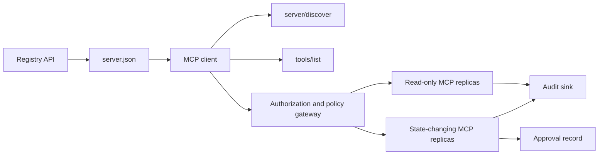

# 综合实战项目13:带登记与管理无状态MCP服务器

> 生产级MCP绝不是单一简单的服务器进程――它是一个整套协议链条:可发布的元数据、实时服务发现、无状态请求包裹、身份认证和授权、细分度策略决策、审计证书以及部署证书――

**Type:** Capstone
**Languages:** Python 与 TypeScript 参考模型；支持任何生产级编程语言
**Prerequisites:** Phase 11, Phase 13, Phase 14, Phase 17 与 Phase 18
**必修 MCP 进阶课：** [Lesson 28: Tool Contracts](../../../13-tools-and-protocols/28-mcp-tool-contracts-and-content/docs/en.md)现在[Lesson 29: 可靠性与流控](../../../13-tools-and-protocols/29-mcp-reliability-cancellation-and-flow-control/docs/en.md)现在[Lesson 30: Registry 供应链](../../../13-tools-and-protocols/30-mcp-registry-supply-chain-and-drift/docs/en.md)及[Lesson 31: 一致性工程](../../../13-tools-and-protocols/31-mcp-conformance-versioning-and-operations/docs/en.md)
**目标协议规范：**股`2026-07-28`
**Time:** ~25 小时

## 学习目标

- 实现合规的无状态MCP 请求与结果包
- 查看现实时间协议与运行时的数据.
- 构建具有确定性排序和缓存感知工具发现体系.
- 对于每一个工具 调用强制执行签发者 发行商 受众 观众 作用域 范围 审批策略
- 部署无会议 亲和性绑定的流媒体HTTP集群──
- 在网络线路,授权,策略,注册和审计边界提供完整的工程证据.

## 必修 MCP 前置路径

在将本项目视为生产准备之前,必须依次完成第13阶段的四节进步课程:

1. [Lesson 28](../../../13-tools-and-protocols/28-mcp-tool-contracts-and-content/docs/en.md)定义本服务器 必须暴露的工具、方案、结构化内容、分页、自动补充、路由及错误分类契约──
2. [Lesson 29](../../../13-tools-and-protocols/29-mcp-reliability-cancellation-and-flow-control/docs/en.md)定义取消竞争态"",截止日期"",等性"",背压"",重试与断线重连行为"",
3. [Lesson 30](../../../13-tools-and-protocols/30-mcp-registry-supply-chain-and-drift/docs/en.md)定义命名空间归属、来源追踪、准入锁定、登记 状态、漂移检测、账本记录与回滚凭证──
4. [Lesson 31](../../../13-tools-and-protocols/31-mcp-conformance-versioning-and-operations/docs/en.md)定义黄金标准与反向转录例"",严格版本时代"",SDK 行为差异校验"",代理网络凭证"",敏感数据脱敏"",健康门禁与发布阻"",

项目负责密集化这些生产阶级元素,绝不能用单一简单的SDK测试来织事物.

## 问题背景

企业内部平台需要一套只读数据工具和少量具有状态变化能力的写操作工具――开发人员必须能够发现该服务器,了解如何连接,检查其实时运行能力,并且只能调用其被明确授权访问的操作――

真正困难从来不是注册一个函数,而是如何让以下六套真相源保持高度一致:

1. `server.json`声明服务器在何处安装或通过什么网络端点访问;
2. `server/discover`声明现行运行的实时进程实际支持的能力;
3. 每个请求明确说明其采用的协议版本和客户能力声明;
4. 授权系统将调用与合法的发发言人,资源指示器,资源指标以及范围的定制;
5. 策略引擎独立决策该具体操作是否准备执行;
6. 审计日志忠实记录跨境的每一次交往,绝不会泄露敏感的载荷或凭据密钥.

任何环节发生漂移,平台就可能显示无法连接的孤儿服务器,错误路由不兼容的客户端,错误用于其他资源发发行的代币,或在未预期的审核的情况下暴露破坏性操作.

## 两层发现机制 (两层发现)

现实时的MCP服务器 回答完全不同维度的问题:

| 发现层次 | 交互契约 | 回答的核心问题 |
|---|---|---|
| 发布层 (Publication) | `server.json` 与 Registry API | 该 Server 是什么？其代码包或远程网络端点在哪里？如何进行配置？ |
| 运行时 (Runtime) | `server/discover` | 该运行进程当前实际支持哪些协议版本、能力特性、扩展及 Server 身份？ |

官方登记册 采用带版本控制的`server.json`方案――一个远程条目可以声明流式HTTP地址:

```json
{
  "$schema": "https://static.modelcontextprotocol.io/schemas/2025-12-11/server.schema.json",
  "name": "com.example/internal-readonly",
  "title": "Internal Read-Only Tools",
  "description": "Read-only incident and data lookup tools.",
  "version": "1.0.0",
  "remotes": [
    {
      "type": "streamable-http",
      "url": "https://mcp.internal.example.com/readonly"
    }
  ]
}
```

报名方案与MCP协议版本完全独立,不要为了让两者一致而改写其中一个日期.

具备合规计划 不代表拥有命名空间所有权──对`example.com`完成验证的发行者使用反向 DNS 命名空间 `com.example/*`或其子命名空间──登记的认证流程负责证明这一所有权──若按普通顺序书写域名标签,则指向另一个不同的命名空间──

标准库模型中的`validate_registry_document`函数刻意只是一个部分的远程配置校验器.`name`,我知道.`description`与`version`字段,可选的`title`已发布的名称与长度约束,具体版本号的格式,以及每个版本的格式`streamable-http`或`sse`远端点的HTTP(S) URL格式──由于本综合项目总会对远端点进行实时探测,它还要求额外的`remotes`列表非空──`validate_publisher_namespace`单独对照已验证的发行者域名检查名称,而`validate_runtime_alignment`则将发布名称与版本同实时的`serverInfo`进行比较──官方方案还支持仅包含代码包的记录以及更多远程字段──发布前,请使用锁定版本的官方JSON方案或`mcp-publisher`校验整个文档;不要把这个无赖子集当成完整的方案校验.

服务器必须实现`server/discover`客户可以在发起其他方法之前主动调用它.

```json
{
  "resultType": "complete",
  "supportedVersions": ["2026-07-28"],
  "capabilities": {
    "tools": {
      "listChanged": false
    }
  },
  "_meta": {
    "io.modelcontextprotocol/serverInfo": {
      "name": "com.example/internal-readonly",
      "version": "1.0.0"
    }
  },
  "ttlMs": 3600000,
  "cacheScope": "public"
}
```

个人目录可以索引额外的所有权,审核或生命周期数据,但绝不能将这些数据构成MCP线路段或线路段.`server.json`根字段──组织策略应与已发布的记录并列存储──当确实需要公开的自定义元数据时,使用注册表的`_meta.io.modelcontextprotocol.registry/publisher-provided`扩展,并保持其4 KB 上限之内──

## 无状态MCP 核心(无状态MCP核心)

股`2026-07-28`完全移除了协议 会议与`initialize`现在,`notifications/initialized`握手,同时移除了`Mcp-Session-Id`,我知道.

每个请求均在`params._meta`中携带协议上下文:

```json
{
  "io.modelcontextprotocol/protocolVersion": "2026-07-28",
  "io.modelcontextprotocol/clientCapabilities": {},
  "io.modelcontextprotocol/clientInfo": {
    "name": "internal-platform-client",
    "version": "1.0.0"
  }
}
```

版本与能力是请求层面的事实,而不是连接层面的事实――负载平衡器可以无忧无虑地将连续请求分发给不同的健康复制品,因为任何一个复制品都可以完全从报道中自验并处理请求――

常规成功结果返回 `resultType: "complete"`服务器应在每个结果中`_meta.io.modelcontextprotocol/serverInfo`中标明身份──协议版本缺失或不是字符串时返回不有效参数 错误码 `-32602`其他`-32022`仅用于提供字符串但不支持的版本,其数据必须恰当.`{"supported": ["2026-07-28"], "requested": "..."}`,我知道.

### 可缓存的服务发现

对于相同有效工具集,`tools/list`必须是确定性的. 其结果包括:

- `ttlMs`面向客户的新鲜度缓存提示
- `cacheScope`其他:`public`公共共享`private`其他地方
- 严格稳定的工具排序,使相同列表能够复用模型端的快速缓存;
- `resultType: "complete"`服务器的身份数据.

针对特定用户权限控制,通常应输出`cacheScope: "private"`绝对不能将用户专属工具的可见性存储在公共共享存储中.

## 流式 HTTP 传输

面向网络的服务器 暴露单一的 POST 端点──每个 JSON-RPC 请求或通知均为独立的 POST──

针对请求,服务器返回单个JSON响应或针对该请求启动的请求作用域 SSE流――长周期的变更通知通过`subscriptions/listen`建立长连接流,承载选择订阅的变更通知――当前传输中没有独立的GET流、Session DELETE、Session 请求头或 `Last-Event-ID`重放

每个请求包含:

- `MCP-Protocol-Version`根据要求的数据;
- `Mcp-Method`:与JSON-RPC 方法名一致;
- `Mcp-Name`用于`tools/call`,我知道.`resources/read`与`prompts/get`其他
- `Accept: application/json, text/event-stream`,我知道.

使用规定的`-32020`错误拒绝不一致的镜像请求头――校验`Origin`将本地开发服务器 绑定到回环地址,认证远程客户端,并将关闭请求作用域 SSE 响应视为取消――



```figure
cf-mcp-gate
```

## 认证与策略决策

传输层元数据绝对不等于权限凭证.

对于远程服务器:

1. 动态发现受保护资源元数据;
2. 为资源选择应对授权服务器;
3. 优先使用客户ID元数据文件 (CIMD) 注册客户,将动态客户注册 (Dynamic Client Registration)视为兼容性支持;
4. 在授权流程中发送资源指标;
5. 验证返回的`iss`是否与记录授权服务器 一致;
6. 根据发行人 隔离存储 凭据客户,绝不跨发行人 复用;
7. 在 MCP Server 侧验证代币的发发发商、受众、过期时间与 Scope;
8. 执行具体工具名称和实际参数的二次策略决策.

`readOnlyHint`与`destructiveHint`等工具注解帮助客户 呈现风险,但它们不是可信的授权控制手段.

### 人工审批是证据记录,而不是魔法范围

状态变更调用需要一个结构化的人工审批凭证 (?? 审批记录),与操作员,工具名,规范化参数哈希值 (?? 测量) 、目标环境,过期时间及单次/多次使用策略深度绑定――单独一条聊天消息绝不能充满审批凭证――

 Python 模型将对排序键的规范化 JSON 计算哈希,并将该 Digest 与代币主体、工具名、服务器URL 和过期时间绑定──改哪怕是一个参数段,该审批记录也会在处理器运行之前重置失败──审批记录是独立的证书证书,而不是添加到访问代币中的范围──

只有当证据,策略,部署身份和审计控制同样分离在一起,这种分离才有意义.

## 动手构建

### 1. 建模发布元数据

创建`server.json`并完成方案 校验. 在发行者已认证的命名空间内使用稳定的名称,并包含版本、描述、适用时的官方名称.`repository`或`packages`关键只能作为声明的环境变量输入,绝不能写入字面值.

### 2. 实现实时服务发现

在任何业务的RPC 之前实现`server/discover`△公布受支持协议版本、能力集、扩展与服务器身份,并添加一个使用 `-32022`版本拒绝使用例:

### 3. 实现无状态信封 (封面)

每个请求都必须携带协议版本和客户能力; 每个结果都返回`resultType`与服务器身分──移除初始状态、按连接缓存能力集以及会议标识符──

### 4. 构建工具表面

从两个只读工具和一个状态变化工具开始. 对于每个工具提供有界限的JSON方案,精确的描述,确定性结果结构以及如实的说明.

### 5. 添加缓存感知的列表

以稳定顺序返回工具,并附带`ttlMs`与`cacheScope`△分别测试缓存过期与列表变更通知行为──

### 6. 添加认证与策略

校验发发行人、受众、过期时间与范围――对每种工具调用执行策略决策,并将审批绑定到确切的高风险操作――在执行处理者之前拒绝缺失或过期审批――

### 7. 分离登记与运行时校验

预测状态`server.json`记录,再使用`server/discover`探测远程端点──当已发布的远程端点、身份、版本或必需能力与实时进程不一致时,上报漂移──

### 8. 添加审计证据

记录操作员,发发行者,资源,工具,策略决策,请求标识符,追踪下文,延迟和结果,进行敏感参数和结果的脱敏或计算摘要,

### 9. 验证水平扩展

在负载均衡器后放置两个无状态副本 (Replica),发送至少100个并发请求,证明正确性不依赖亲和性. 如果某种工具需要跨调用状态,生成一个显而易见的不透明句柄,并将其存储在共享的持久化系统中.

### 10. 跨越真实线路

针对真实服务器 二进制运行一致性检查――捕获请求头与JSON请求体,不仅仅是SDK对象――覆盖错误版本、请求头不匹配、缺少范围、受众错误、参数形、处理器 失败、取消与缓存过期等使用例――

## 必须备证据包(证据包)

提交的物件必须包含以下五类证据,否则视为不完整:

| 证据类别 | 最低验证标准 | 来源课程 |
|---|---|---|
| 网络线路 (Wire) | 正向与反向用例的脱敏原始请求头与 JSON-RPC 请求体，覆盖元数据类型错误、请求头不匹配、不受支持的版本、缺失或未知的 `resultType`、通知无响应以及响应 ID 匹配 | [Lesson 31](../../../13-tools-and-protocols/31-mcp-conformance-versioning-and-operations/docs/en.md) |
| 代理网络 (Proxy) | 同一稳定用例分别直连与经过已部署的中间层运行，记录入口、源站与出口的状态码及响应体摘要；证明协议错误未被折叠为通用 500 响应，且流式传输未被缓冲 | [Lessons 29](../../../13-tools-and-protocols/29-mcp-reliability-cancellation-and-flow-control/docs/en.md) 与 [31](../../../13-tools-and-protocols/31-mcp-conformance-versioning-and-operations/docs/en.md) |
| 准入管理 (Admission) | 已验证的发布者命名空间、不可变的 Registry 记录摘要、产物或远程端点来源证明、实时 `server/discover` 身份与能力观测、描述符锁定、当前 Registry 状态以及准入账本事件 | [Lesson 30](../../../13-tools-and-protocols/30-mcp-registry-supply-chain-and-drift/docs/en.md) |
| 重试与取消 (Retry) | 取消与完成的竞态、显式超时、安全的只读重试、写操作幂等键、重连后重新拉取，以及证明请求取消不会悄然变成持久任务取消 | [Lesson 29](../../../13-tools-and-protocols/29-mcp-reliability-cancellation-and-flow-control/docs/en.md) |
| 发布回滚 (Rollback) | 确切的先前版本、准入与产物摘要、描述符锁定、当前生效的 Registry 状态、当前健康窗口、路由恢复结果以及脱敏的决策证据 | [Lessons 30](../../../13-tools-and-protocols/30-mcp-registry-supply-chain-and-drift/docs/en.md) 与 [31](../../../13-tools-and-protocols/31-mcp-conformance-versioning-and-operations/docs/en.md) |

随着版本的一并保存脱敏证据包的摘要.只要缺少任意一类,就暂缓发布.不要从进程中分发器推断代理行为,不要从注册表中存在该条目推断准入,不要从新的JSON-RPC ID推断重试安全,也不要从上一次部署推断回滚就绪.

## 本地参考模型运行

 Python 模型在不开任何网络套接的情况下,演示了 Registry 元数据"",反向 DNS 发行者命名空间校验"",发布与运行时身份验证"",实时发现"",确定性工具列表"",每请求元数据"",可信发行者/受众/过期时间/范围"检查"",绑定操作审批"",一个有文档说明的部分 Registry 校验器"",策略以及审计:

```bash
cd phases/19-capstone-projects/13-mcp-server-with-registry
python3 code/main.py
python3 -m unittest discover -s code/tests -v
```

通过无状态的 JSON-RPC 结构.`tools/call`路径执行与 `tools/list`已公布的相同界限输入方案;已知工具输入非法参数时,返回带`isError: true`的完整结果,且不调用执行器:

```bash
cd phases/19-capstone-projects/13-mcp-server-with-registry/code/ts
npm install
npm run typecheck
npm test
npm run demo
```

这些模型证明是本地契约逻辑,不能证明HTTP请求头,OAuth 交换,Registry 发布,OPA 集成,负载均衡或采集端接收.

## 线路协议报文范例

```http
POST /mcp HTTP/1.1
Host: mcp.internal.example.com
Content-Type: application/json
Accept: application/json, text/event-stream
MCP-Protocol-Version: 2026-07-28
Mcp-Method: tools/call
Mcp-Name: postgres.readonly
Authorization: Bearer REDACTED

{
  "jsonrpc": "2.0",
  "id": 42,
  "method": "tools/call",
  "params": {
    "name": "postgres.readonly",
    "arguments": {"sql": "SELECT 1"},
    "_meta": {
      "io.modelcontextprotocol/protocolVersion": "2026-07-28",
      "io.modelcontextprotocol/clientCapabilities": {},
      "io.modelcontextprotocol/clientInfo": {
        "name": "internal-platform-client",
        "version": "1.0.0"
      }
    }
  }
}
```

## 交付物品

交付一个包含以下内容的代码仓库:

- 通过计划 校验的`server.json`其他
- 仅读与状态变更两类服务器表面;
- `server/discover`确定的.`tools/list`策略的控制`tools/call`其他
- 带有两个可互换的流通 HTTP 部署;
- 认证与审批集成;
- 登记器发布器或私有登记器API适配器;
- 策略定义和绑定操作审批记录;
- 敏捷的审计输出和追踪传播;
- 线路与代理故障证书;
- 准入、重试、健康与回滚证据以及脱敏证据包摘要

| 权重 | 评分标准 | 证据 |
|---:|---|---|
| 25 | 协议正确性 | 无状态请求元数据、服务发现、结果、请求头与反向用例 |
| 20 | 授权 | 签发者、受众、过期时间、Scope 与绑定操作的审批用例 |
| 15 | Registry 完整性 | 合法的 `server.json`、发布记录、实时发现探测与漂移报告 |
| 15 | 策略与安全 | 允许、拒绝、畸形、过期审批与敏感数据用例 |
| 15 | 扩展性与可靠性 | 两个副本、无亲和性依赖、取消、超时与恢复 |
| 10 | 可审计性 | 接收端脱敏审计与追踪证据 |

## 练习与思考

1. 修改已发布的远程URL,同时保持实时服务器不变,让注册表 校验报告确切漂移.
2. 完全相同的输入发送两次`tools/list`证明工具顺序字节级稳定;然后让 `ttlMs`过期并刷新.
3. 发送一个合法请求体,但`MCP-Protocol-Version`请头与之不同.`-32020`没有调用策略或工具.
4. 为只读服务器 发送一个代币并将其表达给状态变化服务器,证明受众在处理器运行前失败.
5. 修改其中一个段落,证明审批不能重复放弃.
6. 随着工作流的持续调用,交换路由到不同的副本.
7. 中断一个请求作用域的SSE 连接,并使用新的JSON-RPC 请求ID 重试,验证没有使用任何 `Last-Event-ID`恢复路径──

## 核心专业术语

| 术语 | 行业俗称 | 规范真实定义 |
|---|---|---|
| 无状态 MCP (Stateless MCP) | “到处都没有状态” | 协议层不存在 Session；跨调用状态是显式的，并由 Server 管理 |
| `server.json` | “工具清单” | Registry 静态元数据，用于定义发布命名、代码打包、配置项与传输端点 |
| `server/discover` | “传统握手” | 强制实现的常规 RPC，用于获取实时版本与能力，而非 Session 初始化器 |
| 缓存作用域 (Cache scope) | “能不能缓存？” | 标识可缓存结果是否可以被跨上下文公共复用（`public`）或仅限当前上下文（`private`） |
| 策略决策 (Policy decision) | “Token 允许就能调” | 针对调用者主体、工具、操作目标、参数载荷及外部上下文的细粒度二次判定 |
| 审批凭证 (Approval record) | “有人点了同意” | 在过期策略下绑定到一个操作者与一项重大操作的证据 |
| 显式句柄 (Explicit handle) | “Session ID” | 用于命名由 Server 管理之状态的普通应用数据，而非协议连接状态 |

## 延伸阅读

- [MCP 2026-07-28 核心变更](https://modelcontextprotocol.io/specification/2026-07-28/changelog)
- [Streamable HTTP 传输规范](https://modelcontextprotocol.io/specification/2026-07-28/basic/transports/streamable-http)
- [MCP 服务发现](https://modelcontextprotocol.io/specification/2026-07-28/server/discover)
- [MCP 鉴权与授权规范](https://modelcontextprotocol.io/specification/2026-07-28/basic/authorization)
- [官方 Registry server.json 要求](https://github.com/modelcontextprotocol/registry/blob/main/docs/reference/server-json/official-registry-requirements.md)
- [官方 Registry OpenAPI 契约](https://registry.modelcontextprotocol.io/openapi.yaml)
