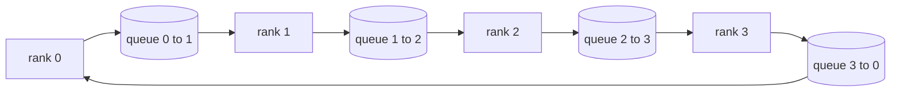

# 从零实现集体行动

> 支分布式训练的四种集体通信(集体) 操作是所有减少,播放,收集和减少_散布――训练框架提供的其他原语几乎都是四者的包装――先在`multiprocessing.Queue`网上实现一遍,再对照参考实现做验证,这条轨道的剩下的部分只是连接.

**Type:** Build
**Languages:** Python
**Prerequisites:** Phase 19 Track C lessons 42-49
**Time:** ~90 分钟

## 学习目标

- 用两遍算法实现环节所有减少,首先减少分散,再聚在一起),并证明每个级别的通信量是每个元素.$2(N-1)/N$字节──
- 在`multiprocessing.Queue`为了实现广播,所有人都会和减少_散播.
- 对于相同的输入,使用`torch.distributed`作为参考,验证每一个原语.
- 从集群形状、延迟下限和带宽上限发出,论证该选环还是树

## 问题

在N个级上做简单的全部减少,将把张量向根发送N次,再播回来N次.$O(N)$放大,根变瓶,钟钟时间下限是最慢的链路乘以N.$2(N-1)$个大小为$T/N$,每一个级别的字节数量降到$2T(N-1)/N$随着N 增大趋势$2T$且永不超出,与集群规模无关.树木全部减少在小N,高延迟链路上更优,因为深度是$\log_2(N)$跳,而不是$2(N-1)$拓选错,最慢的GPU块就会决定步骤时间.

你在这条轨道上会读到的每个分布式训练框架,都依赖于这四个原语――PyTorch DDP 用每个参数桶一次全部减少来同步梯度――ZeRO 用减少_散射 分片优化器状态,再使用全部收集 广播更新后的参数――FSDP 把完整的前进变成全部减少_散射――管道平行需要跨阶段组播放 传动――实现了四个集体,无法推进训练为什么不存在,为什么梯度不匹配现在的排名3以及为什么换扩张后的管道泡会翻倍――

## 概念



### 两遍完成的环全减

把张量拆成N个等大块,索引为0..N-1──每个级别 拥有与自己的级别 号相同的块索引──第 1 遍就是减少散射,跑N-1 步──在第 1 步,排列r 把块$(r - s) \bmod N$发给一个级别$(r + 1) \bmod N$没有从级别$(r - 1) \bmod N$接收部分$(r - s - 1) \bmod N$通过N-1步骤,排列r 持有r的完整求和. 第二次遍就是全部集合,再跑N-1步骤,把完成的分量绕环旋转,直到每个排列都持有r的完整求和.

| 原语 | 每 rank 字节数 | 步数 | 何时使用 |
|-----------|---------------|-------|-------------|
| Ring allreduce | 2T(N-1)/N | 2(N-1) | 大 T、同构 fat-pipe 集群 |
| Tree allreduce | T log2(N) | 2 log2(N) | 小 T 或高延迟链路 |
| Broadcast | T | log2(N) tree | 参数初始化、标量配置 |
| Allgather | T(N-1)/N | N-1 | 分片 forward、ZeRO unshard |
| Reduce_scatter | T(N-1)/N | N-1 | ZeRO 梯度分片 |

### 用排列网取代NCCL

电脑上没有这些. 环上每条边一个.`multiprocessing.Queue`只有单一生产者和单一消费者才能得到有序的点对点交付,归功于用户态,所以要支付Python开销,但线路模式和NCCL环节都减少了同样.

### 对照做做验证

每个原语都带单元测试:在相同的世界尺寸,相同的张量,把它的输出与使用的光线后端初始化.`torch.distributed`对比――如果环节的偏差与光差超过浮32epsilon,测试失败――对照参考实现做验证不可妥协;没有它,原语会在真实训练中跑到第10,000步之前一直看起来正确──

```figure
ci-ring-allreduce
```

## 构建它

`code/main.py`实现:

- `Mesh`类:把N 个`multiprocessing.Queue`接成环,并按排名 暴露 `send(dst, tensor)`与`recv(src)`,我知道.
- `ring_allreduce(mesh, rank, world_size, tensor)`现在,我们要做什么?
- `broadcast(mesh, rank, world_size, tensor, src)`走向数量树.
- `allgather(mesh, rank, world_size, tensor)`转换的时间:
- `reduce_scatter(mesh, rank, world_size, tensor)`作为所有减小的前半段.
- `_gloo_reference(op, world_size, tensor)`让同样的输入送进带着光`torch.distributed`,做字节级对比

运行:

```bash
python3 code/main.py
```

输出:按原语对比排列网与全球 输出验证表,以及证明$2T(N-1)/N$缩放的每一个级别 字节计数器.

## 生产环境中的实践

只有三种模式可以使这些原始语言变硬到可以上线的程度.

**allreduce 前先对梯度分桶。**一个10亿参数模型有上万个梯度张量――每张量一次降低,必须付 N 倍延迟下限――DDP 把梯度打成约25 MB的桶,每桶发一次降低;小张量搭成大张量后面――不分桶时,延迟开销会主导整个步骤――

**让通信与计算重叠。**按层反向层次计算梯度――最后层次计算梯度一就绪,就启动了它的全部减小,同时下层继续计算――PyTorch DDP 用桶式接上这个事物――网络有余量时,重叠可以把可见通信时间砍到半――

**按消息大小选 ring 或 tree，不要教条。**交叉点是带宽对延迟超过1 MB 时带宽项$2T(N-1)/N$占主导,ring 胜出;低于1 MB 时$\log_2(N)$跳数占优优.写死一种拓,会在错误的消息大小上损失吞.

## 使用它

生产中的使用法:

- **PyTorch DDP。**后向分桶梯度调调`dist.all_reduce`△桶 大小可调;100Gbit 以太网下默认 25 MB 合理。
- **DeepSpeed ZeRO。**发减少_散布 分片梯度,前进 前再全部重建完整参数――本课的原语正是ZERO 实际发出调用――
- **FSDP。**往前先全部聚在一起 把这个层不分,算完再用减少_散射 归约并丢掉不分――同套原语,不同调度――

## 交付它

在第7781课中使用这些排列网 原语。第77课把所有减少到DDP──第78课把减少_分散到ZERO──第79课用点对点发送/回收(而不是集体) 传递管道 激活──第81课把四者组成端到端演示──

## 练习

1. 增加树所有减少变体,并按消息大小在环与树之间切换――测出交叉点――
2. 增加`recv_timeout_ms`让卡住的位抛出截止错误,而不是永远挂起.
3. 把四个原语的`multiprocessing.Queue`换成TCP插座──同样的测试,真实线路──
4. 带宽探测,把每个级别的字节计数器记得到JSONL.
5. 在 4 个排列上,对 1KB、1MB、16MB 张量比较环与树的墙钟时间──用实测为交叉点辩护──

## 关键术语

| 术语 | 人们常说 | 实际含义 |
|------|----------------|------------------------|
| Allreduce | “跨 rank 求和” | 调用结束后每个 rank 持有相同的归约张量 |
| Ring | “更快的拓扑” | N-1 个大小为 T/N 的 chunk 绕环流两圈 |
| Tree | “对数拓扑” | 归约沿二叉树进行；深度为 log2(N) 跳 |
| Allgather | “拼接分片” | 每个 rank 最终持有所有其他 rank 的分片 |
| Reduce_scatter | “把求和切开” | 每个 rank 最终只持有某一个 chunk 的求和 |
| Bucket | “融合小张量” | 把 N 次小 allreduce 合并成一次大的 |

## 延伸阅读

- [PyTorch Distributed: NCCL collectives](https://pytorch.org/docs/stable/distributed.html#collective-functions)
- [Horovod ring allreduce paper](https://arxiv.org/abs/1802.05799)
- [NCCL topology and algorithm selection](https://docs.nvidia.com/deeplearning/nccl/user-guide/docs/index.html)
- [Patarasuk and Yuan, Bandwidth optimal allreduce algorithms](https://www.cs.fsu.edu/~xyuan/paper/09jpdc.pdf)
- 第十阶段05课 - 分布培训概述
- 第19阶段 第77课 - - DDP线上这些原始
