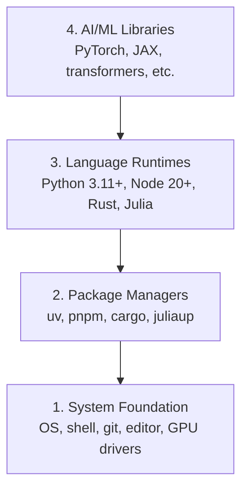

# Dev Environment

> 你的工具会塑造你的思考方式。一次配置好，而且要配置对。

**Type:** Build
**Languages:** Python, Node.js, Rust
**Prerequisites:** None
**Time:** ~45 分钟

## 学习目标

- 从零搭建 Python 3.11+、Node.js 20+ 和 Rust 工具链
- 配置虚拟环境和包管理器，保证构建可复现
- 用 CUDA/MPS 验证 GPU 访问，并跑一次测试张量运算
- 理解四层技术栈：系统、包管理、运行时、AI 库

## 问题

你将用 Python、TypeScript、Rust 和 Julia 学完 500+ 节 AI engineering 课程。如果环境坏了，每一节课都会变成和工具链打架，而不是在学习。

多数人会跳过环境搭建。然后花几个小时 debug import 错误、版本冲突和缺失的 CUDA 驱动。我们要把这件事一次性、正确地做完。

## 概念

一个 AI engineering 环境有四层：



我们自底向上安装。每一层都依赖它下面那一层。

```figure
s0-env-stack
```

## 构建它

### 步骤 1：系统基础

检查你的系统并安装基础组件。

```bash
# macOS
xcode-select --install
brew install git curl wget

# Ubuntu/Debian
sudo apt update && sudo apt install -y build-essential git curl wget unzip

# Windows (use WSL2)
wsl --install -d Ubuntu-24.04
```

### 步骤 2：用 uv 安装 Python

我们使用 `uv`——它比 pip 快 10–100 倍，并且会自动处理虚拟环境。

```bash
curl -LsSf https://astral.sh/uv/install.sh | sh

uv python install 3.12

uv venv
source .venv/bin/activate  # or .venv\Scripts\activate on Windows

uv pip install numpy matplotlib jupyter
```

验证：

```python
import sys
print(f"Python {sys.version}")

import numpy as np
print(f"NumPy {np.__version__}")
a = np.array([1, 2, 3])
print(f"Vector: {a}, dot product with itself: {np.dot(a, a)}")
```

### 步骤 3：用 pnpm 安装 Node.js

用于 TypeScript 课程（agents、MCP servers、web apps）。

```bash
curl -fsSL https://fnm.vercel.app/install | bash
fnm install 22
fnm use 22

npm install -g pnpm

node -e "console.log('Node', process.version)"
```

fnm 安装程序会先检查 `unzip`，缺少时以 `Not installing fnm due to missing dependencies.` 退出：在 Linux 上它要解压一个 zip 归档，在 macOS 上则通过 Homebrew 安装。macOS 自带 `unzip`；Ubuntu、Debian 和 WSL2 会通过步骤 1 的 apt 命令安装它（如果你跳过了那一步，运行 `sudo apt install -y unzip`）。

**macOS / Apple Silicon（M1/M2/M3/M4）：** 如果安装程序因 `Error: Cannot install under Rosetta 2 in ARM default prefix (/opt/homebrew)` 停止，说明你的终端运行在 Rosetta 2 下（`arch` 输出 `i386`），而 Homebrew 是原生 arm64 构建。强制以 arm64 安装 fnm，把它接入你的 shell，然后从 `fnm install 22` 开始重新运行上面的命令：

```bash
arch -arm64 brew install fnm
echo 'eval "$(fnm env --use-on-cd)"' >> ~/.zshrc
source ~/.zshrc
```

### 步骤 4：Rust

用于对性能敏感的课程（inference、systems）。

```bash
curl --proto '=https' --tlsv1.2 -sSf https://sh.rustup.rs | sh

rustc --version
cargo --version
```

### 步骤 5：Julia（可选）

用于 Julia 更拿手的偏数学课程。

```bash
curl -fsSL https://install.julialang.org | sh

julia -e 'println("Julia ", VERSION)'
```

### 步骤 6：GPU 设置（如果你有）

**NVIDIA（Linux / Windows）：**

```bash
nvidia-smi

# Install PyTorch with CUDA
uv pip install torch torchvision torchaudio --index-url https://download.pytorch.org/whl/cu124
```

**macOS / Apple Silicon（M1/M2/M3/M4）：** Mac 上没有 CUDA——这是预期情况，不是故障。**不要**传入 `--index-url .../cuXXX`（这些 wheel 只适用于 Linux/Windows，安装会失败）。安装普通构建即可，它包含 Apple 的 MPS（Metal）GPU 后端：

```bash
uv pip install torch torchvision torchaudio
```

验证（适用于任何平台）：

```python
import torch
print(f"CUDA available: {torch.cuda.is_available()}")           # False on macOS — expected
print(f"MPS available:  {torch.backends.mps.is_available()}")   # True on Apple Silicon
if torch.cuda.is_available():
    print(f"GPU: {torch.cuda.get_device_name(0)}")
```

没有 GPU？没问题。多数课程可在 CPU 上运行。对训练很重的课程，用 Google Colab 或云 GPU。

### 步骤 7：验证你要开始的路线

本课中的每条命令都从仓库根目录运行，也就是包含 `README.md` 和 `phases/` 的目录。预检只检查开始所选路线需要的内容。它默认跳过后续才用到的工具，这样新学员看到的是一个清楚的结论，而不是一大片警告。

开始完整的入门序列：

```bash
python3 phases/00-setup-and-tooling/01-dev-environment/code/verify.py --route beginner
```

或者只检查你想走的路线：

```bash
python3 phases/00-setup-and-tooling/01-dev-environment/code/verify.py --route ml-foundations
python3 phases/00-setup-and-tooling/01-dev-environment/code/verify.py --route llm-engineering
python3 phases/00-setup-and-tooling/01-dev-environment/code/verify.py --route agents
python3 phases/00-setup-and-tooling/01-dev-environment/code/verify.py --route mcp
python3 phases/00-setup-and-tooling/01-dev-environment/code/verify.py --route agent-skills
python3 phases/00-setup-and-tooling/01-dev-environment/code/verify.py --route certification
```

如果想让同一预检也检查后续课程用到的可选工具和依赖，加上 `--show-later`。缺少后续工具绝不会阻塞所选路线。

每个失败的必需检查都会给出检测到的路径或导入错误，以及一条确切的修复命令。Agent Skills 和 certification 路线还会显示需要手动完成的宿主检查，因为 Python 脚本无法证明 AI 宿主已发现某个 skill，也无法证明你选择的 skill 作用域可写。

入门预检通过时，会打印第一个可运行课程的确切命令：

```text
Ready to start Beginner course.
Next: python3 phases/01-math-foundations/01-linear-algebra-intuition/code/vectors.py
```

## 使用它

你的环境已可以开始你检查过的路线。后续工具等课程需要时再安装，不必让整套技术栈阻塞你的第一课。下面是整个课程中会用到的内容：

| Language | Used In | Package Manager |
|----------|---------|-----------------|
| Python | Phases 1-12 (ML, DL, NLP, Vision, Audio, LLMs) | uv |
| TypeScript | Phases 13-17 (Tools, Agents, Swarms, Infra) | pnpm |
| Rust | Phases 12, 15-17 (Performance-critical systems) | cargo |
| Julia | Phase 1 (Math foundations) | Pkg |

## 交付它

本课会产出一个任何人都能运行的验证脚本，用于检查自己的环境。

查看 `outputs/prompt-env-check.md`，其中有一个 prompt，可帮助 AI 助手诊断环境问题。

## 练习

1. 运行验证脚本并修复任何失败项
2. 为本课程创建一个 Python 虚拟环境，并安装 PyTorch
3. 用全部四种语言写一个 "hello world"，并逐个运行

### 提示

**练习 1。** 在仓库根目录运行 `python3 phases/00-setup-and-tooling/01-dev-environment/code/verify.py --route beginner`，先修复第一个失败项，再查看下一项。重新运行脚本，所有必需检查均通过，才算完成。

**练习 2。** 在仓库根目录用 `uv venv` 创建环境并激活，再使用步骤 6 中适合你的硬件的命令安装 PyTorch。在该环境中运行 `python -c "import torch; print(torch.__version__)"`；输出版本号就表示安装成功。

**练习 3。** 使用“概念”部分技术栈中的四种运行时：Python、运行于 Node.js 的 TypeScript、Rust 和 Julia。分别编写一个小文件，用 `python3`、`npx tsx`（Node.js 不能直接运行 `.ts` 文件）、`cargo run` 或 `rustc`、`julia` 运行。每次运行都必须打印你的消息，并以退出码 0 结束。
