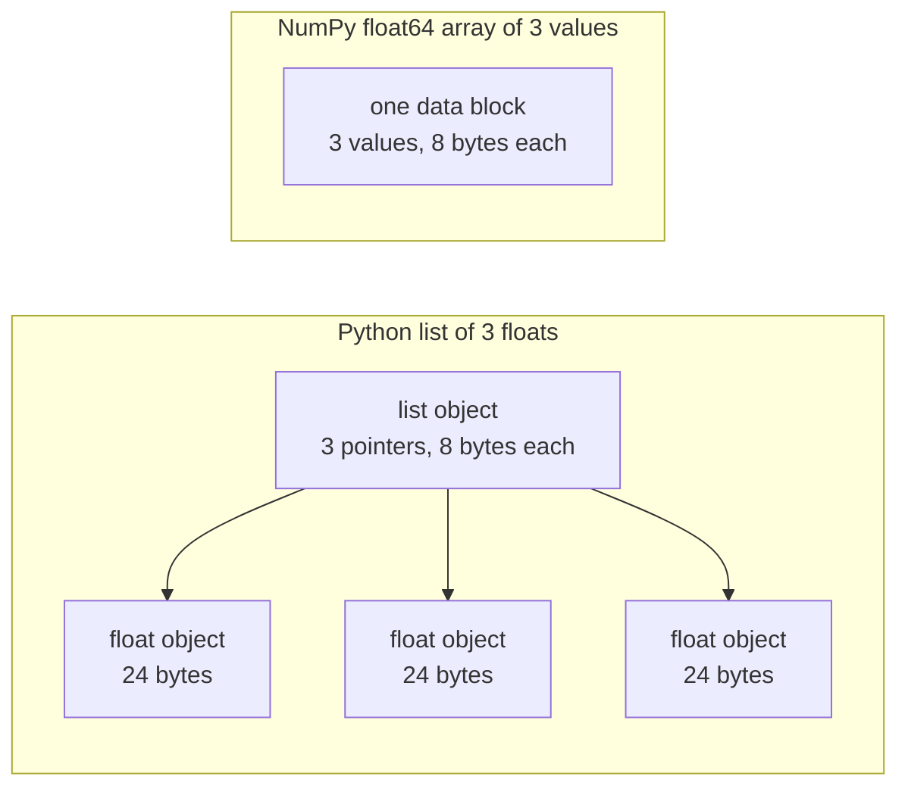

# 面向 AI 工程的 Python

> 本课程的大多数代码都使用同一小组 Python 习惯用法。在后续数学与模型课程依赖它们之前，先在这里掌握它们。

**Type:** Build
**Languages:** Python
**Prerequisites:** 开发环境、Python 环境
**Time:** ~120 分钟

## 学习目标

- 读写课程代码中最常见的习惯用法，从解包和 f 字符串到数据类与推导式。
- 找出三种不会报错却会产生错误结果的 Python 问题：共享列表、可变默认值和已耗尽的生成器。
- 仅使用标准库，构建 CSV 与 JSON 加载器、带随机种子的数据划分，以及小批量生成器。
- 用纯 Python 编写点积、均值和标准差计算，并测量速度与内存用量。
- 解释为什么遍历数值的纯 Python 循环较慢，以及 NumPy 广播如何将循环移入编译后的代码。

## 问题

本阶段之后的课程使用普通 Python 实现数学运算和模型。在课程的 541 个 Python 文件中，276 个导入 `dataclasses`。另外，187 个文件调用 `random.seed` 或创建 `random.Random` 生成器。如果你不熟悉这些习惯用法，就会在本想理解数学的时候忙于理解语法。

Python 还有一些不会给出错误信息、却会导致错误结果的行为。两个名称可以指向同一个列表，因此通过一个名称修改列表，也会改变另一个名称看到的内容。默认参数会在多次调用之间保留其值。生成器遍历一次后便为空，因此第二个训练轮次拿不到数据，损失也就不再变化。

最后一个问题是速度。在我们的测试笔记本电脑上，纯 Python 循环对一百万个浮点数计算点积，大约需要 30 毫秒；NumPy 完成相同计算不到一毫秒。你需要理解原因，才能在清晰的循环与数组操作之间作出选择。

## 概念

### 课程代码使用哪些写法

我们使用 `ast` 模块解析了 `phases/*/*/code/` 中的全部 541 个 Python 文件。下表统计至少使用过一次相应结构的文件数。统计来自编写本课当天，会随着新课程加入而变化。

| 结构 | 文件数 | 占比 |
|-----------|-------|-------|
| 函数定义 | 541 | 100% |
| `if __name__ == "__main__":` | 529 | 98% |
| f 字符串 | 517 | 96% |
| 元组解包 | 448 | 83% |
| 类 | 379 | 70% |
| 列表推导式 | 375 | 69% |
| 函数类型标注 | 342 | 63% |
| 生成器表达式 | 326 | 60% |
| 切片 | 314 | 58% |
| `lambda` | 175 | 32% |
| `try` 与 `except` | 120 | 22% |
| `with` 语句 | 96 | 18% |
| 字典推导式 | 93 | 17% |
| 使用 `yield` 的生成器函数 | 14 | 3% |

导入情况反映了哪些标准模块最重要。在 541 个文件中，340 个以 `from __future__ import annotations` 开头，276 个导入 `dataclasses`。`math`、`random` 和 `json` 模块分别出现在 187、175 和 126 个文件中。`collections` 出现在 70 个文件中，而 `itertools` 仅出现在 4 个文件中。

没有课程调用 `map()` 或 `filter()`；推导式承担了这些工作。超过 140 个文件调用 `sorted`、`min`、`max` 或 `.sort` 时使用了 `key=` 函数。本课会将最多时间花在这些列表中排名靠前的习惯用法上。

### 名称引用对象

在 Python 中，变量是引用对象的名称。赋值将名称绑定到对象，并不复制对象。当两个名称引用同一个列表时，通过任一名称作出的修改，对两个名称都可见。数字、字符串和元组不可变，因此这条规则不会给它们带来问题。列表、字典和集合可变，所以需要独立版本时应创建副本。

### 列表保存指针，数组保存数值

Python 列表并不直接存储数值，而是存储指针，每个指针引用一个完整的 Python 对象。在 64 位 CPython 中，每个指针占 8 字节，每个 `float` 对象占 24 字节。NumPy 的 `float64` 数组则将原始的 8 字节值并排存放在一块内存中。



列表循环处理每个元素时都要做很多工作。解释器逐条执行字节码指令。对于每个元素，它沿指针找到对象，检查每个操作数的类型，再调用浮点乘法代码，并创建一个 Python 浮点对象来保存结果。

NumPy 对原始数值运行编译后的循环，完成相同运算。它只为整个数组检查一次数据类型，不会为每个元素创建 Python 对象。向量化代码用一个操作描述整个数组上的计算，例如 `(x - mean) / std`，再由库执行循环。本课的向量函数也遵循这一原则：每个函数只完成一种数组操作，以后就可以将它替换为一次 NumPy 调用。

### 列表保存全部元素，生成器每次保存一个

列表推导式会在执行下一行之前构建全部元素。生成器则在调用者每次请求下一个元素时，才构建一个元素。列表的内存用量随元素数量增长；无论有多少元素，生成器的内存用量都大致不变。

生成器只能遍历一次。最后一个元素之后，每次请求都会触发 `StopIteration`，因此第二个遍历它的 `for` 循环拿不到任何元素。训练代码每个轮次都会读取一次数据集，因此必须为每个轮次创建新的生成器。

课程代码中很少出现生成器函数，但深度学习课程使用的数据加载器都是按批次提供数据的可迭代对象，因此这一思想存在于每个训练循环中。图示用相同的八行数据展示两种方式。

```figure
s0-list-vs-generator
```

## 你需要掌握的习惯用法

本节中的每个代码块都可以独立运行。将它保存到文件，用 `python3` 运行。代码块需要 Python 3.11 或更新版本，这也是我们在开发环境课程中安装的版本。

### 1. 值、容器与解包

Python 有四种内置容器。请掌握各自适用的场景。

| 类型 | 示例 | 有序 | 可变 | 在课程中的典型用途 |
|------|---------|---------|------------|---------------------------|
| `list` | `[0.5, 1.2]` | 是 | 是 | 样本、损失、权重 |
| `tuple` | `(32, 784)` | 是 | 否 | 形状、固定记录、字典键 |
| `dict` | `{"lr": 0.01}` | 按插入顺序 | 是 | 配置、词表、JSON 行 |
| `set` | `{"cat", "dog"}` | 否 | 是 | 唯一 token、重叠检查 |

以下代码展示了赋值不会复制列表。

```python
weights = [0.5, -1.2, 3.0]
alias = weights
alias[0] = 99.0
print(weights)

independent = list(weights)
independent[1] = 0.0
print(weights, independent)

grid = [[0] * 3] * 2
grid[0][0] = 1
print(grid)

grid = [[0] * 3 for _ in range(2)]
grid[0][0] = 1
print(grid)
```

```text
[99.0, -1.2, 3.0]
[99.0, -1.2, 3.0] [99.0, 0.0, 3.0]
[[1, 0, 0], [1, 0, 0]]
[[1, 0, 0], [0, 0, 0]]
```

表达式 `[[0] * 3] * 2` 创建一个外层列表，其中两个引用都指向同一个内层列表。推导式则为每一行创建新的内层列表。数学阶段会用列表构建矩阵，因此应使用推导式形式。

解包在一行中将序列元素赋给多个名称。带星号的名称收集剩余元素。f 字符串将表达式的值嵌入字符串，还可以在冒号之后指定格式。

```python
shape = (32, 784)
batch_size, n_features = shape
first, *middle, last = [1, 2, 3, 4, 5]
x, y = 1.0, 3.0
x, y = y, x

config = {"lr": 0.01, "epochs": 5}
config["seed"] = 7
tokens = ["the", "cat", "sat", "on", "the", "mat"]
vocab = set(tokens)

print(batch_size, n_features, first, middle, last, x, y)
print(config.get("momentum", 0.9), "cat" in vocab, len(vocab))
print(f"lr={config['lr']:.0e} loss={0.123456:.3f} n={60_000:,} {batch_size=}")
```

```text
32 784 1 [2, 3, 4] 5 3.0 1.0
0.9 True 5
lr=1e-02 loss=0.123 n=60,000 batch_size=32
```

键不存在时，`dict.get` 返回默认值。无论集合大小如何，集合上的 `in` 检查所需时间都大致相同。`{batch_size=}` 形式同时打印名称和值，有助于调试。

切片 `a[start:stop:step]` 包含 `start`，不包含 `stop`。负索引从末尾开始计数。列表的切片是一个新列表，因此对大型列表切片，会复制切片范围内的所有指针。

```python
tokens = ["<s>", "the", "cat", "sat", "on", "the", "mat", "</s>"]
print(tokens[1:-1])
print(tokens[:3], tokens[-3:])
print(tokens[::2])
print(tokens[::-1][:2])
windows = [tokens[i:i + 3] for i in range(len(tokens) - 2)]
print(len(windows), windows[0])
```

```text
['the', 'cat', 'sat', 'on', 'the', 'mat']
['<s>', 'the', 'cat'] ['the', 'mat', '</s>']
['<s>', 'cat', 'on', 'mat']
['</s>', 'mat']
6 ['<s>', 'the', 'cat']
```

### 2. 推导式

推导式通过一个表达式，从可迭代对象构建列表、字典或集合。它的读法接近其所描述的数学运算。

```python
scores = [0.91, 0.42, 0.77, 0.15, 0.66]
labels = [1 if s >= 0.5 else 0 for s in scores]
high = [s for s in scores if s > 0.6]
squares = {i: i * i for i in range(4)}
lengths = {len(word) for word in ["a", "bb", "cc", "ddd"]}
sum_sq = sum(s * s for s in scores)

matrix = [[1, 2, 3], [4, 5, 6]]
transposed = [list(column) for column in zip(*matrix)]
flat = [v for row in matrix for v in row]

print(labels, high, squares, lengths, round(sum_sq, 4))
print(transposed, flat)
```

```text
[1, 0, 1, 0, 1] [0.91, 0.77, 0.66] {0: 0, 1: 1, 2: 4, 3: 9} {1, 2, 3} 2.0555
[[1, 4], [2, 5], [3, 6]] [1, 2, 3, 4, 5, 6]
```

末尾的 `if` 只保留部分元素。`for` 前面的表达式可以是条件表达式，即 `a if condition else b`。两个 `for` 子句的运行顺序，与两个嵌套循环相同。

圆括号创建生成器表达式。在 `sum(s * s for s in scores)` 中，`sum` 每次读取一个平方值，Python 不会构建列表。在 `zip(*matrix)` 中，星号将每一行作为独立参数传入，`zip` 将相同位置的元素配对。

### 3. 函数、参数与闭包

默认值让参数变为可选。关键字实参在调用时明确指定形参名称。参数列表中单独的 `*`，会将其后的参数设为只能通过关键字传入。

```python
def clip(value, low=0.0, high=1.0):
    return max(low, min(high, value))


def train(data, *, lr=0.01, epochs=3):
    return f"{len(data)} samples, lr={lr}, epochs={epochs}"


def make_scaler(factor):
    def scale(values):
        return [v * factor for v in values]
    return scale


print(clip(1.7), clip(-3.0, low=-1.0), clip(0.4, high=0.3))
print(train([1, 2, 3], lr=0.1))
to_percent = make_scaler(100)
print(to_percent([0.25, 0.5]))
```

```text
1.0 -1.0 0.3
3 samples, lr=0.1, epochs=3
[25.0, 50.0]
```

使用仅限关键字的参数时，`train(data, 0.1, 3)` 这样的调用会触发 `TypeError`。调用者必须写出 `lr=0.1`，因此两个数值不会意外交换位置。

内部函数 `scale` 使用创建它的函数中的 `factor`。只要 `scale` 仍然存在，Python 就会保留 `factor`。保留创建者变量的函数称为闭包。动手构建部分的标准化器使用闭包保存训练统计量。

`lambda` 是没有名称、只包含一个表达式的函数。课程代码主要将它用作 `key=` 函数，第 8 部分会介绍这种用法。

Python 在执行 `def` 语句时，只计算一次默认值。每次使用默认值的调用，得到的都是同一个对象。

```python
def add_bad(item, bucket=[]):
    bucket.append(item)
    return bucket


def add_good(item, bucket=None):
    if bucket is None:
        bucket = []
    bucket.append(item)
    return bucket


add_bad("a")
print(add_bad("b"))
add_good("a")
print(add_good("b"))
```

```text
['a', 'b']
['b']
```

列表、字典或集合的默认值应使用 `None`，并在函数内部创建新对象。

### 4. 类与数据类

`@dataclass` 装饰器根据带类型标注的字段，生成 `__init__`、`__repr__` 和 `__eq__`。设置 `frozen=True` 后，对象创建后不可修改，可以用作字典键或放入集合。

```python
from dataclasses import dataclass, field


@dataclass(frozen=True)
class Example:
    features: tuple[float, ...]
    label: int


@dataclass
class TrainConfig:
    lr: float = 0.01
    epochs: int = 5
    hidden: list[int] = field(default_factory=lambda: [64, 32])

    def describe(self):
        return f"lr={self.lr} epochs={self.epochs} hidden={self.hidden}"


ex = Example((1.5, 2.0), 1)
print(ex)
print(ex == Example((1.5, 2.0), 1), len({ex, Example((1.5, 2.0), 1)}))
print(TrainConfig(epochs=10).describe())
try:
    ex.label = 0
except AttributeError as err:
    print(type(err).__name__)
```

```text
Example(features=(1.5, 2.0), label=1)
True 1
lr=0.01 epochs=10 hidden=[64, 32]
FrozenInstanceError
```

`field(default_factory=...)` 为每个实例提供一个新列表。它解决了数据类内部与第 3 部分类似的共享默认值问题。

特殊方法将类与 Python 语法连接起来。`len(ds)` 调用 `__len__`，`ds[2]` 调用 `__getitem__`。

```python
class SquaresDataset:
    def __init__(self, n):
        self.n = n

    def __len__(self):
        return self.n

    def __getitem__(self, index):
        if not 0 <= index < self.n:
            raise IndexError(index)
        return index, index * index


ds = SquaresDataset(4)
print(len(ds), ds[2])
print(list(ds))
```

```text
4 (2, 4)
[(0, 0), (1, 1), (2, 4), (3, 9)]
```

即使没有 `__iter__` 方法，`list(ds)` 内部的 `for` 循环也能工作。Python 依次用 0、1、2 等索引调用 `__getitem__`，直到收到 `IndexError`。PyTorch 的映射式数据集也使用同样两个方法：`__len__` 和 `__getitem__`。

### 5. 迭代器与生成器

可迭代对象是任何能被 `for` 循环接受的对象。`iter()` 从中获取迭代器，`next()` 向迭代器请求一个元素。迭代器没有更多元素时，会触发 `StopIteration`。`for` 循环替你调用 `next()`，并在遇到 `StopIteration` 时停止。

```python
numbers = [10, 20, 30]
it = iter(numbers)
print(next(it), next(it), next(it))
try:
    next(it)
except StopIteration:
    print("no more items")


def countdown(n):
    while n > 0:
        yield n
        n -= 1


gen = countdown(3)
print(type(gen).__name__)
print(list(gen))
print(list(gen))
```

```text
10 20 30
no more items
generator
[3, 2, 1]
[]
```

函数体中包含 `yield` 的函数就是生成器函数。调用它不会执行函数体中的任何代码，而是返回一个生成器对象。每次 `next()` 都会将函数体运行到下一个 `yield`，并暂停在那里。第二次 `list(gen)` 为空，因为第一次调用已耗尽生成器。

生成器可以逐行读取文件。

```python
import os
import tempfile


def read_rows(path):
    with open(path, encoding="utf-8") as fh:
        header = fh.readline().rstrip("\n").split(",")
        for line in fh:
            yield dict(zip(header, line.rstrip("\n").split(",")))


with tempfile.TemporaryDirectory() as tmp:
    path = os.path.join(tmp, "rows.csv")
    with open(path, "w", encoding="utf-8") as fh:
        fh.write("x,label\n")
        fh.writelines(f"{i * 0.5},{i % 2}\n" for i in range(5))
    rows = read_rows(path)
    print(next(rows))
    print(sum(1 for _ in rows))
```

```text
{'x': '0.0', 'label': '0'}
4
```

`read_rows` 每次只在内存中保留文件的一行。它就是图示中的 `read_rows`。为使示例简短，这里直接按逗号切分。真实 CSV 文件的引号字段内可能包含逗号，因此动手构建部分会使用 `csv` 模块。

```python
import sys

as_list = [i * i for i in range(1_000_000)]
as_generator = (i * i for i in range(1_000_000))
print(sys.getsizeof(as_list), sys.getsizeof(as_generator))
print(sum(as_list) == sum(as_generator))
```

在 64 位 CPython 上，列表报告约 8 MB，生成器约 200 字节。`sys.getsizeof` 只统计列表自身的指针，整数对象还会占用额外内存。动手构建部分使用 `tracemalloc` 测量实际峰值，我们已在调试与性能分析课程中使用过它。

### 6. 上下文管理器与异常

`with` 语句先执行准备代码，再运行语句体，最后执行清理代码。即使语句体抛出异常，清理也会执行。`open()` 返回的文件对象就是一个负责关闭文件的上下文管理器。

在调试与性能分析课程中，我们写过一个带 `__enter__` 和 `__exit__` 的 `Timer` 类。`contextlib.contextmanager` 装饰器可以从生成器创建同类对象。`yield` 之前的代码负责准备，`finally` 块负责清理。

```python
import time
from contextlib import contextmanager


@contextmanager
def timer(label):
    start = time.perf_counter()
    try:
        yield
    finally:
        print(f"{label}: {(time.perf_counter() - start) * 1000:.1f} ms")


def parse_label(text):
    try:
        return int(text)
    except ValueError:
        raise ValueError(f"label must be an integer, got {text!r}") from None


with timer("sum of squares"):
    total = sum(i * i for i in range(200_000))

print(parse_label("3"))
try:
    parse_label("cat")
except ValueError as err:
    print("rejected:", err)
```

```text
sum of squares: 9.4 ms
3
rejected: label must be an integer, got 'cat'
```

你的机器上测得的时间会不同。在 `except` 子句中，写明预期的具体异常，例如 `ValueError` 或 `KeyError`。不指定异常类型的 `except:` 也会捕获 `KeyboardInterrupt`，因此 Ctrl+C 可能无法停止包含它的循环。输入错误时，应抛出带清晰消息的异常。如果你的消息代替了原始回溯信息，则添加 `from None`。

### 7. 类型标注、模块与主程序保护

类型标注告诉读者函数接受什么、返回什么。Python 运行代码时不会检查这些标注。mypy 等类型检查器会在代码运行前读取它们。

```python
from __future__ import annotations

from collections.abc import Iterable, Sequence


def mean(values: Sequence[float]) -> float:
    if not values:
        raise ValueError("mean() needs at least one value")
    return sum(values) / len(values)


def count_tokens(docs: Iterable[str]) -> int:
    return sum(len(doc.split()) for doc in docs)


def main() -> None:
    print(mean([1.0, 2.0, 4.0]))
    print(count_tokens(["the cat sat", "on the mat"]))
    print(mean.__annotations__)


if __name__ == "__main__":
    main()
```

```text
2.3333333333333335
6
{'values': 'Sequence[float]', 'return': 'float'}
```

使用 `from __future__ import annotations` 时，Python 将每个标注保存为字符串，如最后一行所示。`Sequence` 表示任何支持 `len()` 和索引的对象，例如列表或元组；`Iterable` 表示任何可以被 `for` 循环接受的对象。许多课程文件从 `typing` 导入这些相同的名称，也同样有效。

每个 `.py` 文件都是一个模块。通过 `python3 file.py` 运行文件时，Python 将其 `__name__` 设置为 `"__main__"`；另一个文件导入它时，`__name__` 则是模块名称。保护条件只在第一种情况下调用 `main()`。因此，`code/tests/` 中的测试可以导入 `main.py`，而不会启动演示。

### 8. 文件、JSON、CSV 与排序

`pathlib.Path` 用 `/` 拼接路径，并能通过一次调用读取或写入整个文件。请始终指定 `encoding="utf-8"`，因为默认编码取决于操作系统。

```python
import csv
import json
import tempfile
from pathlib import Path

rows = [
    {"text": "great movie", "label": 1, "score": 0.93},
    {"text": "boring plot", "label": 0, "score": 0.12},
    {"text": "fine acting", "label": 1, "score": 0.58},
]

with tempfile.TemporaryDirectory() as tmp:
    json_path = Path(tmp) / "reviews.json"
    json_path.write_text(json.dumps(rows, indent=2), encoding="utf-8")
    from_json = json.loads(json_path.read_text(encoding="utf-8"))

    csv_path = Path(tmp) / "reviews.csv"
    with csv_path.open("w", newline="", encoding="utf-8") as fh:
        writer = csv.DictWriter(fh, fieldnames=["text", "label", "score"])
        writer.writeheader()
        writer.writerows(rows)
    with csv_path.open(newline="", encoding="utf-8") as fh:
        from_csv = list(csv.DictReader(fh))

print(from_json == rows)
print(from_csv[0])

by_score = sorted(rows, key=lambda r: r["score"], reverse=True)
print([r["text"] for r in by_score])
print(max(rows, key=lambda r: r["score"])["text"])
print([r["text"] for r in sorted(rows, key=lambda r: (-r["label"], r["text"]))])
```

```text
True
{'text': 'great movie', 'label': '1', 'score': '0.93'}
['great movie', 'fine acting', 'boring plot']
great movie
['fine acting', 'great movie', 'boring plot']
```

JSON 会将数值保留为数值。CSV 返回的每个字段都是字符串，因此你必须转换各字段。按照 `csv` 文档的要求，打开 CSV 文件时应指定 `newline=""`。

`key=` 函数返回 Python 用来比较每个元素的值。`sorted`、`min` 和 `max` 都接受这样的函数。元组键先按第一个值排序，只在相等时使用第二个值。负号让较大的标签排在前面。Python 排序是稳定的，因此键相等的元素会保持原始顺序。

### 9. 计数、分组与迭代工具

这两个模块提供了普通列表与字典没有的数据结构和迭代工具。

```python
from collections import Counter, defaultdict, deque
from itertools import chain, islice, product

labels = ["cat", "dog", "cat", "bird", "cat", "dog"]
counts = Counter(labels)
print(counts.most_common(2))

positions = defaultdict(list)
for i, label in enumerate(labels):
    positions[label].append(i)
print(dict(positions))

recent = deque(maxlen=3)
for loss in [2.0, 1.5, 1.2, 1.1, 0.9]:
    recent.append(loss)
print(list(recent), round(sum(recent) / len(recent), 3))

print(list(product([0.1, 0.01], [16, 32])))
print(list(chain([1, 2], [3], [4, 5])))
print(list(islice(range(100), 5, 10)))
```

```text
[('cat', 3), ('dog', 2)]
{'cat': [0, 2, 4], 'dog': [1, 5], 'bird': [3]}
[1.2, 1.1, 0.9] 1.067
[(0.1, 16), (0.1, 32), (0.01, 16), (0.01, 32)]
[1, 2, 3, 4, 5]
[5, 6, 7, 8, 9]
```

`Counter` 统计标签、token 等可哈希元素。首次使用新键时，`defaultdict(list)` 会创建空列表，因此分组循环无需检查键是否存在。向 `deque(maxlen=3)` 添加第四个元素时，它会移除最旧元素，从而形成一个保存最近损失值的滑动窗口。`enumerate` 为每个元素提供索引。

`product` 生成输入的全部组合，也就是超参数网格。`chain` 将可迭代对象首尾相接。`islice` 可以对任意迭代器取切片，包括生成器。动手构建部分的小批量生成器就使用 `islice`。

### 10. 为什么数值循环很慢

`dis` 模块打印解释器执行某个函数时运行的字节码指令。

```python
import dis


def dot(a, b):
    total = 0.0
    for x, y in zip(a, b):
        total += x * y
    return total


dis.dis(dot)
```

从 `FOR_ITER` 到跳回它的指令，会为每个元素执行一次。每次乘法和加法大约需要十条指令。具体指令名称会随 Python 版本变化。

循环中以字节码执行的步骤越少，速度就越快。`sum`、`map` 和 `zip` 等内置函数用 C 编写。动手构建部分会在纯 Python 中测量这种效果；使用现成工具部分则将整个循环移入 NumPy。

## 动手构建

现在构建后续课程需要的组件。完整版本位于 `code/main.py`，由 `code/tests/test_main.py` 测试。下方每个代码块都可以独立运行。

### 第 1 步：记录类型与数据集加载器

加载器将 CSV 或 JSON 文件读取为同一种结构：浮点特征元组，加一个整数标签。

```python
import csv
import json
import tempfile
from dataclasses import dataclass
from pathlib import Path


@dataclass(frozen=True)
class Record:
    features: tuple[float, ...]
    label: int


def row_to_record(row, names, label_field="label"):
    if label_field not in row:
        raise ValueError(f"row has no {label_field!r} field: {row}")
    if set(row) != {*names, label_field}:
        raise ValueError(f"row fields {list(row)} do not match {[*names, label_field]}")
    return Record(tuple(float(row[name]) for name in names), int(row[label_field]))


def load_records(path, label_field="label"):
    path = Path(path)
    if path.suffix == ".json":
        rows = json.loads(path.read_text(encoding="utf-8"))
    elif path.suffix == ".csv":
        with path.open(newline="", encoding="utf-8") as fh:
            rows = list(csv.DictReader(fh))
    else:
        raise ValueError(f"unsupported file type: {path.suffix!r}")
    if not rows:
        return []
    names = [key for key in rows[0] if key != label_field]
    return [row_to_record(row, names, label_field) for row in rows]


with tempfile.TemporaryDirectory() as tmp:
    csv_path = Path(tmp) / "data.csv"
    csv_path.write_text("x1,x2,label\n1.5,60,1\n1.8,82.5,0\n", encoding="utf-8")
    json_path = Path(tmp) / "data.json"
    json_path.write_text('[{"x1": 1.5, "x2": 60, "label": 1}]', encoding="utf-8")
    print(load_records(csv_path))
    print(load_records(json_path))
```

```text
[Record(features=(1.5, 60.0), label=1), Record(features=(1.8, 82.5), label=0)]
[Record(features=(1.5, 60.0), label=1)]
```

第一行确定特征名称及其顺序。`DictReader` 和 `json.loads` 保留文件中的键顺序，字典也保留键的插入顺序。JSON 标准没有定义对象键的顺序，因此 `row_to_record` 按第一行确定的顺序，按名称读取每一行。标签缺失、特征缺失或多余，或文件类型未知时，会抛出带消息的 `ValueError`，让无效文件在运行开始时就阻止后续处理。`main.py` 还提供 `save_records`，用于写出同样的两种格式。

### 第 2 步：带随机种子的训练集与测试集划分

```python
import random


def train_test_split(items, test_fraction=0.2, seed=0):
    if not 0.0 < test_fraction < 1.0:
        raise ValueError(f"test_fraction must be between 0 and 1, got {test_fraction}")
    if len(items) < 2:
        raise ValueError(f"need at least 2 items to split, got {len(items)}")
    order = list(range(len(items)))
    random.Random(seed).shuffle(order)
    n_test = min(max(1, round(len(items) * test_fraction)), len(items) - 1)
    test = [items[i] for i in order[:n_test]]
    train = [items[i] for i in order[n_test:]]
    return train, test


items = list(range(10))
print(train_test_split(items, seed=1))
print(train_test_split(items, seed=1) == train_test_split(items, seed=1))
print(train_test_split(items, seed=2)[1])
print(items)
```

```text
([9, 7, 5, 3, 0, 4, 1, 2], [6, 8])
True
[5, 9]
[0, 1, 2, 3, 4, 5, 6, 7, 8, 9]
```

`random.Random(seed)` 创建私有随机数生成器。`random.seed(seed)` 重置所有模块共享的全局生成器，因此其他库中的一次调用就可能改变你的序列。课程中有 100 个文件调用 `random.seed`，96 个创建 `random.Random`。新代码中应使用私有生成器。

函数打乱的是索引列表，因此输入列表保持不变。相同种子总会产生相同划分。两边都至少保留一个元素，因此少于 2 个元素的列表会触发 `ValueError`。在标准化等任何需要从数据学习的步骤之前，先划分数据。在调试与性能分析课程中，我们已经看到，训练数据与测试数据重叠会导致测试分数虚高。

### 第 3 步：小批量生成器

```python
from itertools import islice


def batches(items, batch_size, drop_last=False):
    if batch_size < 1:
        raise ValueError(f"batch_size must be at least 1, got {batch_size}")
    return _batch_iter(iter(items), batch_size, drop_last)


def _batch_iter(iterator, batch_size, drop_last):
    while True:
        batch = list(islice(iterator, batch_size))
        if not batch or (drop_last and len(batch) < batch_size):
            return
        yield batch


print(list(batches(range(10), 4)))
print(list(batches(range(10), 4, drop_last=True)))
squares = (i * i for i in range(7))
print([len(b) for b in batches(squares, 3)])

for epoch in range(2):
    sizes = [len(b) for b in batches(range(10), 4)]
    print(f"epoch {epoch}: {sizes}")
```

```text
[[0, 1, 2, 3], [4, 5, 6, 7], [8, 9]]
[[0, 1, 2, 3], [4, 5, 6, 7]]
[3, 3, 1]
epoch 0: [4, 4, 2]
epoch 1: [4, 4, 2]
```

`islice` 从迭代器中取出最多 `batch_size` 个元素。`batches` 只需要 `iter()`，因此接受列表、文件和其他生成器。当总长度不是批大小的整数倍时，最后一批会更小。对于需要固定批形状的模型，`drop_last=True` 会移除这一批。

这里将工作拆成两个函数，是因为生成器函数在第一次 `next()` 之前不会执行任何代码。如果将检查放在生成器内部，`batches(data, 0)` 会不报错地返回，错误要到训练循环内部才出现。外层是普通函数，因此能够立即检查参数。轮次循环每一轮都重新调用 `batches()`，因为生成器只提供一次其元素。

### 第 4 步：向量数学与标准化器

```python
import math


def dot(a, b):
    return sum(x * y for x, y in zip(a, b, strict=True))


def mean(values):
    if not values:
        raise ValueError("mean() needs at least one value")
    return sum(values) / len(values)


def std(values):
    mu = mean(values)
    return math.sqrt(sum((v - mu) ** 2 for v in values) / len(values))


def make_standardizer(rows):
    columns = list(zip(*rows))
    means = [mean(c) for c in columns]
    scales = [s if s > 0 else 1.0 for s in (std(c) for c in columns)]

    def standardize(row):
        return [(v - m) / s for v, m, s in zip(row, means, scales, strict=True)]

    return standardize


print(dot([1.0, 2.0, 3.0], [4.0, 5.0, 6.0]))
values = [2.0, 4.0, 4.0, 4.0, 5.0, 5.0, 7.0, 9.0]
print(mean(values), std(values))

train_rows = [(1.0, 100.0), (2.0, 300.0), (3.0, 500.0)]
standardize = make_standardizer(train_rows)
print([[round(v, 3) for v in standardize(r)] for r in train_rows])
print([round(v, 3) for v in standardize((4.0, 700.0))])
```

```text
32.0
5.0 2.0
[[-1.225, -1.225], [0.0, 0.0], [1.225, 1.225]]
[2.449, 2.449]
```

设置 `strict=True` 后，两向量长度不同时，`zip` 会抛出 `ValueError`。没有它，`zip` 会在较短输入结束时停止，并悄无声息地返回错误答案。`strict` 参数需要 Python 3.10 或更新版本。

`std` 除以 `n`，因此给出总体标准差，与 `statistics.pstdev` 一致。用样本估计更大总体的离散程度时，应除以 `n - 1`。

`make_standardizer` 是一个闭包。它只从训练行计算一次均值和标准差，再由 `standardize` 保存这些统计量。将同一个函数应用于测试行，测试数据就不会影响统计量。常量列的标准差是 0，因此标准化器对它使用 1 作为缩放因子。

### 第 5 步：完整运行

`code/main.py` 将这些组件连接起来。它从两个簇生成 400 条记录，保存为 CSV 和 JSON，再将两个文件加载回来。随后划分记录，在训练集上拟合标准化器，并用大小为 48 的批次计算类别质心。

最近质心分类器保存每个类别的平均特征向量，并预测均值距离输入最近的类别。`fit_centroids` 逐批累加各行，因此无需将完整训练集放入内存。`predict` 使用带 `key=` 函数的 `min()`，找到最近的质心。

```bash
python3 phases/00-setup-and-tooling/13-python-for-ai-engineering/code/main.py
```

```text
Python for AI engineering: a standard-library toolkit
data     400 records, CSV and JSON load back unchanged: True
split    320 train, 80 test, records in both: 0
batches  size 48: [48, 48, 48, 48, 48, 48, 32]
scale    train feature means after standardizing: [0.0, 0.0]
model    nearest-centroid test accuracy: raw 0.86, standardized 0.89
speed    dot product of 200,000 floats, best of 5:
           index loop         6.60 ms
           zip generator      5.93 ms
           map + mul          2.89 ms
memory   peak bytes to sum 100,000 squares:
           list              4,000,616
           generator               472
```

两个特征的尺度相差很大。第二个特征的离散程度是第一个的十倍，因此主导了原始距离，使未标准化时的准确率更低。你的速度和内存数值会与这里不同。

### 第 6 步：测量速度与内存

```python
import operator
import random
import time
import tracemalloc


def dot_index_loop(a, b):
    total = 0.0
    for i in range(len(a)):
        total += a[i] * b[i]
    return total


def dot_zip(a, b):
    return sum(x * y for x, y in zip(a, b, strict=True))


def dot_map(a, b):
    return sum(map(operator.mul, a, b))


def best_time(fn, *args, repeat=5):
    times = []
    for _ in range(repeat):
        start = time.perf_counter()
        fn(*args)
        times.append(time.perf_counter() - start)
    return min(times)


def peak_bytes(fn):
    tracemalloc.start()
    try:
        fn()
        return tracemalloc.get_traced_memory()[1]
    finally:
        tracemalloc.stop()


rng = random.Random(0)
a = [rng.random() for _ in range(1_000_000)]
b = [rng.random() for _ in range(1_000_000)]
for fn in (dot_index_loop, dot_zip, dot_map):
    print(f"{fn.__name__:15} {best_time(fn, a, b) * 1000:7.2f} ms")

print(peak_bytes(lambda: sum([i * i for i in range(100_000)])))
print(peak_bytes(lambda: sum(i * i for i in range(100_000))))
```

`best_time` 报告多次运行中最快的一次。机器上的其他程序只会增加耗时，因此最小值最接近实际成本。`timeit` 模块文档也给出相同建议。

在安装 Python 3.11 的测试笔记本电脑上，索引循环约耗时 33 ms，zip 版本约 30 ms，`map` 版本约 14 ms。三者完成相同运算。`map` 版本更快，是因为 `map` 和 `operator.mul` 用 C 编写，每个元素执行的字节码指令更少。内存结果也与图示一致：列表约 4 MB，生成器不到 1 KB。

## 使用现成工具

### 标准库版本

你构建的大多数组件，在标准库中都有经过测试的版本。

| 自己构建的组件 | 标准库 | 说明 |
|-----------|------------------|------|
| `mean`、`std` | `statistics.fmean`、`statistics.pstdev` | 测试会与这些函数比较 |
| `dot` | `math.sumprod` | Python 3.12 或更新版本 |
| `batches` | `itertools.batched` | Python 3.12 或更新版本，返回元组 |
| `best_time` | `timeit.repeat` | 运行期间还会关闭垃圾回收 |
| `peak_bytes` | `tracemalloc` | 相同模块，支持快照和逐行统计 |

```python
import statistics
import sys

values = [2.0, 4.0, 4.0, 4.0, 5.0, 5.0, 7.0, 9.0]
print(statistics.fmean(values), statistics.pstdev(values))

if sys.version_info >= (3, 12):
    import math
    from itertools import batched

    print(math.sumprod([1.0, 2.0, 3.0], [4.0, 5.0, 6.0]))
    print(list(batched(range(10), 4)))
```

```text
5.0 2.0
32.0
[(0, 1, 2, 3), (4, 5, 6, 7), (8, 9)]
```

课程支持 Python 3.11，因此 `main.py` 使用自己实现的 `dot` 和 `batches`。在 Python 3.11 上，该代码块只会打印第一行。

### 用编译后的数组执行相同数学运算

在 Python 环境课程中建立的虚拟环境内安装 NumPy，例如使用 `uv pip install numpy`。课程代码和测试不需要它。

```python
import time

import numpy as np

n = 1_000_000
rng = np.random.default_rng(0)
a = rng.random(n)
b = rng.random(n)
a_list, b_list = a.tolist(), b.tolist()

start = time.perf_counter()
slow = sum(x * y for x, y in zip(a_list, b_list))
python_ms = (time.perf_counter() - start) * 1000

start = time.perf_counter()
fast = float(a @ b)
numpy_ms = (time.perf_counter() - start) * 1000

print(f"pure Python {python_ms:8.2f} ms")
print(f"NumPy       {numpy_ms:8.2f} ms")
print(f"difference  {abs(slow - fast):.1e}")
print(a.dtype, a.itemsize, a.nbytes)
```

在测试笔记本电脑上，NumPy 用时不到 1 ms，纯 Python 版本约 30 ms。两个结果的末尾数字不同，因为两个版本按不同顺序累加乘积。浮点加法在不同顺序下会得到略有差异的结果。

NumPy 更快有三个原因：

- 数组将原始 `float64` 值保存在同一块内存中，每个值占 8 字节。浮点数列表的每个值则需要一个 8 字节指针和一个 24 字节浮点对象。
- 循环在编译后的代码中运行。NumPy 只为整个数组检查一次数据类型，不为每个元素创建 Python 对象。
- 内存中相邻的数值让 NumPy 可以使用 SIMD（单指令多数据）指令，一条指令处理多个值。

对于非常小的数组，一次 NumPy 调用的固定开销可能超过一个简短的 Python 循环。练习 4 会找出 NumPy 在你的机器上开始更快的数据规模。

### 广播

广播让 NumPy 能够组合不同形状的数组，而无需在你的代码中写循环。这个代码块完成的工作，与第 4 步的 `make_standardizer` 相同。

```python
import numpy as np

X = np.array([[1.0, 100.0], [2.0, 300.0], [3.0, 500.0]])
mu = X.mean(axis=0)
sigma = X.std(axis=0)
Z = (X - mu) / sigma
print(X.shape, mu.shape, Z.shape)
print(Z.round(3))

norms = np.sqrt((X ** 2).sum(axis=1, keepdims=True))
print(norms.shape, (X / norms).shape)
```

```text
(3, 2) (2,) (3, 2)
[[-1.225 -1.225]
 [ 0.     0.   ]
 [ 1.225  1.225]]
(3, 1) (3, 2)
```

NumPy 从最后一个维度向前比较两个形状。两个维度大小相同，或其中一个为 1 时，它们就兼容。缺失的前导维度按 1 处理。大小为 1 的维度会沿较大维度重复使用，NumPy 不会复制数据。

| `X` 的形状 | 另一个数组的形状 | 结果 |
|--------------|--------------------------|--------|
| `(3, 2)` | `(2,)`，各列均值 | `(3, 2)` |
| `(3, 2)` | `(3, 1)`，使用 `keepdims=True` 的各行范数 | `(3, 2)` |
| `(3, 2)` | `(3,)`，未使用 `keepdims` 的各行范数 | `ValueError` |

最后一行是常见错误。NumPy 比较末尾的 2 与 3，而两者都不是 1。按行归约后，如果还要将结果与原数组组合，请保留 `keepdims=True`。归约是沿指定轴将多个值汇总为较少的值，例如求和或计算范数。

## 交付它

本课产出 `outputs/prompt-python-review.md`。它是面向 AI 与数据项目 Python 代码的评审提示词。向它提供文件或差异，它会检查本课介绍的习惯用法和静默错误：

- 共享引用与可变默认参数
- 第二个轮次读取已耗尽的生成器
- 未设置种子，或仅使用全局种子的随机数
- 来自测试集的统计量
- 遍历大型数值数组的纯 Python 循环

它会为每个发现的问题报告位置、问题说明和修复方法。

## 练习

1. 运行 `main.py` 中的 `run_demo(seed=8)`。找出哪些输出行变化、哪些保持不变，并解释为什么划分后的大小不变。
2. 用纯 Python 编写 `median(values)`。使用奇数长度和偶数长度列表，与 `statistics.median` 对照测试。
3. 编写 `stream_records(path)`，作为生成器从 CSV 文件中每次产出一个 `Record`。创建一个包含 200,000 行的文件，用 `tracemalloc` 比较 `stream_records` 和 `load_records` 的峰值内存。
4. 分别用纯 Python 和 NumPy 编写 `matvec(matrix, vector)`。使用 `best_time` 测量大小为 4、64 和 1024 时的两种实现，找出 NumPy 在你的机器上开始更快的规模。
5. 编写概念部分所述的语法结构扫描器。对 `phases/*/*/code/*.py` 中的每个文件使用 `ast.parse` 和 `ast.walk`，统计包含 `ast.ListComp`、`ast.Yield` 和 `ast.With` 的文件数，并与表格比较。

### 提示

**练习 1。** 从 `code/main.py` 导入 `run_demo`，分别使用 `seed=7` 和 `seed=8` 调用，再通过 `format_report` 打印两个结果。来自随机数据的值会变化；划分大小只取决于 `n` 和 `test_fraction`，因此保持不变。

**练习 2。** 先排序列表的副本，奇数长度时取中间元素，偶数长度时取中间两个元素的均值。用 `[3, 1, 2]`、`[4, 1, 3, 2]` 等列表与 `statistics.median` 比较，两者必须给出相同数值。

**练习 3。** 阅读 `code/main.py` 中的 `load_records`，保留解析步骤，但不要将每个 `Record` 追加到列表，而是使用 `yield` 产出它。用 `make_dataset(200_000)` 配合 `save_records` 创建文件，再比较 `peak_bytes(lambda: load_records(path))` 和 `peak_bytes(lambda: sum(1 for _ in your_generator(path)))`。必须在传入的可调用对象内部消费生成器，否则 `peak_bytes` 测量的只是生成器的创建。生成器版本应报告小得多的峰值。

**练习 4。** 纯 Python 版本以 `dot` 为范本，对每一行调用一次；NumPy 版本使用 `np.array(matrix) @ np.array(vector)`。用 `best_time` 分别计时，并为每个规模打印一行表格。在比较耗时之前，两个结果必须相等。

**练习 5。** 用 `Path.read_text` 读取每个文件，通过 `ast.parse` 解析，再用 `any(isinstance(node, ast.ListComp) for node in ast.walk(tree))` 检测一种结构。每个文件只计数一次，因为概念部分的表格统计的是文件数。

## 关键术语

| 术语 | 人们常说 | 含义 |
|------|----------------|----------------------|
| 可迭代对象 | “可以循环遍历的东西” | `iter()` 接受的对象，例如列表、文件或生成器 |
| 迭代器 | “游标” | `__next__` 方法每次调用返回一个元素，并在结束时抛出 `StopIteration` 的对象 |
| 生成器 | “惰性列表” | 来自 `yield` 函数或生成器表达式的迭代器，按需生成每个元素，且只能遍历一次 |
| 推导式 | “单行循环” | 从可迭代对象构建列表、字典或集合的表达式，可以附带筛选条件 |
| 闭包 | “函数里的函数” | 保留创建它的函数中变量的函数 |
| 数据类 | “结构体” | Python 根据带类型标注的字段，生成 `__init__`、`__repr__` 和 `__eq__` 方法的类 |
| 上下文管理器 | “with 块” | 在 `with` 块开始时运行准备代码、结束时运行清理代码的对象，即使发生异常也会清理 |
| 种子 | “随机数” | 伪随机生成器的起始值；相同种子产生相同序列 |
| 向量化代码 | “快速代码” | 将一个操作应用于整个数组，由编译后的代码执行循环的代码 |
| 广播 | “自动形状匹配” | NumPy 通过重复使用大小为 1 的维度、无需复制数据，来组合不同形状数组的规则 |

## 延伸阅读

- [Python 教程：数据结构](https://docs.python.org/3/tutorial/datastructures.html)：列表、元组、集合、字典与推导式。
- [Python 教程：类](https://docs.python.org/3/tutorial/classes.html)：作用域、类、迭代器与生成器。
- [dataclasses](https://docs.python.org/3/library/dataclasses.html)：装饰器的全部选项，包括 `frozen` 和 `field`。
- [collections](https://docs.python.org/3/library/collections.html)：`Counter`、`defaultdict`、`deque` 及其他容器类型。
- [itertools](https://docs.python.org/3/library/itertools.html)：`islice`、`chain`、`product`、`batched`，以及组合它们的配方。
- [排序技巧](https://docs.python.org/3/howto/sorting.html)：键函数、稳定排序和多键排序。
- [timeit](https://docs.python.org/3/library/timeit.html)：如何测量小段代码，以及为什么应报告最小值。
- [random](https://docs.python.org/3/library/random.html)：全局生成器、`random.Random` 实例与可复现性。
- [PEP 255：简单生成器](https://peps.python.org/pep-0255/)：引入 `yield` 的提案及其设计理由。
- [NumPy：广播](https://numpy.org/doc/stable/user/basics.broadcasting.html)：完整的形状规则与图示。
- [Harris 等，Array programming with NumPy，Nature 585，2020](https://doi.org/10.1038/s41586-020-2649-2)：NumPy 数组的设计及其速度优势的原因。
