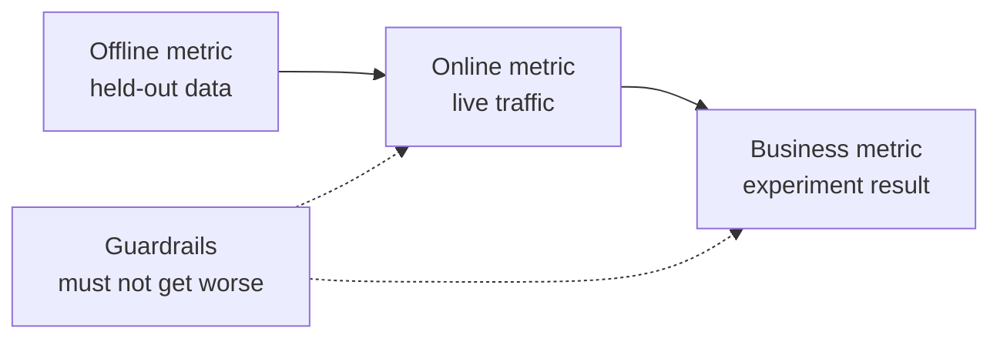

# 机器学习系统设计：从问题到已部署模型

> 模型只是系统的一部分。设计决定模型预测什么、谁根据预测采取行动、代价是多少，以及失败时如何处理。

**Type:** Build
**Languages:** Python
**Prerequisites:** 阶段 2，第 09 课（模型评估）和第 13 课（ML 流水线）
**Time:** 约 110 分钟

## 学习目标

- 将业务问题定义为 ML 任务，明确预测内容、使用预测的决策，以及规则不足以解决问题的原因
- 区分离线、在线、业务和护栏指标，并将每个模型与简单基线及启发式基线比较
- 根据流量估算批量推理和在线推理的每日成本、延迟及数据陈旧程度
- 选择发布方式（影子、金丝雀、A/B 测试），并为每种故障模式选择安全默认行为
- 识别模型如何通过决策改变下一版本训练数据的反馈循环
- 编写 ML 设计文档，并按固定检查清单评分

## 问题

一家订阅制公司要求做“流失预测模型”。数据科学家训练了梯度提升分类器，报告 AUC 达到 0.91。三个月后，却没有人使用它。

原因与算法无关。没人决定分数应触发什么行动。分数每周才更新一次，但客户挽留团队每天都打电话。标签来自取消订阅表，而该表还存储取消原因，因此某个特征直接包含答案。也没人把模型与客服团队原有的规则比较：给连续两周不活跃的客户打电话。

这些失败在训练开始前就已埋下。它们都是设计失败，而一页设计文档就能逐一追问。本课讲解文档中的这些决策。你将构建工具包，估算批量和在线服务的成本、比较模型与基线，并按检查清单为设计文档评分。

## 核心概念

### 从业务目标到 ML 任务

业务目标并不等于 ML 任务。用四个问题把它转化为任务：

1. 模型具体预测什么，预测对象是哪种实体（用户、支付、门店、商品）？
2. 哪项决策使用预测，由谁或什么系统作出决策？
3. 何时需要预测，那个时刻有哪些数据可用？
4. 如何判断决策有所改善？

| 业务目标 | 预测 | 使用预测的决策 | ML 任务 |
|---|---|---|---|
| 减少流失 | 用户未来 30 天取消订阅的概率 | 每晚向风险最高的 5% 用户发送挽留优惠 | 二分类 |
| 减少欺诈损失 | 一笔支付属于欺诈的概率 | 在 100 ms 内批准、送审或阻止 | 二分类 |
| 保持货架有货 | 下周各门店每天的销售件数 | 各门店订货量 | 预测 |
| 展示相关商品 | （用户，商品）对的相关性分数 | 信息流中的商品顺序 | 排序 |

第二列最需要仔细定义。“预测流失”没有明确时间窗口、实体和行动。“预测这个用户是否会在未来 30 天取消订阅，让今晚的任务决定谁收到优惠”则同时明确了三者。

### 何时不应使用 ML

Google《Rules of Machine Learning》的规则 1 建议，不要害怕推出不使用机器学习的产品。机器学习需要数据，简单启发式规则往往已经能解决一部分问题。以下情况不应使用 ML：

- 简短规则可以达成目标，并能持续保持正确。规则运行、测试和解释的成本更低。
- 没有标签，也没有实际可行的收集方法。
- 没人根据预测采取行动，因此预测更准确也不会带来改变。
- 预测时可用的数据不含所需信号。
- 一次错误也不能接受，又没有人可以检查输出。
- 构建和运行系统的成本高于更好决策带来的价值。

当规则变得冗长而脆弱时，ML 才开始值得投入。同一指南的规则 3 建议优先使用 ML 而不是复杂启发式规则，因为学习得到的模型更容易更新和维护。

### 三层指标

在三个层面衡量 ML 系统，同时设置一组限制：

| 层面 | 何时能测量 | 流失预测示例 |
|---|---|---|
| 离线指标 | 上线前，在留出的历史数据上 | 优惠阈值处的 F1、风险最高 5% 中的精确率 |
| 在线指标 | 上线期间，在真实流量上 | 优惠接受率、已评分用户比例、分数分布 |
| 业务指标 | 上线数周后，通过实验 | 干预组与保留对照组的 30 天流失率 |
| 护栏指标 | 始终监测 | 每挽留一名用户的优惠成本、退订率、p99 延迟 |



各层经常给出不同结论。离线指标评估历史数据，而过去并没有你的模型。在线指标取决于人们对决策的反应。业务指标变化缓慢，还混入公司其他活动造成的噪声。

选择与决策匹配的离线指标。如果任务联系风险最高的 5% 用户，就测量这 5% 中的精确率。AUC 对所有阈值综合评估，其中包括你从不使用的阈值。同一指南的规则 2 要求先设计并实现指标，再决定 ML 系统具体做什么。

### 基线

孤立的指标没有意义。若最佳替代方案只有 0.30，F1 达到 0.56 就很好；若一条规则能达到 0.60，它就很差。每个模型都应与三类基线比较：

- **简单基线。** 始终预测多数类别，或始终预测训练集均值。模型评估课使用过这种检查。
- **启发式基线。** 来自领域知识的规则，或在训练数据上拟合的单特征阈值。
- **现有系统。** 当前作出决策的方法，即使它只是一个使用电子表格的人。

提升量是模型分数减去最强基线分数。在查看结果前设定最低提升要求，并确保它足以覆盖额外系统成本。简单基线通常很弱，启发式基线才是真正难以击败的对手。

### 数据和标签要求

训练前回答这些问题：

- **标签来源。** 哪张表或哪个事件定义标签，由谁负责？
- **标签延迟。** 预测后多久才知道真实结果？欺诈拒付可能在支付数周后出现；流失标签要等 30 天预测窗口结束。
- **标签质量。** 谁标注，出错频率多高？
- **预测时的可用性。** 每个特征是否都在预测发生时存在？结果产生后才写入的特征会把标签泄露到训练中。
- **各类样本量。** 有多少正样本？只有两百个正样本时，通常只能使用简单模型。
- **时间切分。** 留出最近的一段时间。时间序列课按时间划分数据也是出于同样原因。

### 延迟、吞吐量和成本预算

三个数字约束每一种服务设计：

- **延迟预算。** p99 延迟是 100 个请求中有 99 个低于的耗时。支付检查可能要求 50 ms；夜间报表则可以运行数小时。
- **峰值吞吐量。** 按最忙一分钟而非日均流量配置系统。峰值 QPS（每秒请求数）往往是平均值的数倍。
- **成本预算。** 用每日美元成本或每 1000 次预测的美元成本表示，便于比较方案。

Little 定律将前两者联系起来：处理中请求数等于吞吐量乘以延迟。若每秒 400 个请求、每个耗时 50 ms，则平均有 20 个请求处于处理中。

### 批量推理与在线推理

提供预测有两种基本方式：

- **批量推理。** 定时任务为每个实体评分，将分数写入表或键值存储。应用在收到请求时读取已存分数。
- **在线推理。** 应用在请求到达时把特征发送给模型服务，等待分数返回。

| 属性 | 批量 | 在线 |
|---|---|---|
| 新鲜度 | 距离上次运行的时间，加上运行耗时 | 使用当前请求的数据 |
| 请求延迟 | 一次键值读取，几毫秒 | 特征获取时间加模型耗时 |
| 成本驱动因素 | 实体数乘以每天运行次数 | 按峰值 QPS 配置的副本数 |
| 新实体 | 下一次运行前没有分数 | 第一次请求时即可评分 |
| 故障时 | 旧分数仍可读取 | 请求失败或超时 |

本课工具包会估算两者成本。批量成本随实体数和每日运行次数增长。允许陈旧时间越短，运行越频繁。在线成本随峰值流量增长，因为高峰之间空闲的副本也要付费。一个耗时一小时的批量任务，无论花多少钱，都不能满足短于一小时的陈旧时间限制。

混合设计很常见：夜间批任务给已有用户评分，在线路径处理新用户和需要新鲜数据的请求。

### 部署模式

新模型分阶段接触用户：

1. **影子运行（Shadow）。** 新模型接收真实流量的副本。系统记录预测，却不使用它。比较新旧模型的延迟、错误率和预测分布。
2. **金丝雀发布（Canary）。** 新模型为一小部分流量作出真实决策，通常从 1% 到 5% 开始。逐步扩大比例，触碰护栏时回滚。
3. **A/B 测试。** 随机分组的用户分别使用不同模型。用统计检验测量业务指标，需要足够流量和时间才能看清差异。

每个阶段都需要在数分钟内完成回滚。保留已部署的旧模型版本，通过配置切换流量。LLM 服务阶段的[影子与金丝雀发布课](../../../17-infrastructure-and-production/20-shadow-canary-progressive/docs/en.md)和 [A/B 测试课](../../../17-infrastructure-and-production/21-ab-testing-llm-features/docs/en.md)会针对语言模型讲解同样的三种模式。

### 反馈循环

当模型的决策改变下一版本的训练数据时，就出现反馈循环。Sculley 等人将直接和隐蔽反馈循环列为 ML 系统技术债的主要来源。三个常见情况：

- **干预隐藏标签。** 流失模型发送优惠，挽留了部分用户。下个月，高风险用户看起来很忠诚，重新训练的模型便学到这些特征不能预测流失。
- **被阻止的行动没有结果。** 欺诈模型阻止一笔支付，这笔支付就永远不会产生拒付标签。重新训练的模型看到的被阻止区域欺诈样本会减少。
- **曝光限制反馈。** 排序模型只展示排名靠前的商品，因此只有这些商品获得点击。

修复方法的共同思想是保留一些未受模型影响的数据。随机保留一小组永不接受干预的用户；给少量流量随机分配决策；随每个样本记录分数与决策，使后续训练能区分受影响数据和干净数据。

### 故障模式与安全默认行为

系统的每个部分迟早会失败。应在设计阶段而不是事故期间决定各类故障的默认行为：

| 故障 | 没有预案时的结果 | 安全默认行为 |
|---|---|---|
| 模型服务超时 | 请求失败 | 使用启发式基线 |
| 夜间批任务失败 | 分数缺失或过旧 | 在固定期限内提供最近的正常分数，之后使用规则 |
| 特征缺失或越界 | 模型对坏输入评分 | 使用文档规定的默认值，并记录事件 |
| 新实体没有历史 | 没有分数 | 使用规则或总体均值 |
| 分数分布突然变化 | 大规模错误决策 | 暂停自动行动，并通知人工处理 |

指标部分的启发式基线也是多数故障的默认方案，所以应先实现它。

### 设计文档

设计文档在训练开始前集中记录上述决策。本课检查器为其 JSON 版本评分。其中六个检查项具有阻塞性，因为任一缺失都会使系统不安全或无用：

| 章节 | 回答的问题 | 阻塞条件 |
|---|---|---|
| 问题 | 预测什么，哪项决策使用它，为什么规则不够？ | 必须明确决策 |
| 指标 | 适用哪些离线、在线、业务和护栏指标？ | 必须明确业务指标 |
| 基线 | 适用哪些简单、启发式和现有系统基线？ | 必须有启发式或现有系统基线 |
| 数据 | 标签来自哪里、延迟多久，每个特征预测时是否可用？ | 不得泄露标签 |
| 预算与服务 | 有哪些延迟、峰值 QPS、成本和陈旧时间限制，哪种模式满足它们？ | 无 |
| 发布 | 使用哪些影子、金丝雀及 A/B 阶段，如何回滚？ | 必须有影子或金丝雀阶段，以及回滚 |
| 反馈循环 | 模型如何改变未来数据，如何保留干净数据？ | 无 |
| 故障模式 | 每种故障的默认行动是什么？ | 每种故障都必须有默认行为 |
| 监控 | 上线后观察什么？ | 无 |

```figure
mlprod-serving-cost
```

## 从零构建

`code/main.py` 仅使用标准库，包含三个工具：服务成本模型、基线比较器和设计文档检查器。

### 第 1 步：描述工作负载和价格

工作负载保存流量与预算数字，成本模型保存价格。这些价格是练习用的整数化示例，不是供应商报价。

```python
@dataclass(frozen=True)
class Workload:
    name: str
    entities: int
    requests_per_day: int
    peak_qps: float
    max_staleness_hours: float
    latency_budget_ms: float


@dataclass(frozen=True)
class CostModel:
    batch_dollars_per_million: float = 0.40
    batch_job_hours: float = 1.0
    lookup_dollars_per_million: float = 0.25
    lookup_latency_ms: float = 4.0
    replica_dollars_per_hour: float = 0.50
    replica_qps: float = 200.0
    min_replicas: int = 2
    online_latency_ms: float = 35.0
```

### 第 2 步：计算批量和在线服务成本

批任务必须在陈旧时间上限内完成。两次运行的间隔等于上限减去任务耗时。无论是否有人请求分数，每次运行都会给所有实体评分。

```python
def batch_plan(workload: Workload, costs: CostModel) -> ServingPlan:
    refresh_hours = workload.max_staleness_hours - costs.batch_job_hours
    if refresh_hours <= 0:
        return ServingPlan(
            "batch", False, math.inf, costs.lookup_latency_ms, math.inf, 0.0,
            "staleness limit is shorter than one batch job",
        )
    runs_per_day = 24.0 / refresh_hours
    predictions = workload.entities * runs_per_day
    dollars = (
        predictions / 1e6 * costs.batch_dollars_per_million
        + workload.requests_per_day / 1e6 * costs.lookup_dollars_per_million
    )
    ...
```

在线服务需付费保留足够副本来承受峰值，并至少保留两个副本以保证可用性：

```python
def online_plan(workload: Workload, costs: CostModel) -> ServingPlan:
    replicas = max(costs.min_replicas, math.ceil(workload.peak_qps / costs.replica_qps))
    dollars = replicas * costs.replica_dollars_per_hour * 24.0
    feasible = costs.online_latency_ms <= workload.latency_budget_ms
    ...
```

`choose_serving` 筛选满足延迟和陈旧时间限制的方案，返回最便宜者。没有可行方案时返回 `None`，提示你需要调整预算。

### 第 3 步：比较模型与基线

比较器用相同指标评估模型和所有基线。它计算相对最强而非最弱基线的提升。

```python
def compare_to_baselines(
    y_true: list,
    model_pred: list,
    baselines: dict[str, list],
    metric,
    metric_name: str,
    higher_is_better: bool = True,
    min_lift: float = 0.02,
) -> BaselineReport:
    if not baselines:
        raise ValueError("a model needs at least one baseline")
    scores = {name: metric(y_true, pred) for name, pred in baselines.items()}
    pick = max if higher_is_better else min
    best_name = pick(scores, key=scores.get)
    model_score = metric(y_true, model_pred)
    lift = model_score - scores[best_name] if higher_is_better else scores[best_name] - model_score
    return BaselineReport(metric_name, {"model": model_score, **scores}, best_name, lift, min_lift)
```

启发式基线是单特征规则。`fit_rule` 在训练数据上把该特征的每个值依次作为阈值，保留 F1 最好的阈值。演示在合成流失数据上训练小型逻辑回归，并与三种基线比较。

### 第 4 步：为设计文档评分

每个检查项包含键、权重、阻塞标志、消息和检查函数。阻塞项的权重为 2。

```python
CheckItem("decision", 2, True, "name the action that uses each prediction", lambda d: _text(d, "problem.decision")),
CheckItem("baselines", 2, True, "add a heuristic or current-system baseline", check_baselines),
CheckItem("no_leakage", 2, True, "confirm every feature exists at prediction time",
          lambda d: get_path(d, "data.features_available_at_prediction_time") is True),
CheckItem("serving_fit", 1, False, "pick a serving mode that meets the staleness, latency, and cost budgets",
          check_serving_fit),
```

`check_serving_fit` 复用成本模型，从文档读取负载数字，并估算选定模式的成本。如果该模式不能满足陈旧时间上限、延迟预算或每日成本预算，检查就失败。声明采用“batch”但只允许三分钟陈旧时间的文档无法通过。成本模型没有混合方案，因此声明“hybrid”的文档也会失败，直到你在练习 1 中加入该方案。

`review_design_doc` 将通过项的权重相加，再除以总权重。只有分数达到 0.85 且所有阻塞项通过，结论才是“ready for review”（可进入评审）。

### 第 5 步：运行

```bash
python3 code/main.py
```

```console
nightly churn scores
  ok batch        $0.91/day      4 ms  1.0 runs per day over 2,000,000 entities
  ok online      $24.00/day     35 ms  2 replicas sized for 40 peak QPS
  choose: batch

feed ranking, 2-hour freshness
  ok batch       $48.50/day      4 ms  24.0 runs per day over 5,000,000 entities
  ok online      $24.00/day     35 ms  2 replicas sized for 120 peak QPS
  choose: online

=== Model versus baselines (churn, metric F1) ===
  model                    0.564
  days_idle > 12.8688      0.500
  random at base rate      0.232
  majority class           0.000
  model beats the strongest baseline (days_idle > 12.8688) by +0.064
```

多数类基线的 F1 为 0，因为它从不预测流失。拟合后的规则才是真正的竞争者。模型比它高 0.064，因此有理由使用模型。如果特征更弱，规则可能胜出，此时规则才是应该部署的系统。

设计文档评审会打印缺少六个阻塞项的薄弱文档，以及得分 1.00 的完整文档。传入路径可评审你自己的文档：

```bash
python3 code/main.py my_design_doc.json
```

## 使用现成工具

工具包各部分都对应团队在生产中使用的工具。

**基线。** scikit-learn 将简单基线实现为估计器，因此它们可以与模型放入同一流水线：

```python
from sklearn.dummy import DummyClassifier, DummyRegressor
from sklearn.metrics import f1_score

majority = DummyClassifier(strategy="most_frequent").fit(X_train, y_train)
base_rate = DummyClassifier(strategy="stratified", random_state=0).fit(X_train, y_train)
mean_value = DummyRegressor(strategy="mean").fit(X_train, y_reg_train)

print(f1_score(y_test, majority.predict(X_test)))
```

`most_frequent` 对应 `majority_baseline`，`stratified` 对应 `base_rate_baseline`。scikit-learn 没有启发式基线，因为启发式规则来自你的具体领域。

**批量服务。** Apache Airflow、Dagster 等工作流调度器运行评分任务，任务将分数写入数仓表，或 Redis、DynamoDB 等键值存储。

**在线服务。** KServe、BentoML、NVIDIA Triton、TorchServe 等模型服务器将模型封装在 HTTP 或 gRPC 端点后。对于小模型，加载模型的普通 Web 服务也可行。

**发布。** Argo Rollouts 等 Kubernetes 工具为金丝雀发布分流。GrowthBook、Statsig 等实验平台把用户分配到 A/B 分组并计算统计量。

**设计评审。** Breck 等人发表的 ML Test Score 包含生产 ML 系统所需的 28 项测试和监控要求。我们的检查器更小，关注这些测试之前应该回答的设计问题。

## 交付成果

本课产出 `outputs/skill-ml-design-review.md`。该技能逐节评审 ML 设计文档，优先指出阻塞性缺口，并用本课的批量及在线成本算术检查服务选择。

## 练习

1. 为 `choose_serving` 添加混合方案：批量为已有用户评分，在线为新用户评分。比较每日成本。
2. 修改流失数据，直到模型不再胜过规则。报告使提升消失的最小系数改动。
3. 在检查清单添加 `budgets.max_dollars_per_1k_predictions` 项，并编写缺少该项时会失败的测试。
4. 为支付欺诈检查编写 JSON 设计文档。运行检查器，修复每个阻塞项。
5. 模拟流失反馈循环：移除收到优惠用户的标签，重新训练，并测量 F1 的变化。

## 关键术语

| 术语 | 常见说法 | 实际含义 |
|------|----------------|----------------------|
| ML 任务 | “做一个流失模型” | 预测目标、实体、时间窗口，以及使用预测的决策 |
| 离线指标 | “模型分数” | 上线前在留出的历史数据上计算的指标 |
| 在线指标 | “实时数据” | 模型运行时在真实流量上测量的指标 |
| 业务指标 | “目标” | 决策必须改变、通过实验测量的公司业务结果 |
| 护栏指标 | “不要造成损害” | 新模型上线时不能变差的指标 |
| 基线 | “简单模型” | 模型必须以规定幅度超越的简单、启发式或现有系统预测器 |
| 批量推理 | “预先算好的分数” | 定时任务为每个实体评分并存储结果，供查询使用 |
| 在线推理 | “实时模型” | 每个请求到达时由模型评分 |
| 影子部署 | “暗发布” | 新模型对真实流量评分，但无人使用输出 |
| 金丝雀发布 | “逐步上线” | 新模型为逐渐扩大的小部分流量决策，同时备好回滚 |
| 反馈循环 | “模型训练自己” | 模型决策改变下一版本的训练数据 |

## 延伸阅读

- [Sculley et al., Hidden Technical Debt in Machine Learning Systems (NeurIPS 2015)](https://papers.nips.cc/paper/2015/hash/86df7dcfd896fcaf2674f757a2463eba-Abstract.html)：反馈循环、相互耦合，以及模型周边的系统成本
- [Google, Rules of Machine Learning](https://developers.google.com/machine-learning/guides/rules-of-ml)：首个模型、指标及训练与服务一致性的实用规则
- [Breck et al., The ML Test Score (IEEE Big Data 2017)](https://research.google/pubs/the-ml-test-score-a-rubric-for-ml-production-readiness-and-technical-debt-reduction/)：衡量生产就绪度的 28 项测试
- [Kohavi, Tang, and Xu, Trustworthy Online Controlled Experiments (Cambridge University Press, 2020)](https://experimentguide.com/)：如何运行能够得出可靠结论的 A/B 测试
- [Sato, Wider, and Windheuser, Continuous Delivery for Machine Learning (2019)](https://martinfowler.com/articles/cd4ml.html)：版本化的数据、模型和部署流水线
- [Google Cloud, MLOps: Continuous delivery and automation pipelines in machine learning](https://cloud.google.com/architecture/mlops-continuous-delivery-and-automation-pipelines-in-machine-learning)：训练与服务自动化的三个成熟度层级
