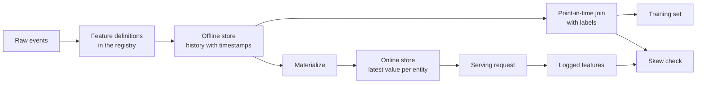

# 特征存储与训练—服务偏差

> 一个特征只有一份定义，却有两个读取方。训练读取各个标签时刻的历史值，在线服务读取最新值。两者不一致时，模型就会遇到训练期间从未见过的输入。

**Type:** Build
**Languages:** Python
**Prerequisites:** Phase 2，第 08 课（特征工程）、第 13 课（机器学习流水线）、第 15 课（时间序列）和第 19 课（机器学习系统设计）
**Time:** ~100 分钟

## 学习目标

- 说明离线存储、在线存储、实体、事件时间戳和 TTL 的含义及各自职责
- 实现时点正确的关联，并展示朴素关联如何把未来值复制到训练数据中
- 列出训练—服务偏差的四个原因：两条代码路径、特征陈旧、默认值不同和时间穿越
- 构建特征注册表，让同一份定义同时供训练路径和服务路径使用
- 在过去的日期上回填新特征，而不读取各个日期之后的数据
- 对同一实体和时刻，比较服务日志中的特征与训练路径产生的特征，从而检测偏差

## 问题

一个团队构建了用户流失模型。每个标签表示用户在标签日之后的 30 天内是否没有购买。团队使用 `user_id` 将标签与用户特征表关联，并基于 `days_since_last_purchase` 训练一条规则。离线准确率为 0.948。

在真实流量上，这个模型却不如更旧、更简单的版本。特征表保存的是每个用户的最新值，其时间比标签日晚了数周。某个用户最后一次购买发生在第 115 天，到第 175 天的快照中已经闲置 60 天，因此特征本身就包含了答案。与此同时，另一个团队在不同服务中重新编写了在线特征计算逻辑。他们的 30 天窗口多包含了一天，新用户的默认值也是 -1，而不是 365。

这两个缺陷的原因相同：训练和在线服务用两种不同方式计算了“同一个特征”。本课将从零构建特征存储的各个部分。你会编写注册表、回填逻辑、时点关联、带 TTL 的在线存储，以及偏差检查。演示将用具体数值重现这两种缺陷。

## 概念

### 同一个特征的两个读取方

训练和在线服务对特征的请求形式不同：

| 属性 | 训练（离线） | 服务（在线） |
|---|---|---|
| 问题 | “一千万个（实体，时间）组合各自对应的值是什么？” | “这个实体现在的值是什么？” |
| 时间 | 过去的多个时点 | 当前 |
| 数据量 | 每个任务数百万行 | 每次请求一行 |
| 延迟 | 可以接受数分钟 | 几毫秒 |
| 存储 | 离线存储：在列式文件或数据仓库中保存带时间戳的完整历史 | 在线存储：在键值数据库中保存每个实体的最新值 |

特征存储根据同一组特征定义填充这两类存储。物化（materialization）是把最新值从离线存储复制到在线存储的任务。



### 实体、时间戳与 TTL

每一行特征都可以用四个术语描述：

- **实体（Entity）。** 特征所描述对象的键，例如 `user_id` 或 `card_id`。
- **事件时间戳（Event timestamp）。** 该值成立的时刻。“截至第 14 天”的购买次数，其事件时间戳就是第 14 天。
- **创建时间戳（Created timestamp）。** 系统写入该行的时刻。今天执行的回填会写入事件时间戳较早、创建时间戳为当前时间的行。
- **TTL（time to live，生存时间）。** 值允许达到的最大年龄。超过 TTL 的值被视为缺失，因此读取方会使用默认值。

具有相同实体、数据源和 TTL 的一组特征，通常称为特征视图（feature view）。

### 时点正确的关联

一行训练数据应将标签与标签时刻已经存在的特征值配对。时点关联会为每个标签执行以下步骤：

1. 找到同一实体的特征行。
2. 只保留事件时间戳不晚于标签时间戳的行。
3. 取其中最新的一行。
4. 如果标签时间戳减去其事件时间戳超过 TTL，就丢弃该行。

下面展示一个用户、第 16 天的标签，以及每周生成的特征行：

| 特征行日期 | `purchases_30d` | 时点关联 | 仅按 `user_id` 进行朴素关联 |
|---|---|---|---|
| 7 | 4 | | |
| 14 | 3 | 选中 | |
| 21 | 1 | 未来 | |
| 28 | 0 | 未来 | 选中 |

标签要判断用户在第 17 到第 46 天是否购买过任何商品。第 28 天的行已经统计了标签日之后没有购买的那些日子。它显示购买次数为 0，是因为用户停止了购买，而这恰好就是标签衡量的事件。朴素关联把答案复制到了输入中。

时间序列一课按时间划分数据，也是出于同样的原因。时点关联将这条规则应用到每一行，而不只是一个划分时点。

### 训练—服务偏差的原因

Google 的《机器学习规则》将训练—服务偏差定义为训练期间与在线服务期间的性能差异，并列出三个原因：两条流水线处理数据的方式不同、训练与服务之间的数据发生变化，以及反馈回路。在特征流水线中，以下四种具体原因反复出现：

| 原因 | 发生的情况 | 演示中的例子 |
|---|---|---|
| 两条代码路径 | 训练与服务使用不同代码计算特征 | 服务窗口包含 `now - 30` 这一天，训练窗口却不包含 |
| 特征陈旧 | 服务读取的值与训练所用值的年龄不同 | 训练读取每周快照，而新服务计算实时的新值 |
| 默认值不同 | 两条路径对缺失值的填充方式不同 | 对“尚未购买”，训练使用 365，服务使用 -1 |
| 时间穿越 | 训练读取了标签时刻之后的值 | 朴素关联为每个标签读取最新快照 |

同一指南的第 32 条规则要求尽可能在训练流水线与服务流水线之间复用代码。特征存储通过让两条路径调用同一份定义来遵守这条规则。

### 特征注册表

注册表是特征定义的目录。每个条目包含名称、实体、数据源、变换、窗口、默认值、TTL、负责人、版本和描述。

两条规则可以保障其安全性：

- 两条路径都从注册表读取定义。任何服务都不能私自维护变换逻辑的副本。
- 修改定义时创建新版本。旧版本继续保留，让旧模型仍能使用训练时的特征。

### 回填

新特征没有历史，但训练需要它在每个历史标签时刻的值。回填会在过去的各个日期执行定义，为每个实体和日期写入一行。每次运行只读取时间戳不晚于该日期的事件。

回填的计算成本随实体数与日期数的乘积增长。它还可能带来隐蔽的泄漏：今天执行的回填虽然写入较早的事件时间戳，却可能读取迟到的数据或后来修正的数据。严格的时点关联还会检查创建时间戳是否不晚于标签时刻。

### 检测偏差

同一指南的第 29 条规则要求记录服务时使用的特征，并将其用于训练。即使只记录少量样本，也能检查一致性。将每个日志值与训练路径在同一实体、同一时刻产生的值比较。对每个特征报告不匹配比例和平均绝对差。

为了定位原因，比较以下三组结果：

1. 在线存储读取结果与训练关联结果。这会测试整个系统，偏差应为零。
2. 实时重新计算的结果与训练关联结果。这可以单独识别陈旧性影响。
3. 第二条代码路径与实时重新计算的结果。这可以单独识别窗口、默认值等代码差异。

```figure
mlprod-pit-join
```

## 动手构建

`code/main.py` 中的代码只使用标准库。时间以整数天表示。每周批处理任务在第 7、14 天等日期写入特征快照，直到第 175 天。

### 步骤 1：特征定义与注册表

`FeatureDefinition` 将变换表示为数据：聚合方式、窗口和默认值。其 `compute` 方法绝不会读取 `as_of` 之后的事件。

```python
@dataclass(frozen=True)
class FeatureDefinition:
    name: str
    entity: str
    aggregate: str
    window_days: int | None
    default: float
    version: int = 1
    owner: str = "growth-team"
    description: str = ""

    def compute(self, events: list[Event], as_of: int) -> float:
        visible = [e for e in events if e.day <= as_of]
        if self.window_days is not None:
            visible = [e for e in visible if e.day > as_of - self.window_days]
        if self.aggregate == "count":
            return float(len(visible))
        if self.aggregate == "sum":
            return round(sum(e.amount for e in visible), 2)
        if self.aggregate == "days_since_last":
            return float(as_of - max(e.day for e in visible)) if visible else self.default
        raise ValueError(f"unknown aggregate {self.aggregate!r}")
```

`FeatureRegistry.register` 允许重复注册相同定义，但会拒绝名称和版本相同、内容却不同的定义。`fill_defaults` 为两条路径的缺失值提供相同默认值。

模型通过 `spend_30d@1` 这样的引用固定定义。`compute` 和 `fill_defaults` 会解析引用，不含 `@` 的名称会读取最新版本。带有 `@` 却没有版本号的引用会触发 `ValueError`，因此拼写错误不会在没有警告的情况下读到最新版本。该引用也是每个存储行中的键，所以回填、在线存储和服务读取都会使用固定的定义。

### 步骤 2：回填离线存储

```python
def backfill(registry: FeatureRegistry, names: list[str], events: list[Event], days: list[int]) -> list[FeatureRow]:
    rows = []
    for entity, entity_events in sorted(group_events(events).items()):
        for day in days:
            rows.append(FeatureRow(entity, day, registry.compute(names, entity_events, day)))
    return rows
```

演示为 299 个用户在 25 个快照日回填三个特征，共生成 7475 行。

### 步骤 3：时点关联

先按日期对每个实体的行排序一次。对于每个标签，`bisect_right` 找到标签日当天或之前的最后一行。TTL 检查会丢弃过旧的行。

```python
def point_in_time_join(labels: list[LabelRow], rows: list[FeatureRow], ttl_days: int | None = None) -> list[JoinedRow]:
    by_entity: dict[str, list[FeatureRow]] = defaultdict(list)
    for row in rows:
        by_entity[row.entity].append(row)
    days_index = {}
    for entity, entity_rows in by_entity.items():
        entity_rows.sort(key=lambda r: r.day)
        days_index[entity] = [r.day for r in entity_rows]
    joined = []
    for label in labels:
        days = days_index.get(label.entity, [])
        pos = bisect.bisect_right(days, label.day) - 1
        match = by_entity[label.entity][pos] if pos >= 0 else None
        if match is not None and ttl_days is not None and label.day - match.day > ttl_days:
            match = None
        joined.append(JoinedRow(
            label.entity, label.day, label.label,
            match.day if match else None, match.values if match else None,
        ))
    return joined
```

### 步骤 4：测量朴素关联造成的泄漏

`naive_latest_join` 只按实体关联，因此为每个标签返回最新行。演示在第 100、120 和 140 天构建标签，并在每个训练集上拟合一条单特征规则。随后使用时点正确的特征，在第 145 天的标签上测试两条规则：

```console
  naive join used a snapshot from after the label day for 100% of rows
  offline accuracy, naive join: 0.948 (rule: idle > 53 days)
  offline accuracy, PIT join:   0.893 (rule: idle > 19 days)
  accuracy on day 145, trained with naive join: 0.763
  accuracy on day 145, trained with PIT join:   0.876
```

朴素关联的离线表现更好：0.948 对 0.893。但在新数据上更差：0.763 对 0.876。泄漏的特征将拟合出的闲置天数阈值从 19 天推到了 53 天。

### 步骤 5：在线存储与物化

在线存储为每个实体保留一行，并拒绝超过 TTL 的行。`materialize` 只写入日期不晚于任务时刻的行。

```python
class OnlineStore:
    def __init__(self, ttl_days: int):
        self.ttl_days = ttl_days
        self._latest: dict[str, FeatureRow] = {}

    def write(self, row: FeatureRow) -> None:
        current = self._latest.get(row.entity)
        if current is None or row.day >= current.day:
            self._latest[row.entity] = row

    def read(self, entity: str, now: int) -> dict[str, float] | None:
        row = self._latest.get(entity)
        if row is None or row.day > now or now - row.day > self.ttl_days:
            return None
        return dict(row.values)
```

TTL 为 10 天时，第 145 天的读取会返回第 140 天的行。如果没有新的物化，第 160 天的读取会返回默认值，因为该行已经有 20 天历史。

### 步骤 6：偏差检查

`detect_skew` 比较两个以 `(entity, day)` 为键的视图。它报告每个特征的不匹配比例和平均绝对差，当超过 1% 的值不同时标记该特征。如果两个视图的键不同或没有任何键，它会触发 `ValueError`。请求缺失可能掩盖偏差，而没有请求的检查无法说明任何问题。

```python
def detect_skew(
    training: dict[tuple[str, int], dict[str, float]],
    serving: dict[tuple[str, int], dict[str, float]],
    features: list[str],
    tolerance: float = 1e-6,
    max_mismatch_rate: float = 0.01,
) -> list[SkewReport]:
    if set(training) != set(serving):
        raise ValueError(f"{len(set(training) ^ set(serving))} keys are in only one view: log and compare the same requests")
    if not training:
        raise ValueError("no requests to compare")
    keys = sorted(training)
    reports = []
    for feature in features:
        diffs = [abs(training[k][feature] - serving[k][feature]) for k in keys]
        mismatches = sum(1 for d in diffs if d > tolerance)
        rate = mismatches / len(keys)
        mean_diff = sum(diffs) / len(keys)
        reports.append(SkewReport(feature, len(keys), rate, mean_diff, rate > max_mismatch_rate))
    return reports
```

演示记录第 141 到第 150 天的请求，并运行概念部分介绍的三组比较。请求池中包含 20 个没有历史记录的新用户。

```bash
python3 code/main.py
```

```console
=== Skew checks on 383 logged requests, days 141 to 150 ===
  online store read  vs  training join (one definition, same snapshots)
    ok   days_since_last_purchase   mismatch   0.0%  mean |diff|    0.00
    ok   purchases_30d              mismatch   0.0%  mean |diff|    0.00
    ok   spend_30d                  mismatch   0.0%  mean |diff|    0.00
  fresh compute      vs  training join (staleness only)
    SKEW days_since_last_purchase   mismatch  83.0%  mean |diff|    2.77
    SKEW purchases_30d              mismatch  30.5%  mean |diff|    0.38
    SKEW spend_30d                  mismatch  37.1%  mean |diff|   16.77
  second code path   vs  fresh compute (code differences only)
    SKEW days_since_last_purchase   mismatch   5.5%  mean |diff|   20.07
    SKEW purchases_30d              mismatch  12.5%  mean |diff|    0.13
    SKEW spend_30d                  mismatch  12.5%  mean |diff|    5.09
```

依次阅读这三个输出块：

- **同一定义、相同快照。** 在线存储和训练关联读取相同的物化行，因此偏差为零。
- **陈旧性。** 在大多数请求中，实时计算值与每周快照不同。这里的数据并非越新越好，因为模型学习的是最多六天前的值。
- **代码差异。** 第二条代码路径在 12.5% 的窗口计数上不同，因为它的窗口多包含了一天。它只在新用户的 `days_since_last_purchase` 上产生差异，但差异很大：-1 对 365。

## 使用现有工具

Feast 是开源特征存储。从零实现中的每个部分都能在 Feast 中找到对应项：

| 从零实现 | Feast |
|---|---|
| `FeatureDefinition`、`FeatureRegistry` | 特征仓库中的 `Entity`、`FeatureView` 和 `Field`，通过 `feast apply` 注册 |
| `FeatureRow` 历史记录 | 离线存储，例如基于 Parquet 文件的 `FileSource` 或数据仓库表 |
| 带 TTL 的 `point_in_time_join` | `store.get_historical_features(entity_df=..., features=[...])` |
| `materialize` | `feast materialize-incremental <end time>` |
| `OnlineStore.read` | `store.get_online_features(features=[...], entity_rows=[...])` |
| 创建时间戳检查 | 数据源上的 `created_timestamp_column` 和 `filter_by_created_timestamp=True` |

定义如下。这些代码遵循 Feast 快速入门指南，运行本课并不需要它们。

```python
from datetime import timedelta

from feast import Entity, FeatureView, Field, FileSource
from feast.types import Float32, Int64

user = Entity(name="user", join_keys=["user_id"])

user_activity_source = FileSource(
    name="user_activity_source",
    path="data/user_activity.parquet",
    timestamp_field="event_timestamp",
    created_timestamp_column="created",
)

user_activity = FeatureView(
    name="user_activity",
    entities=[user],
    ttl=timedelta(days=10),
    schema=[
        Field(name="purchases_30d", dtype=Int64),
        Field(name="spend_30d", dtype=Float32),
        Field(name="days_since_last_purchase", dtype=Int64),
    ],
    source=user_activity_source,
)
```

随后，训练与在线服务读取同一个特征视图：

```python
from feast import FeatureStore

store = FeatureStore(repo_path=".")

training_df = store.get_historical_features(
    entity_df=labels_df,
    features=["user_activity:purchases_30d", "user_activity:days_since_last_purchase"],
    filter_by_created_timestamp=True,
).to_df()

online = store.get_online_features(
    features=["user_activity:purchases_30d", "user_activity:days_since_last_purchase"],
    entity_rows=[{"user_id": 42}],
).to_dict()
```

`labels_df` 为每个标签保存一行，包含 `user_id`、`event_timestamp` 和标签。Feast 文档指出，TTL 相对于实体数据框中的每个时间戳，而不是查询时刻。这与 `point_in_time_join` 中的 TTL 检查一致。同一页面还介绍了 `filter_by_created_timestamp=True`，它可以防止回填值泄漏到训练数据中。并非所有离线存储都支持此选项。不支持的存储会报错，而不是忽略该选项。

Tecton、Hopsworks 和大型云机器学习平台中的特征存储，也采用相同的离线与在线存储分工。检测偏差时，TensorFlow Data Validation 可以比较训练数据与服务数据。Breck 等人介绍了 Google 端到端机器学习平台 TFX 中的数据验证系统，其中包括训练—服务偏差检测。

## 交付成果

本课产出 `outputs/skill-feature-skew-audit.md`。该技能审计特征流水线中的时间穿越和训练—服务偏差，依次检查关联逻辑、定义、默认值、各路径的数据新鲜度，以及偏差检查所需的日志。

## 练习

1. 将快照间隔从 7 天改为 1 天。重新运行陈旧性比较，并解释结果。
2. 将 TTL 设为 3 天。统计有多少训练行失去了特征、转而使用默认值。
3. 为 `FeatureRow` 添加创建日期。让关联忽略标签日之后写入的行。
4. 将 `spend_7d` 注册为 `spend_30d` 的版本 2。回填它，并从注册表中打印两个版本。
5. 修复 `legacy_serving_features`，直到第三组偏差检查通过。列出每项修改。

## 关键术语

| 术语 | 常见说法 | 实际含义 |
|------|----------------|----------------------|
| 特征存储 | “存特征的数据库” | 根据同一组定义计算特征，并同时提供给训练与在线服务的系统 |
| 离线存储 | “训练数据” | 带事件时间戳的完整特征历史，由训练任务和回填任务读取 |
| 在线存储 | “特征缓存” | 每个实体的最新值，供服务路径以毫秒级延迟读取 |
| 实体 | “ID” | 特征所描述对象的键，例如用户或银行卡 |
| 事件时间戳 | “何时发生” | 特征值成立的时刻 |
| 时点关联 | “截至某时刻的关联” | 为每个标签匹配标签时刻当天或之前的最新特征行 |
| TTL | “有效期” | 特征值在被读取方视为缺失之前允许达到的最大年龄 |
| 物化 | “同步到线上” | 将最新特征值从离线存储复制到在线存储的任务 |
| 回填 | “计算历史” | 在过去的日期执行特征定义，以生成其历史记录 |
| 训练—服务偏差 | “离线时明明有效” | 训练与在线服务中的特征或行为差异 |

## 延伸阅读

- [Feast：时点关联](https://docs.feast.dev/getting-started/concepts/point-in-time-joins)：TTL 语义与创建时间戳过滤
- [Feast 文档](https://docs.feast.dev/)：特征视图、离线存储、在线存储和物化
- [Google：《机器学习规则》](https://developers.google.com/machine-learning/guides/rules-of-ml)：第 29 到第 37 条训练—服务偏差规则
- [Breck 等：《机器学习的数据验证》（SysML 2019）](https://research.google/pubs/data-validation-for-machine-learning/)：Google 的数据验证，包括训练—服务偏差
- [TensorFlow Data Validation 指南](https://www.tensorflow.org/tfx/guide/tfdv)：模式检查、偏差检测和漂移检测
- [Sculley 等：《机器学习系统中隐藏的技术债》（NeurIPS 2015）](https://papers.nips.cc/paper/2015/hash/86df7dcfd896fcaf2674f757a2463eba-Abstract.html)：模型周边的数据依赖与流水线技术债
