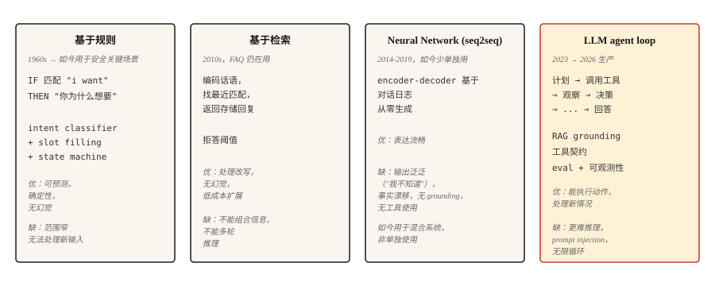

# Chatbots — 从 Rule-Based 到 Neural 再到 LLM Agents

> ELIZA 用 pattern matches 回复。DialogFlow 映射 intents。GPT 从 weights 中作答。Claude 运行 tools 并进行验证。每个时代都解决了上一代最严重的失败。

**类型：** 学习
**语言：** Python
**先修要求：** Phase 5 · 13 (Question Answering), Phase 5 · 14 (Information Retrieval)
**时间：** 约 75 分钟

## 问题

用户说：“I want to change my flight.” 系统必须弄清楚用户想要什么、缺少哪些信息、如何获取这些信息，以及如何完成这个操作。然后用户又说：“wait, what if I cancel instead?” 系统必须记住上下文、切换任务，并保留状态。

对 ML 系统来说，对话很难。输入是开放式的。输出必须在多个轮次中保持连贯。系统可能需要对现实世界执行操作（更改航班、扣款）。每一个错误步骤都会被用户看到。

Chatbot 架构经历了四种 paradigm 的循环，每一种都是因为上一种的失败太明显才被引入。本课会按顺序介绍它们。2026 年的生产环境是后两者的 hybrid。

## 概念



### 脚本化的半个世纪，1950-2001

第一种 paradigm 持续的不是五年，而是五十年。了解它的脉络很重要，因为其中的每个系统都是同一台机器：匹配输入，输出一条预先写好的回复，更新一点 state。五十年来不断给这台机器加规则，却始终没有得到通用的情况。正是这个天花板，才有了第二到第四种 paradigm。

**1950.** Turing 绕开了“机器能思考吗？”这个问题，提出了一个可操作的替代：如果审问者通过电传打字机无法区分机器和人，这个哲学问题就失去了意义。在这个领域还没有名字之前，对话就已经成了它的 benchmark。

**1956.** 名字来了：Dartmouth 的一次夏季研讨会提出了“artificial intelligence”这个词，其依据的猜想是，智能的每一个特征“原则上都可以被精确描述，以至于可以造一台机器来模拟它”。提案为取得实质性进展预留了两个月。

**1966.** ELIZA 上线了你在步骤 1 中构建的 reflection 技巧：decomposition rules 从输入中提取片段，reassembly rules 把它们以问题的形式回显出来。总共约 200 个 patterns，零 state，零理解，可用户还是向它倾诉心事。Weizenbaum 此后的整个职业生涯都在为它所需的机制之少而感到不安。

**1972.** PARRY 由 Stanford 构建，用来模拟偏执，它补上了 ELIZA 缺少的那一块：内部 state。表示恐惧、愤怒和不信任的数值变量在每一轮都会更新，并决定接下来触发哪段脚本，所以相同的输入会根据此前的对话产生不同的回复。在一次盲测的对话记录测试中，精神科医生区分 PARRY 与真实病人的准确率与随机猜测无异。它是 persona conditioning 的直接祖先：一个用三个浮点数实现的 system prompt。同一年，这两个 bot 通过 ARPANET 被接到了一起：一个治疗师脚本在访谈一个偏执 state machine，这是网络上第一次 bot 与 bot 的对话。

**1995.** ALICE 用 AIML（一种描述 pattern-template 对的 XML 方言）扩展了 ELIZA 的方法。大约 40,000 个手写类别，三次赢得 Loebner Prize。它证明了 rule-based 系统的 scaling law：更多规则换来的是覆盖面，而永远不是通用性。每一条规则都是需要有人维护的负担。

**2001.** SmarterChild 把这套方法带到了 3,000 万即时通讯用户面前，并加入了后端查询：天气、股票、电影场次，拼接进模板里。眯起眼睛看，它就是穿着 2001 年外衣的 tool calling：解析 intent，调用服务，把结果渲染进回复。

五十年，一种机制，规则数量不断上升。这个 paradigm 的终结并不是因为有人证伪了它，而是因为手写 state machine 的维护成本随覆盖面线性增长，而用户的期望却随着他们上周看到的东西不断增长。

```figure
chatbot-lineage
```

**Rule-based（ELIZA、AIML、DialogFlow）。** 手工编写的 patterns 匹配用户输入并生成回复。Intent classifiers 将请求路由到预定义流程。Slot-filling state machines 收集必需信息。在它被设计好的狭窄范围内表现非常出色。一旦超出范围就立刻失败。仍然会在安全关键领域（银行身份验证、航空预订）上线，因为这些场景不能容忍 hallucination。

**Retrieval-based。** FAQ 风格的系统。Encode 每一组（utterance, response）。运行时，encode 用户消息并 retrieve 最接近的已存回复。可以把它理解成 Zendesk 经典的“similar articles”功能。比规则更能处理 paraphrases。没有 generation，因此没有 hallucination。

**Neural（seq2seq）。** 在对话日志上训练的 encoder-decoder。从零开始生成回复。流畅，但容易产生泛泛的输出（“I don't know”）和事实漂移。始终无法可靠地贴合主题。这就是 Google、Facebook 和 Microsoft 在 2016-2019 年都推出过令人失望的 chatbots 的原因。

**LLM agents。** 一个 language model 被包装在一个循环中，用于 planning、调用 tools，并验证结果。它不是带着长 prompt 的 chatbot。它是一个 agent loop：plan → call tool → observe result → decide next step。Retrieval-first grounding（RAG）让它避免 hallucination。Tool calls 让它真正能够执行操作。这就是 2026 年的架构。

这四种 paradigm 并不是顺序替代关系。一个 2026 年生产级 chatbot 会经过全部四种路径：rule-based 用于身份验证和 destructive actions，retrieval 用于 FAQ，neural generation 用于自然表达，LLM agent 用于模糊的开放式查询。

## 构建它

### 步骤 1：rule-based pattern matching

```python
import re


class RulePattern:
    def __init__(self, pattern, response_template):
        self.regex = re.compile(pattern, re.IGNORECASE)
        self.template = response_template


PATTERNS = [
    RulePattern(r"my name is (\w+)", "Nice to meet you, {0}."),
    RulePattern(r"i (need|want) (.+)", "Why do you {0} {1}?"),
    RulePattern(r"i feel (.+)", "Why do you feel {0}?"),
    RulePattern(r"(.*)", "Tell me more about that."),
]


def rule_based_respond(user_input):
    for pattern in PATTERNS:
        m = pattern.regex.match(user_input.strip())
        if m:
            return pattern.template.format(*m.groups())
    return "I don't understand."
```

20 行实现 ELIZA。这个 reflection 技巧（“I feel sad” → “Why do you feel sad”）是 Weizenbaum 1966 年经典的心理治疗师 demo。到今天仍然很有教学价值。

### 步骤 2：retrieval-based（FAQ）

这个示例片段需要 `pip install sentence-transformers`（它会拉取 torch）。本课可运行的 `code/main.py` 改用 stdlib Jaccard similarity，因此课程运行时不需要外部依赖。

```python
from sentence_transformers import SentenceTransformer
import numpy as np


FAQ = [
    ("how do i reset my password", "Go to Settings > Security > Reset Password."),
    ("how do i cancel my order", "Go to Orders, find the order, click Cancel."),
    ("what is your return policy", "30-day returns on unused items, original packaging."),
]


encoder = SentenceTransformer("sentence-transformers/all-MiniLM-L6-v2")
faq_questions = [q for q, _ in FAQ]
faq_embeddings = encoder.encode(faq_questions, normalize_embeddings=True)


def faq_respond(user_input, threshold=0.5):
    q_emb = encoder.encode([user_input], normalize_embeddings=True)[0]
    sims = faq_embeddings @ q_emb
    best = int(np.argmax(sims))
    if sims[best] < threshold:
        return None
    return FAQ[best][1]
```

基于 threshold 的 refusal 是关键设计选择。如果最佳匹配不够接近，就返回 `None`，让系统升级处理。

### 步骤 3：neural generation（baseline）

使用一个小型 instruction-tuned encoder-decoder（FLAN-T5）或一个 fine-tuned conversational model。到 2026 年，单独用于生产仍不可用（contradiction、off-topic drift、事实胡说），但会作为 hybrid systems 的一部分用于自然表达。DialoGPT 风格的 decoder-only models 需要显式的 turn separators 和 EOS handling 才能生成连贯回复；FLAN-T5 text2text pipeline 则可以直接作为教学示例使用。

```python
from transformers import pipeline

chatbot = pipeline("text2text-generation", model="google/flan-t5-small")

response = chatbot("Respond politely to: Hi there!", max_new_tokens=40)
print(response[0]["generated_text"])
```

### 步骤 4：LLM agent loop

2026 年的生产形态：

```python
def agent_loop(user_message, tools, llm, max_steps=5):
    history = [{"role": "user", "content": user_message}]
    for _ in range(max_steps):
        response = llm(history, tools=tools)
        tool_call = response.get("tool_call")
        if tool_call:
            tool_name = tool_call.get("name")
            args = tool_call.get("arguments")
            if not isinstance(tool_name, str) or tool_name not in tools:
                history.append({"role": "assistant", "tool_call": tool_call})
                history.append({"role": "tool", "name": str(tool_name), "content": f"error: unknown tool {tool_name!r}"})
                continue
            if not isinstance(args, dict):
                history.append({"role": "assistant", "tool_call": tool_call})
                history.append({"role": "tool", "name": tool_name, "content": f"error: arguments must be a dict, got {type(args).__name__}"})
                continue
            fn = tools[tool_name]
            result = fn(**args)
            history.append({"role": "assistant", "tool_call": tool_call})
            history.append({"role": "tool", "name": tool_name, "content": result})
        else:
            return response["content"]
    return "I could not complete the task in the step budget."
```

需要明确三件事。Tools 是 LLM 可以调用的 callable functions。当 LLM 返回最终答案而不是 tool call 时，循环终止。Step budget 防止在模糊任务上出现无限循环。

真实生产系统还会加入：retrieval-first grounding（在每次 LLM call 之前注入相关文档）、guardrails（没有确认就拒绝 destructive actions）、observability（记录每一步），以及 evaluations（自动检查 agent behavior 是否保持在规范内）。

### 步骤 5：hybrid routing

```python
def hybrid_chat(user_input):
    if is_destructive_action(user_input):
        return structured_flow(user_input)

    faq_answer = faq_respond(user_input, threshold=0.6)
    if faq_answer:
        return faq_answer

    return agent_loop(user_input, tools, llm)


def is_destructive_action(text):
    danger_words = ["delete", "cancel", "charge", "refund", "transfer"]
    return any(w in text.lower() for w in danger_words)
```

模式是：对任何 destructive 内容使用 deterministic rules，对固定 FAQ 使用 retrieval，其余全部交给 LLM agents。这就是 2026 年 customer-support systems 中实际上线的做法。

## 使用它

2026 年的技术栈：

| Use case | Architecture |
|---------|---------------|
| 预订、支付、身份验证 | Rule-based state machines + slot filling |
| 客户支持 FAQs | 对 curated answers 做 Retrieval |
| 开放式帮助聊天 | 带 RAG + tool calls 的 LLM agent |
| 内部工具 / IDE assistants | 带 tool calls 的 LLM agent（search, read, write） |
| Companion / character chatbots | 带 persona system prompt 的 tuned LLM，并对知识做 retrieval |

生产中始终使用 hybrid routing。没有单一架构能很好处理所有请求。Routing layer 本身通常是一个小型 intent classifier。

## 仍然会上线的 Failure modes

- **自信的编造。** LLM agent 声称完成了实际上没有完成的操作。缓解措施：验证结果，记录 tool calls，绝不允许 LLM 在没有成功 tool return 的情况下声称自己完成了某事。
- **Prompt injection。** 用户插入覆盖 system prompt 的文本。在 OWASP Top 10 for LLM Applications 2025 中排名 LLM01。两种形式：direct injection（直接粘贴到聊天中）和 indirect injection（隐藏在 agent 读取的文档、邮件或 tool outputs 中）。

  攻击成功率因场景而异。在通用 tool-use 和 coding benchmarks 中，frontier models 上测得的成功率约为 0.5-8.5%。特定高风险设置（针对 AI coding agents 的 adaptive attacks、vulnerable orchestration）曾达到约 84%。生产 CVEs 包括 EchoLeak（CVE-2025-32711，CVSS 9.3）——Microsoft 365 Copilot 中由攻击者控制的邮件触发的 zero-click data-exfiltration flaw。

  缓解措施：在整个循环中都将用户输入视为不可信；在 tool calls 之前进行 sanitize；将 tool outputs 与主 prompt 隔离；使用 Plan-Verify-Execute（PVE）模式，让 agent 先规划，然后在执行前根据该计划验证每个动作（这会阻止 tool results 注入新的未规划动作）；对 destructive actions 要求用户确认；对 tool scopes 应用 least-privilege。

  再多的 prompt engineering 也无法完全消除这个风险。必须使用外部 runtime defense layers（LLM Guard、allowlist validation、semantic anomaly detection）。
- **Scope creep。** Agent 因为某个 tool call 返回了边缘相关信息而偏离任务。缓解措施：收窄 tool contracts；保持 system prompt 聚焦；加入针对 off-task rate 的 evaluations。
- **无限循环。** Agent 持续调用同一个 tool。缓解措施：step budget、tool-call deduplication、关于“are we making progress”的 LLM judge。
- **Context window exhaustion。** 长对话会把最早的轮次挤出上下文。缓解措施：summarize older turns，按 similarity retrieve 相关历史轮次，或使用 long-context model。

## 交付它

保存为 `outputs/skill-chatbot-architect.md`：

```markdown
---
name: chatbot-architect
description: 为给定 use case 设计 chatbot stack。
version: 1.0.0
phase: 5
lesson: 17
tags: [nlp, agents, chatbot]
---

给定一个产品上下文（用户需求、合规约束、可用 tools、数据规模），输出：

1. Architecture。Rule-based、retrieval、neural、LLM agent 或 hybrid（说明哪些路径走哪里）。
2. LLM choice（如适用）。命名 model family（Claude、GPT-4、Llama-3.1、Mixtral）。匹配 tool-use quality 和成本。
3. Grounding strategy。RAG sources、retrieval method（见 lesson 14）、tool contracts。
4. Evaluation plan。Task success rate、tool-call correctness、off-task rate、held-out dialogs 上的 hallucination rate。

对于任何 destructive action（payments、account deletion、data modification），如果没有 structured confirmation flow，拒绝推荐 pure-LLM agent。如果 agent 对任何内容拥有 write access，拒绝跳过 prompt-injection audit。
```

## 练习

1. **Easy。** 用 10 个 patterns 为 coffee-shop ordering bot 实现上面的 rule-based respond。测试边界情况：double orders、modifications、cancellation、unclear intent。
2. **Medium。** 构建一个 hybrid FAQ + LLM fallback。为一个 SaaS product 准备 50 条 canned FAQ entries，LLM fallback 使用 docs site 上的 retrieval。在 100 个真实 support questions 上测量 refusal rate 和 accuracy。
3. **Hard。** 用三个 tools（search、read-user-data、send-email）实现上面的 agent loop。用包含 prompt injection attempts 的 50 个测试场景运行 evaluation。报告 off-task rate、failed task rate，以及任何 injection success。

## 关键术语

| Term | What people say | What it actually means |
|------|-----------------|-----------------------|
| Intent | 用户想要什么 | Categorical label（book_flight, reset_password）。路由到 handler。 |
| Slot | 一条信息 | Bot 需要的 parameter（date, destination）。Slot filling 是一系列询问。 |
| RAG | Retrieval 加 generation | Retrieve 相关文档，然后 ground LLM 的 response。 |
| Tool call | Function invocation | LLM 发出带有 name + args 的 structured call。Runtime 执行并返回结果。 |
| Agent loop | Plan、act、verify | 交替运行 LLM calls 和 tool calls 的 controller，直到任务完成。 |
| Prompt injection | 用户攻击 prompt | 试图覆盖 system prompt 的恶意输入。 |

## 延伸阅读

- [Turing (1950). Computing Machinery and Intelligence](https://academic.oup.com/mind/article/LIX/236/433/986238) — 让对话成为这个领域 benchmark 的论文。
- [Weizenbaum (1966). ELIZA — A Computer Program For the Study of Natural Language Communication](https://web.stanford.edu/class/cs124/p36-weizenabaum.pdf) — 原始的 rule-based chatbot 论文。
- [Colby, Weber, Hilf (1971). Artificial Paranoia](https://doi.org/10.1016/0004-3702(71)90002-6) — PARRY 的情感变量架构，第一个有 state 的 chatbot。
- [Thoppilan et al. (2022). LaMDA: Language Models for Dialog Applications](https://arxiv.org/abs/2201.08239) — Google 较晚期的 neural-chatbot 论文，正好在 LLM agents 接管之前。
- [Yao et al. (2022). ReAct: Synergizing Reasoning and Acting in Language Models](https://arxiv.org/abs/2210.03629) — 命名 agent loop pattern 的论文。
- [Anthropic's guide on building effective agents](https://www.anthropic.com/research/building-effective-agents) — 2024 年的生产指导，到 2026 年仍然成立。
- [Greshake et al. (2023). Not what you've signed up for: Compromising Real-World LLM-Integrated Applications with Indirect Prompt Injection](https://arxiv.org/abs/2302.12173) — prompt-injection 论文。
- [OWASP Top 10 for LLM Applications 2025 — LLM01 Prompt Injection](https://genai.owasp.org/llmrisk/llm01-prompt-injection/) — 让 prompt injection 成为首要安全关注点的排名。
- [AWS — Securing Amazon Bedrock Agents against Indirect Prompt Injections](https://aws.amazon.com/blogs/machine-learning/securing-amazon-bedrock-agents-a-guide-to-safeguarding-against-indirect-prompt-injections/) — 实用的 orchestration-layer defenses，包括 Plan-Verify-Execute 和 user-confirmation flows。
- [EchoLeak (CVE-2025-32711)](https://www.vectra.ai/topics/prompt-injection) — indirect prompt injection 导致 zero-click data-exfiltration 的典型 CVE。它是说明为什么拥有 write-access 的 agents 需要 runtime defenses 的参考案例。
