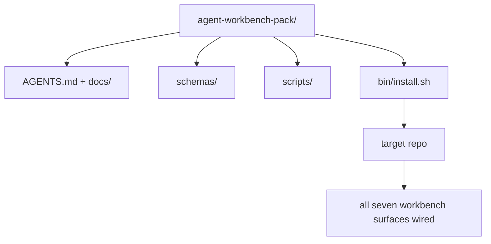

# Capstone：交付一个可复用的 Agent Workbench Pack

> 这个 mini-track 以一个可以放进任何 repo 的 pack 结束。十一节课里的 surface 被压缩进一个目录，你可以 `cp -r`，然后第二天早上就让 agent 稳定工作。这个 capstone 就是本课程真正交付的 artifact。

**类型：** Build
**语言：** Python (stdlib)
**前置要求：** Phases 14 · 31 到 14 · 41
**时间：** ~75 分钟

## 学习目标

- 将七个 Workbench surface 打包成一个可直接放入的目录。
- 固定 schema、script 和 template，让新 repo 获得一个已知可用的 baseline。
- 添加一个 installer script，用幂等方式放置这个 pack。
- 决定哪些内容留在 pack 里、哪些内容留在外面，并为每个取舍辩护。
- 展示一次由 agent 辅助完成的仓库变更，并提供评审者能够复现的证据。

## 问题

一个存在于 Google Doc、聊天历史和三个只被模糊记得的 script 里的 Workbench，是一个每季度都会被重建的 Workbench。解决办法是一个带版本的 pack：一个 repo 或目录，其中包含 surface、schema、script，以及一个一条命令即可运行的 installer。

本课结束时，你会在磁盘上交付 `outputs/agent-workbench-pack/`，以及一个可以把它放进任意目标 repo 的 `bin/install.sh`。

## 概念



### Pack layout

```
outputs/agent-workbench-pack/
├── AGENTS.md
├── docs/
│   ├── agent-rules.md
│   ├── reliability-policy.md
│   ├── handoff-protocol.md
│   └── reviewer-rubric.md
├── schemas/
│   ├── agent_state.schema.json
│   ├── task_board.schema.json
│   └── scope_contract.schema.json
├── scripts/
│   ├── init_agent.py
│   ├── run_with_feedback.py
│   ├── verify_agent.py
│   └── generate_handoff.py
├── bin/
│   └── install.sh
└── README.md
```

### 什么留下，什么放在外面

留下：

- Surface schema。它们就是 contract。
- 上面的四个 script。它们就是 runtime。
- 四份 doc。它们就是 rule 和 rubric。

放在外面：

- 项目特定任务。任务属于目标 repo 的 board，不属于 pack。
- 供应商 SDK 调用。这个 pack 与 framework 无关。
- Onboarding 文案。这个 pack 放在团队已有 onboarding 旁边，而不是放在其中。

### Installer

一个简短的 `bin/install.sh`（或 `bin/install.py`）：

1. 没有 `--force` 时，拒绝覆盖安装到已有 pack 上。
2. 将 pack 复制进目标 repo。
3. 如果存在 `.github/workflows/`，则接入 CI。
4. 打印后续步骤：填写 board、设置 acceptance command、运行 init script。

### 版本管理

这个 pack 携带一个 `VERSION` 文件。需要 migration 的 schema bump 和 script 变更会 bump major。仅 doc 的变更会 bump patch。目标 repo 的 `agent_state.json` 记录它初始化时对应的 pack version。


```figure
wb-pack-install
```

## 构建它

`code/main.py` 会把 pack 组装到本课旁边的 `outputs/agent-workbench-pack/` 中，并用这个 mini-track 前面课程里的 schema 和 script，以及你已经写过的 doc 作为种子。

运行它：

```
python3 code/main.py
```

这个 script 会复制并固定 surface，写入 README，打印 pack tree，然后以 zero 退出。重复运行是幂等的。

## 真实生产中的模式

一个 pack 只有在能够经受 fork、update 和不友好的 upstream 时才有价值。四个模式可以做到这一点。

**`VERSION` 是 contract，不是 marketing。** Major bump 需要 state migration。Minor bump 需要重新运行 checker。Patch bump 只用于 doc。Installer 每次安装都会把 `.workbench-version` 写入目标 repo；如果目标的 lock 与 pack 的 `VERSION` 不一致，`lint_pack.py` 会拒绝交付。这就是 `npm`、`Cargo` 和 `pyproject.toml` 能经受 10 年 churn 的方式；agent 不会改变这些规则。

**跨工具分发的单一来源。** Nx 提供一个 `nx ai-setup`，从单个 config 放置 `AGENTS.md`、`CLAUDE.md`、`.cursor/rules/`、`.github/copilot-instructions.md` 和一个 MCP server。这个 pack 也应该这样做；installer 输出 symlink（`ln -s AGENTS.md CLAUDE.md`），让单一事实来源分发到每个 coding agent。为了支持某个工具而 fork 这个 pack，是一种 failure mode。

**`uninstall.sh` 会在存在非平凡 state 时拒绝执行。** 卸载这个 pack 不能删除用户的 `agent_state.json`、`task_board.json` 或 `outputs/`。Uninstaller 会删除 schema、script、doc 和 `AGENTS.md`（带 `--keep-agents-md` opt-out），并且如果 state file 有任何未提交变更，就拒绝继续。State 属于用户；pack 并不拥有它。

**Skill-as-publishable。SkillKit-style 分发。** 这个 pack 作为 SkillKit skill 交付：`skillkit install agent-workbench-pack` 会从单一来源把它放置到 32 个 AI agent 中。Pack repo 是事实来源；SkillKit 是分发渠道。Vendor lock-in 会消失；七个 surface 保持不变。

## 使用它

Pack 会在三个地方交付：

- **作为一个你放进 repo 的目录。** `cp -r outputs/agent-workbench-pack /path/to/repo`。
- **作为一个公开 template repo。** Fork-and-customize，并用 `VERSION` 控制 drift。
- **作为一个 SkillKit skill。** 接入你的 agent 产品，让一条命令完成放置。

Pack 是 recipe。每次 install 是一份 serving。

## 交付它

`outputs/skill-workbench-pack.md` 会生成一个针对项目调优的 pack：rule 会根据团队历史变得更清晰，scope glob 会匹配 repo，rubric dimension 会扩展一个领域特定条目。

## 练习

1. 决定哪一份可选的第五 doc 值得提升进 canonical pack。为这个取舍辩护。
2. 用 Python 重写 installer，并添加 `--dry-run` flag。将 ergonomics 与 bash 对比。
3. 添加一个 `bin/uninstall.sh`，安全移除 pack，并在 state file 有非平凡历史时拒绝执行。什么算非平凡？
4. 添加一个 `lint_pack.py`，当 pack 偏离 `VERSION` 时失败。把它接入 pack 自身 repo 的 CI。
5. 写一份从手工 Workbench 迁移到这个 pack 的 runbook。什么操作顺序可以最小化 downtime？

## 职业实践：证明一次仓库变更

打包演示证明了组装程序能够运行并生成文件。它并不能证明你的 agent 能完成新任务、生成的检查能够验证该任务，或已部署的系统能够正常工作。请区分这些结论。

在你拥有或获准修改的仓库中，选择一项真实的小任务。使用一个你已经能够访问的编程 agent 即可。修复缺陷、实现边界明确的功能，或改进运维流程都可以；安装多个 agent 不是本练习的内容。

除打包实验外，另行预留一次工作时段。将下方链接的证据模板复制到你自己的 `learning-artifacts/` 目录中。保留仓库中已有的模板和 pack，作为参考资料。

### 1. 明确任务并选择自主程度

使用第 43 课的任务框架和第 44 课的证据计划。记录起始版本、可观测的目标、非目标、允许修改的路径，以及验收证据。明确真正需要该行为的用户或运维人员。

选择一种工作模式：逐步指导、带检查点的实现，或边界明确的自主执行。说明不确定性、潜在后果和可逆性为什么支持这一选择。小范围的本地重构，可能比访问控制变更需要更少的检查点。

设定实际耗时预算；如果 agent 提供相关功能，还要设定 token 或费用上限。对于无法获取的度量数据，如实记录。针对重复失败、新权限需求、预算耗尽或尚未解决的任务约定，明确停止条件，并注明谁有权解决。

### 2. 准备最小且有用的环境

查找相关实现、调用方、测试和本地指令。记录每个来源为什么应进入上下文，以及哪些当前证据能够推翻过时的笔记。不要默认加载整个仓库。

对每一种相关扩展明确作出选择：技能（skill）提供可重复使用的流程；MCP 工具提供访问能力；钩子（hook）执行确定性检查；插件（plugin）打包提供能力。只保留任务确实需要的扩展，并仅授予使其正常工作所需的最小权限。

记录一个被你拒绝的新增项会带来的上下文或维护成本。重新核查一条过时的记忆或指令；如果证据支持退役或替换，就在由你自己管理的学习环境中执行。重新运行受影响的检查，确认移除它没有丢失必要约束。

### 3. 记录基线并实现

编辑之前，运行最相关的现有检查，展示所需行为的当前状态。保留命令、版本、结果和证据位置。尚未存在的功能也有基线：记录实际观察到的响应或不受支持的操作。

让 agent 在任务约定内实现变更。保留干预日志，说明每次纠正、权限变更或计划调整的原因。委派是可选的；如果确实有用，在增加另一位执行者之前，先应用第 45 课的责任归属与集成约定。

### 4. 质疑证据

选择能够观察变更界面的验证方式。对于 UI，重新构建，并在相关视口宽度下检查实际提供服务的用户流程。对于 API，检查请求和序列化后的响应。对于 CLI，运行构建后的命令，检查退出码和输出。选择任务所需的检查，并说明它们的局限。

依据任务约定独立写出预期结果，不要从 agent 的实现反推。在一次性副本中引入一个具体的错误结果，例如接受无效值或遗漏必需的响应字段。运行相同的验收检查：它必须因为这个错误而失败。

如果检查依旧通过，先强化断言或观测方式，再信任它。恢复正确实现，并重新运行至通过。保留两次执行凭据。语法错误或损坏的测试环境，不算检测到了回归缺陷。

对照原始目标和允许修改的路径，评审最终差异，包括测试的变更。请同伴或独立的评审会话在不修改实现的前提下，质疑最薄弱的证据。最终判断仍由你负责；另一个 agent 的认同不是执行证据。

### 5. 演练运行与恢复

在一次性的本地环境或预发布环境中运行变更后的交付物。将每次观测标记为 `local`、`staging` 或 `live`，并注明确切的版本或交付物标识。本地演练只支持本地结论；本练习不要求部署到生产环境。

选择一个与任务相关的失败信号，设定阈值、观测窗口和责任人。说明越过阈值时应如何响应。在演练中安全地触发该信号，并保留观察到的日志、指标或响应。

演练回滚到已知可用的交付物，并检查先前行为是否恢复。适用时，应考虑持久化数据：仅替换二进制文件不一定能撤销数据变更。记录任何尚未验证的恢复步骤。

### 6. 改进下一次执行并交接

将结果与基线对比，包括实际耗时、可获取的用量数据和人工干预。一次任务只能说明该任务中发生了什么，不能证明某个 agent 总体上更快或更可靠。

按照第 46 课，将一次实际发生的纠正转化为测试、更小的权限边界、自动化流程或更清晰的示例。重新运行受影响的检查。移除临时引入的错误变更，并为下一次会话明确最终分支、变更文件、未解决风险和下一步行动。

### 人工评审标准

请评审者检查证据文件，并至少复现最薄弱的验收检查。每一行使用 `demonstrated`（已证明）、`needs revision`（需要修改）或 `unverified`（未验证）作为状态，同时给出证据位置和理由。填满字段或打包脚本通过，都不能代替这些观测。

| 维度 | 评审者应质疑的证据 |
|---|---|
| 任务与自主程度 | 初始行为、边界明确的目标、合理的权限与预算，以及可执行的停止规则 |
| 上下文与环境 | 相关来源、合理的工具访问权限，以及经过重新核查的退役决定 |
| 验证 | 变更前后的实际行为，以及相同检查能够拒绝的、刻意引入的错误结果 |
| 评审与运行 | 已检查的差异、独立质疑、标明环境的运行观测，以及演练过的恢复流程 |
| 迭代与交接 | 一项经过验证的改进、如实说明的局限、干净的最终状态，以及可复现的下一步行动 |

在宣称任务完成之前，解决标记为 `needs revision` 的问题。无法获取的证据应保留为 `unverified`，并相应缩小结论的范围。作品集展示的是你在一项边界明确的任务中的工程判断力，并不保证获得聘用或具备部署条件。

## 交付物

保留可复用的 pack，以及你完成的 [career-agent-evidence.md](https://github.com/rohitg00/ai-engineering-from-scratch/blob/main/phases/14-agent-engineering/42-agent-workbench-capstone/outputs/career-agent-evidence.md) 副本。该模板将任务框架、执行计划、运行凭据、评审、恢复演练和交接整合为一份可评审的案例研究。

## 关键术语

| 术语 | 人们常说 | 它实际含义 |
|------|----------------|------------------------|
| Workbench pack | “starter kit” | 一个带版本的目录，携带全部七个 surface |
| Installer | “Setup script” | 以幂等方式放置 pack 的 `bin/install.sh` |
| Pack version | “VERSION” | schema/script 变更使用 major bump，仅 doc 变更使用 patch |
| Drop-in pack | “cp -r and go” | Pack 在第一天无需按 repo 定制即可工作 |
| Forkable template | “GitHub template” | GitHub 的 “Use this template” 可以从中 clone 的公开 repo |

## 延伸阅读

- Phases 14 · 31 到 14 · 41 — 这个 pack 打包的每个 surface
- [SkillKit](https://github.com/rohitg00/skillkit) — 在 32 个 AI agent 中安装这个 skill
- [Nx Blog, Teach Your AI Agent How to Work in a Monorepo](https://nx.dev/blog/nx-ai-agent-skills) — 跨六种工具的单一来源 generator
- [agents.md — the open spec](https://agents.md/) — 你的 pack 的 router 必须实现的内容
- [HKUDS/OpenHarness](https://github.com/HKUDS/OpenHarness) — pack-equivalent 的参考实现
- [Augment Code, A good AGENTS.md is a model upgrade](https://www.augmentcode.com/blog/how-to-write-good-agents-dot-md-files) — pack doc 的质量门槛
- [Anthropic, Effective harnesses for long-running agents](https://www.anthropic.com/engineering/effective-harnesses-for-long-running-agents)
- [Anthropic, Harness design for long-running application development](https://www.anthropic.com/engineering/harness-design-long-running-apps)
- Phase 14 · 30 — 消费这个 pack 的 verification gate 的 eval-driven agent development
- Phase 14 · 41 — 这个 pack 要改进的 before/after benchmark
