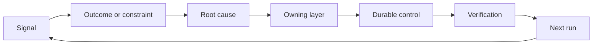

# 构建具备归属与退役机制的反馈棘轮

> 代码发布结束了当期的构建循环，同时开启了长期的学习循环。认知实证必须能够改变系统，否则它就只是无人认领的无用遥测。

**Type:** Learn + Build
**Languages:** Python (stdlib)
**Prerequisites:** Phase 14 lessons 46 and 53
**Time:** ~75 minutes

## 学习目标

- 将故障事件、评测数据、用户行为和纠偏反馈转化为具有责任归属的行动项。
- 将不同信号精准路由至上下文、评测集、安全策略、运行时或需求待办项。
- 根据严重程度与复现频次对复发风险进行优先级排序。
- 为每一处系统控制机制设定明确的退役条件（Retirement Condition）。
- 沟通交付决策，提供证据、权衡取舍及明确负责的决策人。

## 反馈本身也是基础设施

一个团队可以收集大量的系统链路追踪（Traces）、评测记录、支持工单和故障日志，却完全没有从中汲取任何认知教训。这其中缺失的关键机制是**晋级通道（Promotion）**：即从观测事实，通向具备明确责任人、验证证据的持久化系统变更的固定路径。

反馈棘轮（Feedback Ratchet）的闭环是：

1. 观测到具体的实测信号；
2. 将其关联至预期的产出结果、约束条件或前置假设；
3. 识别出对该诱因承担归属责任的最底层系统层级；
4. 实施受控的持久化改进；
5. 验证该故障复发的概率已被切实降低；
6. 定期复审该控制机制是否应当继续保留。

## 精准路由至对应责任层级

| 信号类型 | 归属目的地 |
|---|---|
| 误报、功能倒退、错误输出结果 | 评测集（Evaluation）或自动化测试 |
| 上下文缺失、重复劳动、过时事实 | 上下文数据源或检索路由策略 |
| 不安全操作或越权漏洞 | 安全策略（Policy）或权限硬边界 |
| 超时、重试风暴、依赖服务不可用 | 运行时控制（Runtime Control） |
| 新的产品需求或尚未决断的权衡取舍 | 经过规范成型（Shaped）的待办项 |

在能够从根本上解决问题的最底层进行修复。当自动化测试或硬性权限足以让错误彻底无法发生时，绝不要在 Prompt 中又追加一段唠叨的提示词。



## 责任归属本身就是控制机制的一部分

每一项棘轮行动项都必须明确具备：

- 唯一的人类责任人（Owner）；
- 基于破坏后果与复发频率综合评定的优先级；
- 拟修改的目标系统组件（Artifact）；
- 证明该修改切实生效的验证方案；
- 复审或自动失效窗口；
- 明确的退役条件（Retirement Condition）。

一项无人认领的所谓“改进方案”，充其量只是一段排版略微美观的观测废话。

## 果断退役过时的控制机制

反馈沉淀系统会不断累积策略与控制项。久而久之，这些规则可能会变得自相矛盾且成本高昂。在下列情况下应当主动复审并退役控制机制：

- 系统架构或业务工作流发生了根本性变迁；
- 底层的不变量机制已经彻底替代了上层的文字指令；
- 在预设的时间窗口内，被防范的故障从未再次出现；
- 该控制规则阻碍正常业务推进的频率，已经超过了其防范危害带来的收益。

退役控制项同样需要实证支撑，绝不能仅仅因为“看起来年头太久”就随手删除。

## 打通产品构建与 Coding Agent 的反馈闭环

同一个棘轮机制能够同时服务于产品业务与智能体研发两条轨道：

- 产品业务实证驱动预期产出框架、假设图谱、最小切片或度量计划的演进；
- Coding Agent 的运行纠偏驱动自动化测试、上下文加载、操作作用域、自动化脚本或交接机制的优化；
- 线上真实故障既能促成产品功能边界的调整，也能推动 Agent 工作台的加固。

这也是为什么“任务框架梳理”绝非在编码前就宣告结束的阶段，它贯穿于每一次被系统接纳的变更之中。

## 动手实现

本实验对实测信号进行分类，创建附带责任归属的棘轮行动项，按优先级排序，并输出 `outputs/feedback-backlog.json`。

```bash
python3 code/main.py
python3 -m unittest discover code/tests -v
```

尝试添加一个运行时超时信号，验证它会被正确路由至运行时控制层，而非泛化混入通用需求待办列表。

## 实践实验：为受挫后的决策负责

从你的职业学习路径对应的作品集项目中，选择一个工作流。围绕它完成一次决策、一项小实验和一次复审。将证据保存在[职业交付模板](../outputs/career-delivery-evidence.md)中。

Python 实验会生成示例待办行动项。它不会观察用户、度量干预效果，也不会证明你已经具备职业胜任力。运行该实验只是本练习的准备工作。

### 1. 明确发生了什么

记录用户、任务、当前工作流，以及你希望改进的结果。链接到经过同意的观察记录、已脱敏的支持记录，或可复现的任务轨迹。区分你直接观察到的事实、他人报告的情况，以及你的推断。

找出一次挫折：失效的假设、无法使用的结果、意外成本，或延误的交接。解释哪些证据改变了你的理解。挫折需要回应和决策，而不是被包装成一段成功故事。

如果无法接触用户，请与同伴开展明确标记的模拟，或基于说明清楚的场景进行模拟。将模拟观测与真实用户证据分开。不要编造访谈、批准、采用情况或业务影响。

### 2. 在权限范围内推进

列出未知项，选择成本最低、可逆，且有望解决影响最重大未知项的行动。说明哪些事可以由你决定，哪些选择受到既有约定约束，哪些操作需要先获得授权才能执行。

例如，在等待使用客户数据的许可时，你可以先准备已脱敏的离线回放。主动推进意味着完成获授权的工作，并将被阻塞的决策说清楚；它不会扩大你的访问权限或审批权。

### 3. 比较方案并向决策责任人简报

为不需要了解实现细节的人撰写一份简短的决策简报。内容包括：

- 用户问题，以及改变计划的证据；
- 至少两种方案；在合理可行时，纳入成本更低的人工方案或无需开发的方案；
- 质量、交互设计、工作量、运行成本和风险方面的权衡；
- 你的建议、剩余不确定性，以及需要作出的决策；
- 决策责任人、受影响的利益相关方，以及需要作出决策的日期。

请同伴代表一位受影响的利益相关方，质疑其中一项权衡。记录异议，并说明它如何改变，或为何没有改变你的建议。将角色扮演反馈标记为模拟；它不能替代真实利益相关方的同意。

### 4. 开展边界明确的实验

根据需要回答的问题，选择原型、试点或生产阶段的工作。在收集结果之前，明确受众、数据、授权、持续时间、回滚方案，以及继续、调整或停止的条件。

从用户的起点到任务完成，走查整个交互过程。纳入一个错误输出或数据缺失的情形。观察用户能否发现失败、纠正问题，并在没有你暗中帮助的情况下恢复。

将人工审核和纠正所花的时间计入整个工作流。模型响应更快，仍可能让完整任务变慢，或让结果更难获得信任。

### 5. 比较结果与经济性

使用相同的指标定义、任务总体、采集方法和可比的观测窗口，记录基线与后续结果。将样本数量、排除项和证据链接放在数值旁边。如果这些条件发生变化，解释比较为何受到限制。

纳入一项用户结果、一项质量或安全护栏指标，以及总人工审核工作量。即使结果未达目标，也要如实记录。小样本或模拟样本只支持范围有限的学习结论，不能证明业务影响。

估算每个成功完成任务的成本，计入模型调用、重试、配套服务和人工审核。说明人力单价假设，区分实测用量与估算值。将该成本与人工替代方案，或项目背后的价值假设进行比较。

通过已有的 [LLM FinOps 课程](../../../17-infrastructure-and-production/27-finops-llms/docs/en.md)，进一步学习成本归因与单位经济性。FinOps 指通过协作管理技术用量和成本；成本归因是将成本分配到相应工作负载，单位经济性则考察每个成功任务的成本与价值。更换模型只是可能的应对方式之一；缩小工作流范围或保留人工步骤，可能才是更好的产品决策。

### 6. 完成闭环

依据预先声明的标准，建议继续、调整或停止。如果证据尚无定论，指出缺失的观测，以及下一项边界明确的测试。记录承担责任的决策人的回应；如果尚未作出决定，就保留为待定状态。

选择一项对交付过程本身的改进：更清晰的任务框架、更早的用户走查、更好的评审清单、更小的 agent 交接单元，或更有针对性的评测案例。指定责任人和复审日期。

复审时，决定保留、修改还是退役这项改进。记录选择的证据。如果一份新清单增加了工作量，却没有防止目标失败，它就不应永久保留。

## 交付物

将 [career-delivery-evidence.md](../outputs/career-delivery-evidence.md) 复制到自己的项目，并使用证据链接填写。让仓库中的模板保持可复用。将决策简报、交互走查、度量比较，以及有明确责任归属的后续行动，一并纳入你的职业作品集交付物。

## 验证

与同伴一起使用以下人工验收标准。每一行标记为 **met**（已满足）、**needs work**（需要改进）或 **not observed**（尚未观测），并提供证据链接或具体缺失的观测。填好了字段，并不能证明判断合理。

| 检查项 | 满足标准的证据 |
|---|---|
| 工作流有事实依据 | 可追溯的观测支持问题定义；他人报告、推断和模拟均有标记。 |
| 遵守授权边界 | 下一项可逆工作明确，任何受限操作都等待真正的决策责任人授权。 |
| 权衡沟通清晰 | 记录可信的替代方案、利益相关方的异议、建议，以及明确的决策请求。 |
| 交互经过测试 | 走查覆盖成功、失败、恢复，以及人工审核工作量。 |
| 结果经过比较 | 基线与后续度量的定义一致；样本、护栏指标、成本和比较局限清晰可见。 |
| 对挫折承担责任 | 证据改变了继续、调整或停止的决策，并导向一项有明确责任人的后续行动。 |
| 流程得到改进 | 一项工作流改进具备责任人、复审日期，以及基于证据的保留、修改或退役决定。 |

即使每个模拟步骤都通过，未观测到的真实用户行为仍是证据缺口。在作品集结论中保留这条边界，并明确还需要什么观测来填补缺口。

## 课后练习

1. 将一起近期故障和一条用户真实投诉，分别转化为具体的棘轮行动项。
2. 指明能够从根本上防止其再次复发的最底层系统层级。
3. 为实验输出的行动项补充切实可行的自动化验证命令或观测指标。
4. 为一条既有的安全策略规则制定清晰的退役条件。
5. 将一条被系统接纳的纠偏教训，反向追踪并融入至下一个任务框架之中。

## 延伸阅读

- [Basili, Caldiera, and Rombach, The Goal Question Metric Approach](https://www.cs.toronto.edu/~sme/CSC444F/handouts/GQM-paper.pdf)，探讨如何通过目标导向的度量机制实现组织级的持续认知沉淀。
- [Fagerholm et al., Building Blocks for Continuous Experimentation](https://doi.org/10.1145/2601248.2601276)，剖析将实证实据与产品持续研发相连接的技术与组织闭环。
- [Nuseibeh and Easterbrook, Requirements Engineering: A Roadmap](https://www.cs.toronto.edu/~sme/papers/2000/ICSE2000.pdf)，阐释将需求视为贯穿整个系统生命周期动态演进的工程视角。

## 交付物沉淀

保留 `outputs/feedback-backlog.json` 作为路由示例，并保留你完成的职业交付证据，记录自己的决策。两者共同为“产品判断力与交付（Product Judgment and Delivery）”学习路径收尾，并为下一个预期产出框架提供依据。
