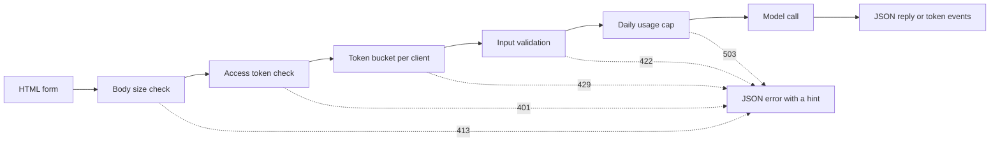

# 模型演示界面：从函数到可分享的应用

> 模型演示有一份约定：输入、模型调用和输出。在分享链接之前，先为每一部分设定限制。

**Type:** Build
**Languages:** Python
**Prerequisites:** Phase 11 · 13（构建生产级 LLM 应用）、Phase 17 · 08（推理指标）、Phase 17 · 19（AI 网关）
**Time:** ~90 分钟

## 学习目标

- 写出演示的输入、模型调用和输出约定，并为每一部分设定限制。
- 使用标准库构建一个 HTTP 应用，包含一张 HTML 页面、一个 JSON 端点和一个服务器发送事件端点。
- 按成本从低到高验证输入，并返回能够告诉用户下一步操作的 JSON 错误。
- 使用每客户端令牌桶、每日用量上限和可选的访问令牌，保护公开演示。
- 编写不保留输入文本和客户端地址的请求日志。
- 将标准库演示与两个框架版本比较，并指出演示必须升级为产品的信号。

## 问题

你的模型已能在 notebook 中运行。现在，一位评审者想尝试十种输入，一位客户想在手机上查看一次结果。他们都不会打开你的 notebook。

notebook 单元格没有输入限制，也没有进度显示。它报错时给出的堆栈跟踪，只有你能读懂。它还使用你的凭据和预算运行。如果不作修改就把这个单元格放到公开 URL 后面，你可以预见以下故障：

- 用户粘贴一份 40,000 字符的文档。模型调用运行一分钟后失败，返回一段堆栈跟踪。
- 一个脚本在一分钟内发送 500 个请求。每个请求都会触发一次付费模型调用。
- 页面八秒没有显示任何内容，于是用户又点击了四次按钮。
- 服务器日志保留每一份输入，包括含有客户账户号码的那份输入。

演示界面用少量代码就能防止这些故障。本课先用 Python 标准库构建一个演示，让你看清每个部分；再使用两个流行框架构建相同的演示，比较各自的默认行为。

## 概念

### 演示就是一份约定

每个演示都有三个部分。输入是用户可以发送的内容；模型调用将输入转化为输出；输出是用户看到的内容，也包括错误。

在编写页面之前，先写下这份约定：

| 部分 | 需要回答的问题 | 本课的答案 |
|------|--------------------|-----------------------|
| 输入 | 什么类型、多大、允许哪些字符？ | 长度为 1 到 500 个字符的字符串，不含控制字符 |
| 模型调用 | 一次调用需要多久、成本多少？ | 一个不到一毫秒即可运行完毕、没有调用费用的玩具关键词模型 |
| 输出 | 成功和失败时，用户分别看到什么？ | 标签、分数和回复，或带有操作提示的 JSON 错误 |

notebook 没有为这三个部分设定任何限制。演示则为每一部分设限，并由服务器对每个客户端执行这些限制。



检查按照成本从低到高的顺序执行。无效请求会在第一次未通过的检查处停止，因此几乎不消耗服务器资源。模型调用放在最后，因为它是唯一需要付费的步骤。

### 在模型运行之前验证

浏览器可以在发送任何内容之前检查输入。文本区域上的 `maxlength` 和 `required` 属性，无需网络调用就能向用户提供反馈。这些检查只能帮助遵守规则的用户。任何客户端都可以绕过页面发送请求，所以服务器必须重复每一项检查。

将服务器检查按成本从低到高排列：

1. 读取 `Content-Length` 请求头。在读取请求体之前，拒绝超过上限的请求体。
2. 解析 JSON 请求体。拒绝不是 JSON 对象的请求体。
3. 检查字段。拒绝空文本、超长文本和控制字符。
4. 只有通过全部检查的请求，才能消耗一次模型调用。

| 未通过的检查 | HTTP 状态 | 错误代码 |
|--------------|-------------|------------|
| 没有 `Content-Length` 请求头 | 411 Length Required（需要长度） | `length_required` |
| `Content-Length` 不是数字 | 400 Bad Request（错误请求） | `bad_length` |
| 请求体超过 4,096 字节 | 413 Content Too Large（内容过大） | `body_too_large` |
| 尚未收到 `Content-Length` 指定的字节数，请求体就停止传输 | 408 Request Timeout（请求超时） | `request_timeout` |
| 内容类型不是 JSON | 415 Unsupported Media Type（不支持的媒体类型） | `unsupported_media_type` |
| 请求体不是 JSON 对象 | 400 Bad Request（错误请求） | `bad_json` |
| 文本缺失、为空、过长或含有控制字符 | 422 Unprocessable Content（无法处理的内容） | `missing_text`、`empty_text`、`text_too_long`、`control_characters` |

RFC 9110 定义了这些状态码及其名称。

示例也是输入设计的一部分。示例向用户展示合适的输入是什么样的，也让评审者只需点击一次就能进行测试。为每种输出类别选择一个示例。本演示分别提供正面、负面和中性示例。

### 让用户知道模型正在工作

模型调用可能需要几秒钟。如果没有反馈，用户无法区分模型缓慢和页面损坏。看不到变化的用户可能再次点击，服务器就会收到第二个付费请求。

本课页面提供四种反馈：

- 请求运行期间禁用提交按钮。
- 显示已用时间，每 100 毫秒更新一次。
- 第一个 token 到达时，显示首 token 时间。
- 请求结束时，显示总耗时。

在学习[推理指标](../../08-inference-metrics-goodput/)时，首 token 时间（TTFT）是服务器指标。演示页面向用户展示相同的指标，但改为在浏览器中测量。

### 以流的形式发送输出

语言模型逐个 token 生成回复。如果服务器等到最后一个 token 才发送，用户就必须等待整个生成过程。如果服务器在每个 token 就绪时立即发送，用户收到第一个 token 就能开始阅读。

服务器发送事件（Server-Sent Events，SSE）是实现这一行为的标准格式。响应的内容类型是 `text/event-stream`。每个事件由一组 `event:` 和 `data:` 行组成，并以一个空行结束。WHATWG HTML 标准定义了这一格式。

```text
event: token
data: {"index":0,"text":"Label:"}

event: token
data: {"index":1,"text":" positive."}

event: done
data: {"label":"positive","score":1.0,"tokens":11}
```

浏览器提供用于 SSE 的 `EventSource` 接口，但它只发送 GET 请求。GET 请求会将输入放入 URL，而 Web 服务器和代理会将 URL 写入访问日志。因此，本演示改用带 JSON 请求体的 POST 请求。页面通过 `fetch()` 和 `response.body.getReader()` 读取响应，并自行解析事件格式。

流式响应存在单次 JSON 回复没有的问题：服务器在第一个 token 之前就发送了状态码 200。如果模型随后失败，服务器无法再更改状态码。因此，服务器会在流中发送一个 `error` 事件，由页面将该事件显示为错误。

在构建[生产级 LLM 应用](../../../11-llm-engineering/13-production-app/)时，框架替你通过 SSE 发送 token。本课手写相同的协议，让你能够看到服务器发送的每一行。

### 编写用户能够据此行动的错误信息

错误信息有两个任务：告诉用户发生了什么，并告诉用户接下来该怎么做。对于不熟悉系统的人，堆栈跟踪无法完成其中任何一项。

本演示中的每个错误都使用相同的 JSON 结构：

```json
{
  "error": {
    "code": "text_too_long",
    "message": "The text has 812 characters. The limit is 500.",
    "hint": "Shorten the text to 500 characters or fewer.",
    "request_id": "a8f3c2b435e3"
  }
}
```

- `code` 是稳定的名称，客户端代码和测试用它作比较。
- `message` 陈述事实，并附上用户需要的数值。
- `hint` 给出一个用户可以执行的操作。
- `request_id` 将用户报告关联到一条日志记录。

RFC 9457 定义了 HTTP API 的标准错误格式，称为问题详情（problem details）。本演示使用更精简的结构实现相同目的。如果其他团队会调用你的 API，请使用 RFC 9457。

### 安全地分享公开演示

公开链接会改变能够发送请求的人群。为每种风险设计一项控制措施：

| 风险 | 本演示中的控制措施 | 面向更多受众的控制措施 |
|------|----------------------|-------------------------------|
| 单个客户端发送过多请求 | 每客户端一个令牌桶，配合 429 和 `Retry-After` | 登录后按用户限流 |
| 陌生人发现链接 | `Authorization` 请求头中的可选访问令牌 | 通过身份提供方实现单点登录 |
| 总成本无限增长 | 每日用量上限，配合 503 和 `Retry-After` | 模型提供方的支出限制和告警 |
| 输入非常大或异常 | 请求体大小限制、文本长度限制、控制字符检查 | 输入与输出的内容审核 |
| 日志保留私人输入 | 只记录输入长度和客户端的带密钥哈希 | 日志保留期限与访问控制 |

令牌桶使用两个数值。容量决定一个客户端最多能突发发送多少请求；补充速率决定长期请求速率。每个请求消耗一个令牌，桶内令牌持续补充，但不超过容量：

```text
tokens = min(capacity, tokens + refill_rate * seconds_since_last_request)
accept the request if tokens >= 1, then subtract 1
```

桶为空时，服务器返回 `429 Too Many Requests`。RFC 6585 定义了状态码 429，并允许服务器附带 `Retry-After` 响应头。本演示始终添加该响应头，给出距离下一个令牌可用还需等待的秒数。页面读取响应头，并在这段时间内禁用按钮。

演示使用客户端 IP 地址作为桶的键。在反向代理后面，每个请求都来自代理地址，因此所有用户会共享一个桶。此时，应从你自己的代理设置的请求头中读取客户端地址。不要信任任何其他来源的同名请求头，因为客户端可以在其中填写任意值。

在学习 [AI 网关](../../19-ai-gateways/)时，网关按租户执行限流。演示也需要同样的控制，只是规模更小。限流控制单个客户端，却不控制总量。一百个客户端即使都未超出各自限制，仍可能耗尽全部预算。用量上限统计一天内的所有模型调用，并在达到固定次数后拒绝新调用。

日志与输入同样需要谨慎处理。默认的 `http.server` 处理器会把客户端 IP 地址和请求行写入标准错误。如果输入位于 URL 中，输入也会进入日志。本演示替换了这条日志。每个请求只写一条记录，包含路由、状态码、错误代码、延迟和输入长度。客户端地址被转换为带密钥哈希，即使用秘密密钥计算的哈希值，使你无需保存地址就能按客户端统计请求。

告诉用户你保留哪些信息。演示页面说明，服务器保留文本长度，但从不保留文本本身。

### 演示何时成为产品

演示由一个进程提供服务，面向已知的人群和短时会话。以下信号表明，演示已经成为产品：

- 团队之外的人每周都会使用它。
- 有人提出可用性目标，或报告服务中断。
- 用户要求登录、保存结果或查看历史。
- 每周的模型成本成为预算中的一个项目。
- 输入包含受到合同或法律约束的数据。

| 属性 | 演示 | 产品 |
|----------|------|---------|
| 用户 | 已知人群，短时会话 | 未知人群，每日使用 |
| 状态 | 无 | 账户、历史、已保存的结果 |
| 可用性 | 尽力而为，单进程 | 书面目标、副本、值班责任人 |
| 成本控制 | 一个每日用量上限 | 每用户配额和计费 |
| 可观测性 | 每请求一条日志 | 链路跟踪、指标和告警 |

看到这些信号时，应将演示迁移到生产级 LLM 应用课程中的生产技术栈。该技术栈增加了真正的身份验证、备用模型、链路跟踪和每用户成本追踪。

```figure
demo-token-bucket
```

## 动手构建

代码只有一个文件 `code/main.py`，除标准库之外不需要任何依赖。先运行自检：

```bash
python3 code/main.py
```

自检会检查验证器、令牌桶、流格式，以及一次真实的 HTTP 往返通信。它在空闲端口上启动服务器，发送三个请求，停止服务器，然后退出。仅在需要浏览器访问时启动服务器：

```bash
python3 code/main.py --serve
```

在浏览器中打开 `http://127.0.0.1:8000`。按 Ctrl+C 停止服务器。

### 第 1 步：模型调用

模型是一个玩具关键词计数器，将文本标记为正面、负面或中性。它还会生成一段简短回复，每次输出一个 token。

```python
def classify(text):
    words = WORD_RE.findall(text.lower())
    positive = sum(1 for word in words if word in POSITIVE)
    negative = sum(1 for word in words if word in NEGATIVE)
    score = (positive - negative) / max(1, positive + negative)
    if score > 0:
        label = "positive"
    elif score < 0:
        label = "negative"
    else:
        label = "neutral"
    return {"label": label, "score": round(score, 3), "positive_cues": positive,
            "negative_cues": negative, "words": len(words)}


def generate(text):
    result = classify(text)
    reply = (
        f"Label: {result['label']}. Positive cues: {result['positive_cues']}. "
        f"Negative cues: {result['negative_cues']}. Words read: {result['words']}."
    )
    parts = reply.split(" ")
    yield parts[0]
    for part in parts[1:]:
        yield " " + part
```

换成真实模型时，只需替换 `generate`。在其中放入 API 调用或本地模型。保持函数签名不变：输入字符串，输出 token。验证器、限制和页面都保持不变。

### 第 2 步：验证与错误响应

一个异常类承载所有错误。它包含 HTTP 状态码、稳定的错误代码、消息、操作提示和可选的响应头。

```python
class DemoError(Exception):
    def __init__(self, status, code, message, hint, headers=None):
        super().__init__(message)
        self.status = status
        self.code = code
        self.message = message
        self.hint = hint
        self.headers = dict(headers or {})


def validate_text(payload, max_chars=MAX_CHARS):
    if "text" not in payload:
        raise DemoError(422, "missing_text", 'The field "text" is missing.', 'Add a "text" field with your input.')
    text = payload["text"]
    if not isinstance(text, str):
        raise DemoError(422, "text_not_string", 'The field "text" is not a string.', "Send the input as a string.")
    text = text.strip()
    if not text:
        raise DemoError(422, "empty_text", "The text is empty.", "Type a sentence or pick an example.")
    if len(text) > max_chars:
        raise DemoError(422, "text_too_long", f"The text has {len(text)} characters. The limit is {max_chars}.",
                        f"Shorten the text to {max_chars} characters or fewer.")
    if CONTROL_RE.search(text):
        raise DemoError(422, "control_characters", "The text contains control characters.",
                        "Remove the hidden characters, then send the text again.")
    return text
```

验证器首先去掉首尾空白。只包含空格的文本会被判为空，提示信息会告诉用户应输入什么。`check_body_size` 和 `parse_json_body` 对 411、413、415 和 400 情形使用相同模式。`error_body` 会将任何 `DemoError` 转换为概念部分展示的 JSON 结构。

### 第 3 步：令牌桶

```python
class TokenBucket:
    def __init__(self, capacity, refill_per_second, now):
        if capacity < 1:
            raise ValueError("capacity must be at least 1")
        if refill_per_second <= 0:
            raise ValueError("refill_per_second must be positive")
        self.capacity = float(capacity)
        self.refill_per_second = float(refill_per_second)
        self.tokens = float(capacity)
        self.updated = now

    def take(self, now, cost=1.0):
        elapsed = max(0.0, now - self.updated)
        self.tokens = min(self.capacity, self.tokens + elapsed * self.refill_per_second)
        self.updated = now
        if self.tokens >= cost:
            self.tokens -= cost
            return 0.0
        return (cost - self.tokens) / self.refill_per_second
```

`take` 接受请求时返回 0.0；否则，返回距离桶内令牌足够还需等待的秒数。服务器将该数值向上取整，并放入 `Retry-After`。

`RateLimiter` 在 `OrderedDict` 中为每个客户端保存一个桶。由于 `ThreadingHTTPServer` 在独立线程中处理每个请求，因此用锁保护这个字典。当字典中的条目数超过 `max_clients` 时，限流器会移除最久未发出请求的客户端。被移除的客户端下一次请求时，会获得一个装满的桶。将 `max_clients` 设置得高于你预期的活跃客户端数量。

限流器接受一个 `clock` 参数。测试传入 `FakeClock`，因此无需真实等待，就能将时间向前推进十秒。`UsageCap` 用相同的时钟模式处理每日总量：以 86,400 秒的固定窗口统计调用，次数用尽时返回距离下个窗口还需等待的秒数。

### 第 4 步：事件流

```python
def sse_event(event, data):
    payload = json.dumps(data, separators=(",", ":"), ensure_ascii=False)
    return f"event: {event}\ndata: {payload}\n\n".encode("utf-8")


def stream_events(text, generate_fn=generate, delay=0.0, sleep=time.sleep):
    count = 0
    try:
        for token in generate_fn(text):
            yield sse_event("token", {"index": count, "text": token})
            count += 1
            if delay:
                sleep(delay)
    except Exception:
        yield sse_event("error", MODEL_ERROR)
        return
    result = classify(text)
    yield sse_event("done", {"label": result["label"], "score": result["score"], "tokens": count})
```

`json.dumps` 会把字符串中的换行写成 `\n` 这两个字符。因此，每个事件只有一行数据，其中不含原始换行符。数据中的原始换行符会破坏事件格式。

生成器捕获模型故障，并发送 `error` 事件，因为服务器已经发送了状态行。`delay` 和 `sleep` 参数可以在浏览器演示时放慢流的速度，同时让测试保持快速。

### 第 5 步：请求处理器

`DemoHandler` 继承自 `BaseHTTPRequestHandler`。POST 处理器按概念部分所述的顺序执行检查：

```python
def do_POST(self):
    app = self.server.app
    request_id = uuid.uuid4().hex[:12]
    client_id = self.client_address[0]
    started = time.perf_counter()
    route = self.path if self.path in self.routes else "other"
    status, code, chars = 200, None, 0
    try:
        declared = self.headers.get("Content-Length")
        try:
            if route == "other":
                raise DemoError(404, "not_found", "This endpoint does not exist.",
                                "Send requests to /api/predict or /api/stream.")
            size = check_body_size(declared, app.config.max_body_bytes)
        except DemoError:
            self.drain(int(declared) if declared and declared.isdigit() else 0)
            raise
        try:
            body = self.rfile.read(size)
        except TimeoutError:
            self.close_connection = True
            raise DemoError(408, "request_timeout", "The request body did not arrive in time.",
                            "Send the request again with the full body.") from None
        app.admit(client_id, self.headers.get("Authorization"))
        text = app.read_text(self.headers.get("Content-Type"), body)
        chars = len(text)
        app.charge()
        if route == "/api/predict":
            self.send_json(200, predict(text), request_id)
        else:
            code = self.send_stream(text, request_id)
    except DemoError as err:
        status, code = err.status, err.code
        self.send_error_json(err, request_id)
    except TimeoutError:
        status, code = 408, "request_timeout"
        self.close_connection = True
    except Exception:
        status, code = 500, "internal_error"
        self.send_error_json(DemoError(500, "internal_error", "The server failed on this request.",
                                       "Try again. Quote the request id if you report the problem."), request_id)
    finally:
        latency_ms = (time.perf_counter() - started) * 1000
        app.log.record(request_id, route, client_id, status, chars, latency_ms, code)
```

`admit` 检查访问令牌和令牌桶。`charge` 检查每日上限，并在最后执行，因此只有有效请求才会计入上限。每个请求都会在 `finally` 块中写入一条日志，包括被拒绝的请求。记录保留的是 `route`，绝不是原始路径，因为路径可能带有包含用户文本的查询字符串。

四个细节能够防止容易被忽略的故障：

- 处理器类上的 `timeout = 10` 会在客户端停止发送时关闭连接。没有它，声明发送 100 字节却只发送 10 字节的客户端，会永久占用一个服务器线程。处理器发送带请求 ID 的 408 JSON 错误，然后关闭连接。如果流已开始后才超时，则只关闭连接，因为状态行已经发送。
- `log_message` 直接返回，不输出内容。这会移除包含客户端地址和请求行的默认日志。
- `drain` 最多读取并丢弃被拒绝请求体中的 64 KiB 数据。RFC 1122 指出，主机关闭仍有未读数据的连接时，TCP 会发送重置；客户端因此可能收不到 413 回复。
- `send_stream` 捕获 `BrokenPipeError` 并关闭生成器。用户关闭标签页时，模型停止，这个请求也就不再增加成本。

`BaseHTTPRequestHandler` 默认使用 HTTP/1.0。因此，服务器关闭连接的时刻就表示流式响应体结束。使用 HTTP/1.1 的服务器通过分块传输编码发送响应体，以实现相同目的。

### 第 6 步：页面

`render_page` 返回一份 HTML 文档，其中内嵌样式和脚本。页面不加载任何外部脚本、字体或图片。脚本按以下方式读取流：

```javascript
const reader = response.body.getReader();
const decoder = new TextDecoder();
let buffer = "";
while (true) {
  const chunk = await reader.read();
  if (chunk.done) { break; }
  buffer += decoder.decode(chunk.value, { stream: true });
  let cut = buffer.indexOf("\n\n");
  while (cut >= 0) {
    const frame = parseFrame(buffer.slice(0, cut));
    buffer = buffer.slice(cut + 2);
    cut = buffer.indexOf("\n\n");
    if (frame.event === "token") { output.textContent += frame.data.text; }
  }
}
```

网络数据块可能在事件中间结束。读取器会将尚未完整的部分保留在 `buffer` 中，直到收到空行。

页面使用 `textContent` 写入模型输出，绝不使用 `innerHTML`。模型输出是不可信文本。假设页面将回复当作 HTML 插入，而回复包含带 `onerror` 属性的元素，该属性就可能在用户浏览器中执行代码。

服务器还会发送带 `default-src 'none'` 的 `Content-Security-Policy` 响应头。该策略只允许一个内嵌脚本和一个内嵌样式，并通过各自的 SHA-256 哈希识别它们。浏览器会拒绝所有其他脚本，包括攻击者注入页面的脚本。

```python
def csp_hash(source):
    digest = hashlib.sha256(source.encode("utf-8")).digest()
    return "'sha256-" + base64.b64encode(digest).decode("ascii") + "'"
```

### 第 7 步：运行它，并尝试使它出错

启动服务器，然后从第二个终端使用 `curl`。向刚启动的服务器连续发送七个请求。桶的容量是五个令牌，每两秒补充一个令牌：

```bash
for i in 1 2 3 4 5 6 7; do
  curl -s -o /dev/null -w '%{http_code} ' -X POST http://127.0.0.1:8000/api/predict \
    -H 'Content-Type: application/json' -d '{"text": "ok"}'
done
```

```text
200 200 200 200 200 429 429
```

等待十秒，然后发送空文本：

```bash
curl -s -X POST http://127.0.0.1:8000/api/predict \
  -H 'Content-Type: application/json' -d '{"text": ""}'
```

```json
{"error": {"code": "empty_text", "message": "The text is empty.", "hint": "Type a sentence or pick an example.", "request_id": "e3e3599feaea"}}
```

使用关闭输出缓冲的 `curl -N` 观察事件流：

```bash
curl -N -X POST http://127.0.0.1:8000/api/stream \
  -H 'Content-Type: application/json' -d '{"text": "The screen is bright."}'
```

如果要要求访问令牌，在启动服务器之前设置 `DEMO_ACCESS_TOKEN`。页面随后会显示一个令牌输入框。

```bash
export DEMO_ACCESS_TOKEN="$(python3 -c 'import secrets; print(secrets.token_urlsafe(24))')"
echo "$DEMO_ACCESS_TOKEN"
python3 code/main.py --serve
```

运行测试：

```bash
python3 -m unittest discover -s code/tests -v
```

HTTP 测试在端口 0 上启动服务器，由操作系统选择空闲端口。`tearDown` 停止服务器，并检查它的线程是否已经结束。

## 使用框架

Gradio 和 Streamlit 这两个 Python 框架能用更少的代码构建同类演示。下面两个示例都从 `main.py` 导入约定，因此验证器和模型保持不变。运行 `main.py` 或测试，不需要安装其中任何一个框架。

### 围绕一个函数组织组件

Gradio 为一个 Python 函数包装 Web 界面。输入和输出组件描述约定，生成器函数发送部分输出。

```python
import os

import gradio as gr

from main import EXAMPLES, MAX_CHARS, DemoError, classify, generate, validate_text


def label_text(text):
    try:
        clean = validate_text({"text": text})
    except DemoError as err:
        raise gr.Error(f"{err.message} {err.hint}")
    label = classify(clean)["label"]
    reply = ""
    for token in generate(clean):
        reply += token
        yield reply, label


demo = gr.Interface(
    fn=label_text,
    inputs=gr.Textbox(label="Text to label", lines=5, max_length=MAX_CHARS),
    outputs=[gr.Textbox(label="Reply"), gr.Textbox(label="Label")],
    examples=list(EXAMPLES),
    flagging_mode="never",
)

if __name__ == "__main__":
    demo.queue(max_size=20).launch(auth=("demo", os.environ["DEMO_PASSWORD"]))
```

每次 `yield` 都会替换整个输出值。因此，该函数每一步都产出截至当前的完整回复。

在分享链接之前，明确设置 `flagging_mode`。默认模式会显示标记按钮。用户按下按钮时，Gradio 将输入和输出写入服务器上的 CSV 文件。值 `"never"` 会移除这个按钮。

`queue(max_size=20)` 限制等待中的请求数量。默认并发限制是每个事件只运行一个调用。在你提高限制之前，慢模型一次只服务一个用户。Gradio 还会在应用启动时创建 API 端点，让脚本无需通过页面就能调用演示。你的限流也必须覆盖这些端点。

### 每次输入都会重新运行的脚本

用户每次更改控件时，Streamlit 都会从头到尾重新运行整个脚本。表单会收集控件值，并在用户按下提交按钮时一次性批量发送。

```python
import streamlit as st

from main import EXAMPLES, MAX_CHARS, DemoError, classify, generate, validate_text

st.title("Toy sentiment demo")
st.caption("Do not paste private data.")

example = st.selectbox("Start from an example", ["", *EXAMPLES])
with st.form("demo"):
    text = st.text_area("Text to label", value=example, max_chars=MAX_CHARS)
    submitted = st.form_submit_button("Run model")

if submitted:
    try:
        clean = validate_text({"text": text})
    except DemoError as err:
        st.error(f"{err.message} {err.hint}")
    else:
        st.write_stream(generate(clean))
        st.write(f"Label: {classify(clean)['label']}")
```

`st.write_stream` 直接接受生成器，在每个数据块到达时写出它。请使用 `@st.cache_resource` 加载真实模型，因为每次提交都会重新运行脚本。该装饰器让所有会话共用一份模型实例。

### 各方案的默认行为

| 需求 | 标准库（本课） | Gradio | Streamlit |
|------|--------------------------------|--------|-----------|
| 表单、示例、结果区域 | 自己编写 HTML | `Interface` 根据组件和 `examples` 构建 | 使用 `st.text_area`、`st.selectbox` 等控件 |
| 输入长度限制 | 页面上的 `maxlength` 加服务器检查 | `Textbox` 上的 `max_length` | `st.text_area` 上的 `max_chars` |
| 部分输出 | 自己编写 SSE 和流读取器 | 使用生成器函数，每次 `yield` 替换输出 | `st.write_stream` 配合数据块生成器 |
| 进度显示 | 自己编写计时器 | 输出区域的进度显示，由 `show_progress` 设置 | `st.write_stream` 在每个数据块到达时显示它 |
| 面向用户的错误 | 带有 `code`、`message`、`hint`、`request_id` 的 JSON | `raise gr.Error(...)` 显示消息 | `st.error(...)` 显示消息 |
| 并发 | 每请求一个线程，无上限 | 队列，默认每个事件只运行一个调用 | 每次交互都会为该会话重新运行脚本 |
| 公开链接 | 自己运行服务器和管理域名 | `launch(share=True)` 提供一周后过期的链接 | 自己将应用部署到服务器 |
| 登录 | Bearer 令牌检查 | `launch(auth=...)` 使用用户名和密码 | `st.login()` 配合 OpenID Connect 提供方 |
| 限流与成本上限 | 令牌桶和每日上限 | 自己编写代码，通过请求获取客户端地址 | 自己编写代码 |
| 工具写入磁盘的输入信息 | 日志中只有输入长度 | 被标记的样本写入 CSV 文件，除非设置 `flagging_mode="never"` | 由自己的代码决定 |

框架在页面方面节省的工作最多：表单、示例、进度显示和部分输出。它们在公开链接风险方面节省的工作较少。三个版本中，限流、成本上限和日志隐私都由你负责。标准库版本展示了这些部分，让你知道使用框架时应检查什么。

## 交付它

本课产出 `outputs/skill-demo-interface-checklist.md`。向它提供模型演示的说明或代码，它会评审约定、反馈、错误以及公开链接的控制措施，并给出通过或不通过的结论。每个不通过项都会附上一项修复建议。

## 练习

1. 将 `BUCKET_CAPACITY` 设置为 2，将 `REFILL_PER_SECOND` 设置为 1。预测七请求循环的输出，再实际运行并比较。
2. 在请求体中添加 `language` 字段，只接受 `"en"`。对其他任何值返回带操作提示的 422 错误，并添加两个测试。
3. 找出一个玩具模型会错误分类的句子，例如 "The screen is not good."。将其作为第四个示例，并在页面上添加说明，解释模型的局限。
4. 在你的机器上，将演示放到反向代理后面。添加 `trust_proxy` 选项，只读取来自代理地址的 `X-Forwarded-For`。编写测试，证明客户端无法自行选择桶的键。
5. 将 `generate` 替换为对流式返回 token 的模型 API 的调用。保持验证器、限制和事件格式不变。比较页面上的首 token 时间与服务器日志中的延迟。

## 关键术语

| 术语 | 人们常说 | 实际含义 |
|------|-----------------|------------------------|
| 演示约定 | “UI” | 输入限制、模型调用，以及包含错误在内的输出结构 |
| 令牌桶 | “限流器” | 每客户端一个计数器，按固定速率补充，最多达到容量上限；每个请求消耗一个令牌 |
| Retry-After | “稍后再试” | 响应头，指定客户端多久之后，或在哪个日期之后，可以再次尝试 |
| 服务器发送事件 | “流式传输” | 由 `event:` 和 `data:` 行组成的 `text/event-stream` 响应，每个事件后有一个空行 |
| 首 token 时间 | “延迟” | 从发出请求到第一个 token 显示在用户屏幕上的时间 |
| 用量上限 | “预算” | 一个时间窗口内所有客户端合计的模型调用次数上限 |
| 带密钥哈希 | “匿名 ID” | 使用秘密盐值对客户端地址计算 HMAC（基于哈希的消息认证码）；它只是化名，任何持有盐值的人都能检验某个已知地址 |
| 内容安全策略 | “CSP” | 响应头，告诉浏览器页面允许使用哪些脚本、样式和连接 |

## 延伸阅读

- [Python `http.server` 文档](https://docs.python.org/3/library/http.server.html)：服务器类、默认的 HTTP/1.0、默认日志，以及该模块不适用于生产环境的警告。
- [WHATWG HTML 标准：服务器发送事件](https://html.spec.whatwg.org/multipage/server-sent-events.html)：事件流格式和 `EventSource` 接口。
- [MDN：使用服务器发送事件](https://developer.mozilla.org/en-US/docs/Web/API/Server-sent_events/Using_server-sent_events)：事件格式与浏览器 API 的示例。
- [MDN：使用可读流](https://developer.mozilla.org/en-US/docs/Web/API/Streams_API/Using_readable_streams)：如何逐块读取 `fetch()` 响应体。
- [MDN：使用 Fetch API](https://developer.mozilla.org/en-US/docs/Web/API/Fetch_API/Using_Fetch)：带 JSON 请求体的请求及响应处理。
- [MDN：429 Too Many Requests](https://developer.mozilla.org/en-US/docs/Web/HTTP/Reference/Status/429) 和 [MDN：Retry-After](https://developer.mozilla.org/en-US/docs/Web/HTTP/Reference/Headers/Retry-After)：限流状态码及其响应头。
- [MDN：内容安全策略](https://developer.mozilla.org/en-US/docs/Web/HTTP/Guides/CSP)：内嵌脚本的哈希和 `default-src` 指令。
- [RFC 6585](https://www.rfc-editor.org/rfc/rfc6585.html)：新增 HTTP 状态码，包括 429。
- [RFC 9110](https://www.rfc-editor.org/rfc/rfc9110.html)：HTTP 语义，包括 413、415 和 422。
- [RFC 9457](https://www.rfc-editor.org/rfc/rfc9457.html)：问题详情，即 HTTP API 的标准 JSON 错误格式。
- [RFC 1122](https://www.rfc-editor.org/rfc/rfc1122.html)：主机要求，包括关闭仍有未读数据的连接时发生的 TCP 重置（第 4.2.2.13 节）。
- [Gradio：分享应用](https://gradio.app/guides/sharing-your-app)：分享链接、身份验证、API 页面和限流。
- [Gradio：流式输出](https://gradio.app/guides/streaming-outputs)：通过生成器函数提供部分输出。
- [Gradio：Interface](https://gradio.app/docs/gradio/interface)：`examples`、`flagging_mode` 和 `concurrency_limit`。
- [Gradio：使用标记功能](https://gradio.app/guides/using-flagging)：被标记样本在磁盘上的存储位置。
- [Streamlit：基本概念](https://docs.streamlit.io/get-started/fundamentals/main-concepts)：重新运行的数据流。
- [Streamlit：st.write_stream](https://docs.streamlit.io/develop/api-reference/write-magic/st.write_stream) 和 [Streamlit：缓存](https://docs.streamlit.io/develop/concepts/architecture/caching)：部分输出，以及只加载一次的模型。
- [Streamlit：st.login](https://docs.streamlit.io/develop/api-reference/user/st.login)：通过 OpenID Connect 提供方登录。
