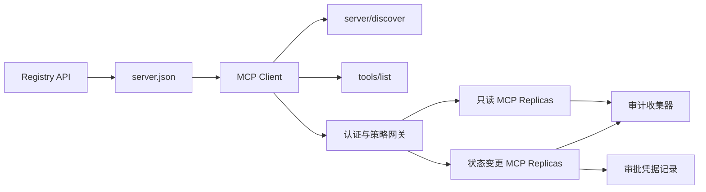

# 综合实战项目 13：带 Registry 与治理的无状态 MCP Server

> 生产级 MCP 绝不是单个简单的 Server 进程。它是一整套契约链条：可发布的元数据、实时服务发现、无状态请求 Envelope、身份认证与授权、细粒度策略决策、审计凭证以及部署证据。

**Type:** Capstone
**Languages:** Python 与 TypeScript 参考模型；支持任何生产级编程语言
**Prerequisites:** Phase 11, Phase 13, Phase 14, Phase 17 与 Phase 18
**必修 MCP 进阶课：** [Lesson 28: Tool Contracts](../../../13-tools-and-protocols/28-mcp-tool-contracts-and-content/docs/en.md), [Lesson 29: 可靠性与流控](../../../13-tools-and-protocols/29-mcp-reliability-cancellation-and-flow-control/docs/en.md), [Lesson 30: Registry 供应链](../../../13-tools-and-protocols/30-mcp-registry-supply-chain-and-drift/docs/en.md), 及 [Lesson 31: 一致性工程](../../../13-tools-and-protocols/31-mcp-conformance-versioning-and-operations/docs/en.md)
**目标协议规范：** MCP `2026-07-28`
**Time:** ~25 小时

## 学习目标

- 实现合规的无状态 MCP 请求与结果 Envelope。
- 将 Registry 静态元数据与运行时的实时协议发现严格区分。
- 构建具备确定性排序与缓存感知的工具发现体系。
- 对每次 Tool 调用强制执行签发者（Issuer）、受众（Audience）、作用域（Scope）及审批策略。
- 部署无 Session 亲和性绑定的 Streamable HTTP 集群。
- 在网络线路、授权、策略、Registry 与审计边界上提供完整的工程证据。

## 必修 MCP 前置路径

在将本项目视为生产就绪之前，必须依次完成 Phase 13 关联的四节进阶课程：

1. [Lesson 28](../../../13-tools-and-protocols/28-mcp-tool-contracts-and-content/docs/en.md)：定义本 Server 必须暴露的 Tool、Schema、结构化内容、分页、自动补全、路由及错误分类契约。
2. [Lesson 29](../../../13-tools-and-protocols/29-mcp-reliability-cancellation-and-flow-control/docs/en.md)：定义取消竞态、截止期限、幂等性、背压、重试与断线重连行为。
3. [Lesson 30](../../../13-tools-and-protocols/30-mcp-registry-supply-chain-and-drift/docs/en.md)：定义命名空间归属、来源追踪、准入锁定、Registry 状态、漂移检测、账本记录与回滚凭证。
4. [Lesson 31](../../../13-tools-and-protocols/31-mcp-conformance-versioning-and-operations/docs/en.md)：定义黄金标准与反向转录用例、严格版本时代、SDK 行为差异校验、代理网络凭证、敏感数据脱敏、健康门禁与发布阻断。

本项目负责将这些生产级要素紧密集成，绝不能用单个简单跑通的 SDK 测试敷衍了事。

## 问题背景

企业内部平台需要一套只读数据工具和少量具备状态变更能力的写操作工具。开发者必须能够发现该 Server、了解如何连接、检查其实时运行能力，并且只能调用其被明确授权访问的操作。

真正困难的从来不是写一个 Python 函数，而是如何让以下六套真相源保持高度一致、绝不漂移：

1. `server.json` 声明了 Server 在何处安装或通过什么网络端点访问；
2. `server/discover` 声明了当前运行的实时进程实际支持的能力；
3. 每个请求明确指明了其采用的协议版本与 Client 能力声明；
4. 授权系统将调用方与合法的签发者、资源指示器（Resource Indicator）和 Scope 绑定；
5. 策略引擎独立决策该特定操作与传入参数是否准予执行；
6. 审计日志忠实记录越过边界的每次交互，且绝不泄露敏感载荷或凭据密钥。

任何一个环节发生漂移，平台就可能展示无法连通的孤儿 Server、错误路由不兼容的 Client、误用为其他资源签发的 Token，或在未获批准的情况下执行高危破坏性操作。

## 两层发现机制（The Two Discovery Layers）

Registry 静态索引与实时的 MCP Server 回答的是完全不同维度的问题：

| 发现层次 | 交互契约 | 回答的核心问题 |
|---|---|---|
| 发布层 (Publication) | `server.json` 与 Registry API | 该 Server 是什么？其代码包或远程网络端点在哪里？如何进行配置？ |
| 运行时 (Runtime) | `server/discover` | 该运行进程当前实际支持哪些协议版本、能力特性、扩展及 Server 身份？ |

官方 Registry 采用带版本控制的 `server.json` Schema。一个远程条目可以声明 Streamable HTTP 地址：

```json
{
  "$schema": "https://static.modelcontextprotocol.io/schemas/2025-12-11/server.schema.json",
  "name": "com.example/internal-readonly",
  "title": "Internal Read-Only Tools",
  "description": "Read-only incident and data lookup tools.",
  "version": "1.0.0",
  "remotes": [
    {
      "type": "streamable-http",
      "url": "https://mcp.internal.example.com/readonly"
    }
  ]
}
```

Registry Schema 版本与 MCP 协议版本完全独立，不要为了让二者一致而改写其中一个日期。每个文档都必须对照其自身的契约进行严格校验。

具备合规 Schema 不代表拥有命名空间所有权。对 `example.com` 完成验证的发布者使用反向 DNS 命名空间 `com.example/*` 或其子命名空间。Registry 的认证流程负责证明这一所有权。若按普通顺序书写域名标签，则指向的是另一个不同的命名空间。

标准库模型中的 `validate_registry_document` 函数刻意只是一个部分的远程配置校验器。它检查官方必填的 `name`、`description` 与 `version` 字段，可选的 `title`，已发布的名称与长度约束，具体版本号的格式，以及每个 `streamable-http` 或 `sse` 远程端点的 HTTP(S) URL 格式。由于本综合项目总会对远程端点做实时探测，它还额外要求 `remotes` 列表非空。`validate_publisher_namespace` 单独对照已验证的发布者域名检查名称，而 `validate_runtime_alignment` 则将发布名称与版本同实时的 `serverInfo` 进行比较。官方 Schema 还支持仅含代码包的记录以及更多远程字段。发布前，请使用锁定版本的官方 JSON Schema 或 `mcp-publisher` 校验整个文档；不要把这个无依赖的子集当作完整的 Schema 校验。

Server 必须实现 `server/discover`；Client 可以在发起其他方法前主动调用它。本综合项目的 Client 在解析出端点后就会这样做，并获得当前协议修订版与实时能力集：

```json
{
  "resultType": "complete",
  "supportedVersions": ["2026-07-28"],
  "capabilities": {
    "tools": {
      "listChanged": false
    }
  },
  "_meta": {
    "io.modelcontextprotocol/serverInfo": {
      "name": "com.example/internal-readonly",
      "version": "1.0.0"
    }
  },
  "ttlMs": 3600000,
  "cacheScope": "public"
}
```

私有目录可以索引额外的所有权、评审或生命周期数据，但绝不能把这些数据臆造为 MCP 线路字段或 `server.json` 根字段。组织策略应与已发布记录并列存放。当确实需要公开的自定义元数据时，使用 Registry 的 `_meta.io.modelcontextprotocol.registry/publisher-provided` 扩展，并保持在其 4 KB 上限之内。

## 无状态 MCP 核心（Stateless MCP Core）

MCP `2026-07-28` 彻底移除了协议 Session 与 `initialize` / `notifications/initialized` 握手，同时移除了 `Mcp-Session-Id`。

每个请求均在 `params._meta` 中携带协议上下文：

```json
{
  "io.modelcontextprotocol/protocolVersion": "2026-07-28",
  "io.modelcontextprotocol/clientCapabilities": {},
  "io.modelcontextprotocol/clientInfo": {
    "name": "internal-platform-client",
    "version": "1.0.0"
  }
}
```

版本与能力是请求层面的事实，而非连接层面的事实。负载均衡器可以毫无顾虑地将连续请求分发给不同的健康 Replica，因为任何一个 Replica 都可以完全从报文自身验证并处理请求。

常规成功结果返回 `resultType: "complete"`，且 Server 应在每个结果的 `_meta.io.modelcontextprotocol/serverInfo` 中标明身份。协议版本缺失或不是字符串时返回 Invalid Params 错误码 `-32602`；`-32022` 仅用于提供了字符串但不受支持的版本，其 data 必须恰好为 `{"supported": ["2026-07-28"], "requested": "..."}`。

### 可缓存的服务发现

`tools/list` 必须保证确定性排序，其结果包含：

- `ttlMs`：面向 Client 的新鲜度缓存提示；
- `cacheScope`：`public`（公共共享）或 `private`（上下文私有）；
- 严格稳定的工具排序，使相同列表能够极大复用模型端的 Prompt Cache；
- `resultType: "complete"` 与 Server 身份元数据。

针对特定用户的权限控制，通常应输出 `cacheScope: "private"`，绝不能将用户专属的工具可见性缓存在公共共享缓存中。

## Streamable HTTP 传输

面向网络的 Server 暴露单一的 POST 端点。每个 JSON-RPC 请求或通知均为独立的 POST。

针对请求，Server 返回单个 JSON 响应或针对该次请求开启的请求作用域 SSE 流。长周期的变更通知通过 `subscriptions/listen` 建立长连接流。

请求必须镜像指定 HTTP 请求头：

- `MCP-Protocol-Version`：与请求体元数据一致；
- `Mcp-Method`：与 JSON-RPC 方法名一致；
- `Mcp-Name`：在调用 `tools/call` 等方法时镜像工具名；
- `Accept: application/json, text/event-stream`。

头部与请求体不一致时立即返回 `-32020` 错误码。校验 `Origin` 防御 DNS 重绑定，并将请求作用域 SSE 流的被动断开视为请求取消。



```figure
cf-mcp-gate
```

## 认证与策略决策

传输层元数据绝不等于权限凭证。每次调用均须严密鉴权。

对于远程 Server：

1. 动态发现受保护资源元数据；
2. 为该资源选定对应的授权 Server；
3. 优先使用 Client ID Metadata Documents（CIMD）注册 Client，将动态 Client 注册（Dynamic Client Registration）视为兼容性支持；
4. 在授权流程中发送 Resource Indicator；
5. 验证返回的 `iss` 是否与记录的授权 Server 一致；
6. 按 Issuer 隔离存储 Client 凭据，绝不跨 Issuer 复用；
7. 在 MCP Server 侧验证 Token 的签发者、受众、过期时间与 Scopes；
8. 对具体的工具名称与实际参数执行二次策略决策。

`readOnlyHint` 与 `destructiveHint` 等工具注解帮助 Client 呈现风险，但它们不是可信的授权控制手段。

### 人工审批是凭据记录，而非魔法 Scope

状态变更调用需要一份结构化的人工审批凭证（Approval Record），与操作者、工具名、规范化参数哈希值（Digest）、目标环境、过期时间及单次/多次使用策略深度绑定。单独的一条聊天消息绝不能充当审批凭证。

Python 模型会对排序键的规范化 JSON 计算哈希，并将该 Digest 与 Token Subject、工具名、Server URL 和过期时间签名绑定。篡改哪怕一个参数字段，该审批记录也会在 Handler 运行之前重放失败。审批记录是独立的证据凭证，而不是直接往 Access Token 里乱塞的 Scope。

当能实质性缩小影响半径时，把高风险工具放在可单独评审的独立表面上。只有当凭据、策略、部署身份与审计控制同样相互隔离时，这种拆分才有意义。

## 动手构建

### 1. 建模发布元数据

创建 `server.json` 并完成 Schema 校验。在发布者已认证的命名空间内使用稳定的名称，并包含版本、描述、适用时的官方 `repository` 或 `packages` 元数据，以及远程或 stdio 传输配置。密钥只能作为声明的环境变量输入，绝不能写入字面值。

### 2. 实现实时服务发现

在任何业务 RPC 之前实现 `server/discover`。公布受支持的协议版本、能力集、扩展与 Server 身份，并添加一个使用 `-32022` 的版本拒绝用例。

### 3. 实现无状态信封（Envelope）

每个请求都必须携带协议版本与 Client 能力；每个结果都返回 `resultType` 与 Server 身份。移除初始化状态、按连接缓存的能力集以及 Session 标识符。

### 4. 构建工具表面

从两个只读工具和一个状态变更工具开始。为每个工具提供有界的 JSON Schema、精确的描述、确定性的结果结构以及如实的注解。当 Client 依赖结构化结果时，添加输出 Schema。

### 5. 添加缓存感知的列表

以稳定顺序返回工具，并附带 `ttlMs` 与 `cacheScope`。分别测试缓存过期与列表变更通知行为。

### 6. 添加认证与策略

校验签发者、受众、过期时间与 Scope。对每次工具调用执行策略决策，并将审批绑定到确切的高风险操作。在执行 Handler 之前拒绝缺失或过期的审批。

### 7. 分离 Registry 与运行时校验

先校验静态的 `server.json` 记录，再用 `server/discover` 探测远程端点。当已发布的远程端点、身份、版本或必需能力与实时进程不一致时，上报漂移。

### 8. 添加审计证据

记录操作者、签发者、资源、工具、策略决策、请求标识符、追踪上下文、延迟与结果。持久化前对敏感参数与结果进行脱敏或计算摘要。审计接收端必须位于模型可见上下文之外。

### 9. 验证水平扩展

在负载均衡器后放置两个无状态副本（Replica），发送至少 100 个并发请求，证明正确性不依赖亲和性。如果某个工具需要跨调用状态，生成一个显式的不透明句柄，并将其存放在共享的持久化系统中。

### 10. 跨越真实线路

针对真实的 Server 二进制运行一致性检查。捕获请求头与 JSON 请求体，而不仅仅是 SDK 对象。覆盖错误版本、请求头不匹配、缺少 Scope、受众错误、参数畸形、Handler 失败、取消与缓存过期等用例。

## 必备证据包（Evidence Pack）

提交物必须包含以下全部五类证据，否则视为不完整：

| 证据类别 | 最低验证标准 | 来源课程 |
|---|---|---|
| 网络线路 (Wire) | 正向与反向用例的脱敏原始请求头与 JSON-RPC 请求体，覆盖元数据类型错误、请求头不匹配、不受支持的版本、缺失或未知的 `resultType`、通知无响应以及响应 ID 匹配 | [Lesson 31](../../../13-tools-and-protocols/31-mcp-conformance-versioning-and-operations/docs/en.md) |
| 代理网络 (Proxy) | 同一稳定用例分别直连与经过已部署的中间层运行，记录入口、源站与出口的状态码及响应体摘要；证明协议错误未被折叠为通用 500 响应，且流式传输未被缓冲 | [Lessons 29](../../../13-tools-and-protocols/29-mcp-reliability-cancellation-and-flow-control/docs/en.md) 与 [31](../../../13-tools-and-protocols/31-mcp-conformance-versioning-and-operations/docs/en.md) |
| 准入管理 (Admission) | 已验证的发布者命名空间、不可变的 Registry 记录摘要、产物或远程端点来源证明、实时 `server/discover` 身份与能力观测、描述符锁定、当前 Registry 状态以及准入账本事件 | [Lesson 30](../../../13-tools-and-protocols/30-mcp-registry-supply-chain-and-drift/docs/en.md) |
| 重试与取消 (Retry) | 取消与完成的竞态、显式超时、安全的只读重试、写操作幂等键、重连后重新拉取，以及证明请求取消不会悄然变成持久任务取消 | [Lesson 29](../../../13-tools-and-protocols/29-mcp-reliability-cancellation-and-flow-control/docs/en.md) |
| 发布回滚 (Rollback) | 确切的先前版本、准入与产物摘要、描述符锁定、当前生效的 Registry 状态、当前健康窗口、路由恢复结果以及脱敏的决策证据 | [Lessons 30](../../../13-tools-and-protocols/30-mcp-registry-supply-chain-and-drift/docs/en.md) 与 [31](../../../13-tools-and-protocols/31-mcp-conformance-versioning-and-operations/docs/en.md) |

随版本一并保存脱敏证据包的摘要。只要缺少任意一类，就暂缓发布。不要从进程内分发器推断代理行为，不要从 Registry 中存在该条目推断准入，不要从新的 JSON-RPC ID 推断重试安全，也不要从“上一次部署”推断回滚就绪。

## 本地参考模型运行

Python 模型在不打开任何网络套接字的情况下，演示了 Registry 元数据、反向 DNS 发布者命名空间校验、发布与运行时身份核对、实时发现、确定性工具列表、逐请求元数据、可信签发者/受众/过期时间/Scope 检查、绑定操作的审批、一个有文档说明的部分 Registry 校验器、策略以及审计：

```bash
cd phases/19-capstone-projects/13-mcp-server-with-registry
python3 code/main.py
python3 -m unittest discover -s code/tests -v
```

TypeScript 项目在不借助 MCP SDK 的情况下，通过 stdio 暴露无状态 JSON-RPC 结构。其 `tools/call` 路径执行与 `tools/list` 所公布的相同有界输入 Schema；对已知工具传入非法参数时，返回带 `isError: true` 的完整结果，且不调用执行器：

```bash
cd phases/19-capstone-projects/13-mcp-server-with-registry/code/ts
npm install
npm run typecheck
npm test
npm run demo
```

这些模型证明的是本地契约逻辑，并不能证明 HTTP 请求头、OAuth 交换、Registry 发布、OPA 集成、负载均衡或采集端接收。

## 线路协议报文范例

```http
POST /mcp HTTP/1.1
Host: mcp.internal.example.com
Content-Type: application/json
Accept: application/json, text/event-stream
MCP-Protocol-Version: 2026-07-28
Mcp-Method: tools/call
Mcp-Name: postgres.readonly
Authorization: Bearer REDACTED

{
  "jsonrpc": "2.0",
  "id": 42,
  "method": "tools/call",
  "params": {
    "name": "postgres.readonly",
    "arguments": {"sql": "SELECT 1"},
    "_meta": {
      "io.modelcontextprotocol/protocolVersion": "2026-07-28",
      "io.modelcontextprotocol/clientCapabilities": {},
      "io.modelcontextprotocol/clientInfo": {
        "name": "internal-platform-client",
        "version": "1.0.0"
      }
    }
  }
}
```

## 交付物

交付一个包含以下内容的代码仓库：

- 通过 Schema 校验的 `server.json`；
- 只读与状态变更两类 Server 表面；
- `server/discover`、确定性的 `tools/list`，以及受策略门控的 `tools/call`；
- 带有两个可互换副本的 Streamable HTTP 部署；
- 认证与审批集成；
- Registry 发布器或私有 Registry API 适配器；
- 策略定义与绑定操作的审批记录；
- 脱敏的审计输出与追踪传播；
- 线路与代理故障证据；
- 准入、重试、健康与回滚证据，以及脱敏证据包的摘要。

| 权重 | 评分标准 | 证据 |
|---:|---|---|
| 25 | 协议正确性 | 无状态请求元数据、服务发现、结果、请求头与反向用例 |
| 20 | 授权 | 签发者、受众、过期时间、Scope 与绑定操作的审批用例 |
| 15 | Registry 完整性 | 合法的 `server.json`、发布记录、实时发现探测与漂移报告 |
| 15 | 策略与安全 | 允许、拒绝、畸形、过期审批与敏感数据用例 |
| 15 | 扩展性与可靠性 | 两个副本、无亲和性依赖、取消、超时与恢复 |
| 10 | 可审计性 | 接收端脱敏审计与追踪证据 |

## 练习与思考

1. 修改已发布的远程 URL，同时保持实时 Server 不变，让 Registry 校验报告确切的漂移。
2. 以完全相同的输入发送两次 `tools/list`，证明工具顺序字节级稳定；然后让 `ttlMs` 过期并刷新。
3. 发送一个合法请求体，但 `MCP-Protocol-Version` 请求头与之不同。返回 `-32020`，且不调用策略或工具。
4. 为只读 Server 签发一个 Token 并将其出示给状态变更 Server，证明受众校验在 Handler 运行前失败。
5. 将一份审批绑定到某个规范化参数摘要上，修改其中一个字段，证明该审批无法被重放。
6. 将连续调用交替路由到不同副本。凡是工作流需要持久化的地方，用显式的共享句柄替换隐藏的进程内存。
7. 中断一个请求作用域的 SSE 连接，并用新的 JSON-RPC 请求 ID 重试，验证没有使用任何 `Last-Event-ID` 恢复路径。

## 核心专业术语

| 术语 | 行业俗称 | 规范真实定义 |
|---|---|---|
| 无状态 MCP (Stateless MCP) | “到处都没有状态” | 协议层不存在 Session；跨调用状态属于显式传递且由业务服务端持久化管理 |
| `server.json` | “工具清单清单” | Registry 静态元数据，用于定义发布命名、代码打包、配置项与传输端点 |
| `server/discover` | “传统握手” | 强制实现的常规业务 RPC，用于获取实时支持的版本与能力，而非建立会话 |
| 缓存作用域 (Cache scope) | “能不能缓存？” | 标识可缓存结果是否可以被跨上下文公共复用（`public`）或仅限当前上下文（`private`） |
| 策略决策 (Policy decision) | “Token 允许就能调” | 针对调用者主体、工具、操作目标、参数载荷及外部上下文的细粒度二次判定 |
| 审批凭证 (Approval record) | “人工在群里点了同意” | 绑定至具体操作者、确切参数哈希与过期时间的强防篡改凭据证据 |
| 显式句柄 (Explicit handle) | “Session ID” | 业务层具名状态的普通应用标识符，绝非底层传输连接会话 |

## 延伸阅读

- [MCP 2026-07-28 核心变更](https://modelcontextprotocol.io/specification/2026-07-28/changelog)
- [Streamable HTTP 传输规范](https://modelcontextprotocol.io/specification/2026-07-28/basic/transports/streamable-http)
- [MCP 服务发现](https://modelcontextprotocol.io/specification/2026-07-28/server/discover)
- [MCP 鉴权与授权规范](https://modelcontextprotocol.io/specification/2026-07-28/basic/authorization)
- [官方 Registry server.json 要求](https://github.com/modelcontextprotocol/registry/blob/main/docs/reference/server-json/official-registry-requirements.md)
- [官方 Registry OpenAPI 契约](https://registry.modelcontextprotocol.io/openapi.yaml)
