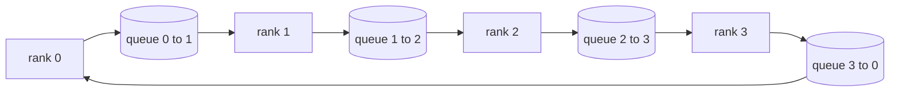

# 从零实现 Collective Ops

> 支撑分布式训练的四种集体通信（collective）操作是 allreduce、broadcast、allgather 和 reduce_scatter。训练框架提供的其他原语几乎都是这四者的包装。先在 `multiprocessing.Queue` mesh 上实现一遍，再对照参考实现做验证，这条 track 剩下的部分就只是接线。

**Type:** Build
**Languages:** Python
**Prerequisites:** Phase 19 Track C lessons 42-49
**Time:** ~90 分钟

## 学习目标

- 用两遍算法实现 ring allreduce（先 reduce-scatter，再 allgather），并证明每个 rank 的通信量是每元素 $2(N-1)/N$ 字节。
- 在 `multiprocessing.Queue` 上的点对点 send 之上实现 broadcast、allgather 和 reduce_scatter。
- 对相同输入，用 `torch.distributed` 的 gloo 后端作为参考，验证每一个原语。
- 从集群形状、延迟下限和带宽上限出发，论证该选 ring 还是 tree。

## 问题

在 N 个 rank 上做朴素 allreduce，会把张量向 root 发送 N 次，再广播回来 N 次。每个 rank 的带宽按 $O(N)$ 放大，root 变成瓶颈，墙钟时间下限是最慢链路乘以 N。Ring allreduce 把它摊平成 $2(N-1)$ 个大小为 $T/N$ 的 chunk，于是每个 rank 的字节数降到 $2T(N-1)/N$，随 N 增大趋近 $2T$ 且永不超出，与集群规模无关。Tree allreduce 在小 N、高延迟链路上更优，因为深度是 $\log_2(N)$ 跳，而不是 $2(N-1)$。拓扑选错，最慢的那块 GPU 就会决定 step 时间。

你在这条 track 里会读到的每个分布式训练框架，都依赖这四个原语。PyTorch DDP 用每个参数 bucket 一次 allreduce 来同步梯度。ZeRO 用 reduce_scatter 分片优化器状态，再用 allgather 广播更新后的参数。FSDP 把完整 forward 变成 allgather 加 reduce_scatter。Pipeline parallel 需要跨 stage group 用 broadcast 传激活。实现不了这四个 collective，就无法推理训练为何卡住、为何梯度不匹配出现在 rank 3、以及为何换拓扑后 pipeline bubble 会翻倍。

## 概念



### 两遍完成的 Ring allreduce

把张量拆成 N 个等大的 chunk，索引为 0..N-1。每个 rank 拥有与自身 rank 号相同的 chunk 索引。第 1 遍是 reduce-scatter，跑 N-1 步。在第 s 步，rank r 把 chunk $(r - s) \bmod N$ 发给 rank $(r + 1) \bmod N$，并从 rank $(r - 1) \bmod N$ 接收 chunk $(r - s - 1) \bmod N$，把收到的 chunk 累加到本地副本。经过 N-1 步后，rank r 持有 chunk r 的完整求和。第 2 遍是 allgather，再跑 N-1 步，把已完成的 chunk 绕环旋转，直到每个 rank 都持有每个 chunk 的完整求和。

| 原语 | 每 rank 字节数 | 步数 | 何时使用 |
|-----------|---------------|-------|-------------|
| Ring allreduce | 2T(N-1)/N | 2(N-1) | 大 T、同构 fat-pipe 集群 |
| Tree allreduce | T log2(N) | 2 log2(N) | 小 T 或高延迟链路 |
| Broadcast | T | log2(N) tree | 参数初始化、标量配置 |
| Allgather | T(N-1)/N | N-1 | 分片 forward、ZeRO unshard |
| Reduce_scatter | T(N-1)/N | N-1 | ZeRO 梯度分片 |

### 用 Queue mesh 代替 NCCL

NCCL 跑在 PCIe 和 NVLink 上，归约可以硬件卸载。在 CPU 上没有这些。环上每条边一个 `multiprocessing.Queue`，就能得到有序的点对点投递，且只有单一生产者和单一消费者。归约发生在用户态，所以要付 Python 开销，但线路模式与 NCCL ring allreduce 相同。先在 queue 版本上把正确性想清楚，集群行为就会跟着清楚。

### 对照 gloo 做验证

每个原语都带单元测试：在相同 world size、相同张量上，把它的输出与用 gloo 后端初始化的 `torch.distributed` 对比。若 ring allreduce 与 gloo 的偏差超过 float32 epsilon，测试失败。对照参考实现做验证不可妥协；没有它，原语会在真实训练跑到第 10000 步之前一直“看起来正确”。

```figure
ci-ring-allreduce
```

## 构建它

`code/main.py` 实现：

- `Mesh` 类：把 N 个 `multiprocessing.Queue` 接成环，并按 rank 暴露 `send(dst, tensor)` 与 `recv(src)`。
- `ring_allreduce(mesh, rank, world_size, tensor)`：跑两遍算法。
- `broadcast(mesh, rank, world_size, tensor, src)`：走对数树。
- `allgather(mesh, rank, world_size, tensor)`：用 N-1 次轮转。
- `reduce_scatter(mesh, rank, world_size, tensor)`：作为 allreduce 的前半段。
- `_gloo_reference(op, world_size, tensor)`：把相同输入送进带 gloo 的 `torch.distributed`，做字节级对比。

运行：

```bash
python3 code/main.py
```

输出：按原语对比 queue-mesh 与 gloo 输出的验证表，以及证明 $2T(N-1)/N$ 缩放的每 rank 字节计数器。

## 生产环境中的实践

三种模式能把这些原语硬化到可上线的程度。

**allreduce 前先对梯度分桶。** 一个 10 亿参数模型有上万个梯度张量。每个张量一次 allreduce，就要付 N 倍延迟下限。DDP 把梯度打成约 25 MB 的 bucket，每个 bucket 发一次 allreduce；小张量搭在大张量后面。不分桶时，延迟开销会主导整个 step。

**让通信与计算重叠。** Backward 按层反向逐层算梯度。最后一层梯度一就绪，就启动它的 allreduce，同时下一层继续算。PyTorch DDP 用 bucket-ready hook 接上这件事。网络有余量时，重叠能把可见通信时间砍半。

**按消息大小选 ring 或 tree，不要教条。** NCCL 自带拓扑检测：大约 1 MB 以上选 ring，以下选 tree。交叉点是带宽对延迟——超过 1 MB 时带宽项 $2T(N-1)/N$ 占主导，ring 胜出；低于 1 MB 时 $\log_2(N)$ 跳数占优。写死一种拓扑，会在错误的消息大小上损失吞吐。

## 使用它

生产中的用法：

- **PyTorch DDP。** Backward 之后对分桶梯度调用 `dist.all_reduce`。bucket 大小可调；100Gbit 以太网下默认 25 MB 合理。
- **DeepSpeed ZeRO。** 发 reduce_scatter 分片梯度，forward 前再 allgather 重建完整参数。本课的原语正是 ZeRO 实际发出的调用。
- **FSDP。** Forward 先 allgather 把该层 unshard，算完再用 reduce_scatter 归约并丢掉 unshard。同一套原语，不同调度。

## 交付它

在第 77–81 课中使用这些 queue-mesh 原语。第 77 课把 allreduce 接到 DDP。第 78 课把 reduce_scatter 接到 ZeRO。第 79 课用点对点 send/recv（而不是 collective）传递 pipeline 激活。第 81 课把四者组成端到端演示。

## 练习

1. 增加 tree allreduce 变体，并按消息大小在 ring 与 tree 之间切换。测出交叉点。
2. 增加 `recv_timeout_ms`，让卡住的 rank 抛出截止错误，而不是永远挂起。
3. 把四个原语的 `multiprocessing.Queue` 换成 TCP socket。同一套测试，真实线路。
4. 加带宽探测 hook，把每 rank 字节计数器记到 JSONL。
5. 在 4 个 rank 上，对 1KB、1MB、16MB 张量比较 ring 与 tree 的墙钟时间。用实测为交叉点辩护。

## 关键术语

| 术语 | 人们常说 | 实际含义 |
|------|----------------|------------------------|
| Allreduce | “跨 rank 求和” | 调用结束后每个 rank 持有相同的归约张量 |
| Ring | “更快的拓扑” | N-1 个大小为 T/N 的 chunk 绕环流两圈 |
| Tree | “对数拓扑” | 归约沿二叉树进行；深度为 log2(N) 跳 |
| Allgather | “拼接分片” | 每个 rank 最终持有所有其他 rank 的分片 |
| Reduce_scatter | “把求和切开” | 每个 rank 最终只持有某一个 chunk 的求和 |
| Bucket | “融合小张量” | 把 N 次小 allreduce 合并成一次大的 |

## 延伸阅读

- [PyTorch Distributed: NCCL collectives](https://pytorch.org/docs/stable/distributed.html#collective-functions)
- [Horovod ring allreduce paper](https://arxiv.org/abs/1802.05799)
- [NCCL topology and algorithm selection](https://docs.nvidia.com/deeplearning/nccl/user-guide/docs/index.html)
- [Patarasuk and Yuan, Bandwidth optimal allreduce algorithms](https://www.cs.fsu.edu/~xyuan/paper/09jpdc.pdf)
- Phase 10 Lesson 05 - distributed training overview
- Phase 19 Lesson 77 - DDP wired on top of these primitives
